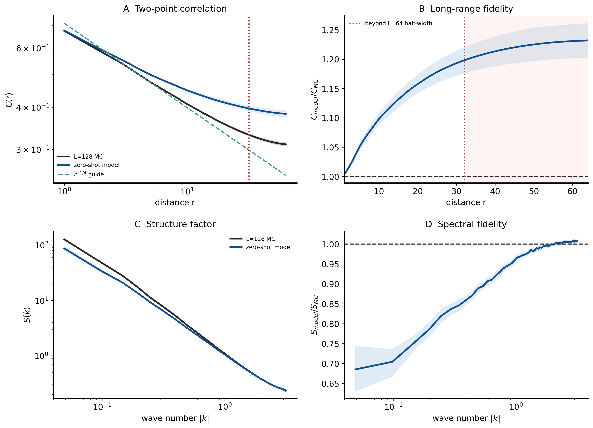

# 早期基线与历史筛选怎样阅读

当前主结论以[近期实验地图](README.md)和[综合报告](REPORT_ZH.md)为准。本页保留早期研究的作用与限制，帮助读者理解为什么后续需要更严格的对照，不把旧GO标签当作今天的科学结论。

## L64同分布生成基线

早期模型为约1270万参数的二维轴向attention网络，带周期距离bias和局部卷积；它不是后期约198万参数的dense RoPE网络。固定L64训练后，经修正采样器并重新评价冻结权重，预设pilot物理检查通过。

正式评价包含3个采样seed、共4608张生成图，参考为8条MC链的10,000张同尺寸场。G(r)在r=8、16、32的模型/MC比值约为.9975、.9994、.9978。三个采样seed不等于三个独立训练模型，有限指标通过也不证明所有分布性质都已正确。

这轮适合作为“有限尺寸上已有可用基线”的背景，不是尺度外推证据。原clock/schedule问题及修正历史见[更正页](CORRECTIONS.md)。

依据：[机器摘要](../artifacts/final_l64/final_summary.json)、[原方案](../docs/L64_PILOT_EXPERIMENT_PLAN_ZH.md)、[技术设计](../docs/TECHNICAL_DESIGN_ZH.md)。

## L64到L128零样本外推

冻结仅在L64训练的同一模型，不重新训练，直接生成L128。部分局部物理检查保留，但长程关联偏强：xi/L约为模型1.1959、MC .9047；G(r)在r=1–32与33–64的NRMSE约为12.17%和22.09%。

这张图适合作为汇报起点：程序能接受更大输入，不代表统计外推正确。偏差在多个采样seed中出现，但仍是一个冻结训练模型的检验，不能冒充多训练seed确认。

依据：[机器摘要](../artifacts/final_l128_zero_shot/final_summary.json)、[原方案](../docs/L128_ZERO_SHOT_PROTOCOL_ZH.md)。

## Level1尺度感知筛选

早期dense筛选比较固定尺寸与单位间距、真实stride配合坐标、只改phase、改变物理stride但保留unit坐标。它观察到某些长程指标改善与局部误差增大并存，提出需要同时检查几何收益和局部保留的动机。

这是有限开发筛选，不能以当时NO-GO概括所有dense训练策略。后来的G/I/N/W在保留dense的不同受控设置下提供了新的证据。

依据：[历史报告](../docs/LEVEL1_RAPID_RESULT_REPORT_ZH.md)、[早期结果目录](../results/scale_aware_context/README.md)。

## Stage2A的Local–Global结构筛选

这轮把局部与全局隐藏状态分开，尝试由局部分支保护近邻规律、全局分支提供残差，得到局部污染减少的筛选信号。它改变了架构，回答的是特定结构修复是否可行，不是仅改变训练尺寸和距离覆盖的同一问题。

阅读时保留“单seed筛选、坐标独立贡献仍有限”的范围，不从局部污染指标直接推出整体分布正确。完整历史材料见[旧综合报告](../docs/SCALE_AWARE_CONTEXT_EXPERIMENT_REPORT_ZH.md)。

## Stage2B必须先看更正

旧发布曾报告matched相对native-unit的CE差约−.08238，并据此使用GO_FULL_2B标签。后续发现native-unit对照不正确：正确unit约.475944，matched约.471505，正确点差约−.004440。

旧置信区间不能套到纠正后的比较；原计划的3seed×15k正式确认未执行，实际是单seed8k筛选。其他比较的原始数组仍保留，但旧整体GO不再是当前确认性结论。

这轮有用的遗产是data-only、RandomPE及坐标置换的对照思路；汇报时应以之后的G/I等更有针对性的正式设计为主，而不是复用旧大效应图。

依据：[更正页](CORRECTIONS.md)、[历史结果](../results/scale_aware_context/README.md)。

## 不计作独立科学结果的开发工作

| 工作 | 已完成什么 | 不应怎样计数 |
|---|---|---|
| L16/L32 smoke与采样器调试 | 验证工程链路和实现，保留配置及调试记录 | 不计为正式临界物理成功 |
| A/B/C附属D/E | 冻结模型的条件、顺序、频率及上下文诊断，部分另有新采样 | 不计为新的独立训练复现 |
| F容量开发筛选 | 两个seed的大模型表现变差，其他四个未启动 | 不称完整六seed容量结论 |
| 尺寸×clock预检 | 正确性检查及scratch拟合；全流程预测超预算 | 正式模型0，不叫科学主假设失败 |

上述后期附属工作分别见[A/B/C](geometry-aligned-conditioning/README.md)、[F](context-consistency-training/README.md)和[未启动方案](preflights/size-clock-factorial/README.md)。保留失败与更正，是为了避免后来报告把不同身份的材料拼成一条过强的成功链。
