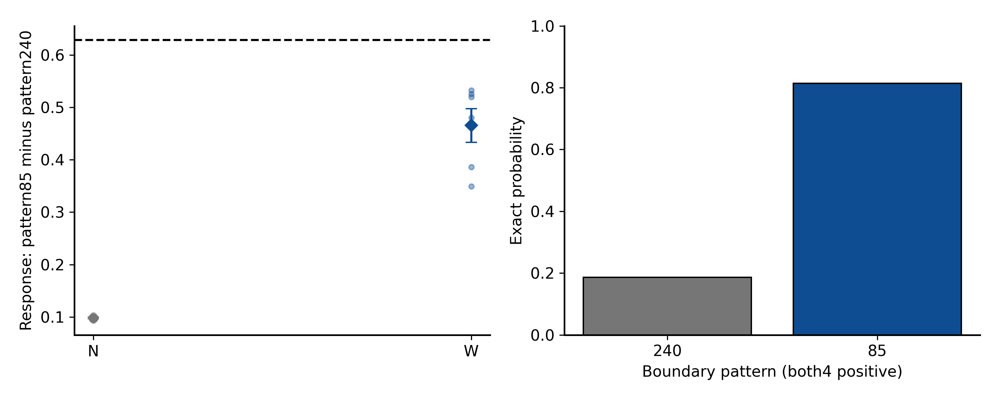

# N/W｜多尺寸训练能否让局部预测在扩容后保持准确

> 一句话结论：在固定clock、原dense结构和精确G8任务下，宽尺寸训练把20×20主测试的平均KL从.092391降至.009247，约下降90%；但六个宽尺寸模型仍全部未通过最坏误差门。相对改善非常明确，可靠的绝对准确性尚未建立。

实验：dense_multisize_canonical_6h_20260930，完成于2026-09-30。本文于2026-11-15扩写为学习版，保留原结果、区间和失败门。这里的W臂表示wide；W48等写法中的W是边长，两个用法须按上下文区分。

[前一篇 Basic](../exact-local-capability/REPORT_ZH.md) · [阅读路线](../STUDY_GUIDE_ZH.md) · [共同方法](../METHODS_ZH.md) · [参数速查](README.md)

## 阅读目标

建议用40–50分钟，先理解腔体，再读N/W对照，最后同时读平均与最坏误差图。

读完应能解释：

1. 为什么扩大外围容器，G8的真实答案却不变？
2. 为什么G8比“数一数四个邻居有几个+”更有说服力？
3. 两组张量一样大，为什么仍不能宣称有效token和计算完全相同？
4. 平均KL降低90%与0/6能力门通过，为什么不矛盾？

## 1. 问题来自Basic，但这是新的训练实验

Basic发现：原dense可以学好4×4精确条件表，但把保留同样四邻信息的任务放进8×8后，最大概率误差仍约.17–.21。由于固定clock也失败，不能把问题全部归给时间输入变化。

N/W问：**在不更换dense结构、不改变clock的情况下，训练时增加有效容器尺寸覆盖，能否缓解这种退化？**

它不是Basic三个模型的继续训练，也不是此前未启动的size×clock四因素单元。这里有六个新配对seed、两臂共12个fresh模型；主比较只研究固定canonical clock条件下的尺寸覆盖。

“6h”是授权窗口名称，不意味着恰好训练六小时。旧12小时size×clock方案因测速投影约26.486小时而未正式启动；旧scratch权重未进入本轮。

## 2. 先把G8腔体画出来

隐藏一个2×2内部腔体，八个与其最近邻相连的边界自旋全部可见：

~~~text
          第0列  第1列  第2列  第3列
第0行       ·     b0     b1     ·
第1行       b2    u0     u1     b3
第2行       b4    u2     u3     b5
第3行       ·     b6     b7     ·
~~~

u0–u3是隐藏自旋，每次选择其中一个为query；b0–b7是已知边界。·是外围未观测位置，在模型有效容器内为MASK，不代表invalid PAD。

一个2×2腔体有2⁴=16种内部状态。给定边界b，计算所有内部状态的相互作用权重，再求query为+1的边缘概率：

$$
q_i(b)=
\frac{\sum_{u\in\{-1,+1\}^4:\,u_i=+1}
\exp\{\beta S(u,b)\}}
{\sum_{u\in\{-1,+1\}^4}\exp\{\beta S(u,b)\}},
$$

其中S包含腔体内部的最近邻边，以及腔体到八点边界的边。β=.44068679350977147、J=1、h=0。真值还与完整4×4的65,536状态枚举交叉核对。

### 为什么外围变大不改变q

腔体与外界的最近邻作用必须经过已知边界b。给定b后，外部自由度的贡献在条件概率分子分母中约掉，不再提供关于u的额外信息。

因此，把同一个腔体、边界与query放入20×20或24×24容器，外围增加MASK，不会改变这一个局部真实概率。模型如果变了，是它处理表示/容器的能力变化，不是任务正确答案偷偷变难了。

这项结论依赖**完整相互作用边界已给定**。若只给K1/K2零散观测，外部边缘化一般会影响答案，不能无条件照搬。

### 本轮测的不是哪种“长程”

G8是一个被已知边界屏蔽的局部条件任务，用来隔离容器鲁棒性。它并不要求模型学到新的远距离Ising边缘关联，也没有用整图生成来检验长程结构。把20×20叫作“长程物理能力已解决”会扩大结论。

## 3. 为什么不用K4作为唯一主任务

K4给出query的全部四个最近邻，正确概率只依赖邻居符号和。只计数正负也可能答对。

G8有相互作用的隐藏内部点；同样八个边界、同样四正四负，不同排列可以给出截然不同的query概率。固定见证对在query u0处：

| 边界模式编号 | b0到b7，1表示+、0表示− | +的个数 | 精确P(u0=+) |
|---|---|---:|---:|
| 240 | 0 0 0 0 1 1 1 1 | 4 | .1857303195 |
| 85 | 1 0 1 0 1 0 1 0 | 4 | .8142696805 |

精确响应差为.6285393611。只依赖正负数量的规则对两者必然给相同答案，所以不能同时正确。

右图是精确oracle概率，没有MC误差；左图是模型响应及跨六seed的±1标准误。模型能对这一对产生响应，只是非计数功能证据，不代表全部测试模式已准确。不能用一对漂亮例子代替168条主测试记录。

## 4. 训练/验证/测试如何避免等价图案泄漏

八个边界有2⁸=256种模式，4个query合计1024条记录。按方形D4旋转反射与整体自旋翻转分成72个轨道，再按固定SHA规则分配：

| 分区 | 轨道数 | 条件记录数 |
|---|---:|---:|
| train | 48 | 696 |
| validation | 12 | 160 |
| test | 12 | 168 |

同一轨道的旋转、反射、整体翻转不跨split。这样留出的是未见等价类，而不是换一个方向就与训练完全相同的模式。

主风险对168条测试记录均匀平均。它不是按这些边界模式在自然MC场中出现的概率加权，也不估计所有可能物理任务的总体风险。

K1/K2沿用Basic的原4×4精确表及划分，**不扩它们的物理系统**；K4保留64条件。四种任务一起训练，避免只关心G8而不检查原基础能力是否丢失。

## 5. N与W：控制住clock，有意改变有效尺寸

| 项目 | N：narrow | W：wide |
|---|---|---|
| K4/G8有效边长循环 | 4、6、4、6 | 4、6、8、12 |
| 分配张量边长循环 | 4、6、8、12 | 4、6、8、12 |
| 分配范围超出有效范围时 | invalid PAD | 本臂范围内为valid MASK |
| 网络时间输入 | 所有任务固定t=.75 | 同左 |
| 物理spacing | 单位间距1 | 同左 |
| K1/K2 | 原4×4系统 | 与N相同 |
| 随机初始化与目标行 | 同seed配对 | 同seed配对 |
| 主模型 | 固定8k raw | 固定8k raw |

在共同的4和6阶段，实际输入可以配对；后两个阶段N仍只有4或6的有效容器，W则有8或12，有效输入有意不同。

### PAD与MASK必须分开理解

PAD只是为了统一数组尺寸，不是一个真实未知自旋，应从有效attention中排除。MASK则是模型有效物理容器内的未知位置，可以参与dense计算。

所以N也“分配过12×12数组”，不等于N训练过有效12×12上下文。正是这一区别让本轮能控制分配形状，同时改变有效尺寸覆盖。

### 公平比较控制了什么，没有控制什么

每更新平均分配token为5184，两臂相同；平均有效token暴露N为2688、W为5184。模型、更新数、目标任务行和clock受控，但有效token暴露、有效位置聚合等一起变化。

因此这是**尺寸覆盖策略的整体比较**，不是对“只改一个长度数字、信息量与有效计算完全一样”的纯机制识别。更不能从本轮推论canonical clock优于native clock：native臂没有训练。

## 6. 训练与评价过程

| 项目 | 固定设置 |
|---|---|
| 独立重复 | 6个配对新seed：93061–93066 |
| 模型 / 更新 | 12个fresh模型，各8000步，总96,000步 |
| 结构 | dense，1,976,706参数；d128、4头、7块、MLP×4、RoPE10000 |
| 精度 | FP32训练与评价；无AMP/TF32，dropout0 |
| batch | K1/K2/K4/G8各32，共128；两个64样本微批组成一次更新 |
| 优化器 | AdamW(.9,.95)、wd.05、clip1；foreach=false |
| 学习率 | 512步warmup到3e−4，余弦降到3e−5 |
| 主权重 | 8k final raw |
| 次要权重 | 固定4k/6k快照及EMA(.999)，仅在全部final锁定后评价 |
| 新MC / 生成 | 均无 |

执行逻辑是：精确真值和结构控制核验 → 固定配对训练 → 锁定全部12个final → 完成主测试与预设次要任务 → CPU重算审计 → 统计与五图。没有按某个模型表现决定是否换checkpoint或补seed。

评价覆盖中心放置的边长4/6/8/12/16/20/24，以及20×20四角放置诊断。主单元始终是**20×20中心、G8 test168条、final raw**，不是事后挑出的最有利尺寸。

## 7. 指标、统计单位和完整门

令精确真值为q、模型概率为p：

$$
D_{\mathrm{KL}}(\mathrm{Bern}(q)\Vert\mathrm{Bern}(p))
=q\log\frac qp+(1-q)\log\frac{1-q}{1-p}.
$$

每seed每臂先平均168条测试记录的KL，得到一个分数。再用同seed的W减N，形成6个配对差。主95%区间是六个配对差的t区间，df=5，不是把168×6条记录当独立训练重复。

完整成功需要多个门同时成立：

| 门 | 问什么 | 原规则 |
|---|---|---|
| 主相对收益 | W是否比N有足够大改善 | 配对t95%区间上界<−.005 |
| 主绝对能力 | W是否在每个条件上足够准 | 每seed最大KL≤.01且最大概率误差≤.05 |
| 旧任务保留 | 改善G8是否严重损害基础任务 | K1hold/K2hold/K4的W−N上界及W绝对门 |
| 结构控制 | 等价表示是否按设计处理 | PAD、平移、联合重排概率差在2e−5容差内 |
| 学习能力相关检查 | 训练/验证模式是否已达到规定能力 | 按冻结协议逐模型检查 |

保留差的三项单侧98.333333%上界须≤+.002，并要求W相应绝对能力通过。不能用保留门通过代替主绝对门。

另保存20,000次seed bootstrap、6次留一分析、64种符号翻转作为敏感性。它们不取代主t区间；符号翻转也有配对对称/可交换假设，不是无假设保证。

## 8. 主结果：六对都改善，而且幅度很大

| seed | N平均KL | W平均KL | W−N |
|---|---:|---:|---:|
| 93061 | .097149 | .014927 | −.082222 |
| 93062 | .091906 | .003002 | −.088904 |
| 93063 | .089733 | .004697 | −.085036 |
| 93064 | .090614 | .005705 | −.084909 |
| 93065 | .093558 | .022029 | −.071529 |
| 93066 | .091388 | .005123 | −.086265 |
| 平均 | .092391 | .009247 | −.083144 |

主配对t95%区间为[−.089534,−.076755]，整个区间低于−.005实质门；主相对门通过。seed bootstrap与留一分析保持有利方向。

先看每一对都落在有利方向，再看均值和黑色t区间是否整体越过−.005线。这里的约90%指平均KL的相对降幅：

$$
1-\frac{.009247}{.092391}\approx90\%.
$$

它不是“90%的测试条件全对”，不是“利用了90%的几何信息”，也不是“全图生成质量提高90%”。

全精度数据：[final_summary.json](evidence/final_summary.json)。

## 9. 为什么仍然是“相对成功，绝对未解决”

W在20×20主测试为**0/6模型通过绝对双门**；24×24也为0/6。0/6的意思是没有一个seed在全部测试模式上同时满足两项最大误差要求，不是每条预测都错。

正确读法：

1. 横轴是有效容器边长，纵轴是一个seed内部全部测试记录的最大概率误差。
2. 浅色点是各seed最大值；大点与误差线总结这些最大值的均值±1标准误，不是最坏误差上界的置信带。
3. 虚线.05是能力门的一部分，另一个最大KL门未在这张图中直接显示。
4. W蓝线比N灰线低很多，说明退化减轻；但到20与24，仍明显超过门槛。

平均KL容易被大量准确模式拉低；最大误差关注少数困难模式。两种指标回答不同问题，结果不矛盾。

### 不能把一切错误都归给“长容器”

W在训练/验证模式的原定检查通过，但训练尺寸上的test模式也只有5/6模型全部通过；16×16的绝对门为1/6。说明困难既包括未见边界排列，也包括容器扩展。

如果要进一步解释机制，应在保存的错误模式中区分这两部分，不能把所有偏差直接命名为某一种attention污染。

## 10. 五张图各承担哪项证据

| 图 | 应读到的内容 | 不应读成 |
|---|---|---|
| [01 平均KL随尺寸](evidence/analysis/figures/01_size_kl.png) | 容器增大时两臂的平均退化；带为跨seed±1标准误 | 所有带都是95%区间 |
| [02 绝对能力](evidence/analysis/figures/02_absolute_ability.png) | 各seed最坏概率误差及.05门 | 蓝色均值低就说明每seed都通过 |
| [03 主配对差](evidence/analysis/figures/03_primary_paired.png) | 20×20主相对效果及t95%区间 | 主相对通过即整个研究成功 |
| [04 非计数见证](evidence/analysis/figures/04_noncounting_response.png) | 相同计数、不同排列对应不同真值 | 单个见证对可替代全部测试 |
| [05 学习与保留](evidence/analysis/figures/05_learning_retention.png) | 固定4k/6k/8k诊断；三项保留上界 | 学习曲线可用于事后选最佳模型 |

[原图注](evidence/analysis/figure_captions.json)保留每张图的区间来源；不要把t区间、标准误和非劣上界统称为同一种“误差条”。

## 11. 其他检查通过了什么，又没证明什么

PAD、平移和联合token/坐标重排控制通过，支持输入与坐标处理按设计工作。旧任务保留门通过。6k→8k训练尺寸G8验证未触发改善>.002的learning-incomplete标记。

这些结果不能证明充分收敛，不能排除其他训练配方更好，也不能救回主绝对门。预设训练seed均值标准误目标为.002，实际约.002486，未达到；仍按固定六seed结束，没有补seed到区间变好为止。

这里MCSE一词指训练seed均值的标准误，不是MC父场误差：本轮目标是精确枚举，根本没有新增MC数据。

600份正式预测文件包含129,600条记录；120份控制预测包含13,920对控制记录。审计重算这些记录有助于核查结果，但独立训练重复仍只有六对。

## 12. 当前科学判断与最值得汇报的内容

这轮是本项目解释力较强的尺寸实验，因为它让局部真值固定、控制clock、设置新模式留出，并同时检查相对与绝对能力。

可以说：在这套固定任务与预算下，多有效尺寸训练显著缓解原dense的平均扩容退化，收益在六个配对seed中一致。

不能说：模型已经可靠完成尺寸外推、学会全部长程物理、canonical clock优于native、真实spacing外推已解决、生成正确或RG成立。

下一步最有信息量的方向是分解未见排列与容器扩展的错误，进一步控制有效token暴露及表示方式。这是待设计的问题，不是已经执行的新实验，也不等于简单加时即可通过。

## 13. 汇报复述与自测

推荐顺序：**Basic的扩容失败 → 腔体屏蔽解释 → 非计数见证 → N/W两种尺寸覆盖 → 六对平均收益 → 0/6绝对门 → 限制与下一问。**

- **G8的G是不是实验G？** 不是；这里是8点边界腔体任务，实验G是前面的尺寸×间距研究。
- **为什么真值不变？** 完整最近邻边界已知，屏蔽外部对腔体的影响。
- **为什么不是训练见过更多测试答案？** 相同G8训练行配对，测试按对称轨道留出；改变的是有效容器尺寸覆盖。
- **N也分配12×12张量，为什么叫窄？** 额外部分是invalid PAD，不是有效MASK。
- **平均KL下降90%为何仍失败？** 平均相对收益与最坏模式绝对准确性是不同门。
- **为何不能叫纯计算公平？** 分配token相同，有效token暴露与有效计算并不完全相同。
- **有没有比较native clock？** 没有，两个臂都固定.75。
- **这是不是证明某个attention根因？** 不是；它建立现象与覆盖策略效果，没有唯一定位内部机制。

## 14. 证据地图与完成状态

| 核对内容 | 入口 |
|---|---|
| 原设计与门槛 | [冻结方案](protocol/DENSE_MULTISIZE_CANONICAL_6H_PLAN_20260930_ZH.md)、[配置](protocol/DENSE_MULTISIZE_CANONICAL_6H_CONFIG_20260930.json) |
| 真值、边界顺序与轨道划分 | [sm6_data.py](../../scripts/research20260930_6h/sm6_data.py) |
| 统计及完整门 | [final_summary.json](evidence/final_summary.json)、[统计实现](../../scripts/research20260930_6h/sm6_statistics.py) |
| 图与原数组 | [图注及文件名](evidence/analysis/figure_captions.json)、[分析实现](../../scripts/research20260930_6h/sm6_analysis.py) |
| 公开与备份边界 | [EVIDENCE](EVIDENCE.md)、[数据可用性](../DATA_AVAILABILITY.md) |

固定96,000更新、评价、审计、五图与备份完成；训练累计约10,395秒，独立记录的评价约108秒、审计约46秒。管理窗口约05:21至09:02完成交付，不能将文件名“6h”当作实际运行时间。

旧12h方案仍是未正式启动；本轮协议文件里的design_only等字段是历史冻结状态，当前执行状态以完成摘要为准。公开核对统计与从全部大权重重跑是不同复现层级，后者需要清单中的非Git材料。
