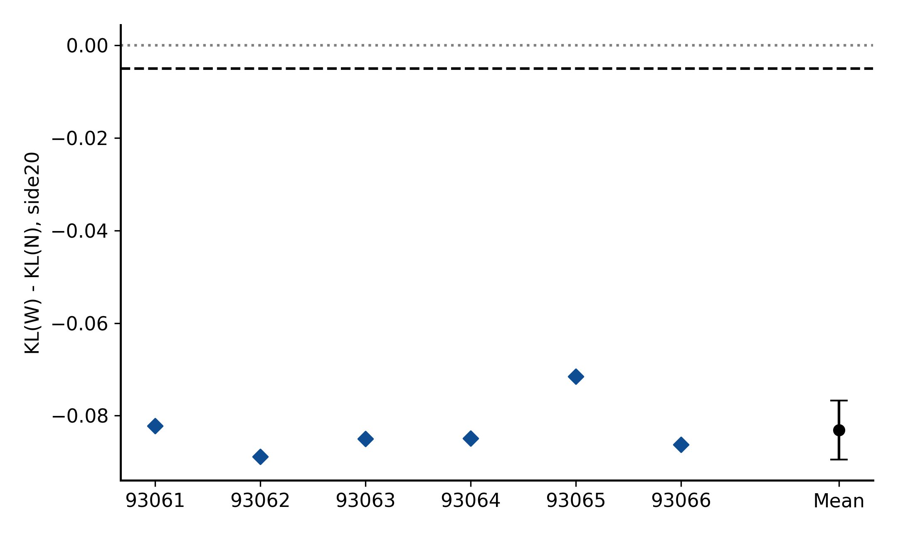
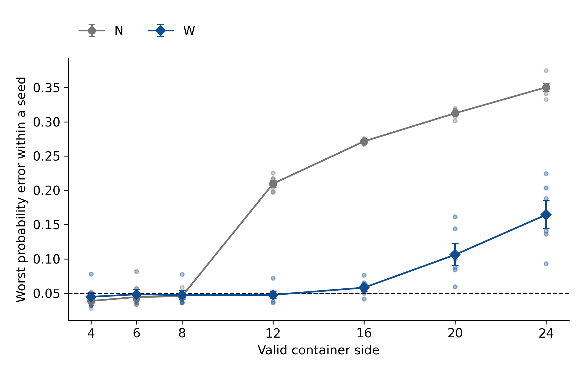

# 多尺寸训练能否让局部预测在扩容后保持准确

本轮得到一个明确而有限的正结果：宽尺寸训练把20×20主测试的平均精确KL从0.092391降到0.009247，约下降90%；但六个宽尺寸模型仍全部未通过最坏误差门。多尺寸训练显著缓解扩容退化，却没有建立可靠的绝对准确性。

实验简称N/W，完成于2026年9月30日。六个新配对seed、每组8k更新，共12个从零训练模型。它不是此前未启动的12小时size×clock方案，也没有继承其scratch权重。

[参数摘要](README.md) · [冻结方案](protocol/DENSE_MULTISIZE_CANONICAL_6H_PLAN_20260930_ZH.md) · [全精度结果](evidence/final_summary.json) · [阅读路线](../STUDY_GUIDE_ZH.md)

## 为什么先做一个精确局部任务

如果模型在大输入上失效，可能是真实条件变难，也可能是参考样本不够，还可能只是容器变化破坏了已学能力。为了分开这些情况，需要一个正确答案已知、且扩大外围容器不会改变正确答案的任务。

G8任务隐藏一个2×2腔体，八个边界自旋可见。隐藏自旋共有16种配置，可以对其能量权重精确求和，得到查询点的真实条件概率。给定完整边界，外围再放更多未知位置不会改变腔体内部真值。因而本轮主要检验的是局部信息不变时的容器扩展鲁棒性，而不是直接学习新的远距离边缘关联。

## 为什么G8比简单邻居计数更有解释力

早期K4任务让查询点的四个最近邻全部可见，其概率可由邻居自旋之和计算，容易通过计数解决。G8中边界的排列会影响隐藏腔体的条件概率，不能仅看正负数量。

预定见证对中，同样四正四负、相同查询点的两个边界模式，真值约为0.185730与0.814270。这说明只计数的规则不可能同时正确。见证对仅是功能检查，不能代替全部测试模式的准确性评价。

## N与W怎样比较

| 条件 | N窄尺寸覆盖 | W宽尺寸覆盖 |
|---|---|---|
| K4/G8有效边长周期 | 4、6、4、6 | 4、6、8、12 |
| 张量分配边长周期 | 4、6、8、12，多余位置为invalid PAD | 4、6、8、12 |
| 模型时间输入 | 全程t=.75 | 全程t=.75 |
| 坐标 | 真实单位坐标 | 真实单位坐标 |
| K1/K2任务 | 原4×4系统 | 与N相同 |
| 训练 | 六配对新seed，各8000更新 | 同左 |
| 主权重 | 固定8k raw | 固定8k raw |

PAD不是物理MASK。两组可以分配相同张量大小，却拥有不同数量的有效上下文位置。共同阶段的实际输入配对；后两个尺寸阶段的有效上下文有意不同。

固定clock把时间输入从这一比较中控制住。它不能检验native clock优劣；而且两臂平均有效token暴露为2688与5184，不能宣称有效信息量或有效计算量完全相同。本轮识别的是整个尺寸覆盖策略的增量，不单独分离尺寸频率、token暴露和网络内部机制。

## 数据划分与训练过程

G8共1024条模式记录，按旋转反射D4与整体自旋翻转分成72组，再用固定规则分为696训练、160验证、168测试。同一组的变换不跨split，避免靠看到等价图案获得虚假的留出表现。

训练同时包含K1/K2/K4/G8精确软标签任务。原dense约198万参数、128维、4头、7块；FP32训练，不使用AMP或TF32。AdamW、梯度裁剪及学习率计划固定。每更新四任务各32条，共128条，分两个64微批。

所有12个final先锁定身份，再评价固定4k/6k快照及EMA作为次要诊断。主权重从方案起就是8k raw，并非看到raw好于EMA后再选择。没有新增MC或整图生成。

主风险是168个固定测试模式的均匀平均，不是这些边界在自然Ising样本中出现频率加权的风险。

## 平均收益非常明确

主任务为20×20容器中心的G8测试。指标为精确局部KL，越低越好；主比较W−N。

| 主结果 | 数值 |
|---|---:|
| N平均KL | 0.092391 |
| W平均KL | 0.009247 |
| 配对差 | −0.083144 |
| 六seed配对t的95%区间 | [−0.089534, −0.076755] |
| 原实质门 | 区间上界小于−0.005，已通过 |

六对均有改善，seed bootstrap与留一分析保持有利方向。约90%是平均KL相对下降幅度，不是“模型利用了90%的信息”或“90%的测试已经正确”。来源：[主统计与逐seed损失](evidence/final_summary.json)。

## 为什么完整成功门仍然失败

绝对能力要求每个模型在主测试上的最大KL≤.01且最大概率误差≤.05。W为0/6通过，也就是没有一个seed在全部测试模式上同时满足这两个条件；不是每一条预测都错了。

图中每个浅色点是一条训练seed在相应尺寸上的最坏概率误差，虚线是.05。宽尺寸训练使退化推迟并减轻，但到20与24时仍有明显越线。平均损失会被大量较准确模式拉低，少数大错误必须单独检查。

W训练和验证模式通过预定检查，但在训练尺寸上的测试模式也只有5/6模型全部通过。这意味着错误不只来自扩大容器，也包含未见边界排列的泛化问题；不能把所有失败唯一归因于新增长程token。

## 保留与控制检查

三项旧任务保留门、PAD/平移/联合重排控制均通过，支持输入处理与比较按设计执行；它们不能救回主绝对门。6k→8k未触发预定learning-incomplete标记，也不等于证明充分收敛。

训练seed均值的标准误约0.002486，高于预设精度目标0.002；记录中仍按固定六seed结束，没有为达标补seed。这个精度目标未达应保留，但主相对改善的区间仍明确位于实质门以下。

公开600份预测及120份控制预测，可从logits与精确目标重算损失。独立重复仍是六个训练seed，不是129,600条预测记录。复核入口见[复现说明](../REPRODUCING.md)。

## 最合适的结论与下一问

支持的结论是：在固定clock、原dense和本轮精确局部任务下，扩大训练尺寸覆盖显著降低了平均外推误差。与此同时，最坏模式仍不准确，尺寸外推和未见排列两种问题都需要继续区分。

这轮没有测试真实spacing外推、native相对canonical clock、整图联合生成或RG。下一步应利用保存的错误模式区分表示、聚合与学习不足，而不是仅增加训练时长寻求更小均值。任何新实验都需要另行设计与授权。

## 汇报前应能回答

**为什么外围MASK不应改变真值？** 因为测试给出了隐藏腔体的完整相互作用边界，外部不再提供额外条件信息；模型输出变化是能力问题而不是真实目标变化。

**既然平均提高那么多，为什么还说没解决？** 相对门回答“比基线好多少”，绝对门回答“是否足够准确”；它们是不同问题。

**这是不是证明attention污染机制？** 它清楚显示扩容脆弱性，但没有唯一识别网络内部原因；RoPE、聚合、有效token暴露及训练分布仍需进一步对照。

原始[五图与图注](evidence/analysis/figure_captions.json)、[证据清单](EVIDENCE.md)、[配置](protocol/DENSE_MULTISIZE_CANONICAL_6H_CONFIG_20260930.json)和[历史更正](../CORRECTIONS.md)可用于进一步核查。
