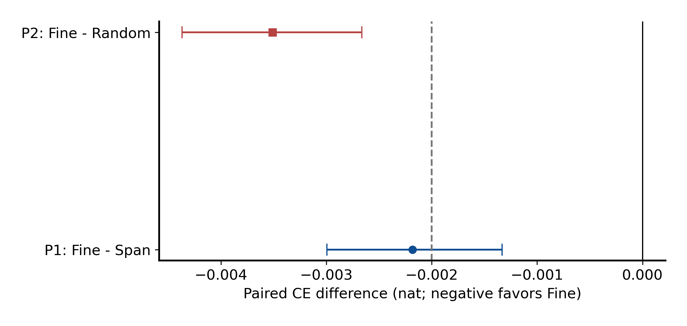

# I｜真实细几何相对总跨度和随机对应有什么价值

> 一句话结论：在预定H48、K512条件任务上，真实细坐标相对独立随机对应有超过原实质门的收益；相对只保留跨度也有明确改善方向，但未通过实质收益门。更大H96任务存在反转，所以没有建立普遍几何外推成功。

实验：geometry_identification_20260926；完成于2026-09-26。学习版更新于2026-11-15。本文保留原假设、数据和统计，修正旧讲解中“同坐标多重集置乱”的不准确概括：实际R是**独立排列同一gap多重集，再累积构成新坐标轴**。

[前一篇 G](../size-spacing-factorial/REPORT_ZH.md) · [阅读路线](../STUDY_GUIDE_ZH.md) · [共同方法](../METHODS_ZH.md) · [参数速查](README.md)

## 阅读目标

建议精读30–40分钟。重点不是记住F/S/R三个字母，而是能画出三种输入，解释：

1. 为什么物理数据完全相同，坐标信息却不同？
2. 为什么同时需要跨度对照S与随机对照R？
3. “有改善方向”与“达到预定实质强度”为什么不同？
4. 为什么一个任务上的真实坐标优势不等于任意尺寸都能外推？

## 1. G留下的空缺：训练覆盖有用，不等于细几何已被识别

G的H1/H2表明指定训练覆盖有益，但H3——G11相对同跨度均匀坐标G11S——尚未确认。一个模型可能主要利用整体跨度、平均密度或数据分布，而未充分利用每个自旋与具体物理位置的对应。

I因此把问题收窄：**同样的自旋观测、同样的监督和训练预算，只改变输入坐标信息，是否出现稳定的条件预测差异？**

它不继承G权重，而是6个新seed×3臂、共18个从零训练模型。这里的新训练与新MC是新的证据；但研究问题由G结果启发，不应伪装成与G完全无关的独立发现。

## 2. 三臂究竟给模型什么

| 臂 | 物理自旋、mask、query、t | 输入坐标 | 对照意义 |
|---|---|---|---|
| I-F：Fine | 同seed三臂逐样本配对 | 真实物理采样轴a | 提供正确细排列 |
| I-S：Span | 与F相同 | 每轴保留端点跨度，内部均匀化 | 去掉细排列，仍知道跨度 |
| I-R：Random | 与F相同 | 独立gap排列累积出的轴b | 保留gap统计与跨度，破坏逐点物理对应 |

三臂不是把自旋重新排序后再训练；spin、mask、query、标签仍与物理轴a对应。改变的是“告诉网络这些token在哪里”。

### 2.1 一个具体例子：R不是打乱原坐标点

以下是教学示例，正式实验使用更大W和协议给定gap计数。

设真实gap为[1,4,2]，真实轴：

$$
a=[0,1,5,7].
$$

从这个轴取出自旋后，三个输入分别为：

| 表示 | 交给网络的轴 | 保留什么 |
|---|---|---|
| F | [0,1,5,7] | 正确位置与真实gap排列 |
| S | [0,7/3,14/3,7] | 跨度7，内部均匀 |
| R的一种实现 | gap独立排列为[4,1,2]，得到b=[0,4,5,7] | gap多重集{1,2,4}、跨度7，非正确对应 |

a和b的**坐标值多重集不必相同**，但gap多重集相同。b仍是单调坐标轴，不是把a直接排列成[5,0,7,1]。旧文字“同坐标多重集随机排列”会导致错误理解，应以这个构造为准。

在普通非均匀布局中，给定W和布局类型，a、b由独立随机流从相同gap排列分布产生。没有“b必须不等于a”的拒绝规则；偶然相等不会重抽。

连续布局所有gap均为1，F/S/R自然相同。聚集布局B48是例外：物理轴采用聚集gap，R仍作普通随机gap排列，因此B48不再是坐标分布边缘匹配的对照，只是压力测试。

实现依据：[identification_data.py](../../scripts/research20260926/identification_data.py)的axes、training_batch、native_coordinates，而不是事后为结果发明的新解释。

### 2.2 F−S和F−R回答不同的问题

F−S直接问：“知道总跨度以后，正确的局部gap排列还值多少？”S不是完全没有位置信息，所以这是更贴近细几何增量的问题。

F−R问：“相对于拥有同类gap统计但对应关系随机的模型，正确对应有多少价值？”R是机制性信息对照，不是一个追求最优性能的实用基线。

F胜R不能自动推出F显著胜S，也不能排除随机对应使学习更困难等解释。因此必须同时报告两者，不能只挑差距最大的对照。

## 3. 配对与训练：哪些完全相同，哪些有意不同

同一seed三臂共享初始化、物理父场选择、crop原点、物理轴、对称变换、自旋翻转、mask、query、标签和t。R用单独的坐标随机流，不让生成错误坐标这一步意外改变监督数据。

这是**分别训练三种原生坐标配方**，并按各自原生配方测试；不是训练好F以后，临时把F的测试坐标搞乱。后者是另一个分布移位问题。

| 项目 | 固定设置 |
|---|---|
| 新seed | 92601–92606，共6个配对重复 |
| 模型 / 更新 | 18个fresh模型，各12,000步，共216,000步 |
| 结构 | 原dense，1,976,706参数；d128、4头、7块、MLP×4 |
| 坐标处理 | 二维RoPE，base10000；dropout0 |
| 尺寸与几何 | W16/24/32/48；连续与训练gap布局各半 |
| 监督 | 32步均衡周期；75%普通遮盖，25%稀疏可见 |
| token与batch | 18,432 token/步；W16/24/32/48对应batch72/32/18/8 |
| 稀疏任务 | K1/2/4/8/16/32；全batch共512隐藏query槽 |
| 优化 | AdamW(.9,.95)、wd.05、clip1；750步warmup至3e−4，余弦至3e−5 |
| 精度 / 权重 | BF16训练、FP32损失和评价；主权重固定12k EMA(.999) |
| 学习诊断 | 固定4k、8k、12k，不选checkpoint、不补步 |

训练gap与G相同：1/2/4/8；held gap为3/6，固定计数使相同W下跨度相同。普通遮盖t∈[.01,1]、2%全MASK；稀疏条件使用t=1−K/W²。全程不是精确oracle软标签训练。

每模型221,184,000 token、390,000个窗口实例。“实例数”包含父场复用和不同crop，不等于这么多独立物理样本。完整冻结参数见[配置](protocol/GEOMETRY_IDENTIFICATION_CONFIG_20260926.json)。

## 4. 为什么主任务选H48、K512

G的旧H3将K2/32/512等权汇总，整体未过。进一步的旧数据切片提示K512更值得研究；于是I在**新训练和新参考产生前**把H48、K512固定为主任务。

这意味着：

- 新主终点有旧探索结果的研究动机，不是无来由地挑一个K。
- 新终点不更改旧G-H3，也不将G的探索切片升级为旧确认性成功。
- I的其他K仍完整报告，但不因某个次要K更显著而替换主K512。

H48表示W48、held gap3/6、跨度174。K512表示2304个有效位置中有512个可见，约22.2%；“高K”是相对K2等稀疏状态而言，不表示几乎全可见。自然clock为1−512/2304≈.7778。

## 5. 数据、bank与R重复怎样统计

训练/旧验证父场沿用既有划分；新增测试参考为16条MC链×128场=2048父场，8条random、4条plus、4条minus初始化。固定burn40、gap4及QA，不根据神经结果延长参考采样。

### 测试矩阵

| 布局 | K集合 | 父场数 / bank | 作用 |
|---|---|---:|---|
| H48 | 2、8、32、128、512、1152 | 2048 | K512为主，其余观察区间为次要 |
| C48 | 上述六K，另加115 | 256 | 原连续任务与保留 |
| U48 | 上述六K | 256 | 已见gap |
| B48 | 上述六K | 256 | 聚集gap压力，非边缘分布匹配对照 |
| C96、H96 | 2、8、32、128、512、4608 | 各256 | 尺寸及共同外推 |

共37个bank，每父场64个隐藏query。H48六bank使用全2048父场；其余31bank各256父场，按每链16场选取。

对于R，非均匀bank有4次独立原生坐标实现。计算顺序是**每次前向先算loss，再平均4次loss**，不是平均概率后再算loss，因此不是一个四次预测集成算法。连续bank的重复相同，实际只算一次并复用。

18模型×37bank是666个逻辑模型—任务单元；考虑R的4次实现后有1098个实际预测文件。4套坐标仍对应同一父场，不能当成4份新物理样本。

### 主风险与不确定性

每个父场先平均query；R再按上述方式平均坐标重复；然后形成每seed、每臂的H48 K512经验条件CE。两项主差分别是F−S与F−R，负值有利于F。

主bootstrap联合重抽6个训练seed和16条MC链；链内128帧用循环块长8，固定20,000次。块4/16、seed-only、MC-only各10,000次为敏感性。使用256父场的次要bank只有每链16个选定场，因此主块2、敏感块1/4，不能把两种时间网格混为一谈。

两个主比较使用97.5%联合区间；方向门看上界<0，实质门看上界<−.002 nats/query。query和坐标重复均嵌套在父场内，不独立重抽来人为缩小误差条。

## 6. 主结果：不要将方向与实质混成一个“显著”

| 比较 | CE配对差 | 97.5%联合区间 | 方向门 | 实质门 |
|---|---:|---|---|---|
| P1：F−S | −.002182 | [−.002994, −.001332] | 通过 | 未通过 |
| P2：F−R | −.003512 | [−.004369, −.002664] | 通过 | 通过 |

来源：[summary.json](evidence/analysis/summary.json)。两个比较的六个seed点差都为负，主判定在块长4/8/16分析下保持一致。

横轴是条件CE差；点是平均差，线是97.5%联合区间。竖虚线为−.002，0线表示无平均差。

- P1点落在−.002左边，但区间右端−.001332在门槛右边。因此有利方向已建立，收益至少达到原实质强度尚未建立。
- P2整个区间都在−.002左侧，原方向与实质门均通过。
- 完整合取门需要两个主比较的实质门都过，因此本轮完整门未过。

这里的“未过”不该被说成“两个结果都没有价值”；同样，P2通过也不能抹掉P1未通过。

## 7. 次要任务：收益依赖K、布局与尺寸

### 7.1 K曲线不是纯观察密度因果实验

[观察区间图](evidence/analysis/observation_regimes.png)展示H48不同K的配对差，用次要逐点95%区间。只有K512是本轮预定主单元。

K变大时，不仅可见自旋更多，t=1−K/W²也改变。因此曲线描述“可见量与自然clock共同变化”的表现，不能唯一归因于观测密度。

### 7.2 必须带上H96反例

H96、K512的F−R为+.011427，次要95%区间[+.004857,+.018114]，F反而更差。

图中每个格点属于不同任务。主H48正结果与H96反转并不矛盾，而是说明正确几何的可利用性依赖任务。B48还是聚集布局压力，不是严格保持坐标边缘分布的纯对应关系对照。

所以结论应说“指定任务上正确对应提供价值”，不能说“给真实坐标就自动外推”。

### 7.3 低K构造诊断提供哪种信息

80个成对低K布局，每布局有K1两个符号条件与K2四个符号条件，共6种。设计某些布局对时，使S看到的粗信息相同、F知道的具体位置不同，用来观察细信息有没有可利用的预测增量。

这里的参考由有限MC局部条件表估计，并使用共同平移等配对；不是全分布精确真值，也不是自然H48任务的代表性随机子样本。rare与undefined条件另作记录。

阅读[信息差图](evidence/analysis/low_k_information.png)和[超额风险图](evidence/analysis/low_k_excess_risk.png)必须注意：Fine相对fine-information Bayes基线，Span/Random相对coarse-information Bayes基线。基线不同，超额风险小不能直接解释为共同绝对风险更低，更不能编造“使用了多少百分比几何信息”。

### 7.4 有效MASK扩容与PAD不是一回事

[扩容图](evidence/analysis/masked_context_extension.png)比较同一组观测和query的三种输入：

1. 小48容器及其自然clock。
2. 放入大96容器，新增有效MASK，但clock保持小容器值。
3. 同样大容器，clock改为大容器的自然值。

1→2观察固定clock下的表示扩展响应；2→3观察clock变化。新增MASK仍参与dense attention，不是应该被完全忽略的invalid PAD。

这类漂移说明模型对容器敏感，但不唯一证明原因是attention分母、RoPE还是训练分布。后续Basic和N/W用已知精确真值进一步分开这些问题。

## 8. 生成、保留与学习：辅助证据不能改判主终点

固定18模型各生成128张W96，共2304张、144个16图shard。生成是次要评价，使用固定S0 256步；没有因此产生新的训练seed。

[生成图](evidence/analysis/secondary_generation.png)显示不同距离区间及物理指标的结果混合。F−R短程NRMSE差约+.020117，方向不利。能量与signed magnetization偏差以0为目标，不是统一“越低越好”。次要生成中的有利格点不能救回P1实质门。

四个连续保留门采用各98.75%区间上界≤+.005，均通过。[学习曲线](evidence/analysis/learning_curves.png)使用8个固定旧验证条件、4k/8k/12k评分，带状区间仅反映训练seed不确定性，条件于固定验证数据。没有预定learning标记不等于未见布局已充分收敛。

## 9. 这轮最有意义的认识

I的价值在于把一句模糊的“几何有用”拆成了三个层次：

- **正确对应相对随机对应**：在主任务上有实质证据。
- **细排列相对总跨度**：有方向证据，原实质强度未确认。
- **这种收益是否普遍外推**：没有，H96反例限制推广。

这比只给一个总平均或只展示P2更能解释网络究竟学到了什么、还欠缺什么。R也不是某篇random positional encoding方法的完整复现；本轮不能据此否定整个方法家族。

## 10. 汇报复述与自测

推荐顺序：**G-H3留下问题 → 同物理输入的F/S/R → 用小轴例子解释R → H48 K512新主任务 → P1/P2分开判定 → H96反例 → 转向精确能力诊断。**

- **R保留原坐标点集合吗？** 不必；保留的是gap多重集与跨度，再独立累积成轴。
- **连续布局的R是不是也错配？** 所有gap为1，F/S/R坐标相同。
- **为什么不能只比F/R？** 随机对应是信息破坏对照；S才进一步问超过粗跨度的增量。
- **P1点差−.002182为何没过−.002门？** 门约束区间上界，不是均值。
- **R四次前向能算四倍样本吗？** 不能；同父场内的算法随机性，且平均的是loss。
- **K512结果能否修复G-H3？** 不能；这是新实验的新主单元，旧主检验原样保留。
- **H96反转是否否定H48？** 不否定，但否定了不加范围的普遍外推说法。

## 11. 证据地图与完成状态

| 问题 | 证据入口 |
|---|---|
| 原假设、R定义、测试矩阵 | [冻结方案](protocol/GEOMETRY_IDENTIFICATION_PLAN_20260926_ZH.md) |
| 实际训练身份 | [运行协议](evidence/run_protocol.json)、[完成摘要](evidence/final_summary.json) |
| gap独立轴与物理流配对 | [数据实现](../../scripts/research20260926/identification_data.py) |
| 主区间、逐seed差、块长敏感性 | [主摘要](evidence/analysis/summary.json)、[逐seed指标](evidence/analysis/main_per_seed_metrics.csv) |
| 各图统计口径 | [原图注](evidence/analysis/figure_captions.json) |
| 来源、备份和公开范围 | [EVIDENCE](EVIDENCE.md)、[数据可用性](../DATA_AVAILABILITY.md) |

正式计算约6.874小时；含预检预算约6.994小时。40包、2,164,852,006字节、1752/1752本地路径覆盖，代表执行及保存完成，不代表所有科学假设通过或所有大文件公开。

I-F后来用于J-C、末期MASK以及RG暖启动。这些后续分支继承旧谱系，不是对I的独立fresh复现。下一篇可读[Basic精确局部能力](../exact-local-capability/REPORT_ZH.md)，理解“模型可以响应坐标”与“它能算对条件概率”之间的差别。
