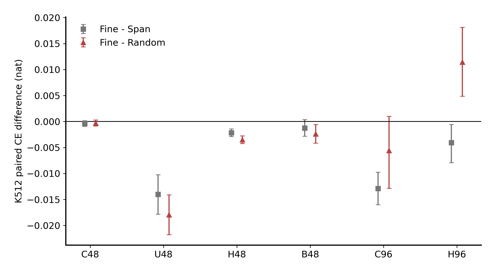

# 正确细几何相对总跨度和随机坐标有什么价值

本轮在指定W48高观测任务上确认：真实细排列优于随机坐标对应，并超过预定实质门；相对只保留总跨度也有明确改善方向，但尚未通过实质收益门。更大W96任务存在方向反转，因此不能把结果推广为普遍几何外推成功。

实验简称I，完成于2026年9月26日。六个新训练seed×三组，共18个从零训练模型，不继承G权重。[参数摘要](README.md) · [冻结方案](protocol/GEOMETRY_IDENTIFICATION_PLAN_20260926_ZH.md) · [全精度统计](evidence/analysis/summary.json)

[阅读路线](../STUDY_GUIDE_ZH.md) · [共同方法](../METHODS_ZH.md) · [前一问 G](../size-spacing-factorial/REPORT_ZH.md)

## 为什么G之后还需要I

G确认了两种训练覆盖在指定任务上的作用，但它的细几何主比较仍未决。一个模型可能主要根据整体跨度或采样密度判断，而没有充分利用每个自旋的具体位置对应。I把物理数据固定，专门比较提供不同坐标信息时能获得多少预测收益。

## 三组对照如何区分解释

| 组别 | 自旋数据与监督 | 输入坐标 | 比较意义 |
|---|---|---|---|
| F Fine | 同seed三组完全配对 | 真实细排列 | 正确位置关系 |
| S Span | 与F相同 | 保留每轴总跨度，内部均匀化 | 去掉细排列后，还保留多大能力 |
| R Random | 与F相同 | 保留坐标多重集，独立随机排列 | 正确自旋与坐标的对应是否重要 |

三组数据、mask、query和时间流一致；随机坐标使用单独随机流，不能让它意外改变训练样本。这里是分别训练三个固定配方的模型，不只是把一个训练好的F模型在测试时突然换成错误坐标。

F−S和F−R不是同一个问题。F−S问超过总跨度信息的细排列价值；F−R问正确对应相对打乱对应的价值。后者成功，不能自动说明前者效应也足够大。

## 训练与评价过程

模型保留原dense结构：1,976,706参数、128维、4头、7块、二维RoPE。六个seed为92601–92606；每组固定12k更新、每更新18,432 token，普通／稀疏监督配方与G一致。主权重为预先固定的12k final EMA，4k/8k快照只作诊断，不选最优checkpoint。

新MC参考为16链×128=2048个父场。主任务使用全部2048场、每场64个隐藏查询；其他多数bank使用256场。随机坐标组的非均匀布局有四套坐标变体，先平均损失，不平均概率，也不把四套当成四倍独立物理数据。

唯一两项主比较均在H48 held、K=512上：H48表示本轮W48未见非均匀间距任务，K512是512个可见自旋。六seed与MC链分层重抽，主块长8、20,000次bootstrap，块长4/16及不确定性分解为敏感性。

## 两个主结果应该分开判定

实质门为97.5%联合区间上界小于−0.002 nats/query；方向门为上界小于0。

| 比较 | CE差 | 97.5%联合区间 | 方向 | 实质 |
|---|---:|---|---|---|
| P1 F−S | −0.002182 | [−0.002994, −0.001332] | 通过 | 未通过 |
| P2 F−R | −0.003512 | [−0.004369, −0.002664] | 通过 | 通过 |

两个比较的六个seed点差都为负，块长敏感性保持同样主判定。P1不能因为平均值−0.002182低于−0.002就宣布实质通过：它的区间仍容许较小的收益。它也不应被概括成“没有效果”，因为改善方向已得到本轮统计支持。

完整合取门未通过是由于P1的实质门失败，不等于P2的正证据消失。所有全精度区间、逐seed差和留一分析见[机器摘要](evidence/analysis/summary.json)。

## 为什么仍然不能说几何外推解决了

在H96、K512这个次要任务上，F−R为+0.011427，95%区间[+0.004857,+0.018114]，真实坐标组反而更差。这个反例与H48正结果来自不同任务，不能挑一个代表所有尺度。

额外的MASK扩容诊断也显示：增加有效但未观测的位置可以改变预测。它不是invalid PAD影响，更不能仅凭这种变化唯一认定attention分母或RoPE是根因。低K诊断中的参考是有限MC局部条件表，不是完整分布的精确真值。

本轮还生成18×128张W96样本，共2304张。不同关联区间与物理量表现混合；不能拿次要生成中的有利指标救回P1，也不能把CE收益直接解释成联合分布正确。[生成结果](evidence/analysis/secondary_generation.png)应作为补充而非改写主判定。

## 这轮最有意义的贡献

I把“真实几何有用”收窄为可审查的比较：同一物理输入和监督下，正确位置对应在指定任务上提供额外预测价值；相对只知道跨度的增量也有方向证据，但原定实质强度尚未建立。

这使下一问更明确：为什么网络能在一类布局使用几何，却在更大容器或其他观测状态中失效？后续J和精确局部任务对结构与能力作进一步诊断，而不是重复宣称坐标普遍有用。

## 汇报时容易被问到的细节

**R是不是不公平的弱基线？** R是信息破坏对照，不是最佳实用算法。它帮助识别正确对应的价值；因此同时需要S这种保留总跨度的对照。F优于R不等于超过所有合理基线。

**为什么不只展示P2？** 因为P1是另一个预定主问题，且更直接衡量超过粗跨度信息的增量。只展示P2会隐去原完整门未通过的原因。

**H48正结果与H96反转矛盾吗？** 不矛盾，它们说明收益依赖任务与尺度；这正是不能宣称普遍外推的证据。

## 阅读和复核入口

先读上面的三组设计及两张图，再按需要查看[逐seed指标](evidence/analysis/main_per_seed_metrics.csv)、[原统计](evidence/analysis/summary.json)、[学习曲线](evidence/analysis/learning_curves.png)和[证据索引](EVIDENCE.md)。正式计算约6.874小时；固定训练、评价与本地归档均已完成，未把不利任务从结果中移除。

I的F基座后来用于J-C、末期MASK与RG暖启动，但这些分支不是I的独立从零复现。权重谱系见[总地图](../README.md)，后续结果不能修改本轮原检验。
