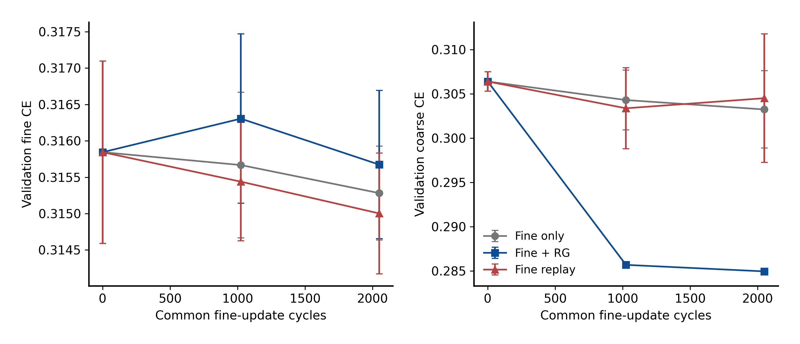

# RG先导｜把真实粗粒化数据加入训练，会帮助细尺度预测吗

> 一句话结论：这轮确实训练了3×3多数投票粗数据，粗尺度条件目标得到一致的探索性改善；但相对等更新量细尺度重放，W96细尺度迁移仍未确认，且有细尺度任务代价。它是三条旧谱系的短先导，不是逆RG、固定点或生成成功的证明。

实验：rg_data_training_pilot_20261001；完成于2026-10-01。本文于2026-11-15扩写为学习版，保留所有谱系、原区间和不利结果，不重算或改选模型。

[阅读路线](../STUDY_GUIDE_ZH.md) · [共同方法](../METHODS_ZH.md) · [完整数值与时间](RESULTS_ZH.md) · [三张正式图](FIGURES.md) · [参数速查](README.md)

## 阅读目标

建议用35–45分钟，重点掌握“做了真正粗粒化训练”与“已经证明跨尺度迁移”之间的距离。

读完应能回答：

1. 本轮粗自旋如何从真实细场产生，为什么不同于G的稀疏取样？
2. 为什么必须有fine_replay，不能只比较加RG与不加RG？
3. 三个臂的共同输入配对到哪一层，哪个混杂仍在？
4. 粗任务进步、细迁移未确认、细留存有代价如何同时解释？
5. 三条旧训练谱系能支持怎样强度的统计结论？

## 1. 这是主线中的哪一步

之前已有两类看起来“与尺度有关”的操作：

- G在不同真实间距上取细格点自旋，仍是原自旋变量。
- 一些生成评价把样本再粗粒化后检查统计，是评价操作。

这两者都不等于**把粗变量作为训练数据**。本轮真正新增了第三件事：将原始细场通过固定粗粒化映射变成粗场，让同一个网络学习细、粗两个层次的条件任务，并检查粗任务训练是否反过来帮助细任务。

本轮不是从粗场反演细场，没有训练逆RG，也没有生成大图或拟合RG固定点。最直接的研究问题是一个迁移问题：

**额外学习粗尺度，是否比额外学习同量细尺度更有利于细尺度条件预测？**

## 2. 粗粒化怎样实际进入数据

从真实父场取3W×3W细自旋区域，划分为不重叠3×3块。第(i,j)块的粗自旋为：

$$
S_{ij}=\mathrm{sign}
\left(\sum_{a=0}^{2}\sum_{b=0}^{2}s_{3i+a,\,3j+b}\right).
$$

9是奇数，没有平票。得到W×W粗自旋图后再进行遮盖和条件学习，不是先对已经遮盖的图随意投票。

### 一个块的教学示例

~~~text
细块              粗自旋
+  +  -
+  -  +    →       +
-  +  +
~~~

9点中6个+、3个−，所以粗标签为+。每个粗token代表一个块的集体状态，不是任选一个细点，也不是把9个细token只改名为1个token。

### 坐标和尺度标签怎样给网络

细输入用level=0、单位坐标i；粗输入用level=1、块中心坐标3i+1。坐标单位始终是细晶格单位，二维为(3i+1,3j+1)，不把粗间距3伪装成细间距1。

原dense添加一个2×128尺度嵌入，加入时间表示；两个level的嵌入初始均为0。主体1,976,706参数加256参数，共1,976,962参数，三臂结构完全相同。初始时输出可复现旧基座，不因新增随机尺度嵌入而先产生臂间差异。

这里的level不是温度标签，也没有证明粗粒化分布仍是相同β的最近邻Ising。

### 为什么粗尺度不能套细尺度oracle

细格点最近邻Ising在四邻全可见时有简单条件公式。多数投票后，一个粗变量整合多个细自由度；本轮没有证明其有效相互作用仍只包含相同参数的最近邻项。

因此细任务可以用精确局部KL，粗任务只能对真实留出粗标签计算经验CE。给粗任务套细格点公式会制造错误“真值”。

## 3. 为什么需要三个臂

| 臂 | 每谱系共同细更新 | 每谱系辅助更新 | 每谱系总更新 |
|---|---:|---|---:|
| fine_only，简称fine | 2048 | 无 | 2048 |
| fine_plus_rg，简称RG | 2048 | 2048次粗数据 | 4096 |
| fine_replay，简称replay | 2048 | 2048次额外细数据 | 4096 |

RG与replay的主比较控制了更新数与每步token。若只比RG和fine_only，RG训练两倍更新，无法区分“粗数据有用”与“多做训练有用”。

fine_only仍有价值：它给出只做共同细学习的参照，提醒我们更复杂方案未必胜过更少更新的方案。但它不是与另外两臂等计算的主对照。

### 共同流和辅助流如何配对

三臂共同细更新的实际输入完全相同。RG/replay的辅助流共同选择父场、原点、自旋翻转、坐标对称变换、时间和mask随机数。

但两个辅助输入的内容不同：

- RG取3W×3W细场，粗粒化为W×W。
- replay取同一3W区域中央W×W的细场，直接作为细输入。

所以同一个mask位置对应的是粗块或细点；随机选择相同不表示物理信息相同。

### 一个没有被消掉的混杂：物理视野

以W32为例，RG看到来自96×96区域的1024个粗变量；replay看到中央32×32区域的1024个细变量。token数相同，物理视野和每token语义不同。

本轮识别的是这套**粗数据＋更大视野＋尺度表示**的训练干预。不能单独归因于多数投票、level标签或更大视野中的任一个因素。粗level=0消融也不能替代完整的训练因素分离。

## 4. 权重身份：九个分支，不是九个独立新实验

固定选择旧I-F的92601–92603三个谱系、global12000的EMA权重，与它们的结果好坏无关。每个谱系分成三臂；相同基座加同样零尺度嵌入后，重置AdamW与RNG。

这叫**旧EMA暖启动的新微调**，不是完整raw/EMA/AdamW/RNG续训，也不是9个fresh独立模型。统计效应的独立模型单位是三条配对旧谱系。

三条谱系共享原研究背景，测试参考也此前已查看；本轮定位是探索先导，不能当作全新盲测确认。

## 5. 训练设置与固定过程

| 项目 | 规定 |
|---|---|
| 共同周期 | 每谱系2048；RG/replay每周期2次更新，fine_only每周期1次 |
| 总更新 | 3×(2048+4096+4096)=30,720 |
| 轮换 | 每256共同周期切换九个分支 |
| 有效边长 | 16、24、32、48固定均衡循环；连续几何 |
| 输入量 | 每更新18,432 token；对应batch72/32/18/8 |
| 遮盖 | 独立mask，t∼Uniform[.002,1)，逆t加权 |
| 优化 | AdamW(.9,.95)、wd.05、clip1、EMA.999 |
| 学习率 | 按共同周期；从3e−5 warmup128周期至1e−4，下降至1e−5 |
| 配对学习率 | 每个辅助更新与紧邻共同细更新相同 |
| 精度 | BF16 autocast训练，FP32参数/损失/优化器；评价全FP32 |
| 确定性 | TF32关闭，固定数据/RNG/源码，不按效果改batch或精度 |
| 快照 | 周期1024的9个midpoint EMA；周期2048的9个完整final |
| 正式评分权重 | 固定终点EMA；midpoint仅作学习诊断 |

训练没有使用G/I的非均匀gap混合，也没有额外引入精确oracle软目标训练；精确局部oracle用于评价。细输入与粗输入都通过对应真实场的遮盖任务学习。

顺序为：初始基座评分 → 固定三臂训练 → 终点与中点评分 → CPU训练/bank/预测审计 → 统计和三图 → 备份。没有根据中点曲线挑checkpoint、加步或筛掉不利谱系。

## 6. 数据独立性、测试矩阵与真值

训练768、学习验证64、测试256个整场样本的摘要互不重合。测试复用已完成旧评价中的16条MC链，每链取前16场；不是新增MC，也不是全新盲测。

### 12个正式测试bank

| 任务 | 组合 | bank数 | 每bank父场 | 指标与角色 |
|---|---|---:|---:|---|
| 细W96 | M=1、8、32 | 3 | 256 | 精确局部KL，三M等权为主汇总 |
| 细W48 | M=1、8、32 | 3 | 256 | 精确局部KL，次要保留 |
| 粗W32 | t=.1、.5、.9 | 3 | 256 | 经验CE，粗任务学习 |
| 细W48 | t=.1、.5、.9 | 3 | 256 | 经验CE，细任务留存 |

另有6个学习bank，即粗W32与细W48的三个t，各64验证父场，固定在初始/中点/终点评分。不是把测试分数当作学习曲线来选模型。

### 细任务的M和精确局部KL

M是剩余MASK数，M小意味着几乎全部可见，与I中的低K稀疏可见正好相反。

query从内部同色棋盘位置取M个，因此互不为最近邻，且每个query的四个单位最近邻都可见。真值为：

$$
q=\frac{1}{1+\exp\left(-2\beta\sum_{\text{四邻}}s_j\right)}.
$$

用q与模型p计算Bernoulli KL，先平均该父场的M个query，再汇总父场。时间输入为max(M/W²,.002)，不是所有M都统一用.002。三个M在主汇总中等权，因此不会因为M32有更多query就自动获得32倍权重。

这是局部高观测能力，不是全图KL；单点oracle精确也不意味着测试父场的抽样分布无限精确。

### 粗CE和细留存CE怎样算

每个经验bank对真实场按固定t遮盖，再从隐藏位置选32个query，与标签无关地选点。预测真实标签的交叉熵后先在父场内平均。

粗任务没有精确概率oracle，只是对真实粗标签评分。同一任务内三臂可比较；不同尺度CE的目标熵不同，不能用“粗CE比细CE低”表示粗物理更正确。

### 为什么有297份预测

3个初始谱系×18个测试/学习bank=54；9个终点分支×21个任务（12测试＋3个粗level0消融＋6学习）=189；9个中点×6学习=54。合计297。

这代表评分覆盖完整，不是297个独立模型重复。

## 7. 统计：为什么三条谱系必须谨慎解释

对每个父场、每条谱系，先将W96的M1/M8/M32局部KL等权平均，再作RG−replay。负值有利于RG。

报告两种预先固定的描述性区间：

- 三个配对谱系的t95%区间，df=2；展示训练谱系间的差异。
- 固定2000次联合bootstrap：重抽谱系、MC链，并在每链16个父场上用循环块长4；所有臂同一次抽样共用父场。

还保留留一谱系均值及8种符号翻转。三条谱系下分布估计很粗，bootstrap不会创造新谱系；t区间也依赖小样本假设。本轮明确不作确认性成功声明，更不把2000次bootstrap当成2000次独立实验。

## 8. 主结果：细尺度迁移没有得到确认

| 旧谱系 | fine_only | RG | replay | RG−replay |
|---|---:|---:|---:|---:|
| 92601 | .020632 | .017319 | .025243 | −.007924 |
| 92602 | .026401 | .022956 | .043661 | −.020705 |
| 92603 | .019372 | .029377 | .019510 | +.009867 |
| 平均 | .022135 | .023217 | .029471 | −.006254 |

主差：

- 配对t95%区间：[−.044396,+.031888]。
- joint bootstrap95%区间：[−.019653,+.009152]。
- 两区间都跨零，三个谱系中一个变差。
- 留一均值约−.005419、+.000972、−.014314，删去一条谱系可翻转平均方向。

因此最准确的表述是“主点估计有利，但迁移收益未确认”，而不是“RG显著改善细尺度”，也不是“证明RG无效”。

RG−fine_only的W96平均差为+.001083，两类区间也跨零。fine_only只有一半更新，不能替代等更新主对照；但它提醒我们，RG比replay的有利点差不自动意味着比单纯细学习更强。

## 9. 粗任务学到了，细任务仍可能有代价

| 各自固定任务的平均分数 | fine_only | RG | replay | RG−replay |
|---|---:|---:|---:|---:|
| 粗W32经验CE | .316150 | .298164 | .318719 | −.020555 |
| 粗W32，全部强制level=0 | .316152 | .298249 | .318731 | −.020482 |
| 细W48局部KL | .002114 | .002741 | .001741 | +.001000 |
| 细W48留存CE | .314056 | .314329 | .313857 | +.000472 |

### 9.1 最一致的探索信号：粗任务学习

粗CE三个谱系都改善，RG−replay的t95%区间为[−.029465,−.011646]，joint区间[−.025228,−.016761]，均在零以下。

这说明新增粗任务不是只存在于代码名字里，训练后确实在相同粗测试目标上产生了改善。但是“学会新增任务”与“帮助原细任务”是两个不同终点，不能用前者替代主迁移问题。

三谱系的粗任务符号翻转双侧p=.25，也体现极小重复数限制；不应只选一种最乐观的推断方式来升级为确认性发现。

### 9.2 level=0消融排除了什么

把粗输入的level全部强制为0后，RG−replay仍为−.020482，t与joint区间仍在零以下。这缓解了一个担忧：优势不是纯粹来自“基线从未训练level=1，所以被这个标签惩罚”。

但这仍是终点评价消融，不是独立训练“有/无尺度标签”的因素实验，不能据此精确归因于尺度嵌入有用或没用。

### 9.3 细尺度不能说完全无损

细W48局部KL的差在三个谱系均为正；t区间[−.000023,+.002023]跨零，joint区间[+.000610,+.001474]在零上方。细CE的t区间[−.000297,+.001241]与joint区间[+.000010,+.000972]也不完全一致。

所以应保留小幅不利点估计和方法差异，不能挑一个区间后宣布“无损”。

九个分支相对初始细CE均未触发增量>.002警告。这只是预定点估计警告，**不是正式非劣检验**，更不是所有细尺度能力均保留。

## 10. 三张正式图怎样读

### 图一：三臂绝对分数

[01_all_arms.png](evidence/analysis/01_all_arms.png)中每个点是一条旧谱系，短线为均值，区间是各臂跨三谱系的描述性t95%。它不是臂间配对差区间；不能用两条误差线是否重叠来代替主配对分析。

KL的t近似下限可能落到0以下，不意味着观察到了负KL，而是这种对称区间近似没有强制非负边界。

### 图二：主迁移、粗学习和细代价要一起看

- 左面板：细W96局部KL，是主迁移；两个区间都跨零。
- 中面板：粗W32经验CE，三谱系都改善，是最一致的探索信号。
- 右面板：**细W48经验CE**，不是细W48局部KL，显示细留存代价。
- 蓝点为每谱系差，黑线为t95%，红线为joint bootstrap95%；负值有利于RG。

三个面板的目标和量级不同，不能比较柱/线长度来给物理意义排名。只展示中间面板会隐藏本轮主问题未解决。

### 图三：固定学习时点不等于挑最优时点

横轴是共同细更新周期0/1024/2048；RG/replay每周期两次优化，fine_only一次。不是所有曲线在相同横坐标经历相同更新数。

RG粗验证CE约.306406→.285698→.284963，改善主要在中点前出现，末段仍变化。细验证CE则约.315844→.316305→.315674，先略升再回落。这只有三个固定时点，不能证明充分收敛，也没有据此延长或挑中点。

验证与测试来自不同父场/掩码集合，不能把二者绝对CE串成一条学习曲线。[原图注与PDF](FIGURES.md)保留完整说明。

## 11. 这轮价值、限制与下一步讨论

| 证据层 | 当前认识 |
|---|---|
| 数据与工程 | 真正粗粒化进入训练；共同/辅助流配对、恢复和预测审计通过 |
| 粗目标学习 | 三谱系方向一致，两个描述性区间均有利，值得继续研究 |
| 细尺度迁移 | 主点估计有利但不稳定，未确认 |
| 细能力保留 | 有小幅代价，警告未触发不等于正式无损 |
| RG大目标 | 逆RG、固定点、完整生成均未测试 |

限制包括三条旧谱系、短固定微调、已查看的参考、粗化与视野一起改变，以及只覆盖有限条件任务。它们应与正结果放在同一页，不能移到不讲的脚注。

后续若重点是解释迁移，需要先决定是否加入匹配物理视野的细数据对照，再设计更多配对训练重复与独立参考；若目标是逆RG，则还缺一个不同的建模和评价问题。这些都只是待讨论方案，不是已完成成果。

## 12. 汇报复述与自测

推荐顺序：**过去只改采样/做粗诊断 → 这次真训练粗变量 → 三臂与等更新replay → 三条旧谱系 → 主迁移跨零 → 粗目标改善与细代价 → 下一步如何拆解释。**

- **G的gap训练是不是RG？** 不是，取原自旋与块多数投票生成新变量是两回事。
- **为什么选3×3？** 固定奇数块多数投票无平票；本轮没有比较其他块大小。
- **为什么要给3i+1坐标？** 保留粗块中心在细格点单位中的实际位置。
- **为什么replay不可少？** 否则额外训练量与粗数据作用混杂。
- **等token是否等物理视野？** 不等，RG代表3W区域，replay取中央W区域。
- **九个模型为什么统计上只有三条谱系？** 每个旧基座分出三臂，是三组配对重复。
- **粗CE下降为什么不够？** 主终点是对细W96迁移，而粗目标是不同任务。
- **没有触发留存警告为什么不能说无损？** 警告是点估计阈值，不是带不确定性控制的非劣门。
- **是否已经证明RG固定点？** 没有，未检验完整粗化分布不变性或逆映射。

## 13. 证据与实测完成状态

| 内容 | 入口 |
|---|---|
| 三臂、预算、统计边界 | [冻结方案](protocol/RG_DATA_TRAINING_PILOT_PLAN_20261001_ZH.md)、[配置](protocol/RG_DATA_TRAINING_PILOT_CONFIG_20261001.json) |
| 粗粒化、配对、level与bank | [model_data.py](../../scripts/research20261001_rgpilot/model_data.py) |
| 细局部oracle和时间下限 | [endpoint_data.py](../../scripts/research20261001/endpoint_data.py) |
| 主/次差与全部谱系 | [summary.json](evidence/analysis/summary.json)、[完整中文结果](RESULTS_ZH.md) |
| 汇总、bootstrap与评价权重 | [evaluation.py](../../scripts/research20261001_rgpilot/evaluation.py) |
| 原图、公开与来源 | [FIGURES](FIGURES.md)、[EVIDENCE](EVIDENCE.md)、[数据可用性](../DATA_AVAILABILITY.md) |

30,720更新、9final、9midpoint、297预测及训练/bank/预测三项CPU审计完成。正式科学流程约42分05秒；初始评分结束至训练完成约34分14秒，包含切换与保存。准备、备份和报告另计，不能把“两小时窗口”说成两小时都在训练。

科学包与管理补包两处逐成员核验，包含继承材料的454/454规范路径联合覆盖；三张PNG与PDF保留原图。公开预测可重算经验CE；重新从oracle构造KL还需相应输入bank，所有大权重和父场并不全部托管普通Git。

最终定位仍是：**粗数据学习的可执行、有信号先导；细尺度迁移及更大的RG主张未完成证据闭合。**
