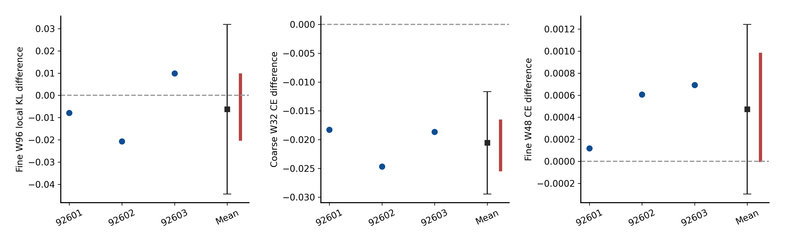

# 粗粒化训练是否帮助细尺度预测

本轮真正把3×3多数投票粗粒化数据加入训练。模型在粗尺度条件任务上学得更好，但相对等更新量细尺度重放的W96迁移收益仍未确定；部分细尺度指标出现小幅代价。它是三个旧训练谱系的探索性先导，不是逆RG、固定点或整体生成成功的证据。

完成日期为2026年10月1日。本文解释设计与结果；[完整数值结果](RESULTS_ZH.md)、[冻结方案](protocol/RG_DATA_TRAINING_PILOT_PLAN_20261001_ZH.md)和[机器摘要](evidence/analysis/summary.json)提供详细依据。

[阅读路线](../STUDY_GUIDE_ZH.md) · [共同方法](../METHODS_ZH.md) · [三张正式图](FIGURES.md)

## 与之前实验有什么不同

G的非均匀采样改变哪些细格点被观察；前一轮生成报告还对结果进行粗尺度诊断。这两件事都不等于训练粗粒化数据。

本轮把实际3W×3W细自旋场分成不重叠3×3块，每块多数投票得到一个粗自旋，形成W×W输入。粗位置使用细格点单位的块中心坐标3i+1，并标记level=1；细数据使用level=0。

这里检验的是“加入粗任务训练是否帮助细任务”，不是从粗场重建细场，也不是验证粗粒化后的全部有限尺寸分布严格不变。粗尺度条件目标只用经验交叉熵，不套用细格点的最近邻oracle。

## 为什么必须设置细重放对照

如果只比较普通细训练与额外加入RG训练，RG组做了更多更新，无法区分收益来自粗数据还是训练量。因此每条旧谱系分为三臂。

| 臂 | 共同细尺度更新 | 辅助更新 | 每谱系总更新 |
|---|---:|---|---:|
| fine_only | 2048 | 无 | 2048 |
| fine_plus_rg | 2048 | 2048次粗粒化数据 | 4096 |
| fine_replay | 2048 | 2048次额外细尺度数据 | 4096 |

RG与replay是等更新量、等token预算的主对照；fine_only显示仅进行共同细训练的参照水平。不能把fine_only的半数更新与其他组称为等计算比较。

每次更新18,432 token，W=16/24/32/48均衡循环。三臂共同细输入完全配对；RG与replay的辅助父场、原点、对称变换、时间和mask随机选择也配对。但replay取同一物理区域中央W×W细场，而RG来自3W×3W区域，因此物理视野不同。

所以本轮识别的是整套粗数据训练干预，不单独识别粗粒化、尺度标记或物理视野各自的因果作用。

## 模型身份与执行过程

固定使用旧I-F的92601–92603三个谱系、12k EMA权重暖启动，新增2×128的零尺度嵌入，初始输出复现旧模型。AdamW与RNG重新初始化，因此不是完整优化器续训，也不是九个从零独立训练重复。

三个谱系合计30,720更新，按256共同周期轮换九模型；保存9个midpoint EMA和9个可恢复final。训练采用BF16 autocast、FP32参数/损失/优化器；所有评价FP32，TF32关闭，固定checkpoint与预测任务，不按效果选模型。

训练768、验证64、测试256个整场样本不重合。测试取已完成旧评价的16条MC链、每链前16场；它不是新的盲测参考。共12个测试bank和6个学习bank，297份预测文件不代表297个独立模型重复。

## 主问题是细尺度迁移

预定主终点为W96细尺度、M=1/8/32的等权平均精确局部KL，负的RG−replay差表示RG有利。M是剩余MASK数，不是可见点数。

| 旧谱系 | fine_only | RG | replay | RG−replay |
|---|---:|---:|---:|---:|
| 92601 | .020632 | .017319 | .025243 | −.007924 |
| 92602 | .026401 | .022956 | .043661 | −.020705 |
| 92603 | .019372 | .029377 | .019510 | +.009867 |
| 平均 | .022135 | .023217 | .029471 | −.006254 |

主差的配对t 95%区间为[−.044396,+.031888]，固定2000次seed→MC chain→block4 bootstrap区间为[−.019653,+.009152]。两者都跨零，且三个谱系中有一个变差。

这不是只差“再多采一些图”就能肯定的结果：独立训练谱系只有三条，留去某一谱系时均值方向可以翻转。Bootstrap不会创造新的训练重复。相对fine_only，RG平均差为+.001083，两种区间也跨零，因此“优于replay的有利点估计”不能自动变成“优于单纯细训练”。

## 粗任务学到了什么

在同一个粗W32任务上，对t=.1/.5/.9的经验CE取平均，结果如下。

| 同一测试任务 | fine_only | RG | replay | RG−replay |
|---|---:|---:|---:|---:|
| 粗W32 CE | .316150 | .298164 | .318719 | −.020555 |
| 粗W32全部强制level=0 | .316152 | .298249 | .318731 | −.020482 |
| 细W48局部KL | .002114 | .002741 | .001741 | +.001000 |
| 细W48留存CE | .314056 | .314329 | .313857 | +.000472 |

粗任务三个谱系均改善，t与joint区间都在零以下；将粗输入尺度标记全部置为level=0后优势仍存在。因此优势不只是“基线没有训练过level=1”造成的表面惩罚。这仍是小样本探索信号，不是独立确认性结论。

细W48的KL与CE有小幅不利点估计，两种区间方法并不总给出相同方向判断。九个分支没有触发相对初始细CE增量>.002的点估计警告，但这个警告不是正式非劣检验，不能据此说细尺度能力完全无损。

## 主图怎样读

左面板是细W96主迁移，中间是粗任务学习，右面板是细W48留存。蓝点为三个谱系的差；黑色为t区间、红色为联合bootstrap区间。负值有利于RG。应先看左面板是否确认主问题，再看中间的探索信号和右边代价，不能只展示中间一栏。

不同面板的指标和目标不同，不比较它们绝对值的大小。粗CE更低不能解释成比细任务更接近同一个分布。

初始、中点、终点评分显示粗任务改善主要在中点前出现，末段仍变化。横轴是共同细更新周期：RG/replay每周期两次更新，fine_only一次。三个时点不能证明充分收敛，也未据此延长训练。

## 当前能支持的判断

这轮说明粗粒化数据的训练流程可执行，并在同一粗条件目标上产生了一致的探索性改善。但细尺度迁移、无损保留和全局物理正确性仍未建立。三条旧谱系、短训练、已查看参考以及视野差异是解释时必须带上的限制。

后续若优先研究迁移，应先决定是否要分离粗粒化与更大视野，再设计独立测试和更多配对训练重复；这只是待讨论的研究方向，不是已经执行的下一轮。

## 汇报时的关键问答

**为什么粗任务成功不等于RG思想全部成功？** 模型学会新增任务是必要进展，但本轮真正关心它是否帮助细尺度任务；两者不是同一终点。

**是否只是训练更多？** RG与replay更新数和token预算相同，已控制这一点；但物理视野和数据尺度仍一起改变。

**为什么只有三个seed还报告区间？** 用来展示方向、幅度和不稳定性，而不是包装确认性成功。应直接展示三条谱系的差和跨零区间。

## 完成状态与数据边界

30,720更新、9final/9midpoint、297预测及三项CPU审计均完成。正式科学流程约42分5秒；没有重启、缩样本或追加轮次。详见[结果与实测时间](RESULTS_ZH.md)。

公开预测、统计、原图、协议和审计记录；大权重、输入bank和继承父场按清单保存在已核验备份，不全部托管普通Git。经验CE可用公开预测重算；从oracle重新构造KL还需要对应输入bank。[证据索引](EVIDENCE.md)与[数据清单](withheld-manifest.json)给出具体边界。
