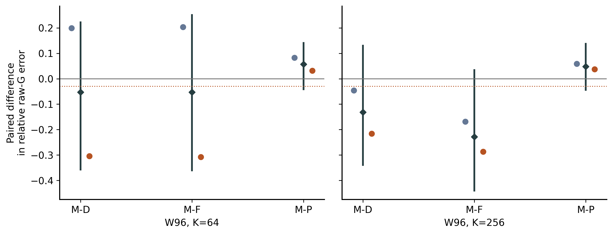
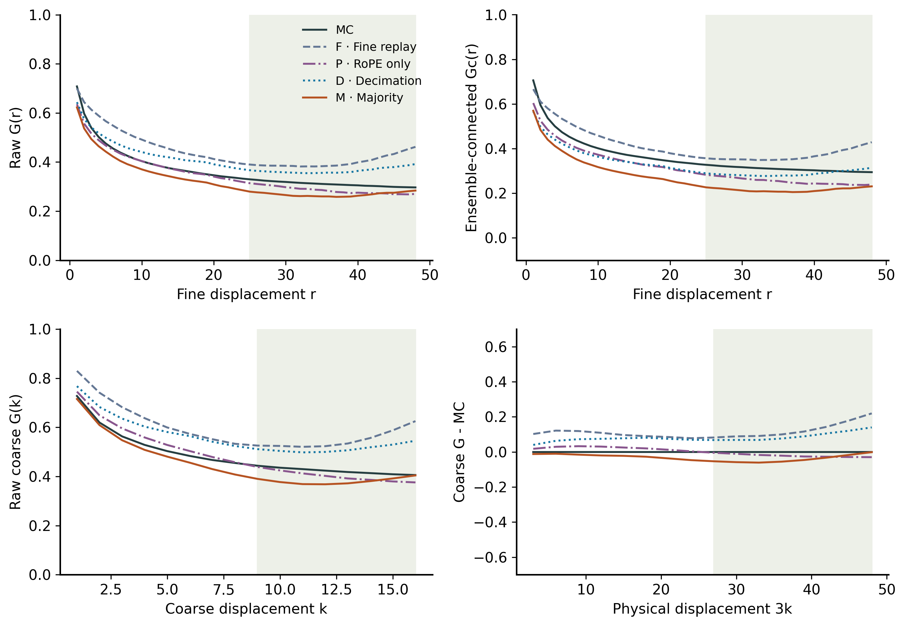
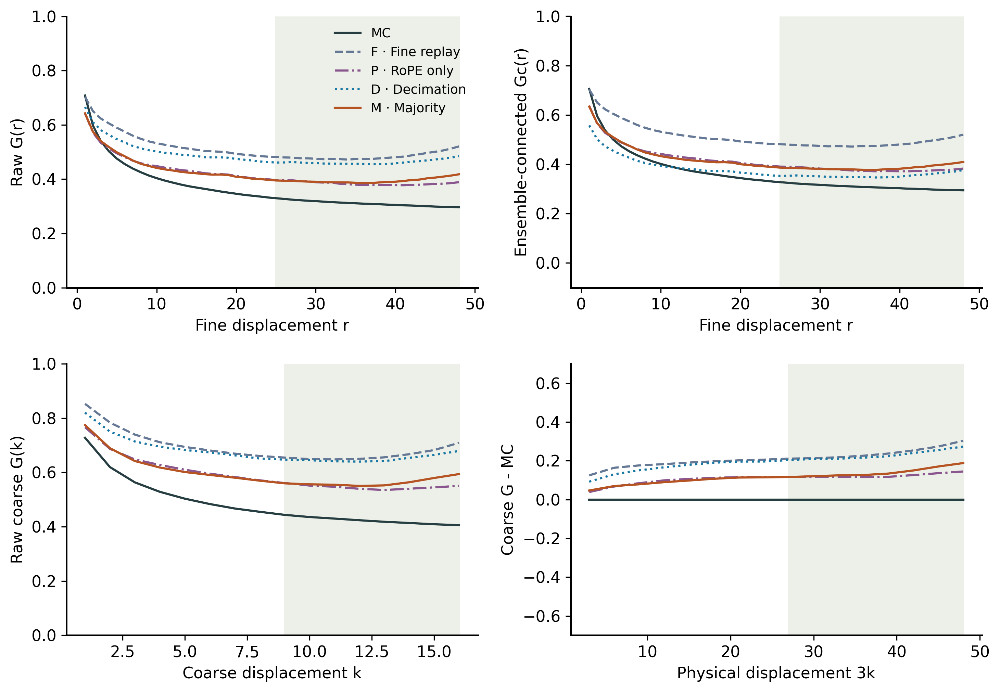
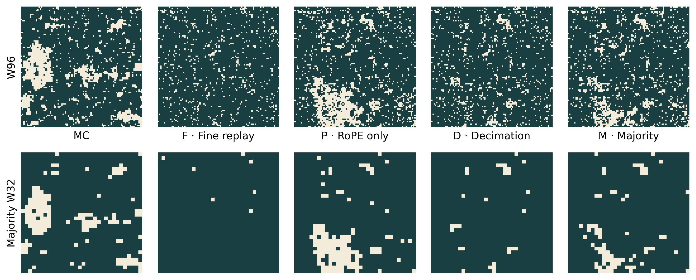
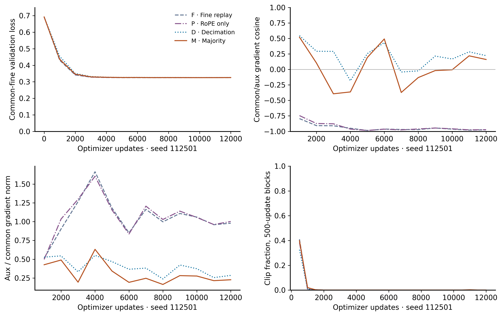
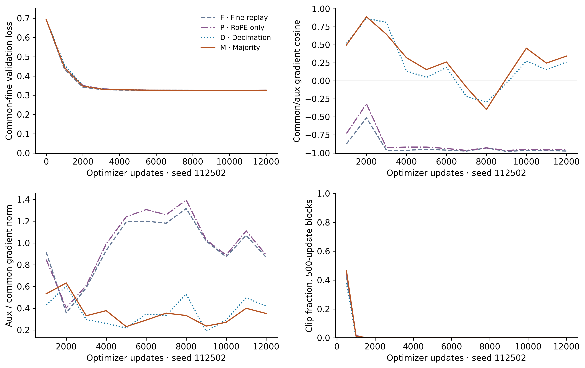

# RG-2 v1.2 实验结果：A 诊断与 B 四臂开发

**A、B 已完成，全部结果通过独立数值核验。当前最有价值的发现是：256 步采样下，多数投票训练 M 在两个开发 seed 上都改善了相对 F、D 的长程关联误差，但 P 的点估计仍更好，M 的能量表现又弱于 F。** 因而，本轮支持“存在依赖采样设置的收益与代价”，尚不支持“多数投票带来整体优势”或“优于纯坐标增广”。

本轮按授权执行到 A、B。**阶段 C 未启动。建议暂缓原样扩大 C**，先明确能量／局部能力保留要求和确认样本量；256 步下的收益值得继续检验，但必须保留 P 对照。

## 1. 先读这四点

| 发现 | 证据 | 可支持的结论 |
|---|---|---|
| 旧 Fine+RG 没有稳定生成收益 | A 中 256 步的三个旧谱系均弱于初始和 replay；64 步排序混合 | 旧局部指标的改善不能代替生成评价，也不能代表 Fresh 训练 |
| Fresh M 在 256 步有一致方向的收益 | M−F 平均 −0.22817，M−D 平均 −0.13134，两个 seed 都为负 | 有值得跟进的开发信号；不是独立确认 |
| 纯坐标增广仍是必要对照 | M−P 平均 +0.04776；两个 seed 的 M 误差都高于 P | 不能把相对 F 的收益直接归因于多数投票的集体变量 |
| 长程改善伴随近程代价 | 256 步下 M 的能量 Wasserstein 距离在两个 seed 上均高于 F | 不能宣称全面物理真实性或整体非劣 |

所有差值都是“前者相对 G 误差减后者”，负值表示前者更好。0.03 表示相对误差的 3 个百分点；它只是原方案候选门槛，B 没有按 C 的确认性规则宣告过门。

## 2. 做了什么：四臂只在辅助训练流不同

共同训练流均使用连续细场、单位坐标和共同任务嵌入。每个 seed 内四臂共享初始化、窗口选择、宽度、掩码、噪声与相应随机身份，每条训练独立执行。

| 臂 | 辅助流中的自旋 | 辅助流中的坐标 | 用途 |
|---|---|---|---|
| F：Fine replay | 3W 父窗口中央的连续 W×W 细场 | 单位间距 | 等预算细训练参照 |
| P：RoPE-only | 与 F 逐位相同 | 间距 3、块中心位置 | 分离纯坐标增广效果 |
| D：Decimation | 每个 3×3 块的中心自旋 | 与 P 相同 | 真实抽点与物理覆盖对照 |
| M：Majority | 同一批 3×3 块的多数方向 | 与 D、P 相同 | 检查集体粗变量的额外价值 |

B 使用两个开发 seed（112501、112502），共 8 个从零初始化的模型。每模型 12,000 次更新，共同／辅助各 6,000；W=16/24/32/48 等频，每更新 18,432 token，共计 **1,769,472,000 token**。骨干为原 7-block、d128、4-head 模型，含两个任务嵌入，共 1,976,962 参数。

AdamW、750 步预热、3e−4→3e−5 余弦调度、EMA 0.999、裁剪阈值 1；BF16 前向、FP32 参数和损失。最终评价只用预定的 12k EMA，以 FP32、关闭 TF32、batch=1 生成 W96；64／256 步各 32 张，合计 **512 张**。同一张 W96 图再做多数投票成为 W32。

训练 MC 与参考 MC 的总种子、链种子不同。训练全局链 0–5、验证全局链 6–7；生成参考为历史 MC 奇数链 1、3、…、15 各前 32 场，共 256 场。参考独立于训练，但已用于开发，不能当作 C 的新测试链。

## 3. 主结果：W96 长程关联

G 使用窗口内水平与垂直轴向自旋乘积，不跨裁剪边界。每图先按有效点对求均值，再对图等权；距离 25–48 上的相对误差为：

$$
E_G=\sqrt{\frac{\sum_r(G_{gen}(r)-G_{MC}(r))^2}{\sum_rG_{MC}(r)^2}}.
$$

| 开发 seed | 采样步数 | F | P | D | M |
|---|---:|---:|---:|---:|---:|
| 112501 | 64 | 0.12150 | 0.24226 | 0.12573 | 0.32458 |
| 112501 | 256 | 0.31061 | 0.08309 | 0.18789 | 0.14157 |
| 112502 | 64 | 0.38292 | 0.04334 | 0.37939 | 0.07467 |
| 112502 | 256 | 0.56416 | 0.23981 | 0.49322 | 0.27685 |

256 步时，M 相对 F、D 的方向在两个 seed 上一致；64 步时，这两项比较发生 seed 间方向反转。P 在四个 seed×步数组合中的长程误差都低于 M。**训练臂与采样步数存在明显交互，不能只报告最有利的一档。**

灰蓝点为 seed 112501，赭橙点为 seed 112502，黑菱形为两 seed 等权平均；竖线是描述性区间。

| 步数 | 比较 | seed 112501 | seed 112502 | 等权均值 | 描述性 95% 联合 bootstrap 区间 |
|---|---|---:|---:|---:|---|
| 64 | M-D | +0.19885 | -0.30472 | -0.05294 | [-0.35731, +0.22222] |
| 64 | M-F | +0.20308 | -0.30825 | -0.05259 | [-0.36068, +0.25104] |
| 64 | M-P | +0.08232 | +0.03133 | +0.05682 | [-0.04139, +0.14053] |
| 256 | M-D | -0.04633 | -0.21636 | -0.13134 | [-0.33896, +0.12981] |
| 256 | M-F | -0.16904 | -0.28731 | -0.22817 | [-0.44019, +0.03444] |
| 256 | M-P | +0.05848 | +0.03705 | +0.04776 | [-0.04424, +0.13764] |

联合重抽样共 10,000 次：完整配对训练 seed → 配对生成图，同时独立抽 MC 链与链内循环块（块长 8）；每次重算非线性误差及 MC 分母。参考池严格限于点估计实际使用的 256 场。

上述区间全部跨零。只有两个开发 seed，尾部分位和训练变异估计都不稳定；这些区间用于展示不确定性，不是 C 规定的确认区间。也不能把“未确认”解释为各臂等效。

两图按 seed 分开，避免平均曲线掩盖训练变异。阴影是预定的长距离评价范围，原始关联保持绝对振幅；连通关联按系综平均磁化扣除，并另保存有限样本修正。

## 4. 同一张细图粗化后，结论是否一致

下表是 W96 生成图逐图多数投票后的 W32 粗关联误差，粗距离 9–16；参考为真实 MC 的同一算子粗化。

| 开发 seed | 采样步数 | F | P | D | M |
|---|---:|---:|---:|---:|---:|
| 112501 | 64 | 0.14230 | 0.20524 | 0.09224 | 0.28881 |
| 112501 | 256 | 0.32076 | 0.05358 | 0.22561 | 0.10776 |
| 112502 | 64 | 0.43394 | 0.08430 | 0.43574 | 0.13979 |
| 112502 | 256 | 0.57725 | 0.29396 | 0.54476 | 0.33934 |

256 步下的粗尺度点估计与细尺度方向一致：M 优于 F、D，但仍弱于 P；相应描述性区间也跨零。粗图丢失块内信息，因此粗统计较好不能单独证明细图正确。

每列下方粗图都来自正上方细图。MC 是独立参考构型；模型之间共享配对随机数，不计算与 MC 的逐像素误差。完整图版保留预登记 ID 0、1、2、3，以及另一 seed 和 64 步结果。

## 5. 能量、磁化和条件能力：收益是否付出代价

下面展示 256 步的分布距离及最终 EMA 局部 KL。Wasserstein 距离衡量整条一维经验分布与 MC 的差异；两种距离及 KL 都越小越好。局部 KL 对 M=1/8/32 三个任务等权平均。

| seed | 臂 | 有符号磁化 W1 | 每键能量 W1 | W48 局部 KL | W96 局部 KL |
|---|---|---:|---:|---:|---:|
| 112501 | F | 0.17709 | 0.02485 | 0.001245 | 0.104234 |
| 112501 | P | 0.13714 | 0.07256 | 0.001837 | 0.086455 |
| 112501 | D | 0.23599 | 0.06553 | 0.002644 | 0.126668 |
| 112501 | M | 0.18446 | 0.08530 | 0.002163 | 0.099393 |
| 112502 | F | 0.19467 | 0.02201 | 0.001892 | 0.099013 |
| 112502 | P | 0.10298 | 0.06852 | 0.002572 | 0.092629 |
| 112502 | D | 0.31824 | 0.04704 | 0.003227 | 0.128609 |
| 112502 | M | 0.12223 | 0.06560 | 0.002177 | 0.112936 |

M 的每键能量距离在两个 seed 上都大于 F，且不是只看平均能量得到的结论。磁化分布、|m|、近程 G 和局部条件 KL 分别保留，不能用长程主指标覆盖这些代价。开发后尚未冻结 C 的逐项非劣界限，因此这里不作整体非劣声明。

[逐 seed 全部观测量](stage_B/B_per_seed_metrics.csv) · [48 格局部预测](stage_B/B_local_retention.csv) · [完整图版与图注](stage_B/FIGURES.md)

## 6. 模型确实学到了吗

共同细任务验证使用独立验证链和固定输入，以 EMA 评价。表中验证损失对四个宽度等权平均；实际训练损失是 inverse-t masked CE、按全部 token 归一。裁剪率来自全部 12,000 次更新的原始梯度范数。

| seed | 臂 | 初始化验证损失 | 12k 验证损失 | 实际裁剪率 |
|---|---|---:|---:|---:|
| 112501 | F | 0.69240 | 0.32536 | 1.73% |
| 112501 | P | 0.69240 | 0.32560 | 1.64% |
| 112501 | D | 0.69240 | 0.32592 | 1.40% |
| 112501 | M | 0.69240 | 0.32561 | 1.76% |
| 112502 | F | 0.69240 | 0.32598 | 1.82% |
| 112502 | P | 0.69240 | 0.32610 | 1.97% |
| 112502 | D | 0.69240 | 0.32592 | 1.59% |
| 112502 | M | 0.69240 | 0.32602 | 1.99% |

两流梯度在同一 raw 参数状态下分别计算，不在两次反传之间更新；共享参数集合排除任务嵌入。报告保留所有逐更新日志、固定验证、梯度余弦／范数比、4k/8k/12k raw、EMA、优化器和 RNG。

每个时点的梯度诊断仅使用一对固定 W48 验证批次；其余弦不能直接当作整个训练分布上的梯度相关，也不能单凭该图认定某臂存在总体梯度冲突。

## 7. A 给出了哪些额外证据

阶段 A 包含 126 格精确局部测试、735 格条件／几何保留、396 组精确小块联合诊断和 960 张生成输出。旧 Fine+RG 在 256 步下三个谱系的细生成误差都高于 initial 和 replay；直接粗生成与“细生成再投票”也不一致。

真实 MC 中，中心抽点 D 与多数投票 M 在 W96 上约有 8.2523% 的块不同，95% 整链 bootstrap 区间为 [8.1937%, 8.3081%]。在固定小块的 32 个 MC 边界中，九点并行 oracle 的平均因子化 KL 为 0.317135 nats；这说明小块内的独立近似代价，不能直接当成全图误差的定量解释。

A3-N 显示，n=32 时即使比较 MC 与 MC，细场相对 G 误差的 95% 分位也约 0.202。当前规模用于开发筛查，不能确认 0.03 的小效应；此分位也不是配对模型比较的正式门槛。

[完整 A 中文报告](stage_A/RESULTS_ZH.md)包含全部逐谱系结果、三路径表、精确机制诊断和样本量分析。

## 8. 对 C 的建议与本轮边界

建议暂缓把本配方原样扩大成“大规模整体优势确认”。256 步下 M 相对 F、D 的同向信号值得跟进，但 P 更好、能量代价和采样交互都需要保留在问题定义中。

若继续 C，应保留全部四臂及原定主次比较，先冻结主采样设置、能量／磁化／局部能力的容许代价、独立训练 seed、新 MC 链与采样 RNG、样本量和完整统计规则。256 步可以作为 B 后的主设置候选，64 步保留为敏感性；不能在确认数据出来后切换。原拟 6 个新配对 seed、每格 128–256 张只是起点，两个开发 seed 不足以可靠决定精度。

本轮 B 训练实际耗时 2.028 小时，生成与统计评价 46.77 分钟。按相同配方线性估计，6 seed × 4 臂仅训练约 6.08 小时，还不包含新 MC、确认生成、W144 压力测试和统计核验。这不是已启动的预算或已执行的 C。

## 9. 完整性、异常记录与数据

全部 96,000 条训练记录、配对数据流哈希、共同初始化、24 个阶段检查点、优化器与最终 EMA 一致性均通过检查。独立 NumPy 复算了 48 格局部预测及 512 张图的物理统计；与保存值最大差为 6.42×10⁻¹⁷。另以独立循环重新计算全部 120,000 个对比 bootstrap 值，最大差为 0，并用 SciPy 复核了 96 项 Wasserstein 距离。A 和 B 的完整备份均逐文件校验。

B 首次启动在 **0 次正式训练更新** 时因链编号检查失败；原文件内部对每个 split 从 0 编号，验证集的全局链应通过元数据映射到 6、7。修复只涉及编号验证与预检，训练数据、数值配方、batch 构造、损失和 RNG 均未改变；新预检重新通过四臂断点恢复逐位一致性。原失败记录和源码版本保留在证据中，没有把失败预检当成正式训练。

B 的后台队列完成时间为 **2026-11-25T07:57:54+08:00**。本地连接中断没有中断这一正式训练／评估队列；服务器计算完成后的下载、复核与报告整理另计。

[数据与权重下载](DATA_AVAILABILITY.md) · [复核和复现](REPRODUCING.md) · [机器可读状态](status.json) · [全部图版入口](FIGURES.md)
