# 临界 Ising 模型的重整化训练与跨尺度生成：物理统计、坐标增强及集体变量的机制研究

**ISM RG-2 v1.2 整合研究报告**

科学结果截至 2026 年 11 月 25 日。本文整合原 RG pilot、旧模型机制诊断与两个新训练 seed 的四臂开发实验；阶段 C 的独立确认尚未执行。本次修订仅复核和重新组织既有数据，没有新增模型训练或生成样本。源码与结果固定于提交 `5516370b3ae6e98160d9468668acdcbf851dc902`，历史实验基于 `7e608a594c06ead3c484cdd5b38e1d8f2c4d56e3`。

[HTML 图文版](REPORT_ZH.html) · [权重与完整复现输入](https://github.com/zxfly666/ISM/releases/tag/rg2-v12-20261125) · [修订及核验记录](integrated/REVISION_NOTES.md)

## 摘要

临界系统的长程相关使局部条件预测与整体分布生成成为不同的学习问题。本文研究：在相同 Transformer 架构和可比训练预算下，真实块自旋粗粒化能否提供超越纯位置编码增强和中心抽点的跨尺度生成收益，并同时保持局部物理统计。为此，我们先检查真实 Monte Carlo 自旋场中中心抽点与多数投票的统计差异，再复核已有权重上的 RG 辅助续训，最后从零训练 Fine replay（F）、RoPE-only（P）、Decimation（D）和 Majority（M）四臂。四臂共享共同细场任务，仅辅助流的数据变量或编码坐标不同。

真实数据表明，中心抽点和多数投票在约 8.25% 的块上取值不同，却诱导了明显不同的关联幅度与磁化分布。原 RG pilot 确实学会了粗条件任务，但这种改善没有稳定转化为细场自由生成优势。新四臂的两个开发 seed 中，256 步采样时 M 的细场长程关联误差均低于 F 和 D，然而均高于 P；64 步时 M 相对 F、D 的排序随 seed 反转。完整曲线进一步显示，P、M 降低了 F、D 在 256 步时的长程过关联，但尚未稳定恢复真实关联幅度，并伴随相对 F 更高的最近邻异号键比例和更大的能量分布误差。

这些结果支持受采样设置影响的长程收益与局部代价，而不支持多数投票辅助训练的整体优越性。精确小块分析揭示了单点条件误差与并行因子化误差的区别；当前两个训练 seed、每个模型每档采样 32 张图仍不足以完成独立确认。后续应优先区分有限样本、训练阶段、辅助任务比例和粗细任务错配的影响，并在明确物理保留标准后决定是否开展新的确认实验。当前结论只针对共享参数的粗变量辅助训练，不能推广为对重整化生成或层次化建模的否定。

## 1. 为什么临界系统要求同时检验尺度外推与联合生成？

### 1.1 从局部相互作用到跨尺度相关

研究对象是零外场、最近邻相互作用的二维正方格 Ising 模型。令自旋 $s_i\in\{-1,+1\}$，取耦合常数 $J=1$，周期父场的分布为

$$
p_\beta(s)=Z_\beta^{-1}\exp\left(\beta\sum_{\langle i,j\rangle}s_i s_j\right),\qquad
\beta_c=\frac{\log(1+\sqrt 2)}{2}\simeq0.44068679.
$$

临界点没有固定的有限关联长度；在无限体积、适当渐近距离下，二维 Ising 的自旋关联具有幂律行为，$G(r)\propto r^{-1/4}$。有限父场、有限裁剪窗口和短距离修正都会影响实际曲线，因而本文不以几十个距离点拟合新的临界指数。这里利用的是临界系统同时包含局部相互作用与跨尺度涨落这一结构，而不是把理论幂律当作有限样本的逐点真值。临界点与块自旋思想分别有经典精确解和重整化理论基础。[Onsager, 1944](https://doi.org/10.1103/PhysRev.65.117)；[Kadanoff, 1966](https://doi.org/10.1103/PhysicsPhysiqueFizika.2.263)；[Wilson, 1975](https://doi.org/10.1103/RevModPhys.47.773)。

这类系统特别适合检验生成模型的尺度泛化：局部条件分布可以由明确的物理相互作用验证，整体关联和磁化又不能由少数局部指标替代。一个网络可能准确预测已有背景中的单个缺失自旋，却在从全 MASK 开始的生成过程中积累联合分布偏差。尺寸增大还同时增加 token 数、可见上下文和长波动模式，不能将困难简单归结为序列变长。

### 1.2 四种“尺度变化”不能互相替代

| 概念 | 本文中的操作 | 能说明什么，不能自动说明什么 |
|---|---|---|
| Token 数量外推 | 训练最大 $48^2$ 个 token，生成使用 $96^2$ | 检验更大注意力集合和上下文；不等于所有距离都是未见距离 |
| 编码空间跨度变化 | 自旋不变，RoPE 坐标从 $(i,j)$ 改为 $(3i+1,3j+1)$ | 改变模型使用的相对位置相位；不改变真实物理取样 |
| 真实物理取样尺度变化 | 从 $3W\times3W$ 区域每隔 3 格抽取中心自旋 | 改变可观测点集和目标联合分布；不仅是坐标变换 |
| 粗细变量之间的分布迁移 | 用每块九个细自旋的多数方向定义一个粗自旋 | 学习另一个随机变量的分布；不等于给定粗场恢复细场 |

RoPE（rotary position embedding，旋转位置编码）通过旋转查询和键向量，使注意力依赖相对坐标。放大编码坐标是模型干预，不是对物理场本身做重整化。[Su 等，RoFormer](https://arxiv.org/abs/2104.09864)。真实粗粒化则对自旋变量施加一个有损映射，通常改变有效相互作用、有限尺寸分布和观测量振幅。**普适性与临界尺度不变性不意味着原始细场和粗场在有限窗口上具有完全相同的联合分布。** 即使它们共享长距离临界行为，短程结构和归一化也可以不同。

这一区分对本实验尤其重要：P、D、M 在训练 $W=48$ 时，辅助编码坐标的轴向跨度均达到 $3(48-1)=141$。其中 D/M 来自真实 $144\times144$ 的块布局，P 的数据仍是连续 $48\times48$ 细窗。生成 $W=96$ 确实超出了训练 token 数，但评价距离 $r=25\ldots48$ 不能统称为网络从未接触过的编码距离或物理距离。

### 1.3 研究问题与证据层次

本文围绕三个连续的问题组织证据。首先，中心抽点与块多数投票究竟保留了怎样不同的物理统计？其次，这些粗变量作为辅助训练目标，是否改善更大细场的生成？最后，生成细场经过粗粒化后，能否同时接近真实粗分布，并与模型直接生成的粗分布一致？

为回答这些问题，本文区分四类陈述：**实验观察**来自冻结数据；**数学关系**来自算子和分布定义；**机制假设**用于解释观察但尚未被识别；**研究建议**描述未执行的对照。全文用 $W$ 表示窗口边长，$S$ 表示反向采样步数，$n_{\mathrm{mask}}$ 表示隐藏自旋数，$n_{\mathrm{gen}}$ 表示生成图数；M 专指 Majority 实验臂。训练阶段 A/B/C 与三条生成路径分别命名，不复用 B/C 表示路径。

## 2. 中心抽点与多数投票诱导不同的真实物理统计

### 2.1 两个算子与各自的概率分布

在同一 $3W\times3W$ 细窗口 $x$ 中，用从 0 开始的索引定义非重叠块

$$
\mathcal B_{ab}=\{(3a+u,3b+v):u,v\in\{0,1,2\}\},\qquad 0\leq a,b<W.
$$

中心抽点与多数投票分别为

$$
D(x)_{ab}=x_{3a+1,3b+1},\qquad
R_3(x)_{ab}=\operatorname{sign}\!\left(\sum_{(i,j)\in\mathcal B_{ab}}x_{ij}\right).
$$

九个自旋不会平票。两个输出都是 $W\times W$ 的二值场，可赋予相同块中心坐标 $(3a+1,3b+1)$；粗格距离 $k$ 对应细格物理距离 $3k$。但二者的变量含义不同：D 是一个真实格点的自旋，$R_3$ 是九个自旋的集体函数。它们诱导的分布分别是 $p_D(d)=\sum_x p(x)\mathbf1\{D(x)=d\}$ 和 $p_R(z)=\sum_x p(x)\mathbf1\{R_3(x)=z\}$，不能因输出形状相同而混用参考分布。

多数投票将局部状态压缩为一位。一个块内 5 个正自旋、4 个负自旋，与 9 个正自旋都映射为 $+1$；位置排列、多数裕量与块内界面均被丢弃。中心抽点同样有损，但保留的是另一个函数。二者谁更有利于特定预测任务，需要该任务上的证据；关联更强并不能证明其中一个保留了更多关于全部环境的信息。

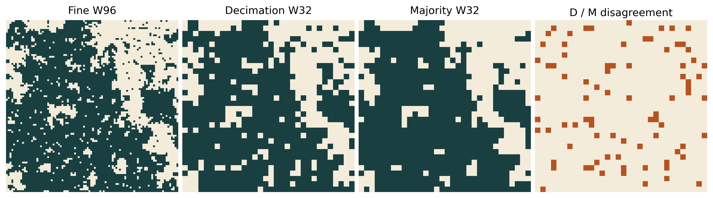

**图1｜真实物理构型，而非模型生成。** 使用历史参考 MC 的预先固定父场（chain 0、ordinal 0），展示中心 $W96$ 细窗口、对应 $W32$ 中心抽点和多数投票，以及逐块分歧图。两种粗图来自同一细图，颜色方向一致，不进行事后全局翻转。图像展示具体映射，整体统计则使用全部 16 条链、2,048 个父场。

### 2.2 约 8.25% 的块分歧对应明显的关联振幅差

在 16 条历史 MC 链、每链 128 个父场的中心裁剪中，D 与 $R_3$ 的分歧率在 $W96$ 为 **8.2523%**，在 $W144$ 为 **8.2719%**。整链重抽样给出的逐项 95% 描述区间分别为 [8.1937%, 8.3081%] 和 [8.2334%, 8.3073%]。这里的统计单位保留链内依赖，不将每个块视为独立重复。

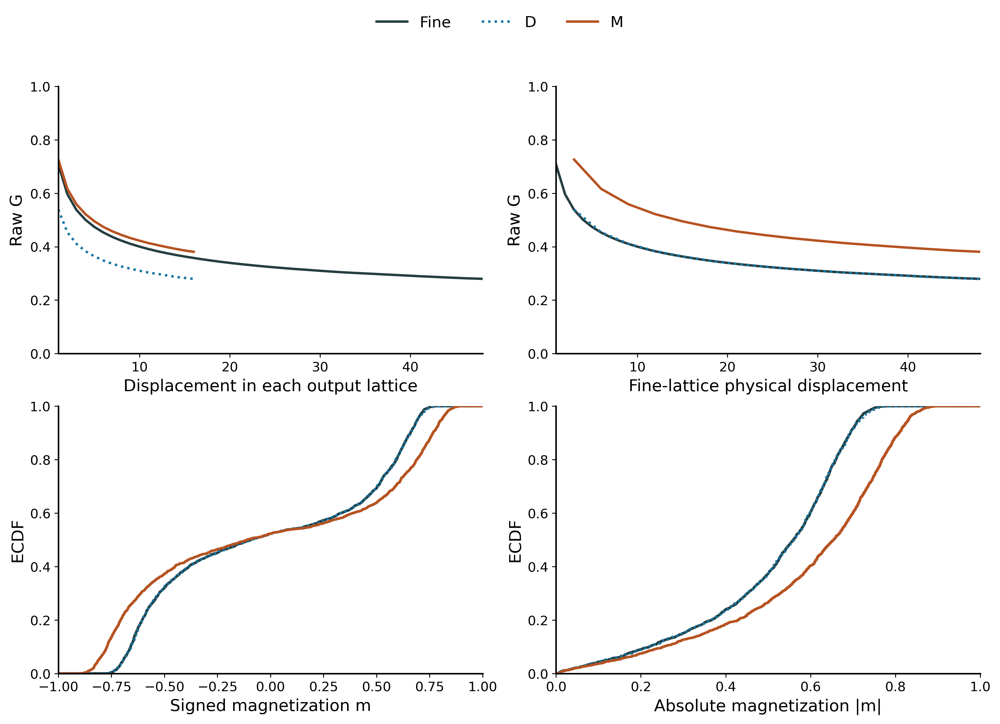

**图2a｜真实 $W96\rightarrow W32$ 的分布变化。** 2,048 个父场、16 条链；细场按细格距离 $r$，粗场按对应物理距离 $3k$ 比较，并保留有符号和绝对磁化统计。D 的中心点对只覆盖特定余数子格，不能在有限样本上要求其平均值与全体细格点对的 $G(3k)$ 逐位相等。

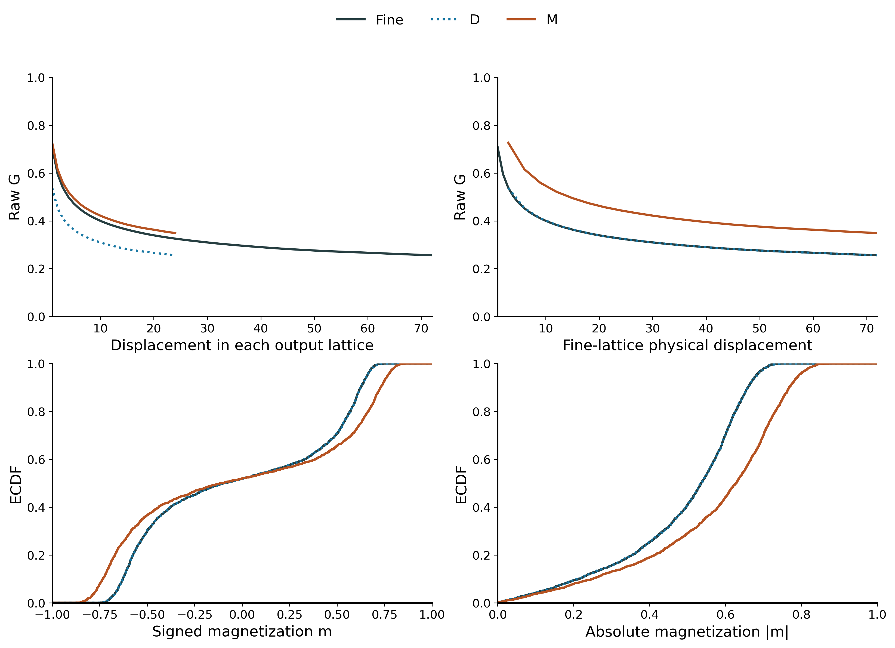

**图2b｜更大真实窗口中的同类现象。** 相同 2,048 个父场，$W144\rightarrow W48$。这是真实 MC 的物理诊断，不是模型在 $W144$ 上的生成实验；本轮 Fresh 模型没有执行 $W144$ 生成。

以 $W96$ 为例，D 的粗最近邻关联为 0.53895，M 为 0.72612；最远粗距离 $k=16$（细格距离 48）分别约为 0.27939 和 0.38080。平均绝对磁化分别为 0.50776 和 0.59231，而细窗口为 0.50756。$W144$ 中也观察到多数投票关联和绝对磁化幅度更大。这里使用全部 2,048 场的物理诊断池，后文模型误差的参考仅使用预定的 256 场；两处均值的小差别不是数据冲突。

分歧率小并不保证二点统计变化小。写 $R_i=D_i\eta_i$（$R_i$ 表示该位置的多数粗自旋），其中 $\eta_i=-1$ 表示该块发生分歧，则

$$
G_R(i,j)-G_D(i,j)=\mathbb E[D_iD_j(\eta_i\eta_j-1)].
$$

一个块的改变会影响所有以它为端点的自旋乘积；变化还与局部环境相关，而不是独立随机翻转。由取值范围可得 $|G_R-G_D|\leq2\Pr(\eta_i\ne\eta_j)\leq2(p_i+p_j)$。若两端边际分歧均约 0.0825，这个示意上界约为 0.33，远大于“只有 8% 的变化”的直觉。开放窗口有效点对的端点权重随距离改变，全格平均分歧率未必等于每个距离的端点边际；0.33 因而不是由本数据直接得到的逐距离严格数值界。该式解释小比例块变化为何容许明显关联差异，但不是对观察差值的精确预测，也不证明特定团簇机制。

多数投票对局部多数方向的选择与更大的绝对磁化相容。然而，本文没有计算块变量对外部环境的互信息，没有拟合新的临界指数，也没有估计完整有效 Hamiltonian；不能据此宣称 M 是对所有任务都更充分的表示。

## 3. 原 RG pilot 学会了粗任务，但没有建立稳定的细场生成收益

### 3.1 原实验研究的是已有几何能力上的迁移

原 RG pilot 从三个已有 I-F 模型的 12,000 步 EMA 权重出发，使用训练 seed 92601、92602、92603。I-F 的历史任务包含连续与非均匀 gap 几何，以及部分稀疏条件更新；它并非只学过连续图像的模型。续训为新增任务嵌入零初始化，并重置 AdamW 状态与随机流。其科学问题是：在已有条件与几何能力之上，粗尺度辅助学习能否产生增量迁移？

| 旧实验臂 | 共同流 | 辅助流 | 共同更新数 | 总更新数 |
|---|---|---|---:|---:|
| Fine-only | 连续细场 | 无 | 2,048 | 2,048 |
| Fine replay | 连续细场 | 从较大父窗中央取连续细场 | 2,048 | 4,096 |
| Fine+RG | 连续细场 | $3\times3$ 多数投票粗场、块中心坐标 | 2,048 | 4,096 |

旧 replay 的辅助仍使用 level 0，而 Fine+RG 的辅助使用 level 1；原 pilot 也没有额外 2% 全 MASK 端点。这两点与 Fresh 配方不同。Fine+RG 与 Fine replay 才是等更新预算的辅助策略对照；Fine-only 用于观察仅保留共同训练流的变化，不能不加说明地当作等计算预算对照。共同和辅助流分别抽取窗口，RG/replay 的辅助样本彼此配对。原实验只评估条件任务，没有新增自由生成图；本报告使用的旧模型生成结果来自后来 RG-2 阶段 A。

原 pilot 的积极结果是粗条件预测可学习，而不是仅改变任务标签。在 $W32$、遮盖时间 $t=0.1,0.5,0.9$ 三档任务等权平均的测试中，seed 92601 的粗 CE 从初始 0.31754 降至 Fine+RG 终点 0.29810，对应 Fine replay 终点为 0.31641；seed 92602 的粗 CE 从初始 0.31934 降至 Fine+RG 终点 0.29860，对应 Fine replay 终点为 0.32329；seed 92603 的粗 CE 从初始 0.31814 降至 Fine+RG 终点 0.29779，对应 Fine replay 终点为 0.31646。这些值由保存的概率与真实粗标签计算，每档先平均各父场和隐藏查询，再对三档等权平均。 对这些粗任务，降低交叉熵表明模型利用了真实粗变量的条件结构。这项科学价值应保留，即使它没有转化成整体细生成优势。

### 3.2 初始—中点—终点揭示了迁移与能力保留的不同方向

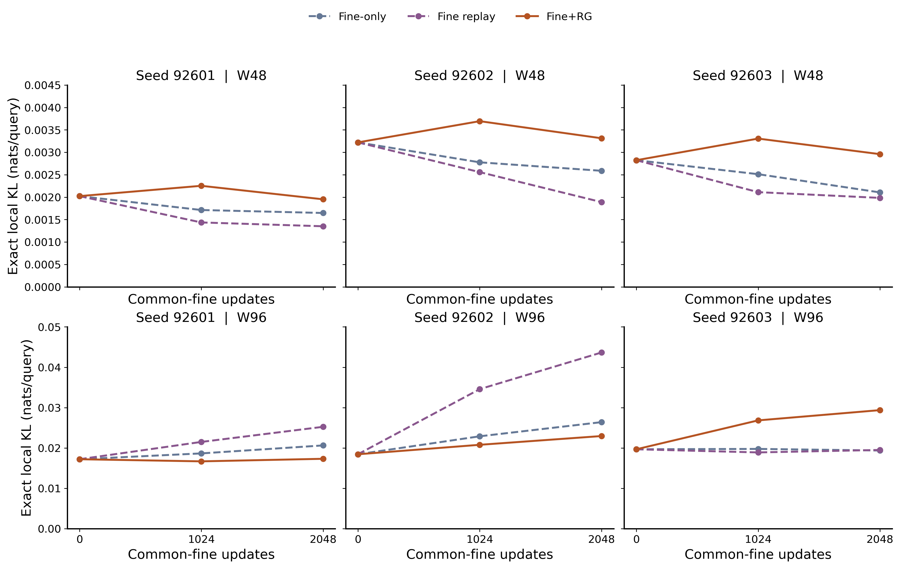

**图5｜旧权重在训练内与外推窗口中的条件能力。** 三个 seed 分别展示；横轴按共同细更新对齐，0、1,024、2,048 对应初始、中点、终点。Fine-only 的总更新与横轴一致，另外两臂总更新为横轴的两倍。每个点对 $n_{\mathrm{mask}}=1,8,32$ 三种精确局部任务等权平均；真值与预测来自实际保存的概率数组。

| 训练 seed | 窗口 | Initial | Fine-only 终点 | Fine replay 终点 | Fine+RG 终点 |
|---|---|---:|---:|---:|---:|
| 92601 | $W48$ | 0.00202280 | 0.00164717 | 0.00135077 | 0.00195209 |
| 92601 | $W96$ | 0.01721050 | 0.02063207 | 0.02524295 | 0.01731926 |
| 92602 | $W48$ | 0.00322114 | 0.00258774 | 0.00188954 | 0.00331327 |
| 92602 | $W96$ | 0.01843843 | 0.02640063 | 0.04366090 | 0.02295614 |
| 92603 | $W48$ | 0.00282368 | 0.00210576 | 0.00198358 | 0.00295891 |
| 92603 | $W96$ | 0.01967585 | 0.01937182 | 0.01950994 | 0.02937690 |

表中为阶段 A0 统一接口重评后的局部精确 KL，越小越好；每个值对 $n_{\mathrm{mask}}=1,8,32$ 三档等权。完整中点与终点数据见图5和 `integrated/data/history_exact_trajectory.csv`。旧 $W96$ 原预测与 A0 重评存在微小浮点差异，二者在数值容差内一致，并非全部概率逐位相同。

原报告中的 Fine+RG 相对 Fine replay 的 $W96$ 局部 KL 平均差约为 −0.00625，但三个旧 seed 的方向并不一致，95% 配对区间跨零。更关键的是，Fine+RG 三个 $W96$ 终点均高于各自 initial，三个 $W48$ 终点均劣于对应 replay；相对退化的 replay 改善并不等于相对初始模型改善。轨迹图同时呈现绝对水平，避免把“较少遗忘”误写成已经建立新的外推能力。

旧几何保留测试还需要区分连续与非均匀布局。原“geometry”集合共有 20 项，其中 7 项是 C48/C96 连续布局，只有 13 项属于 U48/H48/B48/H96 非均匀布局。本次描述性后处理重新分组发现（不是新增预注册检验），Fine+RG 在这 13 项非均匀任务上的平均 CE 相对初始分别增加 **0.00693、0.00591、0.00756**；Fine replay 分别增加 **0.00318、0.00375、0.00309**。Fine+RG 在另外 7 项连续任务上的平均变化却分别为 **−0.00039、−0.00036、−0.00164**。因此，整体 20 项均值掩盖了“连续任务略改善、旧非均匀能力下降”的结构，不能将其笼统称为同一类几何退化。

不同组的可见布局和条件熵不同，因此不以跨组 CE 绝对值判断任务难易，只比较同组权重的变化。这类保留损失与训练任务支持集收缩相容，但还不是遗忘机制的完整因果识别。它不能单独确定是数据布局、任务嵌入、更新预算还是其他因素所致。历史 G、I 实验说明真实间距与几何布局对指定条件任务有影响，同时保留外推失败的反例；它们没有自动证明 RG 粗变量对自由生成有利。HK3 Stage 3 的纯坐标对照提供了设计动机，但使用另一骨干、另一训练配置和一个训练 seed，不与本报告的效应量合并。

### 3.3 旧模型的自由生成没有复现统一优势

阶段 A 对初始模型及三类续训终点分别生成 $W96$ 细场，每个模型在 $S=64,256$ 下各 32 张；旧 Fine+RG 另有直接 $W32$ 粗生成，总计 960 张。256 步时，三个 Fine+RG 模型的细场长程误差均高于对应 initial 和 Fine replay；64 步相对 replay 则一个 seed 改善、两个退化。

| 训练 seed | $S$ | Initial | Fine-only 终点 | Fine replay 终点 | Fine+RG 终点 |
|---|---:|---:|---:|---:|---:|
| 92601 | 64 | 0.04902 | 0.11229 | 0.11929 | 0.09917 |
| 92602 | 64 | 0.20933 | 0.09820 | 0.22988 | 0.37174 |
| 92603 | 64 | 0.22032 | 0.05196 | 0.06866 | 0.10018 |
| 92601 | 256 | 0.03933 | 0.06685 | 0.04843 | 0.15897 |
| 92602 | 256 | 0.37158 | 0.25486 | 0.31268 | 0.41828 |
| 92603 | 256 | 0.33200 | 0.25351 | 0.14409 | 0.43030 |

表中为 $W96$ 细场的 $E_G$（$r=25,\ldots,48$；越小越好）；每个单元对应 32 张生成图，与同一预定 256 场 MC 参考比较。数值来自 `stage_A/A1_metrics.csv`，只作旧三 seed 的描述性比较。

旧训练的 30,720 条更新记录中没有触发梯度裁剪，最大裁剪前范数约 0.648。这排除了“旧实验因频繁触及阈值 1 而改变更新”的解释，却不能排除任务错配、梯度方向变化或联合采样误差。旧暖启动实验与后文 Fresh 实验还同时改变了训练历史与共同流覆盖；不能把两者结果的差别归因于初始化这一个因素。

## 4. 四臂设计怎样分离坐标增强、真实抽点与集体变量？

### 4.1 为什么所有实验臂都保留共同细任务

RG-2 的最终评价对象是细自旋场。因此，每个模型都直接学习连续细场分布，并用一半更新预算执行相同的共同任务；另一半用于辅助任务。这样，四臂具有共同的最终学习目标、相同的总体更新量，以及可解释的辅助策略差别。若只训练粗场然后直接要求细场输出，变量语义变化、编码变化和尺寸外推就会同时发生，难以确定失败来自何处。

保留共同任务是本次研究“辅助训练能否迁移”的实验选择，不是重整化方法的数学必要条件。纯粗场预训练或纯粗场零样本迁移都是不同的学习策略，本轮并没有直接检验它们。

### 4.2 $W32$ 时四臂实际看到了什么

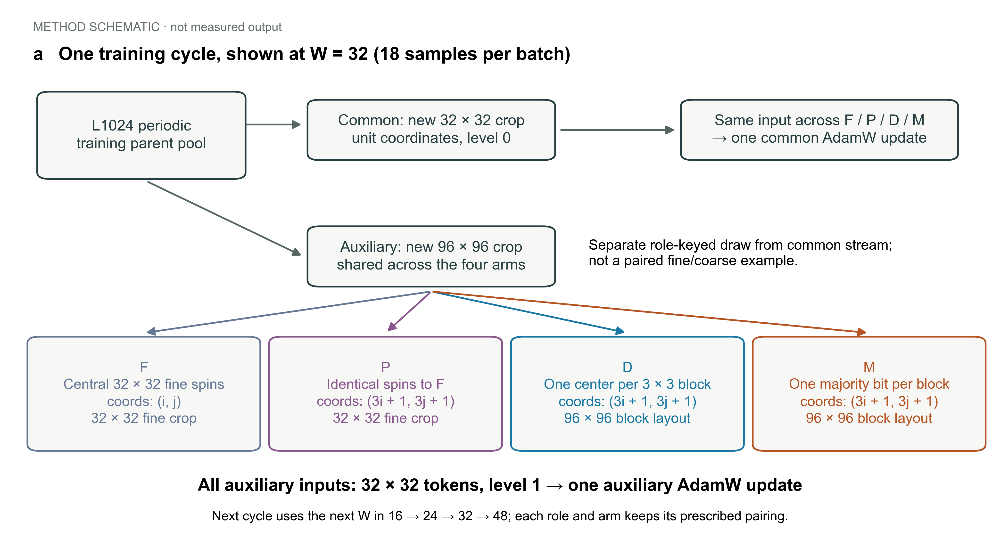

**图3a｜方法示意，不是实验生成图。** 每次共同更新取 $32\times32$ 连续细窗；随后辅助更新另外选择一个 $96\times96$ 父窗口，四臂在该辅助窗口及随机增强上配对。图中区分 token 网格、真实取样区域与编码坐标。共同流和辅助流不要求来自同一父场或同一区域。

父场为周期 $L1024$ 的真实 MC 样本。每个样本的原点在两个轴上独立均匀选取，裁剪索引取模 1024。共同流直接取 $W\times W$ 连续细场。辅助流先取 $3W\times3W$ 的父窗口，再按下表构造网络输入；以下坐标均在对称增强前给出，$i,j=0,\ldots,W-1$。

| 实验臂 | 辅助输入自旋 | 实际取样位置／区域 | 编码坐标 | $W32$ 时的含义 |
|---|---|---|---|---|
| F，Fine replay | 父窗中央的连续细场 | $(W+i,W+j)$ | $(i,j)$ | 1,024 个细自旋，真实和编码轴跨度均为 31 |
| P，RoPE-only | 与 F 逐位完全相同 | 与 F 相同 | $(3i+1,3j+1)$ | 真实跨度仍为 31，编码跨度变成 93 |
| D，Decimation | 每个块中心的细自旋 | $(3i+1,3j+1)$ | 同 P | 取样点覆盖轴跨度 93，属于 $96\times96$ 的块布局 |
| M，Majority | 每个块的多数方向 | 各 $3\times3$ 块的集体变量 | 同 P/D | 从 9,216 个细自旋计算 1,024 个粗自旋，再送入网络 |

四臂送入网络的 token 数都为 $W^2$。D 与 M 使用相同父窗口和块中心布局，但 D 只保留中心取值，M 汇总块内符号。P 的坐标与它的真实细数据间距不匹配，这正是纯编码增强对照的定义，而不是数据预处理错误。坐标使用局部原点，父场的绝对位置不输入网络。

共同与辅助流的随机数键包含不同的任务角色，因此各自随机选择父场和物理窗口；两流偶然选中同一父场当然可能发生，但不存在逐样本配对约束。配对发生在**同一 seed、同一更新周期、同一角色的四个实验臂之间**：父场、原点、翻转、坐标变换、时间与 MASK 都一致。F/P 的辅助标签逐位相同，P/D/M 的辅助编码坐标逐位相同。这个配对层次是解释对照和估计不确定性的基础。

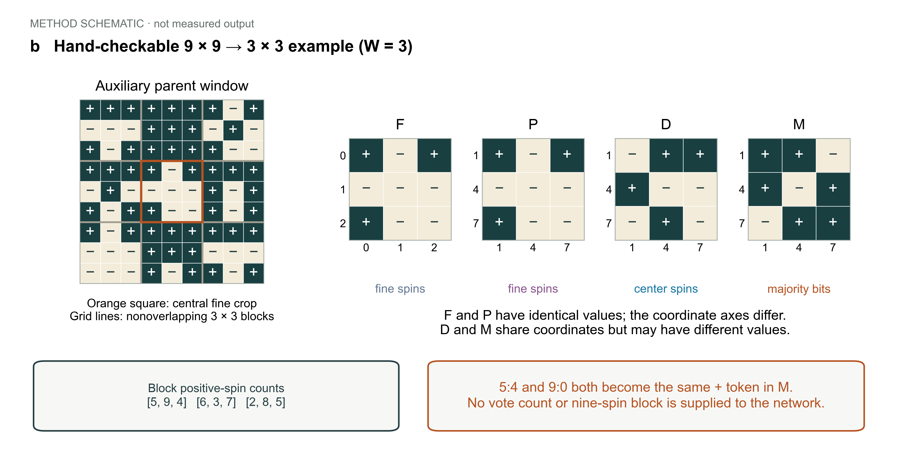

**图3b｜可手算的方法例子。** 使用明确标记的人工 $9\times9$ 数组，分别输出 F/P 的中央 $3\times3$、D 的九个块中心和 M 的九个多数符号；逐项列出编码坐标。该例子仅解释映射，不用于实验统计。完整数组与块内票数保存在 `integrated/data/method_example.json`。

这个人工例子的三个输出可直接写为

$$
F=P=\begin{pmatrix}+&-&+\\-&-&-\\+&-&-\end{pmatrix},\quad D=\begin{pmatrix}-&+&+\\+&-&-\\-&+&-\end{pmatrix},\quad R_3=\begin{pmatrix}+&+&-\\+&-&+\\-&+&+\end{pmatrix}.
$$

九块正票数依次为 $\left(\begin{smallmatrix}5&9&4\\6&3&7\\2&8&5\end{smallmatrix}\right)$。左上块以5:4多数为正但中心为负，因此D与M不同；上中块9:0也映射为正，M输入不能区分这两种多数强度。F/P只取中央连续3×3，自旋相同而编码不同；D/M取九块中心坐标，坐标相同而变量不同。

### 4.3 五个比较对应五种问题，但不是完全因子设计

| 比较 | 直接改变的因素 | 可以回答的问题 | 不能单独得出的解释 |
|---|---|---|---|
| P−F | 辅助编码坐标，自旋标签保持相同 | 纯位置编码尺度增强的总体训练效果 | 增强为何有效、是否来自某个频率分量 |
| D−P | 同编码布局下改变真实取样及目标分布 | 跨较大物理区域抽点相对连续细标签的效果 | 单一的“物理覆盖”效应或坐标匹配因果效应 |
| M−D | 同一块布局下改变随机变量定义 | 多数集体变量相对中心点的增量效果 | 多数位对全部环境的信息含量更大 |
| M−F | 块粗变量与扩大编码的整体辅助策略 | RG 辅助相对等预算细重放的迁移收益 | 收益全部来自真实粗粒化 |
| M−P | 粗标签对连续细标签，两者编码布局相同 | 真实粗变量能否超过纯坐标增强 | 任意粗细建模策略的优劣 |

现有四臂没有加入 D 使用单位编码坐标的 D1。因此，即使 D 与 P 不同，也不能独立证明“正确匹配真实物理坐标”是原因。D−P 同时改变真实点集、物理覆盖和目标联合分布；M−D 改变的则是集体变量定义及其条件结构。四臂建立了必要的机制对照，但不是对全部物理与表示因素的完全析因设计。

### 4.4 从零训练解决了哪一类可比性问题

本轮为 seed 112501、112502 各初始化四个模型；同一 seed 的四臂共享初始参数，却各自独立训练和维护优化器。这样可以研究相同训练起点与预算下的辅助策略效果，避免将已有 I-F 几何能力的保留程度直接混入主比较。

Fresh 与原 pilot 仍是不同研究问题。旧 I-F 有非均匀几何和稀疏条件训练历史，新四臂的共同流为连续细场；旧实验是短程暖启动迁移，新实验是 12,000 次更新的从零训练。本文将它们放在同一证据链中，是为了解释为什么需要新对照，而不是将跨实验差值当作单因素因果效应。

## 5. 模型接收哪些张量，怎样完成一次参数更新？

### 5.1 坐标只直接进入查询和键的旋转

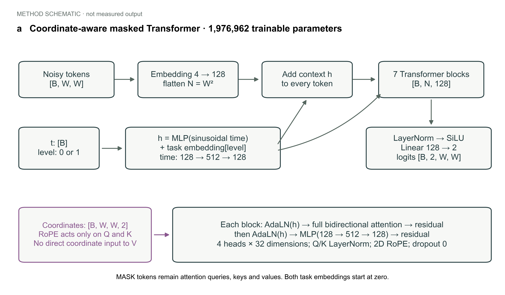

**图4a｜模型结构示意。** 四类 token 嵌入后，加上时间与任务表征；七个双向 dense Transformer block 使用 AdaLN、Q/K LayerNorm 和二维 RoPE。坐标直接旋转 Q/K，不直接写入 V、token embedding 或残差流；它们通过注意力输出间接影响后续表示。输出为每个位置两个自旋类别的 logits。

网络隐藏维度为 128，包含 7 层 Transformer、4 个注意力头，每头 32 维，前馈隐藏维度 512，dropout 为 0。词表为负自旋、正自旋、MASK、PAD 四类；本轮没有 PAD，所有 $W^2$ 个位置都有效。MASK 位置也参与查询、键和值计算，不是仅允许可见自旋充当键值的架构。

时间 $t$ 先经 128 维正弦／余弦特征和 $128\rightarrow512\rightarrow128$ 的 SiLU 多层感知机，得到时间表征；再加共同／辅助任务嵌入的一行，形成条件向量 $h$。两个任务嵌入均零初始化。$h$ 一方面加到初始 token 表征，另一方面调制每层的两个 adaptive layer normalization（AdaLN，自适应层归一化）：

$$
\operatorname{AdaLN}(x;h)=\operatorname{LN}(x)\odot[1+\gamma(h)]+\beta(h).
$$

AdaLN 的基础 LayerNorm 不含可学习仿射，产生缩放和偏移的线性层零初始化。每个注意力头的 Q 和 K 先分别进行可学习 LayerNorm，再将前后各 16 维分别用于两个坐标轴的 RoPE，底数为 10,000。对某一旋转频率，$R(c_i)^\top R(c_j)=R(c_j-c_i)$，因此坐标差影响注意力打分。坐标放大改变这组相位，并不直接改变输入自旋分布。

每层依次执行 AdaLN—全双向注意力—残差，再执行 AdaLN—$128\rightarrow512\rightarrow128$ GELU 前馈网络—残差。末端使用 LayerNorm、SiLU 和两分类线性层。输出线性层的权重与偏置零初始化，因此初始每点预测为 $1/2$。模型含 **1,976,962** 个参数，四臂架构完全相同。

### 5.2 $W32$、batch size 18 的实际张量

| 对象 | Shape | 取值／物理意义 | 是否输入模型 |
|---|---|---|---|
| Noisy tokens | $[18,32,32]$ | 整数 0/1/2，分别为负／正／MASK | 是 |
| Conditioning time | $[18]$ | 每个样本一个浮点时间 $t_b$ | 是 |
| Coordinates | $[18,32,32,2]$ | 行列编码坐标，已做 D4 变换 | 是 |
| Level | 一个 batch 共用整数 0 或 1；内部展开 $[18]$ | 0 为共同任务，1 为辅助任务 | 是 |
| Clean labels | $[18,32,32]$ | 未遮盖的 0/1 自旋标签 | 否，仅用于损失 |
| Loss mask | $[18,32,32]$ | 布尔值，记录哪些位置被遮盖 | 否，仅用于损失 |
| 输出 logits | $[18,2,32,32]$ | 每点两分类未归一化分数 | 模型输出 |

当模型属于 M 且执行辅助任务时，clean/noisy 都是**多数投票后的二值粗场**。网络不接收块内九个自旋、投票数、块内置信度，也不同时接收配对细场。5:4 与 9:0 的同号多数在该接口下不可区分；不能将“输入来自九个自旋”误写成“网络能访问九个细自旋”。

### 5.3 先构造变量，再做对称增强与独立 MASK

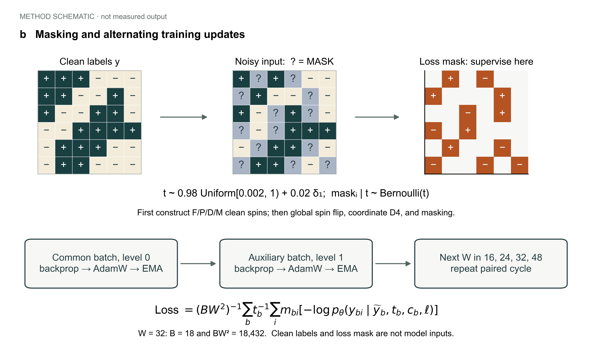

**图4b｜训练机制示意。** 先生成当前任务的 clean 标签，再做全局自旋翻转、坐标对称增强与随机 MASK；只在 MASK 位置监督。共同更新和辅助更新分别执行一次 AdamW 步，不是在同一参数点将两个损失相加后更新一次。图中的小数组只用于说明操作。

每个样本以 $1/2$ 概率执行全局自旋反转，保持零场 Ising 的 $\mathbb Z_2$ 对称性。D4 对称增强在实际代码中作用于**坐标**：以相同概率选择轴交换、第一坐标符号反转、第二坐标符号反转的八种组合；不调用图像旋转来重新排列自旋数组。它改变输入内容相对于空间方向的表示，同时保留该样本的 token 和 MASK 索引。

时间先逐样本采自 $U[0.002,1)$，再以独立概率 2% 置为 $t=1$。对每个 token 独立生成遮盖指示 $a_{bi}\sim\operatorname{Bernoulli}(t_b)$，用 MASK 替换对应标签。端点样本因此全 MASK。训练使用抽到的 $t_b$，不会用实际隐藏比例 $n_{\mathrm{mask}}/W^2$ 替换它。M 的多数投票发生在细场被遮盖之前：先计算粗标签，再对粗 token 遮盖，避免将“部分可见细块投票”混成另一种任务。

### 5.4 实际损失是逆时间加权的 masked cross-entropy

以 $q_\theta$ 表示模型的两分类 softmax，$y_{bi}\in\{0,1\}$ 为当前任务的 clean 标签，实际 batch 损失为

$$
\widehat{\mathcal L}(\theta)=\frac{1}{BW^2}
\sum_{b=1}^{B}\frac{1}{t_b}\sum_{i=1}^{W^2}
a_{bi}\left[-\log q_\theta(y_{bi}\mid\widetilde y_b,t_b,c_b,\ell)\right],
\qquad BW^2=18,432.
$$

只监督被 MASK 的位置，是因为这些位置需要从条件上下文恢复；可见标签作为条件参与网络计算。乘以 $1/t_b$ 对随时间变化的监督位置数量作补偿，使低遮盖率样本不会仅因 MASK 少而几乎没有权重。分母是**整个 batch 的 token 数**，不是这次随机出现的 MASK 数。由于条件上下文本身也随 $t$ 改变，不能将 $1/t$ 理解为使所有时间下的学习问题完全相同。

M 辅助任务的预测目标是每个块的多数符号，而非其中心自旋或原始九位排列。该目标属于 absorbing-mask diffusion 的逆时间去噪风险家族，和混合 masked-language-modeling 损失具有相同形式上的联系。[Sahoo 等，2024](https://arxiv.org/abs/2406.07524)。但这里采用截断时间区间并额外加入全 MASK 端点质量，不能直接宣称它就是完整、未经修改的连续时间负证据下界（NELBO）。本文依照实际损失解释结果。

### 5.5 统一训练配置及更新顺序

| 配置 | 本轮 Fresh 四臂实际使用值 |
|---|---|
| 数据 | $L1024$ 周期临界 Ising；训练全局链 0–5、768 个父场，验证链 6–7、256 个父场；每链 128 场 |
| 模型 | 7 层，隐藏 128，4 头，前馈比 4，二维 RoPE 底 10,000，两个零初始化任务嵌入 |
| 独立训练重复 | seed 112501、112502；每个 seed 的 F/P/D/M 共享初始化 |
| 更新总数 | 每模型 12,000，common/aux 各 6,000；8 模型共 96,000 |
| 宽度与 batch | $W16/72$、$W24/32$、$W32/18$、$W48/8$；每更新 18,432 token |
| 宽度调度 | 按 16、24、32、48 循环；一个周期先 common 后 aux，两步使用同一宽度；每流每宽度 1,500 更新 |
| 总 token 暴露 | 每模型 221,184,000；全体 1,769,472,000，不是独立物理样本数 |
| 优化器 | AdamW，$\beta_1=0.9,\beta_2=0.95$，weight decay 0.05，默认 $\epsilon=10^{-8}$，fused=False |
| 学习率 | 750 步线性预热到 $3\times10^{-4}$，随后余弦下降至 $3\times10^{-5}$ |
| 梯度与精度 | 全参数二范数裁剪阈值 1；BF16 前向，FP32 参数／损失／梯度；TF32 关闭 |
| EMA | 每步更新 $\bar\theta\leftarrow0.999\bar\theta+0.001\theta$ |
| 检查点 | 每 500 步保存恢复状态，4k/8k/12k 另存 raw、EMA、AdamW 和随机状态 |
| 主评价权重 | 预先规定的 12k EMA，不依据验证曲线事后选最佳模型 |
| 验证／梯度诊断 | 验证在 step 0 及每 1,000 步；梯度每 1,000 步、首次 1,000；验证是四个宽度的固定共同流批次，梯度诊断仅一对固定 $W48$ 批次 |

一次共同更新依次执行清梯度、前向、反向、裁剪、AdamW 更新和 EMA 更新；下一次辅助更新从已经改变的参数和优化器状态出发。两种任务共享主干参数及同一套 AdamW 状态，任务嵌入为同一矩阵的两行。四个实验臂则是四个独立模型，优化器并不跨臂共享。

当前 M 学到的是在共享表示中同时拟合细场和粗变量的条件分布。它没有配对粗细条件训练、没有由粗场恢复细场、没有细粗 token 信息交换、没有显式跨尺度一致性损失，也没有先粗后细的层次化生成过程。这些差别决定了后文负结果可以约束的机制范围。

## 6. 从全 MASK 生成细场，以及怎样判断物理真实性

### 6.1 四臂使用同一个单尺度生成过程

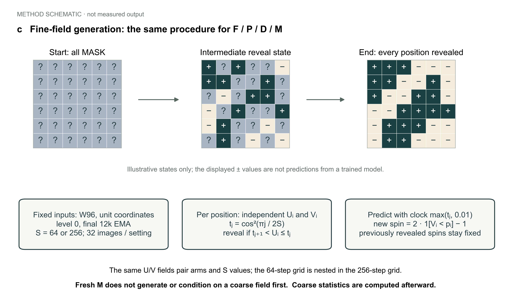

**图4c｜生成机制示意。** 所有 Fresh 模型从 $W96$ 的全 MASK 场出发，以 level 0 和单位间距坐标生成细自旋；没有先生成粗场的步骤。两个预分配均匀随机场分别决定揭示时刻与自旋抽样，已揭示自旋不再修改。示意中显示的时间步数用于说明算法，正式评价使用 $S=64$ 或 256。

令 $t_j=\cos^2(\pi j/(2S))$，$j=0,\ldots,S$，并将端点显式设为 $t_0=1,t_S=0$。实际实现先建立 256 步网格，64 步取其每四个端点，因此两档日程严格嵌套。每个像素位置 $i$ 在生成前获得独立的 $U_i,V_i\in(0,1)$：前者决定在哪一步揭示，后者决定揭示时选择哪个自旋。

第 $j$ 步用当前整场 $x^{(j)}$、单位坐标和网络条件时间 $\widehat t_j=\max(t_j,0.01)$ 计算 $p_i^{(j)}=q_\theta(s_i=+1\mid x^{(j)},\widehat t_j,c,\ell=0)$。当

$$
t_{j+1}<U_i\leq t_j
$$

时，该位置被揭示并写为 $+1$ 若 $V_i<p_i^{(j)}$，否则写为 $-1$；其余位置保持不变。条件时间下限只限制网络输入，**不会将揭示日程截断在 0.01**，最后所有 MASK 都被揭示。每步同时揭示的多个位置按照各自的单点概率独立抽样，是对联合条件分布的近似。

同一训练 seed、窗口宽度和样本 ID 的四臂及两档 $S$ 共用同一 $U,V$。这减少比较中的采样随机差异，但不保证生成图逐像素相同，因为不同模型和日程访问的条件历史不同。$W96$ 与旧诊断的直接 $W32$ 生成使用不同宽度随机键，不存在逐像素配对。所有 Fresh 评价使用最终 EMA、FP32、关闭 TF32、batch size 1，无额外温度缩放；每臂每 seed 每档 $S$ 有 $n_{\mathrm{gen}}=32$，共 512 张。

### 6.2 开放观测窗口中的关联、磁化与能量

训练父场具有周期边界，但本文对裁剪窗口和生成图的统计**不跨越窗口边界**。对一张 $W\times W$ 图 $s$，距离 $r\geq1$ 的轴向关联定义为

$$
G_s(r)=\frac{\sum_{i=0}^{W-r-1}\sum_{j=0}^{W-1}s_{ij}s_{i+r,j}
+\sum_{i=0}^{W-1}\sum_{j=0}^{W-r-1}s_{ij}s_{i,j+r}}{2W(W-r)}.
$$

先合并水平与垂直有效点对，再对图像等权取平均得到 $G(r)$；$G(0)=1$。这里使用轴向距离，不是径向分箱。正文展示 $r=1,\ldots,W/2$ 全曲线，并用长距离区间 $I$ 上的相对误差概括：

$$
E_G(I)=\sqrt{\frac{\sum_{r\in I}[G_{\mathrm{gen}}(r)-G_{\mathrm{MC}}(r)]^2}
{\sum_{r\in I}G_{\mathrm{MC}}(r)^2}}.
$$

细 $W96$ 使用 $I=\{25,\ldots,48\}$；同图多数投票后的粗 $W32$ 使用 $I=\{9,\ldots,16\}$，对应细格物理距离 27–48。分母使用该尺度真实 MC 的关联，而非生成模型自己的幅度。它衡量所选距离区间上的曲线偏差，不能替代全距离曲线或整个分布的距离。

每图磁化、平均每键能量和最近邻异号键比例为

$$
m_s=\frac1{W^2}\sum_i s_i,\qquad
e_s=-\frac1{2W(W-1)}\sum_{\langle i,j\rangle\text{ in window}}s_is_j=-G_s(1),
$$

$$
p_{\mathrm{wall},s}=\frac1{2W(W-1)}\sum_{\langle i,j\rangle}\mathbf1\{s_i\ne s_j\}
=\frac{1-G_s(1)}2.
$$

$m$ 描述全局正负方向，$|m|$ 描述有序程度，$e$ 与 $p_{\mathrm{wall}}$ 则直接约束局部相邻关系。这里能量按**键数**归一，不是按格点数。对粗场计算的 $-G(1)$ 只是粗变量的近邻乘积负均值；粗粒化通常引入更复杂的有效相互作用，不能将它直接等同于原始细格 Hamiltonian 的物理能量。

### 6.3 连通关联与分布距离各有作用

本文使用全局均值版本的系综连通关联估计

$$
G_c(r)=G(r)-\bar m^2,\qquad \bar m=\frac1{n_{\mathrm{gen}}}\sum_a m_a.
$$

在平移均匀的目标分布下，这对应通常的均值扣除；对可能非平移均匀的模型分布，它不等于逐位置扣除 $\mu_i\mu_j$ 的一般连通函数。这个量先在系综层面估计均值；不能对每图减去自己的 $m_a^2$ 后再平均来替代它。两者相差样本间磁化涨落，逐图中心化会消去临界系统的重要长波／零模贡献。有限样本中 $\bar m^2$ 还有偏差；因此保存的补充统计使用不同独立生成图间的磁化乘积估计均值平方，MC 则使用不同链的链均值乘积。相关曲线仍受有限图数和 MC 不确定性影响，不能因一次中心化后接近参考就宣布分布正确。

对磁化、有符号能量等一维经验分布，使用一阶 Wasserstein 距离

$$
W_1(P,Q)=\int_{-\infty}^{\infty}|F_P(x)-F_Q(x)|\,dx.
$$

它比较整条累积分布而不是只比较均值。本文分别报告 $W_1(m)$、$W_1(|m|)$、$W_1(e)$，不把三者和 $E_G$ 合成为没有明确物理意义的总分。

### 6.4 精确局部 KL 检验的是已知邻域条件能力

当目标自旋 $s_i$ 的四个最近邻均可见时，最近邻 Ising 的精确条件为

$$
p_i^*=\Pr(s_i=+1\mid s_{\partial i})=
\frac1{1+\exp[-2\beta_c\sum_{j\in\partial i}s_j]}.
$$

精确局部任务在 $W48$、$W96$ 的独立参考窗口中选取 $n_{\mathrm{mask}}=1,8,32$ 个目标；这些位置互不最近邻，且不位于观测窗边缘，保证四邻域全可见。使用 $t=\max(n_{\mathrm{mask}}/W^2,0.002)$，对每个目标计算 Bernoulli forward KL：

$$
D_{\mathrm{KL}}(p_i^*\Vert q_i)=p_i^*\log\frac{p_i^*}{q_i}
+(1-p_i^*)\log\frac{1-p_i^*}{1-q_i}.
$$

每种窗口／隐藏数配置有 256 个参考场，先在场内对目标等权，再对场取平均；正文的窗口级 KL 对三个隐藏数配置等权。普通条件 CE 则用实际标签 $y_i$ 计算 $-[y_i\log q_i+(1-y_i)\log(1-q_i)]$，不需要精确真值概率，也不等同于 KL：它包含目标条件熵及样本波动，比较必须在相同任务上进行。

这类精确局部任务的真值只依赖四邻域，因此很适合检验尺寸扩大后是否仍正确使用局部信息，却不能直接证明网络学习了长程联合分布。相反，当远处未知自旋被边缘化而最近邻也不全可见时，条件问题发生变化；不能把局部公式无条件套用到任意遮盖布局。

## 7. Fresh 四臂的生成构型与完整关联曲线

### 7.1 固定样本身份下的实际细场及粗化结果

下面四幅图使用预登记样本 ID 0，按两个训练 seed 和两档采样步数全部展示。每列上方为 $W96$ 细图，下方为该图的 $3\times3$ 多数投票 $W32$ 粗图，标注实际磁化与近邻乘积统计。真实 MC 图使用固定参考父场；它不与模型输出做逐像素误差比较。

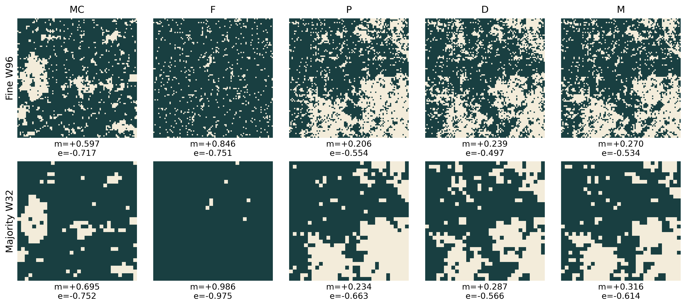

**图6a｜seed 112501，$S=64$。** MC、F、P、D、M 使用相同配色和方向；模型间共享随机身份。此单图用于观察空间结构，分布结论使用每臂全部 32 图。

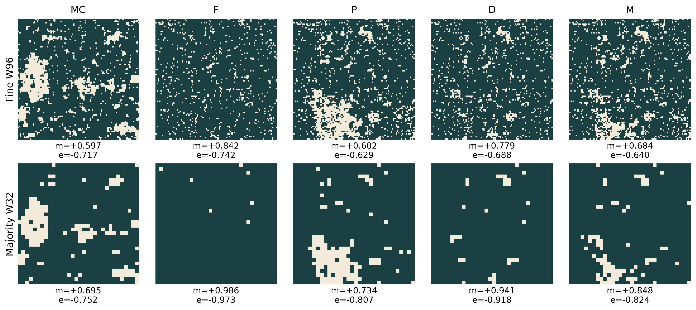

**图6b｜seed 112501，$S=256$。** 与图6a 使用相同生成 ID 和配对随机场，日程不同，因此构型可以不同。没有按外观选择较有利的一张图。

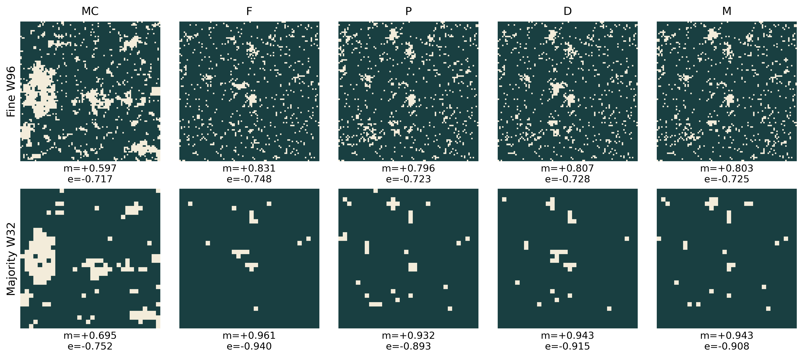

**图6c｜seed 112502，$S=64$。** 与第一训练 seed 分开展示，避免将构型差异误当成更多独立训练重复。

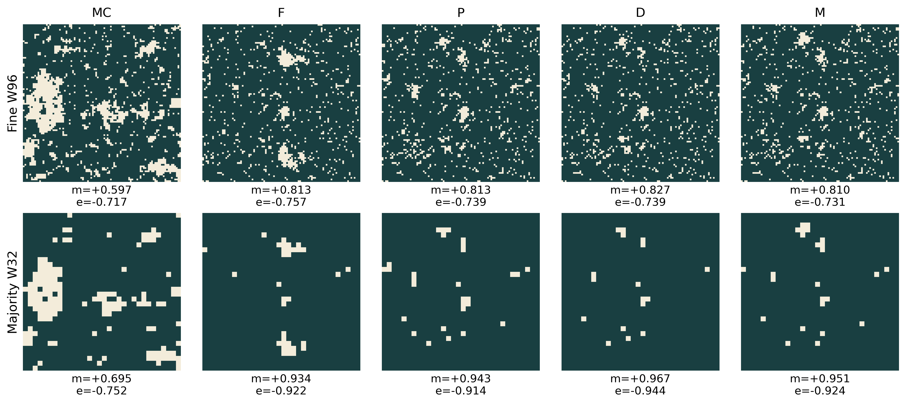

**图6d｜seed 112502，$S=256$。** 粗图严格来自正上方细图。完整原图版还保留预登记 ID 1、2、3；本次没有更换样本选择规则。

这些构型可直观提示局部细碎结构或大尺度有序，但单个图像不能确定团簇统计、模式缺失或总体优劣。下面用完整关联曲线、磁化和能量分布检查这些视觉印象。

### 7.2 256 步下 F/D 过关联，P/M 降低幅度但仍有 seed 依赖

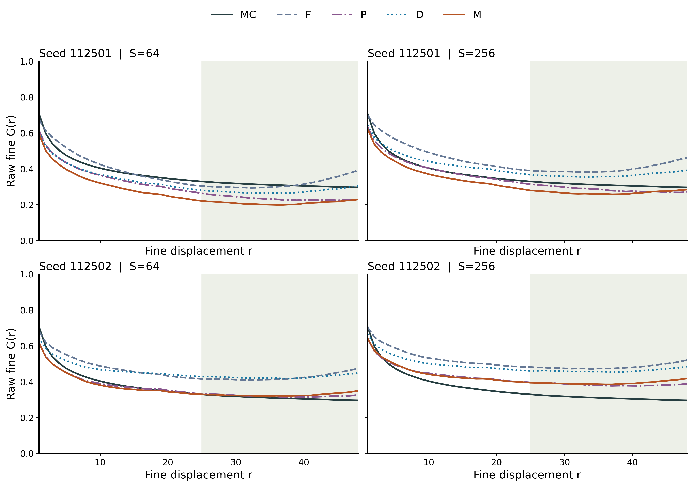

**图7｜细场原始两点关联。** 行为两个训练 seed，列为 $S=64,256$；每条模型曲线使用 32 张 $W96$ 图，MC 使用独立于训练的 8 条历史奇数链各前 32 场，共 256 场。五条曲线使用统一颜色／线型和共同纵轴，阴影标记主距离 $r=25\ldots48$。不显示含义不明的误差条，训练重复直接分面呈现。

**256 步的共同现象是 F、D 在主距离区间逐点高于 MC。** 对 seed 112501，F 的曲线相对 MC 偏高约 0.060–0.165，D 偏高约 0.037–0.095；对 seed 112502，F 偏高约 0.152–0.224，D 偏高约 0.132–0.188。这些差值描述原始关联振幅，不是误差条。部分曲线远端回升也不符合当前参考曲线的缓慢下降，表明仅增加揭示步数没有自动恢复真实长程结构。

P、M 降低了上述关联幅度，但降到哪里取决于训练 seed。112501 的两臂在整个主区间均低于 MC，112502 则均高于 MC。因此，不能将 P/M 概括为“正确消除过关联”，也不能统一称为“欠关联”。它们在相同采样预算下的残余偏差和曲线形状仍须分别评价。

64 步展示了这一结论的条件性：112501 的 F、D 曲线在主区间穿过参考，P、M 则整体偏低；112502 的 F、D 明显偏高，P、M 更接近参考。将两个 seed 先平均可能掩盖这种方向反转，也会隐藏采样步数与训练策略的交互。

### 7.3 逐 seed 效应量：M 相对 F/D 的收益没有超过 P

表1列出上述完整曲线在预定主区间的 $E_G$，越小越好。

| 训练 seed | S | F | P | D | M |
|---|---|---|---|---|---|
| 112501 | 64 | 0.12150 | 0.24226 | 0.12573 | 0.32458 |
| 112501 | 256 | 0.31061 | 0.08309 | 0.18789 | 0.14157 |
| 112502 | 64 | 0.38292 | 0.04334 | 0.37939 | 0.07467 |
| 112502 | 256 | 0.56416 | 0.23981 | 0.49322 | 0.27685 |

表2给出同 seed 配对差，均为“左臂误差减右臂误差”，负值表示左臂更好。

| seed | S | P−F | D−P | M−D | M−F | M−P |
|---|---|---|---|---|---|---|
| 112501 | 64 | +0.12076 | -0.11653 | +0.19885 | +0.20308 | +0.08232 |
| 112501 | 256 | -0.22751 | +0.10480 | -0.04633 | -0.16904 | +0.05848 |
| 112502 | 64 | -0.33958 | +0.33605 | -0.30472 | -0.30825 | +0.03133 |
| 112502 | 256 | -0.32436 | +0.25341 | -0.21636 | -0.28731 | +0.03705 |

在 $S=256$ 下，M−F 分别为 −0.16904、−0.28731，M−D 为 −0.04633、−0.21636；两项比较在两个 seed 上方向一致。但 M−P 分别为 **+0.05848、+0.03705**，说明同编码布局下 M 的主误差仍大于 P。P−F 同时为负，而 D−P 为正；这些观察要求保留纯坐标对照，不能把相对 F 的全部改善归因于真实粗粒化。

在 $S=64$ 下，M−F 和 M−D 都随 seed 反转，M−P 则仍为正。因而“256 步时 M 在两个 seed 上优于 F/D”是准确的开发观察，“M 稳定优于 F/D”却超出了数据。以 112501、256 步为例，F 的误差从 0.31061 降至 M 的 0.14157：绝对差为 −0.16904，即相对误差尺度上的 **16.90 个百分点**；相对 F 本身则减少约 **54.42%**。两种百分数分母不同，不应互换。

所有已保存的开发性联合 95% 区间均跨零，完整结果与算法保留于附录 C。只有两个训练 seed，不能把复杂重抽样当作训练重复充分的替代物；同样，未获得确认也不等于证明各臂等效。

### 7.4 同一张细图的粗统计保留了主要排序，但不是细图正确性的充分条件

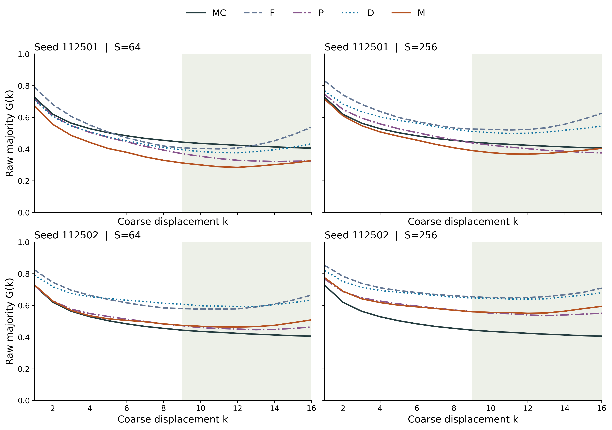

**图8｜$W96\rightarrow W32$ 的粗关联。** 布局与图7一致；每个粗样本来自对应细样本，MC 参考也执行相同多数投票。粗格距离 $k=9\ldots16$ 对应细格物理距离 $3k=27\ldots48$。不能以未经粗化的 $W32$ 细窗口充当这里的真值。

| 训练 seed | S | F | P | D | M |
|---|---|---|---|---|---|
| 112501 | 64 | 0.14230 | 0.20524 | 0.09224 | 0.28881 |
| 112501 | 256 | 0.32076 | 0.05358 | 0.22561 | 0.10776 |
| 112502 | 64 | 0.43394 | 0.08430 | 0.43574 | 0.13979 |
| 112502 | 256 | 0.57725 | 0.29396 | 0.54476 | 0.33934 |

256 步下粗场误差的方向与细场相同：M 在两个 seed 上均优于 F、D，又均弱于 P；64 步下 M 相对 F、D 仍随 seed 反转。这个结果说明部分长程改善在同图粗化后仍可见，而不是只出现在某一个细距离汇总值中。

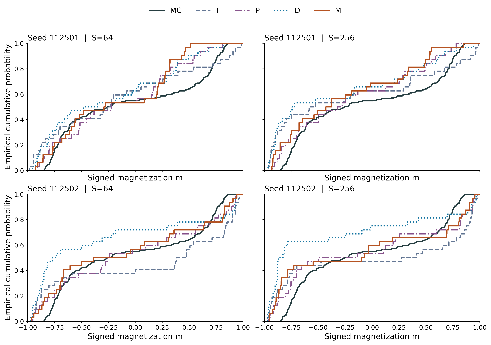

**图9a｜粗场磁化经验分布。** 每个分面分别保留训练 seed 与采样步数，比较真实细场粗化和各模型细场粗化后的磁化，不对各图做正负翻转。

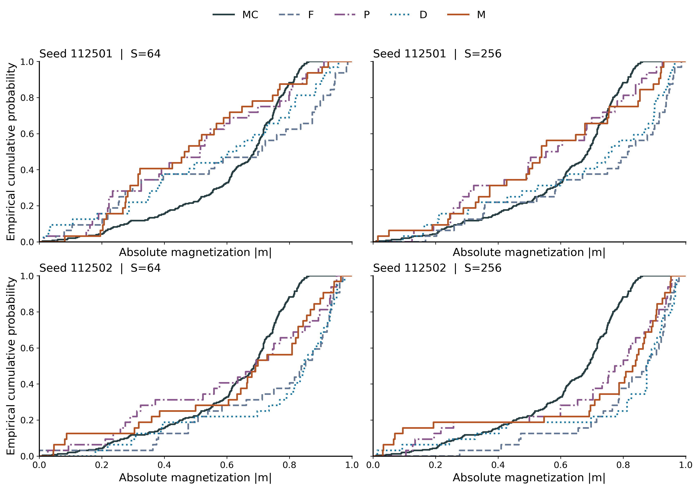

**图9b｜粗场有序程度。** 与图9a使用完全相同样本，显示 $|m|$ 的经验分布。粗图压缩了块内信息，统计接近参考不能据此证明细图的局部物理已经正确。

一个明确反例是先生成某个粗图，再将每个粗自旋复制成九个同号细自旋：再次多数投票会精确还原粗图，但细图块内异号键比例被强制为零。因此，粗尺度真实性、细尺度真实性与跨尺度自洽必须分别检验。

## 8. 长程关联改善伴随着怎样的局部物理代价？

### 8.1 更低的长程误差可以同时伴随更多异号近邻键

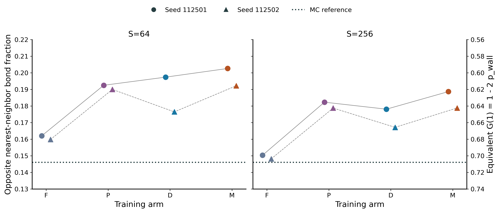

**图15a｜局部物理的直接量。** 按 seed、采样步数和实验臂展示 $G(1)$ 及由同一图像精确推得的异号键比例 $(1-G(1))/2$；MC 水平线来自实际用于模型比较的 256 场。两项是同一近邻统计的不同表达，不应当作两个独立成功指标。

在 256 步时，MC 的异号键比例为 **0.14604**。F 的两个 seed 为 **0.15033、0.14818**，接近该参考；P 为 **0.18232、0.17876**，M 为 **0.18869、0.17880**，均高于 F 和 MC。D 为 **0.17810、0.16716**，也偏高。P/M 的局部涨落在这个可直接计数的意义上过多，细场平均每键能量相应更不负。

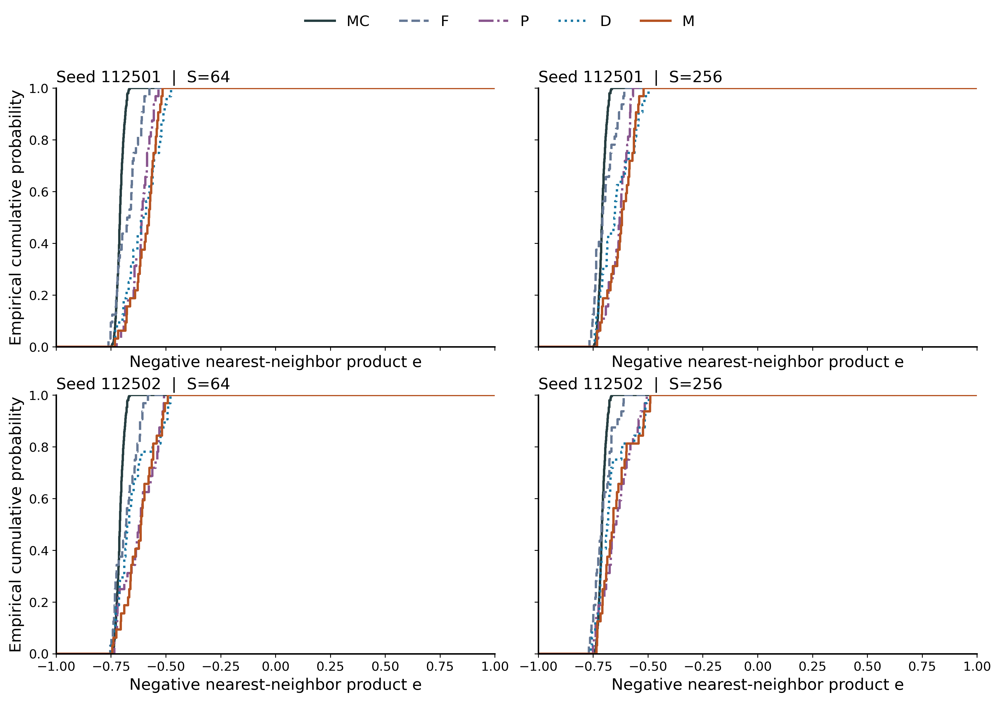

**图9c｜每键能量的完整取值范围。** 横轴保留理论范围 $[-1,1]$，比较全部生成样本和 MC，不只比较均值。

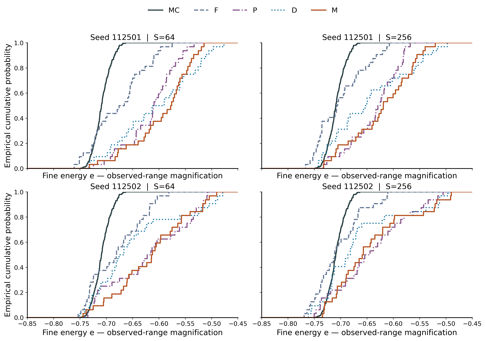

**图9d｜能量分布局部放大。** 明确标注放大区间 $[-0.85,-0.45]$，覆盖本轮所有生成与参考样本的实际能量；图9c同时保留完整范围。读者可以看到不同实验臂的分布位置与形状，而非只看一项距离。

能量分布差异也体现在 Wasserstein 距离上。256 步时 F 的两 seed 为 0.02485、0.02201，M 为 **0.08530、0.06560**；64 步时 M 相对 F 的能量距离同样更大。最近邻统计和分布距离共同支持“相对 F 存在局部代价”，但不直接证明具体的团簇破碎过程；团簇大小、连通性、界面形状尚未测量。

### 8.2 平均磁化接近零，并不能证明磁化分布正确

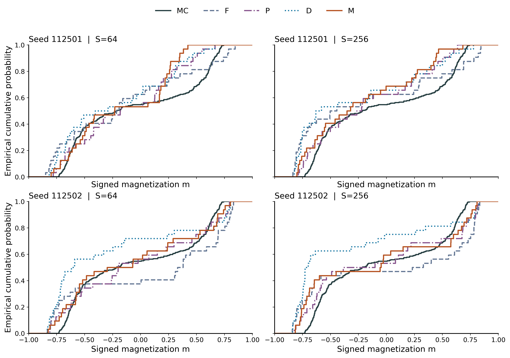

**图9e｜保留符号的磁化分布。** 每条曲线使用完整 32 图；MC 为 256 场。零外场的对称性是总体分布性质，有限参考本身的平均磁化也不严格为零。

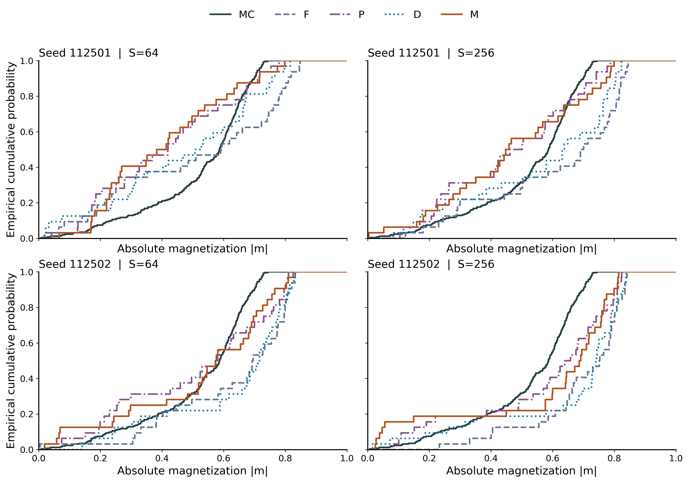

**图9f｜有序程度与符号偏置分开检查。** $|m|$ 消去符号但保留磁化幅度；结合图9e区分“过度有序”和“正负质量不平衡”。

D 的四种 seed／步数组合均出现负向样本平均磁化，约为 −0.223、−0.278、−0.268、−0.329；这些有限样本提示符号不平衡，需要更多生成图检验，尚不足以认定模型分布确实缺失某一模式。另一个有用反例是 seed 112502、256 步的 F：平均 $m$ 约 0.018，接近零，但平均 $|m|$ 约 0.691，明显高于 MC 的 0.527。正负两侧都过度有序也可以使平均值相互抵消。

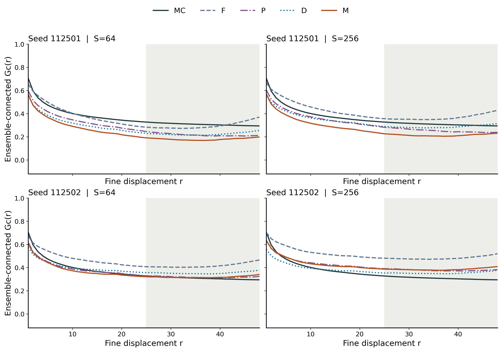

**图15b｜均值扣除改变了哪些曲线。** 与图7使用同一系综，按 $G_c=G-\bar m^2$ 计算，不能逐图中心化。D 的较大样本磁化均值会造成更大的扣除，因此原始关联与连通关联可能给出不同的数值排序；这种变化不能单独证明 D 的联合分布更好。

### 8.3 能量与长程误差形成真实的二维权衡

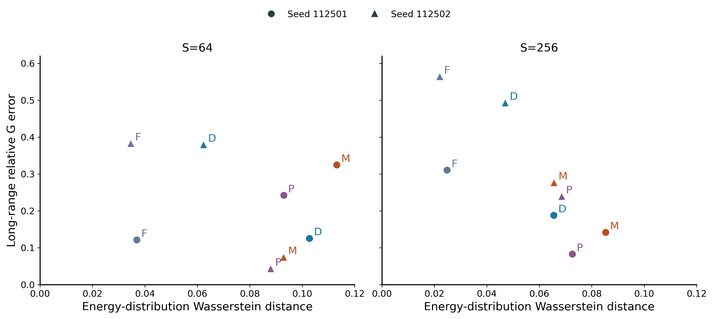

**图10｜每个点是一臂下的一次训练重复。** 横轴为 $W_1(e)$，纵轴为细场 $E_G(25\!:\!48)$，分别显示两档 $S$；圆点和三角区分两个训练 seed。左下方向同时改善两类物理统计。每个点的统计基于 32 图，但不是 32 个独立训练重复；图中没有人为合成总分。

256 步下，F 的点靠左但较高，P/M 往往向右下移动：长程误差降低，能量分布误差增加。M 对 P 也没有形成一致支配关系；112502 的 M 能量距离略小于 P，但长程误差更大。64 步的 112501 则显示 M 在两轴上都弱于 F，提醒我们这个权衡并非每种设置都会换来有价值的长程收益。

这不是从一个总分挑选“最佳模型”的问题，而是要明确最终用途允许怎样的局部偏差。当前尚未冻结逐项非劣界限，因此不能在看到结果后以某个任意加权组合宣布总体成功。

### 8.4 局部条件 KL 显示所有 Fresh 模型仍有尺寸外推困难

| seed | 臂 | W48 局部 KL | W96 局部 KL |
|---|---|---|---|
| 112501 | F | 0.001245 | 0.104234 |
| 112501 | P | 0.001837 | 0.086455 |
| 112501 | D | 0.002644 | 0.126668 |
| 112501 | M | 0.002163 | 0.099393 |
| 112502 | F | 0.001892 | 0.099013 |
| 112502 | P | 0.002572 | 0.092629 |
| 112502 | D | 0.003227 | 0.128609 |
| 112502 | M | 0.002177 | 0.112936 |

$W48$ 的平均 KL 约在 0.0012–0.0032，$W96$ 则约在 0.086–0.129。四臂共同验证损失确实下降，并不意味着精确条件能力在更大窗口中被完整保留。P 的 $W96$ KL 点估计在两个 seed 上都低于 F；M 相对 F 一个改善、一个退化，D 两个都更差。局部 KL 与长程生成误差没有一一对应关系，不能只凭某一项替代其他物理评价。

这些 Fresh 模型的 $W96$ KL 高于旧 I-F 初始权重的约 0.017–0.020，但旧模型接受了不同几何与稀疏条件训练。该差异只能作为背景性观察，不能归因于是否使用多数投票或是否暖启动这单一因素。

## 9. 单点预测、联合采样与跨尺度自洽的机制诊断

### 9.1 直接粗生成与细生成后粗化回答不同问题

旧 Fine+RG 权重允许比较三条路径：真实细场经 $R_3$ 得到粗参考；模型以 level 0 生成 $W96$ 细场后经 $R_3$ 得到 $W32$；同一权重以 level 1、块中心坐标直接生成 $W32$ 粗场。后两条路径各有 32 张样本。这里检验的是**旧 Fine+RG**，不是 Fresh M；当前八个 Fresh 模型只执行了统一的细场生成。

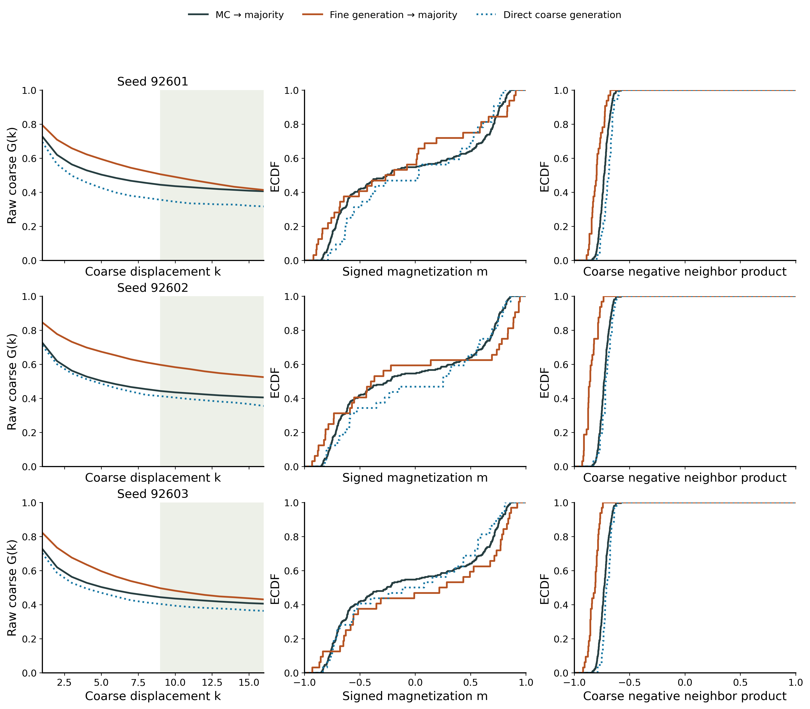

**图11a｜旧 Fine+RG 的三路径，$S=64$。** 三行对应旧训练 seed，逐行展示完整粗关联、磁化与负近邻乘积的经验分布。真实参考始终来自真实细场的多数投票；直接粗生成的坐标间隔为 3，不能改用单位间隔细场作参考。

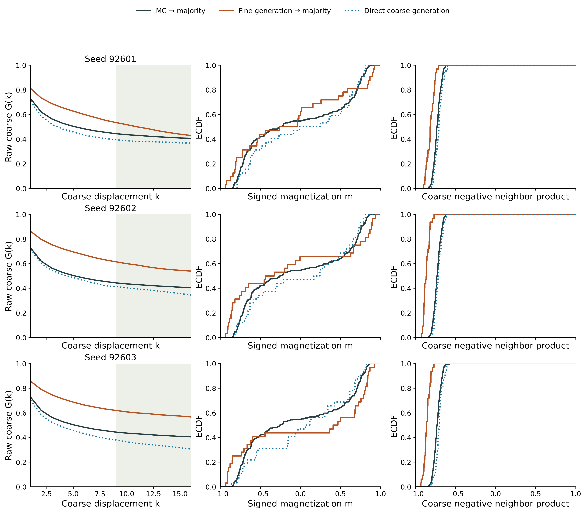

**图11b｜同一批旧权重的 $S=256$ 诊断。** 对比细生成后粗化与直接粗生成，保留与图11a相同的行、列和颜色语义。粗图的负近邻乘积仅为统计量，不是原细格 Hamiltonian 的每键能量。

在 256 步下，细生成后粗化／直接粗生成的长程误差分别为：92601 的 **0.14143／0.10443**，92602 的 **0.35509／0.10117**，92603 的 **0.39833／0.19494**。三个点上直接粗生成都更接近真实粗关联；64 步下则没有完全相同的排序。磁化和近邻分布仍有残余偏差，不能仅凭较小的关联误差认定直接粗生成已经正确。

这个对照区分了两个命题。粗尺度真实性要求某一路径的粗分布接近真实 $p_R$；跨尺度自洽要求模型的细分布经 $R_3$ 推送后，与模型自己的直接粗分布一致。两条模型路径可以彼此一致但共同错误，也可以其中一条接近真值而另一条错误。当前训练没有约束两条路径的一致性，因而“学会粗任务”并不保证细生成自动服从相同的粗统计。

### 9.2 精确单点边缘仍不足以保证并行联合生成正确

**受控问题。** 在 $W16$ 可见外部场 $c$ 中只隐藏中央 $3\times3$ 的九个自旋。将这九位按行编号为 0–8，内部状态 $x$ 共有 $2^9=512$ 种，可直接枚举

$$
\begin{aligned}
B_c(x)&=\sum_{\langle i,j\rangle\subset H}x_i x_j+
\sum_{i\in H,j\notin H:i\sim j}x_i c_j,\\
P(x\mid c)&=\frac{\exp[\beta_c B_c(x)]}
{\sum_{x'\in\{-1,+1\}^9}\exp[\beta_c B_c(x')]}.
\end{aligned}
$$

其中 $H$ 是九个隐藏位置。外部—外部相互作用与 $x$ 无关，在归一化中抵消。该真值是固定外部条件下的小块联合分布，不是对整个 $W96$ 分布的枚举。边界集合包含 1 个全正场，以及 16 条 MC 链各取 ordinal 0、64 的 32 个真实外部场；全正边界单独保留于数据表，不混入 MC 边界均值。共检查 12 个旧 initial／final 权重与 33 个边界，即 396 组；没有把 Fresh 权重纳入这项诊断。

**揭示分组。** serial 按固定顺序逐点揭示；adjacent 仅把首组三个相邻点 $[0,1,2]$ 同时揭示，其余六点逐点；checker 仅把首组 $[0,2,4]$ 同时揭示，其余六点逐点；nine 一次独立抽取九点。这里的“三点”不是将整个小块反复按三点分组。模型每一步接收当前可见状态，时间输入为 $\max(n_{\mathrm{mask}}/256,0.01)$；随着隐藏数变化，不能把它写成固定 0.01。

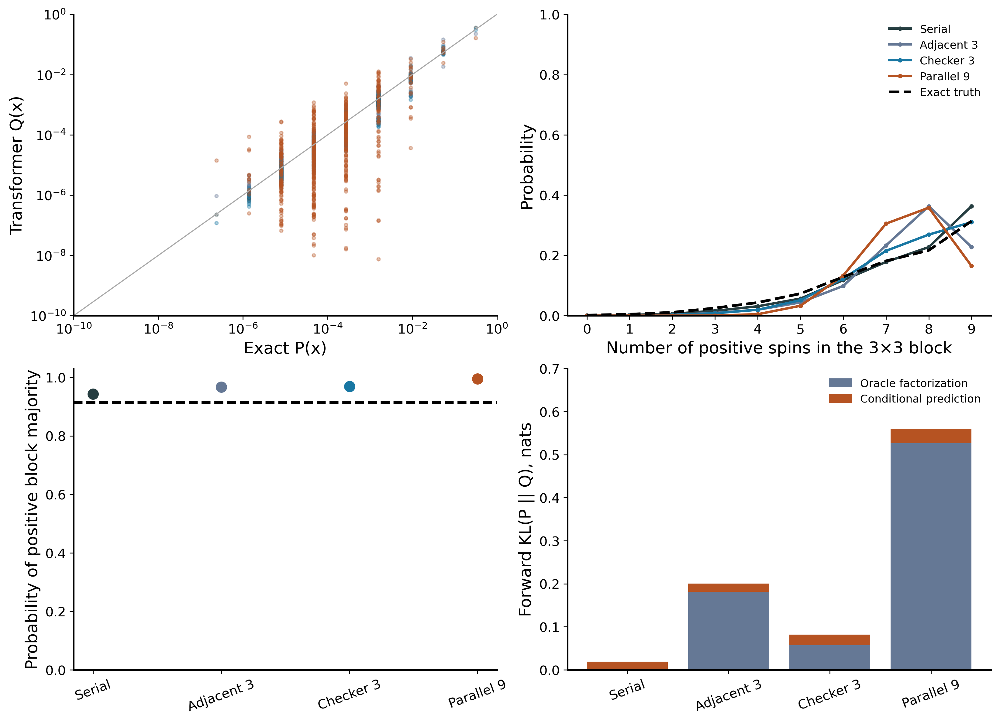

**图12a｜旧 Fine+RG、seed 92601 的联合分布诊断。** 选用固定边界 mc_chain0_ord0 的旧 Fine+RG 终点，分别展示四种揭示方案下的 512 态概率对照、块内正自旋数分布与多数为正的概率。Oracle 使用精确单点条件边缘，Transformer 使用实际网络概率；两者均按相同揭示分组独立抽取组内自旋。

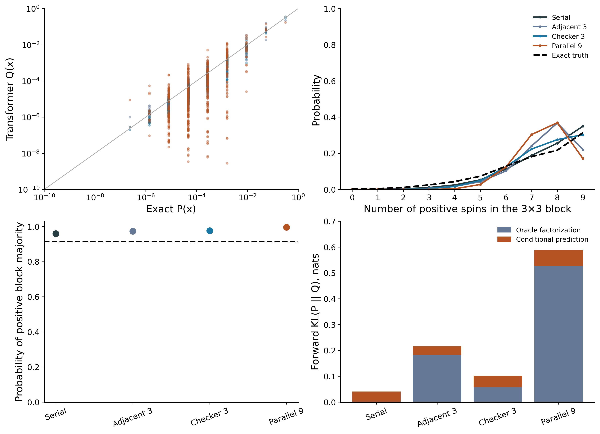

**图12b｜旧 Fine+RG、seed 92602。** 与图12a采用同一边界选择及布局，保留训练重复之间的差异。散点离开对角线表示联合概率不匹配；即使少数汇总量接近，仍不保证 512 态分布正确。

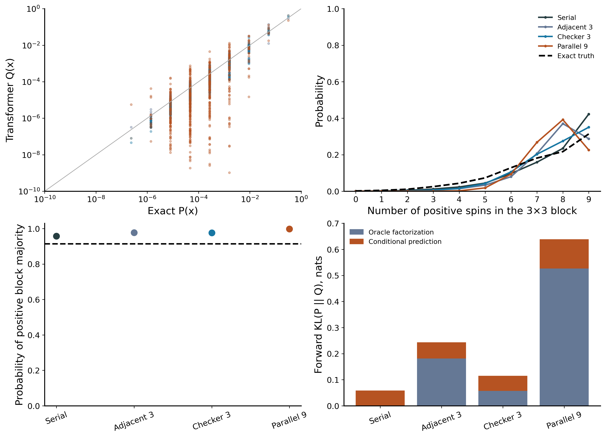

**图12c｜旧 Fine+RG、seed 92603。** 多数概率轴保留接近 1 的真实数值；这里所有概率都来自精确枚举或保存的模型条件概率，没有用重复采样估计散点。

**两个误差来源可以严格分开。** 记揭示方案为 $\pi=(J_1,\ldots,J_T)$，$A_t=\bigcup_{u<t}J_u$ 为此前已揭示的位置。分组生成分布为

$$
Q_\theta^\pi(x\mid c)=\prod_{t=1}^T\prod_{j\in J_t}q_{\theta,j}(x_j\mid x_{A_t},c).
$$

用真实分布 $P$ 的精确单点条件边缘替代每个 $q_{\theta,j}$，定义 $Q_*^\pi$。即使边缘全部精确，组内的乘积仍可能丢失依赖。对 forward KL（真值到模型的相对熵，单位 nat）有恒等式

$$
\begin{aligned}
\mathrm{KL}(P\Vert Q_\theta^\pi)
&=\underbrace{\mathrm{KL}(P\Vert Q_*^\pi)}_{\text{组内因子化误差}}\\
&\quad+\underbrace{\sum_t\mathbb E_{X_{A_t}\sim P}\sum_{j\in J_t}
\mathrm{KL}\big(P(X_j\mid X_{A_t},c)\Vert q_{\theta,j}(\cdot\mid X_{A_t},c)\big)}_{\text{单点条件预测误差}}.
\end{aligned}
$$

第一项又等于各揭示组的条件总相关之和：

$$
\mathrm{KL}(P\Vert Q_*^\pi)=\sum_t\mathbb E_{X_{A_t}\sim P}
\mathrm{KL}\!\left(P(X_{J_t}\mid X_{A_t},c)\;\middle\Vert\;\prod_{j\in J_t}P(X_j\mid X_{A_t},c)\right).
$$

两项均非负。推导只需对 $\log(P/Q_\theta)$ 加减 $\log Q_*$，再按真实条件分布取期望。**这些期望均按真实 $P$ 的前缀加权**，不是按 Oracle 或模型自己生成的前缀加权；后两种量一般不满足这一式子。逐点 Oracle 的第一项为零，但模型逐点采样仍可因第二项而出错。一次九点揭示则即使单点概率完美，也通常无法恢复块内联合分布。

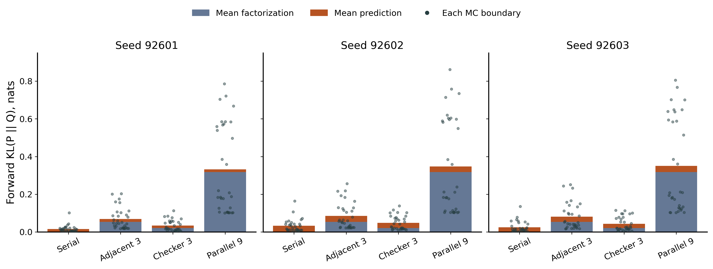

**图12d｜不依赖单一边界的机制证据。** 图中使用32个MC边界，展示各旧训练 seed 的 Fine+RG 终点及四种揭示方案，不对12个权重混合平均，也不包含全正边界。柱为32边界的平均分解，点为单个边界的总KL，点的散布不是误差条。精确 Oracle 因子化项与网络条件预测项分别显示；数值复核覆盖全部396组，最大分解残差约 $2.01\times10^{-14}$。

在 32 个 MC 边界上，Oracle 因子化 KL 的平均值依次为 serial 约 **0**、adjacent **0.05341**、checker **0.01988**、nine **0.31714**。checker 首组三点没有直接最近邻边，但其余六个隐藏自旋被边缘化后仍可产生有效依赖。因此，“没有直接相互作用”并不意味着在当前可见条件下独立。只有把剩余六位也变为已知、让这三个互不近邻的点各自拥有完整可见 Markov 邻域时，对应的三点 Oracle 乘积才等于精确联合分布。

这个诊断建立了一种可能限制联合采样的机制，却没有证明它主导 Fresh M−P 的差异。实际 $W96$ 生成有不同的隐藏结构、时间日程和网络输入大小；不能把 0.31714 乘以块数来估算全图误差，也不能由 $S$ 增加就假定总误差必然降低。更多步骤减少同组独立化的机会，同时改变网络被查询的条件状态；两种影响需要分别测量。

### 9.3 训练收敛不等于所有物理统计收敛，固定梯度也不代表全分布

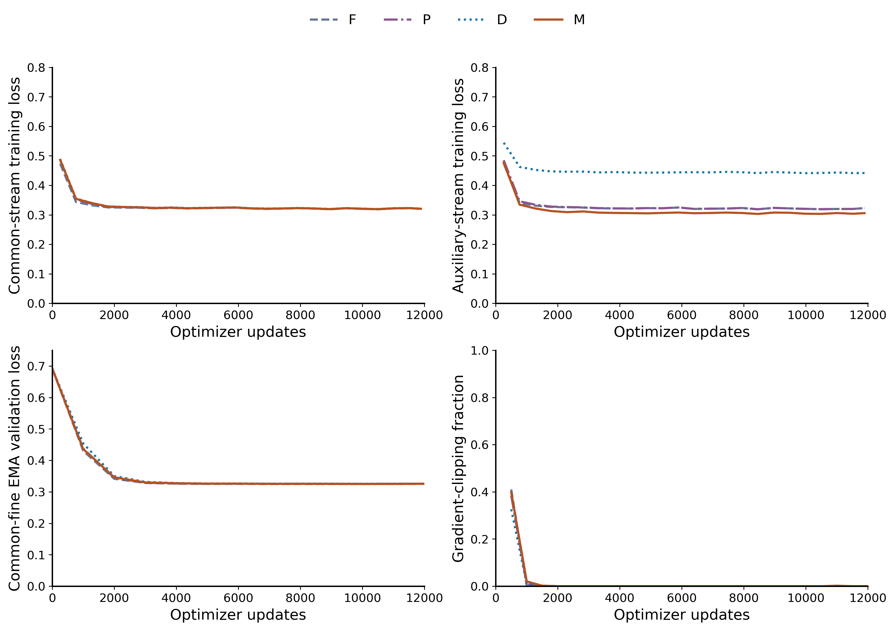

**图14a｜seed 112501 的训练记录。** 上排为每256次流内更新的共同与辅助损失均值，另展示固定共同验证和每500次优化器更新分块的实际梯度裁剪比例；宽度轮换和逆时间加权会使单批训练值波动，图中训练曲线不是逐批原值。横轴为真实优化器更新数，不把共同／辅助一对更新合并成一步。

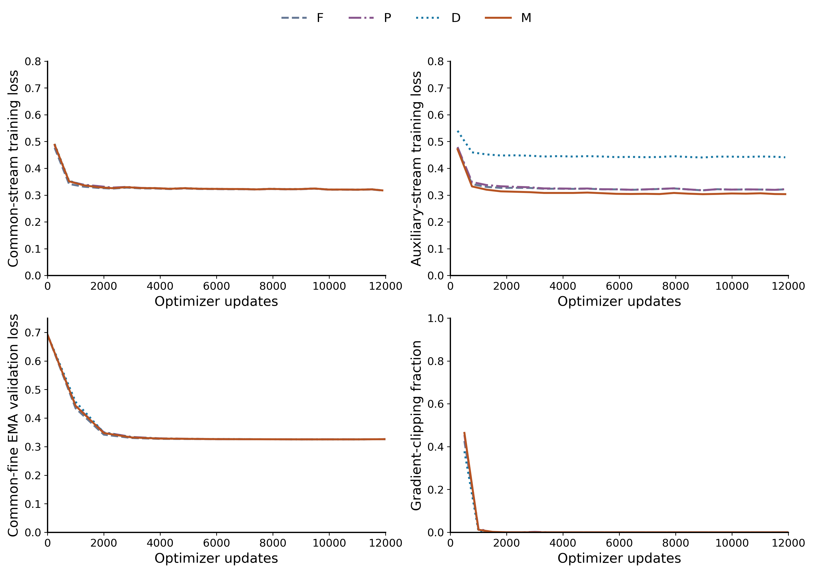

**图14b｜seed 112502，使用相同坐标尺度与布局。** 两个 seed 分开展示。主评估使用预定 12k EMA 权重，没有从曲线中事后挑选生成效果较好的 checkpoint。

共同验证损失由约 0.6924 降至 0.325–0.326，说明各臂已学习到大量可用于当前验证分布的条件信息。训练中约 1.4%–1.99% 的更新触发范数阈值 1；这与旧 pilot 的零裁剪不同，但没有单凭裁剪率识别生成差异的因果机制。条件损失收敛和局部 KL／长程生成的表现可以不同，原因是输入条件分布、窗口大小及评价函数均不相同。

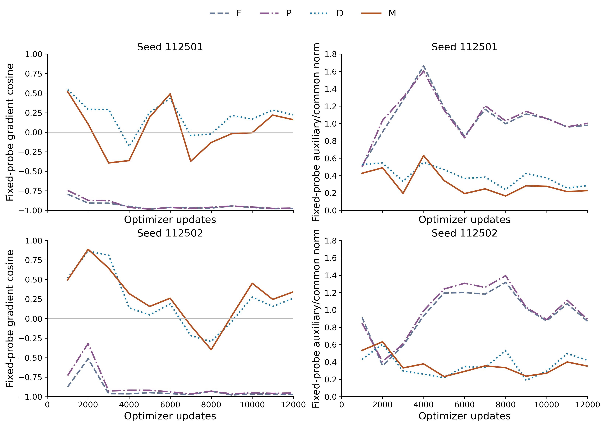

**图14c｜固定 $W48$ probe 的梯度余弦与范数比。** 每次在同一 raw 权重上分别对一批共同输入和一批辅助输入反传，排除任务嵌入后比较共享参数梯度；范数比为辅助／共同。这不是整个训练分布的梯度均值，也不是 EMA 生成权重的直接诊断。

实际方向与“粗任务天然更冲突”的直觉并不一致：F/P 两个 seed 的时间平均余弦大约在 **−0.87 至 −0.94**，D/M 约在 **0.03 至 0.28**；F/P 的范数比接近 1，D/M 约为 0.3–0.4。由此不能将 M 未超过 P 解释成已被证实的“更强负梯度冲突”。同样，这也不证明 M 在全训练分布上完全兼容：固定一对样本、宽度和时间条件可能过度代表某种状态，不同参数子空间的方向还会被一个总体余弦压缩。多批次、分时间／宽度和分层的梯度统计才能区分典型现象与 probe 特例。

### 9.4 有限生成图数、参考 MC 与训练重复是三种不同不确定性

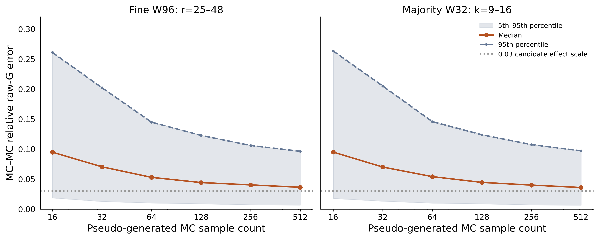

**图13｜MC–MC 校准，而非模型实验。** 历史 16 条链分为互不重叠的 8 条伪生成链和 8 条参考链，参考数固定 256；伪生成样本量从 16 到 512。曲线展示 2,000 次链与循环块重抽样下的误差分布摘要；阴影为5%–95%经验分位（中央90%范围），虚线为95%分位，不是95%置信带；块长 8 为主方案，4、16 为敏感性分析。它描述的是这份有限 MC 库及抽样算法的精度。

当伪生成样本数为 32 时，细场 $E_G$ 的中位数约 **0.07031**，95% 分位约 **0.20204**；粗场分别约 **0.06990、0.20484**。增至 512 时，细场中位数降至约 **0.03621**，95% 分位约 **0.09615**；参考端有限仍参与残余波动。这说明 32 张图对长程统计的分辨率有限，但不是任何估计器的严格数学下界，更不是模型配对差的显著性门槛。

增加生成图数主要减少固定模型的采样波动，增加独立 MC 主要减少真值参考不确定性，增加独立训练 seed 才能更好描述训练结果间的变异。三者不可互相替代。四臂和两档步数共享随机身份可降低某些配对差的噪声，却不会把两个训练 seed 变成更多训练重复。当前统计适合发现机制线索和设计下一步，尚不适合精确估计训练总体的尾部风险。

## 10. 为什么 Majority 没有超过 RoPE-only：十种解释的证据与可辨别性

以下讨论针对本轮观测到的 M−P 点估计排序。四种 seed／步数组合中 M 的细场长程误差均高于 P，但只有两个开发 seed，不能把这一排序当作训练总体的既定规律。解释的目标是形成可被否证的实验，而不是从负结果倒推唯一原因。

### 10.1 P 的辅助标签仍是最终任务需要的细自旋

**直接证据：** F/P 辅助输入逐位相同，P 仅改变坐标；M 则改变为粗二值变量。P 因而在全部更新中监督细自旋，且与共同流共享最终变量语义。**间接支持：** P 的长程误差在本轮均低于 M，$W96$ 局部 KL 也在两个 seed 上低于 F。**未验证：** 变量一致性是否正是收益来源，还是坐标扰动形成了某种正则化。**可区分对照：** 固定更新总数与坐标日程，改变粗任务比例并加入 P+M 混合辅助流；同时检查细局部能力是否随细监督比例恢复。单纯增加 M 训练量会同时改变预算，不能单独回答这一点。

### 10.2 M 的粗条件学习必须经过共享参数迁移到细任务

**直接证据：** M 的辅助标签为 $R_3(x)$，最后生成却只调用 level 0 的细场输出；两者只通过共享网络参数相联。旧 pilot 中粗 CE 改善而细生成没有稳定改善，证明这两种能力可以分离。**间接支持：** 三路径分布不同，提示粗任务的学习未必自动约束细生成。**未验证：** 是迁移不足、细任务遗忘，还是生成阶段没有使用已学信息。**可区分对照：** 对 Fresh M 直接粗生成，并比较 4k/8k/12k 的粗任务、细局部及细生成轨迹。粗任务本身若尚未学好，不能先归因于迁移失效；粗任务已好而细生成未好，才更支持迁移瓶颈。

### 10.3 P 与 M 共享的扩大编码跨度可能解释一部分共同收益

**直接证据：** P/D/M 的辅助坐标完全相同，W48 的轴向编码跨度均为 141，P 的真实数据仍是连续细窗。**间接支持：** 256 步时 P、M 均降低 F 的长程过关联，P−F 与 M−F 同向。**未验证：** 收益是否来自编码距离覆盖、位置相位扰动或其他优化效应；D 共享坐标却没有获得相同改善，已经说明“跨度更大”不是充分条件。**可区分对照：** 加入 D1（真实抽点、单位坐标），并在冻结数据语义下系统改变训练坐标倍率。推理时事后调倍率回答的是另一个问题，不能替代训练对照。

### 10.4 多数投票汇总方向，同时丢失多数强度与块内结构

**直接证据：** 5:4 与 9:0 都成为同一 token，网络不接收票数、九点布局或配对细场。真实粗场具有不同统计，但这不构成关于环境信息量的排序。**间接支持：** M 的长程幅度改善没有同时恢复局部近邻统计，与表示丢失细节的可能影响相容。**未验证：** 被丢弃的信息是否限制了本次共享参数迁移；细共同流仍可学习细节，不能说丢失信息必然导致细场失败。**可区分对照：** 在预算与模型容量受控时增加块磁化或票差信息，或者提供配对细粗任务；若改善出现，也需分辨新增信息、输入容量和新损失各自的作用。

### 10.5 临界粗分布与细分布共享普适行为，不等于具有相同条件规律

**直接证据：** D/M 的关联和磁化不同；多数粗场的条件分布不能套用原细格四邻域 logistic 真值。重整化后一般会出现不同的有效耦合及更复杂相互作用。**间接支持：** 旧粗 CE 与细局部 KL 的变化方向不同。**未验证：** 当前共享骨干是否有足够容量同时表达两类条件规律，任务嵌入是否足以分离它们。**可区分对照：** 对比共享骨干、部分分离的输出／调制层和明确配对的跨尺度任务，保持训练预算并分别报告粗任务与细任务表现。简单增大网络能测试容量，但会同时改变计算成本。

### 10.6 一半预算用于粗变量，是否减少了有效细场监督？

**直接证据：** M 的共同细更新为 6,000 次，辅助粗更新也为 6,000 次；P/F 的辅助仍监督细变量。所有臂共同流完全对齐，因此 M 没有少于对照的共同更新，但其“全部细标签更新”确实较少。**间接支持：** M 存在局部物理代价，且没有形成超越 P 的长程收益。**未验证：** 50% 是否过高、较小比例是否存在有益区间；不能在未做比例消融前称其为错误配方。**可区分对照：** 在总更新和尺寸分布固定下比较少量预定粗比例，另设固定细更新数量的预算对照，以区分替代效应和增加计算的效应。

### 10.7 当前 M 没有显式粗细对应约束

**直接证据：** 共同／辅助随机流独立，模型没有同时看到同一窗口的细粗对，没有一致性损失，也没有粗场到细场的条件通道。**间接支持：** 旧权重直接粗生成与细生成粗化不同，说明独立的两类条件任务可以形成不一致分布。**未验证：** 显式对应是否能改善细生成，还是仅让两个错误分布彼此接近。**可区分对照：** 添加配对粗细训练并同时评估两路径对真实 MC 的误差；一致性约束本身不能替代真实性约束。

### 10.8 并行揭示可能限制集体信息的利用，但尚未解释 M−P

**直接证据：** 当前生成在每次前向内按单点边缘独立揭示；旧小块实验即使使用精确边缘仍有组内因子化误差。**间接支持：** 改变 64／256 步会改变 M 相对 F/D 的排序，说明训练与生成存在交互。**未验证：** Fresh M 是否比 P 受到更强因子化误差，或两者差异主要来自条件概率本身。**可区分对照：** 先对 Fresh 四臂做相同 512 态分解，再对固定权重比较受控的揭示分组。改变采样器后出现改善，并不自动证明原训练已学会全图正确联合分布。

### 10.9 有限生成样本和两个训练 seed 可能改变排序

**直接证据：** 每个设置只有 32 图；MC–MC 校准显示长程误差有显著有限样本波动，两个训练 seed 的曲线偏差方向也不同。**间接支持：** 64 步 M−F/D 反转，开发性联合区间均跨零。**未验证：** 增加固定模型样本后 M−P 的差是否仍在，以及新训练重复是否保持方向。**可区分对照：** 首先增加现有八个模型的配对生成图并使用更多独立 MC，随后才用新 seed 确认剩余效应。不能用反复扩样直至出现有利结果代替预定样本计划。

### 10.10 固定 probe 的梯度结果不支持简单的“粗任务更冲突”叙述

**直接证据：** 固定 probe 中 F/P 的余弦更负，D/M 更接近零或为正；M 的相对范数也更小。**间接支持：** P 虽在该 probe 上更负，却有较小长程误差，说明这个标量与物理质量没有简单单调关系。**未验证：** probe 是否代表训练分布，参数子空间是否存在局部冲突，优化器动量如何累积两类更新。**可区分对照：** 在固定 checkpoint 上抽取多个宽度、时间和数据批次，分别估计梯度分布与层间结构，再视结果决定是否值得训练时干预。直接采用梯度修正算法会同时改变优化过程，应作为后续机制实验而非已经有根据的修复。

上述十种解释并不互斥。当前实验直接检验的是**共享参数、交替更新的粗变量辅助训练**；它没有直接检验纯粗场零样本跨尺度迁移、先粗后细的预训练流程、配对粗到细条件生成或显式层次化生成。因而本轮结果限制了一个具体策略的收益主张，同时为其他策略提出了需要解决的任务语义和联合采样问题。

## 11. 用最少的新计算区分机制，再决定是否独立确认

### 11.1 优先利用现有权重，不先原样扩大整个训练实验

下表是尚未执行的研究建议。成本为相对等级，不是承诺 GPU 小时；大尺寸 dense attention 的实际代价应先以短评测计时。任何新增确认样本都应在检查结果前固定身份与分析方法。

| 优先级与工作 | 目的及必要对照 | 主要信息增益 | 成本与解释限制 |
|---|---|---|---|
| 1：现有八模型增加配对生成，连同独立 MC 扩充 | 保持两档 S、各臂配对；预定每模型128–256图作为候选 | 判断现有权重的排序与物理代价是否主要受32图噪声影响 | 中等生成成本；不能增加独立训练重复 |
| 1：补齐 W48 生成 | 同一权重、同一采样器，比较训练内与W96外推 | 区分生成本身困难和尺寸外推带来的额外困难 | 较低；窗口改变也改变物理分布，必须使用对应MC |
| 1：4k/8k/12k生成轨迹 | 所有臂按预定checkpoint与随机身份比较 | 检查局部／长程权衡是否随训练形成、是否粗任务改善而细任务退化 | 中等；作为轨迹诊断，不能事后挑最好点冒充原终点评价 |
| 1：Fresh M直接粗生成 | 与同模型细生成粗化和真实粗MC三路径比较 | 区分粗任务未学好与粗到细迁移不足 | 较低至中等；三路径一致不等于都真实 |
| 1：Fresh四臂精确小块 | 相同边界、serial/adjacent/checker/nine与Oracle | 分开条件预测项和组内因子化项，检验M−P机制 | CPU枚举加有限网络前向；不能外推全图KL |
| 2：多批次梯度诊断 | 已有checkpoint，按宽度、时间、层分组 | 判断固定probe的反直觉结果是否具有代表性 | 较低至中等；不直接识别梯度干预的因果效果 |

这组分析应先回答：在减少采样噪声以后，是否还存在值得解释的 M−P 差；局部代价是否已经在 W48 出现；粗分布是否学好；问题在训练过程的哪个阶段形成。若没有这些判断，直接扩大训练重复可能只会更精确地估计一个尚不清楚来源的权衡。

### 11.2 只训练能够区分竞争解释的新对照

| 后续对照 | 应固定什么 | 能回答的问题 | 仍不能回答什么 |
|---|---|---|---|
| 辅助粗任务比例 | 总更新、宽度、共同数据身份；另设固定细更新预算组 | 50%替代细监督是否过多，收益是否有比例区间 | 不能由单一最优比例证明普遍RG优势 |
| P+M辅助混合 | 编码覆盖与总预算，预先指定混合比例 | 细变量坐标增强与粗变量监督能否互补 | 若增加预算，无法区分互补与更多训练 |
| D1：抽点配单位坐标 | 抽点自旋与D完全相同，只改编码 | 真实物理间距对应的坐标是否有增量价值 | 仍不能独立识别Majority的所有表示机制 |
| 新训练seed的独立重复 | 选定配方、终点、采样器及物理保留界限 | 观察是否在训练总体中稳定，并估计不确定性 | 不能修复开发后反复选配方造成的选择偏差 |

阶段 C 不应以“总要得到正结果”为目的自动推进。更合理的进入条件是：现有权重扩样后仍有科学上有意义的目标效应；方法和采样设置已固定；局部能量、磁化与条件能力的可容许代价已事先确定；预算足以支持独立训练和参考数据。当前这些条件尚未全部满足。附录 C 保存原候选确认层级，但没有把候选界限写成已实施的判定。

### 11.3 层次化研究需要新的模型问题，而不只是更换辅助标签

显式粗到细生成可写为先采样粗变量 $z\sim q_\phi(z)$，再采样 $x\sim q_\theta(x\mid z)$，同时检查 $R_3(x)$ 是否与 $z$ 一致以及 $x$、$z$ 各自是否接近真实分布。这要求配对细粗样本、条件输入通道和相应损失，与当前共享骨干辅助任务明显不同。多数投票有损，所以逆问题应保留给定粗场后的多样性，不能把一个粗场当成唯一细场的标签。

跨尺度一致性也可作为约束，但必须防止两条错误分布互相靠拢；需要独立真实参考和局部物理保留。更丰富的块变量、联合块采样或层间信息交换值得研究，其计算和设计成本高于前述已有权重诊断。当前证据支持先查明迁移与采样瓶颈，再决定哪一种结构性改变最有信息价值。

## 12. 总结：物理粗变量的价值需要在任务匹配与联合生成中检验

真实 MC 的中心抽点与多数投票虽只在约 8.25% 的块上分歧，却具有明显不同的关联振幅和磁化分布；它们不是可以互换的二值场。原 RG pilot 学会了粗条件结构，同时暴露出细局部能力和旧非均匀几何能力的保留问题。Fresh 四臂进一步将纯坐标增强、真实中心抽点与多数粗变量区分开来。

两个开发 seed 在 256 步下共同显示：M 相对 F/D 的长程误差较小，但仍高于 P，且相对 F 存在明确的近邻与能量代价。64 步的排序变化、完整磁化分布与有限样本校准共同限制了结论的强度。现有结果没有证明 RG 辅助训练整体优于纯 RoPE，也没有否定真实粗变量在其他训练或生成机制中的价值。

研究的下一步应围绕一个更具体的问题展开：**粗任务已经学到的信息，怎样才能在保留局部物理的同时，转化为细场的正确联合生成？** 扩充既有权重的评测、分离训练内外推和联合采样误差，以及少量针对任务比例与粗细对应的对照，比不加区分地扩大训练更能回答这一问题。

## 附录 A：完整实验配置

### A.1 数据、模型和随机身份

正文第 4–6 节定义了算子、输入和损失；这里集中列出复现所需的剩余身份。训练输入来自历史 $L1024$ 周期临界 MC，训练池为全局链 0–5 共 768 父场，验证池为链 6–7 共 256 父场，每链 128 场。用于本轮物理评价的历史 MC 参考池是另一组 16 条链、2,048 父场，不能将其局部链编号 0–15 与训练池全局编号混同。训练池与参考池的原MC随机根分别为20260818和2026100111，详情见 [训练数据元信息](project/runs/B_training_data_metadata.json)、[参考MC元信息](project/runs/MC_reference_metadata.json) 与 [数据分区核验](project/runs/data_partition_audit.json)。

| 配置 | Fresh阶段B实际值 |
|---|---|
| 独立训练seed | 112501、112502；每seed四臂共享初始化与相应随机角色 |
| 网络 | 7层，隐藏128，4头，每头32，MLP512；共1,976,962参数 |
| token／输出 | 负、正、MASK、PAD四类输入；两个自旋logit输出 |
| 位置与任务 | 二维RoPE底10,000；共同level0、四臂辅助均level1 |
| 训练宽度与batch | W16/24/32/48分别72/32/18/8；每次18,432 token |
| 宽度调度 | 每流每宽1,500更新；每流6,000，合计12,000次AdamW更新 |
| 每模型总token | 221,184,000；并非等量的未遮盖标签 |
| mask时间 | U[0.002,1)，另2%置1；逐token Bernoulli(t) |
| 随机增强 | 整体正负翻转；D4仅作用于编码坐标 |
| 优化器 | AdamW，beta=(0.9,0.95)，weight decay=0.05，共享状态 |
| 学习率 | 750次更新预热至0.0003，余弦降至0.00003 |
| 数值与稳定性 | BF16前向、FP32参数和loss、TF32关闭；梯度裁剪1；EMA0.999 |
| 保存与评价 | 每500步恢复文件；4k/8k/12k完整checkpoint；预定12k EMA评价 |
| 验证／梯度时点 | 验证step0及每1,000步；梯度每1,000步，首次1,000 |
| 自由生成 | 每模型W96、level0、单位坐标；S64/256各32图，共512细图 |
| 生成随机根 | 2026112501；身份还含训练seed、W、sample ID及随机角色，不含臂或S |
| 日程与clock | cosine-squared揭示日程到0；网络clock下限0.01；已揭示位不修改 |
| 主比较参考 | 历史奇数8链各前32场，共256；同图投票构造W32粗参考 |

同 seed、同 cycle、同 role 的四臂严格配对；common 与 auxiliary 是不同角色，不要求共享父场或裁剪区域。生成的随机阈值与类别抽样均预分配，64 步日程端点嵌在 256 步的每第四个端点上。配对随机数控制比较方差，但不能使不同网络输出相同构型。

### A.2 历史实验与阶段 A 的边界

| 内容 | 已执行配置及用途 |
|---|---|
| 原pilot | I-F 12k EMA暖启动，seed92601/92602/92603；Fine-only总2,048更新，replay/RG总4,096；无2%全MASK端点；旧replay辅助level0，RG辅助level1 |
| A0局部轨迹 | 初始／1,024共同更新／2,048共同更新；W48/W96，隐藏1/8/32，合计126项；三个隐藏数等权 |
| 历史能力保留 | 21权重×35任务=735预测；20项geometry中13非均匀、7连续，另9容器和6普通时间任务 |
| A1自由生成 | 旧initial和三类终点W96细场；Fine+RG另直接W32粗场；S64/256各32图，共960图 |
| A2联合枚举 | 12旧initial/final权重×33边界=396；W16中央九点；四种揭示方案 |
| A3物理池 | 16链×128=2,048父场；同一父场中心W96/W144，真实抽点与投票 |
| A3-N精度 | 偶数8链伪生成、奇数8链参考；n=16/32/64/128/256/512；2,000次重抽 |

局部精确 bank 的时间下限为 **0.002**，A2 和自由生成的网络 clock 下限为 **0.01**；三者输入和用途不同。旧模型重评复现的是同一身份，历史网络概率前向的最大偏差约 $1.52\times10^{-6}$，不宣称跨环境逐位相等。

## 附录 B：逐 seed、逐步数与逐尺度数值

### B.1 Fresh细场完整汇总

每行基于32张图。$E_G$ 使用细距离25–48；能量按每键计。表中 $W_1$ 均与实际256场参考比较。更多位数、正磁化比例和完整曲线在配套CSV中保留。

| seed | S | 臂 | G(1) | 平均 m | 平均 \|m\| | 平均 e | 异号键比例 | W1(m) | W1(\|m\|) | W1(e) |
|---|---|---|---|---|---|---|---|---|---|---|
| 112501 | 64 | F | 0.67591 | -0.14404 | 0.50920 | -0.67591 | 0.16204 | 0.14329 | 0.11275 | 0.03691 |
| 112501 | 64 | P | 0.61500 | -0.13093 | 0.41185 | -0.61500 | 0.19250 | 0.13546 | 0.12306 | 0.09293 |
| 112501 | 64 | D | 0.60519 | -0.22302 | 0.46694 | -0.60519 | 0.19740 | 0.17765 | 0.09314 | 0.10274 |
| 112501 | 64 | M | 0.59476 | -0.17270 | 0.40628 | -0.59476 | 0.20262 | 0.14937 | 0.13233 | 0.11316 |
| 112501 | 256 | F | 0.69934 | -0.18155 | 0.61124 | -0.69934 | 0.15033 | 0.17709 | 0.09763 | 0.02485 |
| 112501 | 256 | P | 0.63537 | -0.17643 | 0.46433 | -0.63537 | 0.18232 | 0.13714 | 0.08321 | 0.07256 |
| 112501 | 256 | D | 0.64380 | -0.27785 | 0.56131 | -0.64380 | 0.17810 | 0.23599 | 0.08348 | 0.06553 |
| 112501 | 256 | M | 0.62263 | -0.22982 | 0.46792 | -0.62263 | 0.18869 | 0.18446 | 0.09186 | 0.08530 |
| 112502 | 64 | F | 0.68038 | 0.08966 | 0.62921 | -0.68038 | 0.15981 | 0.21114 | 0.10634 | 0.03456 |
| 112502 | 64 | P | 0.62000 | -0.05240 | 0.51138 | -0.62000 | 0.19000 | 0.08216 | 0.07976 | 0.08795 |
| 112502 | 64 | D | 0.64706 | -0.26838 | 0.63006 | -0.64706 | 0.17647 | 0.26191 | 0.10671 | 0.06234 |
| 112502 | 64 | M | 0.61556 | -0.09215 | 0.52451 | -0.61556 | 0.19222 | 0.08113 | 0.06245 | 0.09285 |
| 112502 | 256 | F | 0.70365 | 0.01823 | 0.69119 | -0.70365 | 0.14818 | 0.19467 | 0.16421 | 0.02201 |
| 112502 | 256 | P | 0.64248 | -0.07705 | 0.57442 | -0.64248 | 0.17876 | 0.10298 | 0.08124 | 0.06852 |
| 112502 | 256 | D | 0.66568 | -0.32852 | 0.65019 | -0.66568 | 0.16716 | 0.31824 | 0.13430 | 0.04704 |
| 112502 | 256 | M | 0.64241 | -0.09128 | 0.57887 | -0.64241 | 0.17880 | 0.12223 | 0.11536 | 0.06560 |

### B.2 同图多数投票后的粗场汇总

每行与上一表同一批细图逐张对应，$E_G$ 使用粗距离9–16；列中 $e$ 仅是粗格负近邻乘积，不是原细物理能量。

| seed | S | 臂 | G(1) | 平均 m | 平均 \|m\| | 平均 e | 异号键比例 | W1(m) | W1(\|m\|) | W1(e) |
|---|---|---|---|---|---|---|---|---|---|---|
| 112501 | 64 | F | 0.79177 | -0.16870 | 0.59607 | -0.79177 | 0.10411 | 0.16997 | 0.13390 | 0.07445 |
| 112501 | 64 | P | 0.71510 | -0.15790 | 0.49286 | -0.71510 | 0.14245 | 0.15361 | 0.13965 | 0.03364 |
| 112501 | 64 | D | 0.71091 | -0.26331 | 0.55823 | -0.71091 | 0.14455 | 0.20998 | 0.11015 | 0.07199 |
| 112501 | 64 | M | 0.67493 | -0.20312 | 0.48694 | -0.67493 | 0.16253 | 0.17128 | 0.14514 | 0.06886 |
| 112501 | 256 | F | 0.82983 | -0.21051 | 0.71295 | -0.82983 | 0.08509 | 0.20358 | 0.11044 | 0.10211 |
| 112501 | 256 | P | 0.74540 | -0.20673 | 0.55096 | -0.74540 | 0.12730 | 0.15938 | 0.09486 | 0.02243 |
| 112501 | 256 | D | 0.76767 | -0.32495 | 0.66687 | -0.76767 | 0.11616 | 0.27765 | 0.10188 | 0.08367 |
| 112501 | 256 | M | 0.71554 | -0.26929 | 0.56055 | -0.71554 | 0.14223 | 0.21635 | 0.10204 | 0.05562 |
| 112502 | 64 | F | 0.82475 | 0.11157 | 0.74475 | -0.82475 | 0.08762 | 0.25691 | 0.13341 | 0.09703 |
| 112502 | 64 | P | 0.72530 | -0.06281 | 0.61481 | -0.72530 | 0.13735 | 0.09537 | 0.09167 | 0.07887 |
| 112502 | 64 | D | 0.79240 | -0.31952 | 0.75311 | -0.79240 | 0.10380 | 0.31984 | 0.13882 | 0.11571 |
| 112502 | 64 | M | 0.73006 | -0.10986 | 0.63550 | -0.73006 | 0.13497 | 0.10609 | 0.08183 | 0.06421 |
| 112502 | 256 | F | 0.85254 | 0.02545 | 0.80817 | -0.85254 | 0.07373 | 0.22830 | 0.19167 | 0.12482 |
| 112502 | 256 | P | 0.76644 | -0.09760 | 0.68854 | -0.76644 | 0.11678 | 0.13431 | 0.10973 | 0.07867 |
| 112502 | 256 | D | 0.81990 | -0.38916 | 0.77222 | -0.81990 | 0.09005 | 0.38019 | 0.16718 | 0.12668 |
| 112502 | 256 | M | 0.77441 | -0.10931 | 0.69464 | -0.77441 | 0.11279 | 0.15623 | 0.14833 | 0.09425 |

实际参考的细场均值为 $G(1)=0.7079277$、$\bar m=-0.0453627$、平均 $|m|=0.5269826$、$\bar e=-0.7079277$；粗场分别为 0.7277202、−0.0533295、0.6165009、−0.7277202。细场 $G(25)=0.3295268$、$G(48)=0.2965715$；粗场 $G(9)=0.4436460$、$G(16)=0.4057465$。

### B.3 配对差与历史完整数值的索引

正文表2已列细场全部五项配对差；下面补齐粗场，同样为左臂减右臂，负值有利于左臂。

| seed | S | P−F | D−P | M−D | M−F | M−P |
|---|---|---|---|---|---|---|
| 112501 | 64 | +0.06293 | -0.11300 | +0.19657 | +0.14651 | +0.08357 |
| 112501 | 256 | -0.26718 | +0.17203 | -0.11784 | -0.21300 | +0.05419 |
| 112502 | 64 | -0.34964 | +0.35144 | -0.29595 | -0.29415 | +0.05549 |
| 112502 | 256 | -0.28329 | +0.25081 | -0.20542 | -0.23791 | +0.04539 |

以下文件是正文表图的可读数值来源；读者理解核心结论无需逐一打开。

| 数值内容 | 数据文件 |
|---|---|
| Fresh32个细／粗设置与参考 | [逐seed汇总](integrated/data/report_per_seed.csv)、[MC参考](integrated/data/report_mc_reference.csv) |
| 五项配对点差 | [配对差](integrated/data/report_paired_differences.csv) |
| 旧pilot原始条件指标 | [旧pilot指标](integrated/data/history_pilot_metrics.csv) |
| 初中末精确局部轨迹 | [轨迹](integrated/data/history_exact_trajectory.csv) |
| 历史非均匀／连续能力 | [分组保留](integrated/data/history_retention_families.csv) |
| 旧模型自由生成 | [生成汇总](stage_A/A1_metrics.csv) |
| 旧三路径逐seed统计 | [三路径](integrated/data/physical_old_three_paths.csv) |
| 396组精确联合诊断 | [精确联合核验](integrated/data/history_joint_decomposition.csv) |

作为图9e的另一视图，下面给出共同分箱的有符号磁化直方图。它与经验累积分布使用同一批数据，不新增样本；每个设置32图，细小箱间差异不宜过度解释。

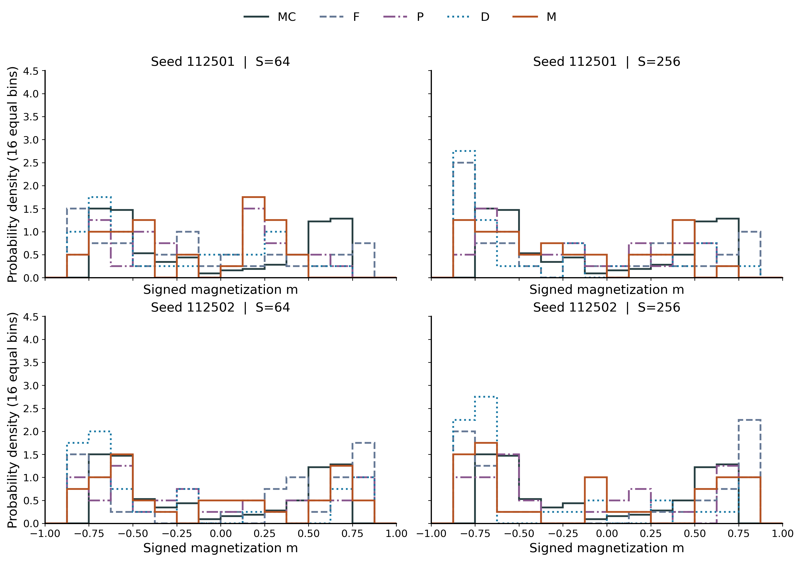

**附图B1｜两档S、两个seed的完整有符号磁化。** 所有方法使用相同分箱和范围，MC保留其实际256样本分布；不以正负翻转强制对称。

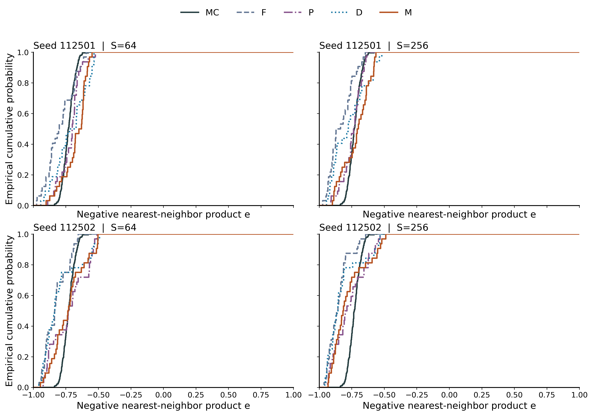

**附图B2｜同图粗化后的近邻统计。** 与图8、图9a–b是同一组粗图；该量用于比较粗分布形状，不被解释成原Hamiltonian的能量。

## 附录 C：统计推断、精度与未来确认

### C.1 不同统计单位与原pilot的配对推断

独立训练 seed 是模型重复单位；一个模型生成的图是给定权重后的采样单位；MC 父场有链内时间相关；一个场中的点对和块又有空间依赖。本文不把 token、距离点或所有父场简单当作独立训练重复。对非线性 $E_G$，必须在每次重抽样中重新形成模型与参考曲线，再计算误差及参考分母，不能仅对已汇总的误差加减标准差。

原 pilot 有三个配对旧 seed。先在每个 bank 和父场内按原协议等权汇总，再计算 Fine+RG−Fine replay。$W96$ 局部KL平均差为 **−0.00625383**；自由度2的配对t 95%区间为 **[−0.04439557, +0.03188791]**。原联合bootstrap进行2,000次重抽，同时重抽三个成套seed、16条参考链，并在每条链的16场内用循环块长4抽样；区间为 **[−0.01965284, +0.00915247]**。两种区间都保留，不挑较乐观者作为结论。留一seed均值可反转，三个配对重复也限制了非参数检验的分辨率。

本轮报告独立复算了全部2,000次主比较bootstrap。对旧保存概率的CE／KL可复算到约 $10^{-16}$，这与网络前向跨环境约 $10^{-6}$ 的复现是不同层次；两者均不构成新的独立训练确认。

### C.2 真实粗化统计与MC–MC校准使用不同重抽样

A3 对16条完整链重抽10,000次，每次保留所选链全部128场及D/M配对，以估计分歧率、关联和磁化统计的描述性区间。逐距离95%带是**逐点带**，不是覆盖整条曲线的同时置信带。

A3-N先对24条统计序列去除各链均值，估计合并链内自相关函数，并用正配对截断规则计算 $\tau=1+2\sum_\ell\rho_\ell$，下限1，最大约1.5995。主循环块长取至少 $2\tau_{\max}$ 的最小2的幂且不小于8，得到8；4和16用于敏感性检查。奇偶链先分池，再分别按链和循环时间块重抽2,000次，参考大小固定256；每条原链长度128。该校准针对实际有限MC库，不能被称为真实分布下所有估计方法的不可突破误差。

### C.3 Fresh开发性联合区间

阶段 B 已执行10,000次层级联合bootstrap：顶层重抽两个完整配对训练seed；每个所选seed内重抽32个成套生成身份，保持四臂和两档S的配对；MC端独立重抽实际参考的8条奇数链，并在各链前32场内用循环块长8重抽。每次重算参考曲线与非线性误差，再计算配对差。此处没有将A3全部2,048场偷偷替换为模型点估计参考。

下表是已保存的12项描述性95%区间，即 M−D、M−F、M−P × 细／粗 × S64／256。P−F与D−P只在正文和附录B报告逐seed点差，不宣称这份冻结文件还提供了它们的联合区间。

| 尺度 | S | 比较 | seed 112501 | seed 112502 | 等权均值 | 描述性95%区间 |
|---|---|---|---|---|---|---|
| 细 W96 | 64 | M-D | +0.19885 | -0.30472 | -0.05294 | [-0.35731, +0.22222] |
| 细 W96 | 64 | M-F | +0.20308 | -0.30825 | -0.05259 | [-0.36068, +0.25104] |
| 细 W96 | 64 | M-P | +0.08232 | +0.03133 | +0.05682 | [-0.04139, +0.14053] |
| 粗 W32 | 64 | M-D | +0.19657 | -0.29595 | -0.04969 | [-0.35814, +0.21359] |
| 粗 W32 | 64 | M-F | +0.14651 | -0.29415 | -0.07382 | [-0.36086, +0.20367] |
| 粗 W32 | 64 | M-P | +0.08357 | +0.05549 | +0.06953 | [-0.03002, +0.14868] |
| 细 W96 | 256 | M-D | -0.04633 | -0.21636 | -0.13134 | [-0.33896, +0.12981] |
| 细 W96 | 256 | M-F | -0.16904 | -0.28731 | -0.22817 | [-0.44019, +0.03444] |
| 细 W96 | 256 | M-P | +0.05848 | +0.03705 | +0.04776 | [-0.04424, +0.13764] |
| 粗 W32 | 256 | M-D | -0.11784 | -0.20542 | -0.16163 | [-0.34516, +0.08770] |
| 粗 W32 | 256 | M-F | -0.21300 | -0.23791 | -0.22545 | [-0.42213, +0.01361] |
| 粗 W32 | 256 | M-P | +0.05419 | +0.04539 | +0.04979 | [-0.04493, +0.14100] |

这12项区间均跨零。它们同时反映有限生成样本、参考MC及经验训练seed分布的变化，但顶层只有两个seed，不能提供可靠精确的训练总体尾分位或方差估计，也未按未来确认层级校正多重比较。[已归档的独立审计](verification/B_independent_statistics_audit.json)重新计算全部120,000个已保存配对差，最大差为0，另有[公开载荷复核](verification/public_statistics_recheck.json)；这证明计算与保存数组一致，不是科学假设得到独立验证，也不把原发布审计冒充本次新实验。

### C.4 阶段 C 的候选方案尚未执行

原协议提出使用新训练seed、新MC与新生成随机数独立确认，候选起点为6个训练seed、每模型128–256张图，并采用50,000次层级bootstrap。主层比较 M−D 和 M−F，各使用97.5%双侧区间，要求两者上界均低于 $-\delta_G$；通过后再检验 M−P 的97.5%双侧区间上界是否低于 $-\delta_G$；粗尺度M−D/M−F各使用98.75%双侧区间，要求两项上界均低于0。候选 $\delta_G=0.03$ 表示相对误差降低3个百分点，不是相对改善3%。

物理保留还要求预先列出的能量、磁化及条件能力代价，其单侧95%上界全部低于对应可容许界限。**这些界限与最终样本量尚未冻结，C也没有执行。** 当前B的描述性95%区间不能代替上述确认程序。若根据本报告改变方法或主问题，应在独立数据产生之前重新固定确认方案，并说明与原候选设计的区别。

## 附录 D：复现、完整性与证据来源

### D.1 固定科学版本与原始材料

本报告依据 RG-2 结果提交 [`5516370b3ae6e98160d9468668acdcbf851dc902`](https://github.com/zxfly666/ISM/tree/5516370b3ae6e98160d9468668acdcbf851dc902/experiments/rg2-v12-fresh-four-arm)；历史主仓库提交为 [`7e608a594c06ead3c484cdd5b38e1d8f2c4d56e3`](https://github.com/zxfly666/ISM/tree/7e608a594c06ead3c484cdd5b38e1d8f2c4d56e3)。本轮独立分支只更新报告与新增的派生图表、审计和阅读资源，不改动训练源码、冻结协议、checkpoint或原始统计数组。

原始报告精确副本保留为 [最初RG-2报告](REPORT_ZH.initial-20261125.md)，原阶段A/B图版与数据仍在原目录；原发布清单另存为 [基线清单](integrated/provenance/publication-manifest.baseline.json)。权重和大型复现输入由原 [GitHub Release](https://github.com/zxfly666/ISM/releases/tag/rg2-v12-20261125) 提供，文件范围及校验方法见 [数据可用性](DATA_AVAILABILITY.md) 和 [复现指南](REPRODUCING.md)。本报告的数字来源于随仓库保存的实际数组及日志，未重新训练或补采生成样本。

### D.2 方法、数值与图版如何复核

| 核验对象 | 独立操作与结果 | 记录 |
|---|---|---|
| 原发布完整性 | 重新验证原清单3,457个文件；原科学载荷保持不变 | [基线清单](integrated/provenance/publication-manifest.baseline.json) |
| 四臂构造及模型 | CPU人工输入核对64批、6,240个物理位置、16组日程配对及参数数目 | [方法核验](integrated/provenance/method_mechanics_audit.json) |
| 历史条件与保留 | 297旧CE、72精确局部KL、126轨迹项、735保留预测、30,720更新日志 | [历史核验](integrated/provenance/history_audit.json) |
| 小块联合分布 | 直接Hamiltonian重建、归一化、Oracle及P前缀KL分解；396组最大残差约2.01e−14 | [历史核验](integrated/provenance/history_audit.json) |
| Fresh主数值 | 32个细粗设置、96项Wasserstein、能量恒等式；最大差1.11e−16 | [数值核验](integrated/provenance/report_values_audit.json) |
| 实测图数据 | 1,111个源文件、5,000次数值检查；最大差约2.00e−14；另核显示范围 | [图源](integrated/provenance/physical_figure_sources.json)、[显示审核](integrated/provenance/physical_figure_review.json) |
| 方法图 | 手算例与实际源码相符；示意图不冒充实验数据 | [图源](integrated/provenance/method_figure_sources.json)、[图审阅](integrated/provenance/method_figure_review.json) |

全部36张新图均保留PNG与PDF，入口为 [图版索引](integrated/FIGURES.md)。[绘图脚本](integrated/scripts/physical_figures.py)、[方法图脚本](integrated/scripts/method_figures.py)、[报告数值脚本](integrated/scripts/report_tables.py) 和 [历史审计脚本](integrated/scripts/history_audit.py) 随报告公开；它们读取冻结数据，产生派生文件。精确来源文件和SHA保存在附带JSON中，正文避免逐项展开这些工程记录。

### D.3 本次修订解决的歧义与仍存在的限制

修订明确了四项容易影响结论的区别：旧geometry集合包含13项非均匀与7项连续任务；旧replay与Fresh F的任务嵌入设置不同；三路径和小块诊断使用旧权重；固定probe梯度没有支持“粗任务更冲突”的简单叙述。报告同时保留所有seed、两档步数、局部代价和负结果，没有选择有利checkpoint或构型替代冻结评价。

图像和数值核验可以发现计算、来源与展示错误，却不能弥补独立训练重复不足、固定MC库的代表性、缺少D1／比例消融及未测团簇统计等科学限制。小块精确机制也不能替代大图联合正确性的证明。报告中的机制假设均给出了可区分对照；后续实验与候选确认程序没有混入已完成结果。

Markdown是唯一正文权威，HTML由同一文件构建，公式使用本地KaTeX资源并在构建时渲染，可离线阅读与打印。内容指纹、链接与图片检查、修订范围见 [修订记录](integrated/REVISION_NOTES.md) 及 [HTML构建记录](integrated/provenance/html_build.json)。

### D.4 文献与外部设计背景

1. Onsager, L. (1944). *Crystal Statistics. I. A Two-Dimensional Model with an Order-Disorder Transition.* [Physical Review 65, 117](https://doi.org/10.1103/PhysRev.65.117)。用于临界点与二维Ising精确理论背景。
2. Kadanoff, L. P. (1966). *Scaling Laws for Ising Models Near Tc.* [Physics Physique Fizika 2, 263](https://doi.org/10.1103/PhysicsPhysiqueFizika.2.263)。用于块自旋与尺度思想。
3. Wilson, K. G. (1975). *The Renormalization Group: Critical Phenomena and the Kondo Problem.* [Reviews of Modern Physics 47, 773](https://doi.org/10.1103/RevModPhys.47.773)。用于重整化与普适性背景。
4. Su, J. 等. *RoFormer: Enhanced Transformer with Rotary Position Embedding.* [arXiv:2104.09864](https://arxiv.org/abs/2104.09864)。用于旋转位置编码机制。
5. Sahoo, S. S. 等 (2024). *Simple and Effective Masked Diffusion Language Models.* [arXiv:2406.07524](https://arxiv.org/abs/2406.07524)。用于吸收式遮盖扩散目标背景；本文截断时间与额外端点的配方以实际源码为准。
6. HK3 Stage 3，[固定提交f2dbd378](https://github.com/zdacongming-glitch/Hackathon-3/tree/f2dbd3789508b33aab08b8e0b681a5cf580c5642/results/stage3_multiscale)。已核查README、训练配置、同50k终点控制源码和主汇总；其4层骨干、一个训练seed及四个采样seed、坐标倍率0.3–3.0均不同于本实验。它仅提供纯坐标对照的动机，不并入本报告的配对统计。
