# 阶段 A：完整图版与图注

所有构型 ID、配色和坐标范围保持预定规则。

## A3_W96_chain0

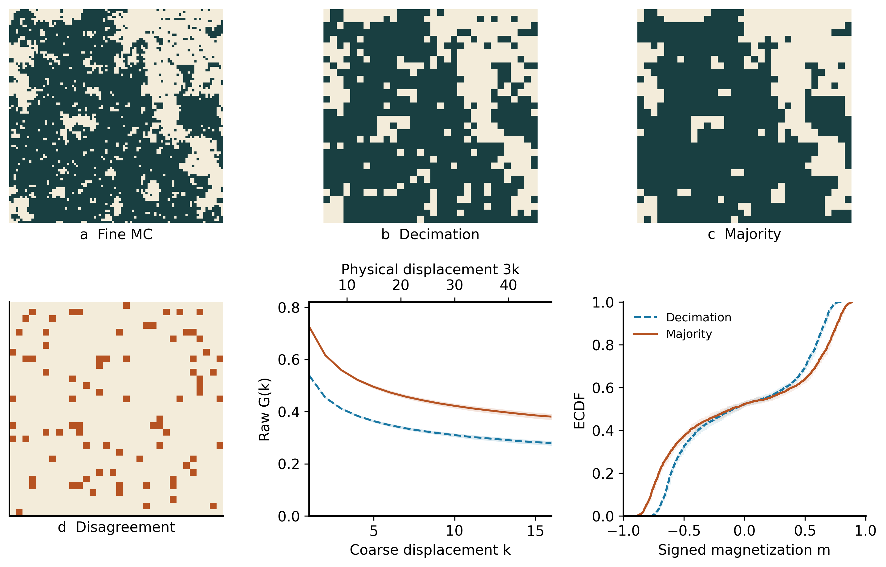

历史 MC：chain=0, ordinal=0, parent=0, global crop origin=464. 前四格来自同一父场；曲线和 ECDF 使用全部 2048 场、16 链，开窗口边界。阴影为10000次完整MC链重抽样的逐点95%分位区间，保留同链相关性及D/M配对，不是同时置信带；分歧率及配对曲线差的区间另见A3_chain_intervals.csv。

[矢量 PDF](figures/A3_W96_chain0.pdf)

## A3_W96_chain1

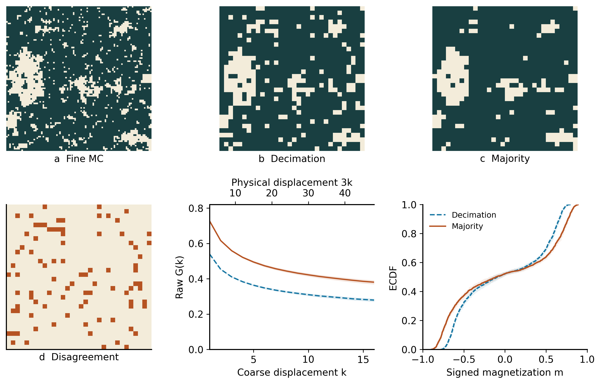

历史 MC：chain=1, ordinal=0, parent=128, global crop origin=464. 前四格来自同一父场；曲线和 ECDF 使用全部 2048 场、16 链，开窗口边界。阴影为10000次完整MC链重抽样的逐点95%分位区间，保留同链相关性及D/M配对，不是同时置信带；分歧率及配对曲线差的区间另见A3_chain_intervals.csv。

[矢量 PDF](figures/A3_W96_chain1.pdf)

## A3_W96_chain2

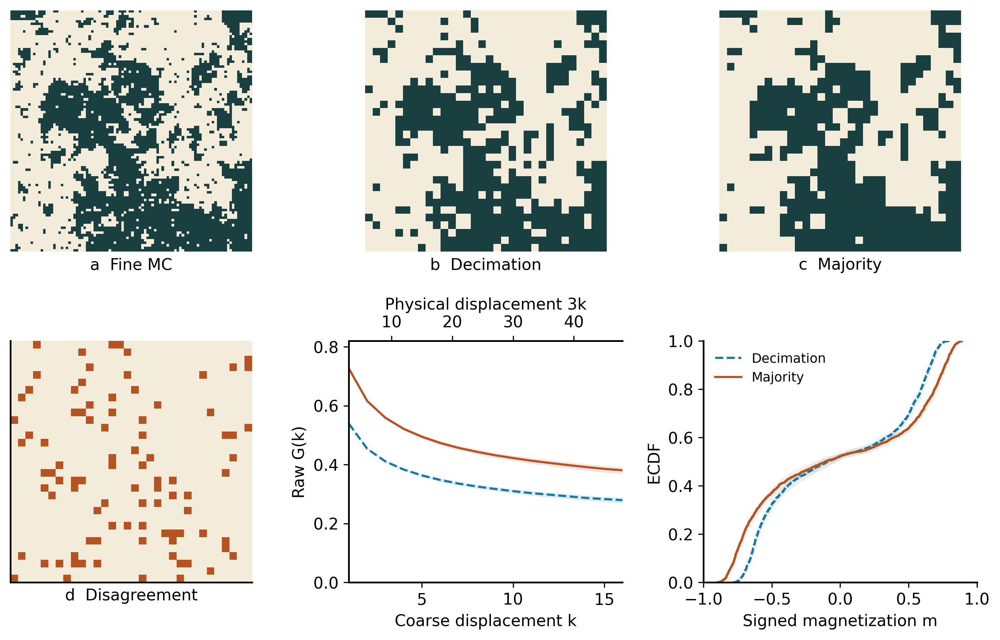

历史 MC：chain=2, ordinal=0, parent=256, global crop origin=464. 前四格来自同一父场；曲线和 ECDF 使用全部 2048 场、16 链，开窗口边界。阴影为10000次完整MC链重抽样的逐点95%分位区间，保留同链相关性及D/M配对，不是同时置信带；分歧率及配对曲线差的区间另见A3_chain_intervals.csv。

[矢量 PDF](figures/A3_W96_chain2.pdf)

## A3_W96_chain3

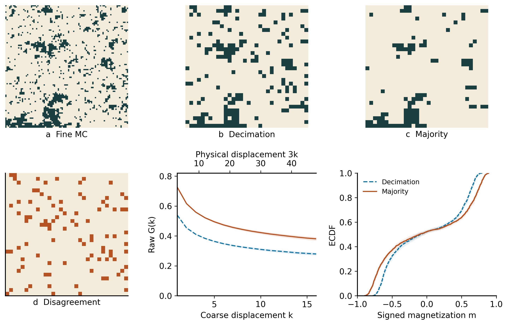

历史 MC：chain=3, ordinal=0, parent=384, global crop origin=464. 前四格来自同一父场；曲线和 ECDF 使用全部 2048 场、16 链，开窗口边界。阴影为10000次完整MC链重抽样的逐点95%分位区间，保留同链相关性及D/M配对，不是同时置信带；分歧率及配对曲线差的区间另见A3_chain_intervals.csv。

[矢量 PDF](figures/A3_W96_chain3.pdf)

## A3_W144_chain0

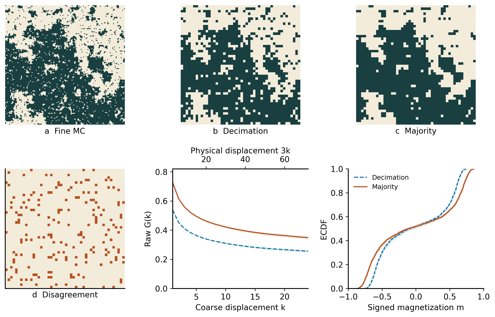

历史 MC：chain=0, ordinal=0, parent=0, global crop origin=440. 前四格来自同一父场；曲线和 ECDF 使用全部 2048 场、16 链，开窗口边界。阴影为10000次完整MC链重抽样的逐点95%分位区间，保留同链相关性及D/M配对，不是同时置信带；分歧率及配对曲线差的区间另见A3_chain_intervals.csv。

[矢量 PDF](figures/A3_W144_chain0.pdf)

## A3_W144_chain1

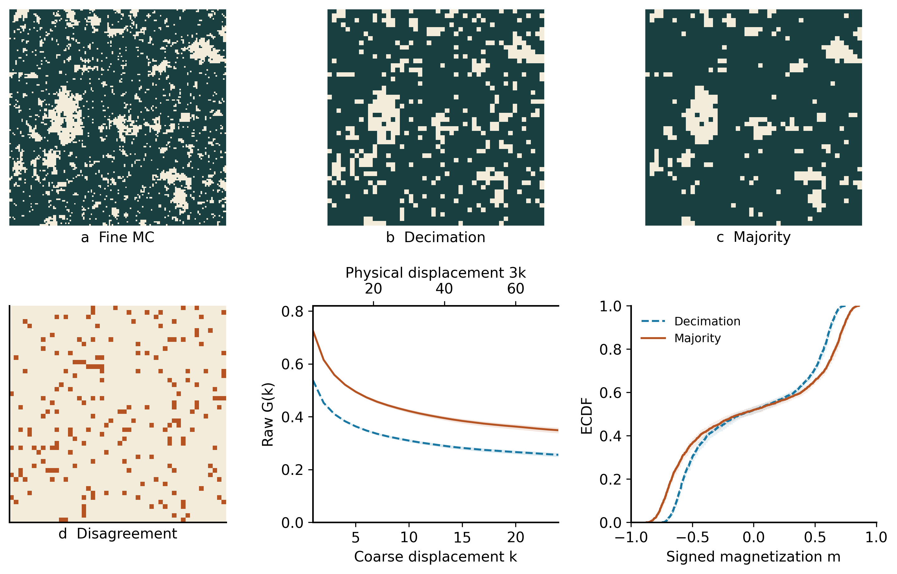

历史 MC：chain=1, ordinal=0, parent=128, global crop origin=440. 前四格来自同一父场；曲线和 ECDF 使用全部 2048 场、16 链，开窗口边界。阴影为10000次完整MC链重抽样的逐点95%分位区间，保留同链相关性及D/M配对，不是同时置信带；分歧率及配对曲线差的区间另见A3_chain_intervals.csv。

[矢量 PDF](figures/A3_W144_chain1.pdf)

## A3_W144_chain2

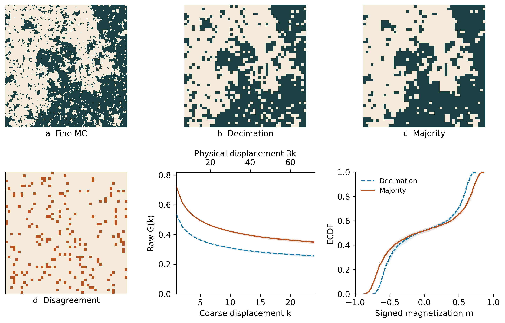

历史 MC：chain=2, ordinal=0, parent=256, global crop origin=440. 前四格来自同一父场；曲线和 ECDF 使用全部 2048 场、16 链，开窗口边界。阴影为10000次完整MC链重抽样的逐点95%分位区间，保留同链相关性及D/M配对，不是同时置信带；分歧率及配对曲线差的区间另见A3_chain_intervals.csv。

[矢量 PDF](figures/A3_W144_chain2.pdf)

## A3_W144_chain3

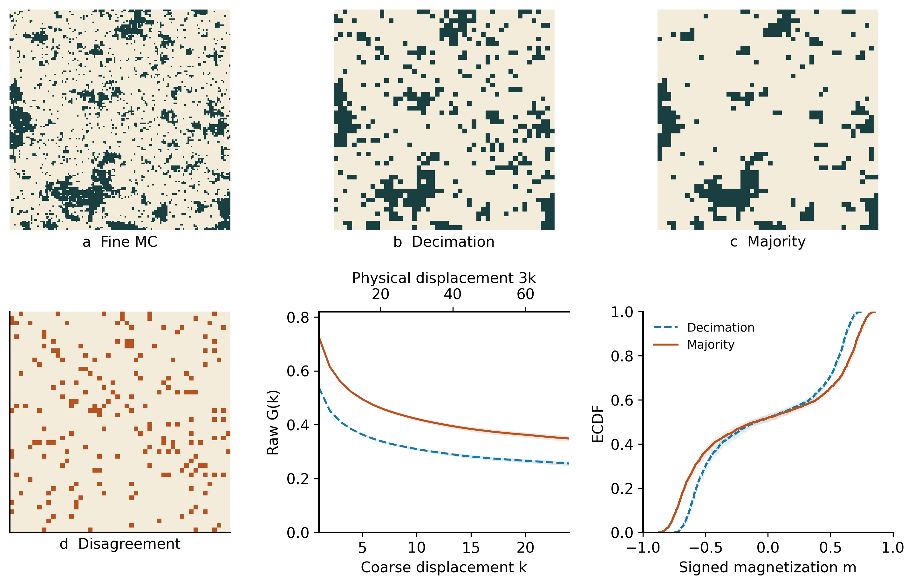

历史 MC：chain=3, ordinal=0, parent=384, global crop origin=440. 前四格来自同一父场；曲线和 ECDF 使用全部 2048 场、16 链，开窗口边界。阴影为10000次完整MC链重抽样的逐点95%分位区间，保留同链相关性及D/M配对，不是同时置信带；分歧率及配对曲线差的区间另见A3_chain_intervals.csv。

[矢量 PDF](figures/A3_W144_chain3.pdf)

## A3N_noise

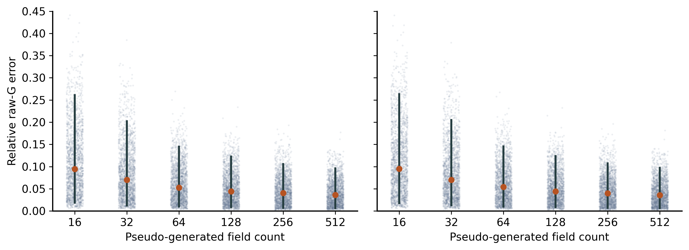

左：W96 r=25…48；右：majority W32 k=9…16。每格 2000 次；参考 256 场；偶数链为伪生成、奇数链为独立参考；链与链内循环块长 8 重抽。点为全部原始重复，竖线为 5%–95%，橙点为中位数。

[矢量 PDF](figures/A3N_noise.pdf)

## A0_trajectory

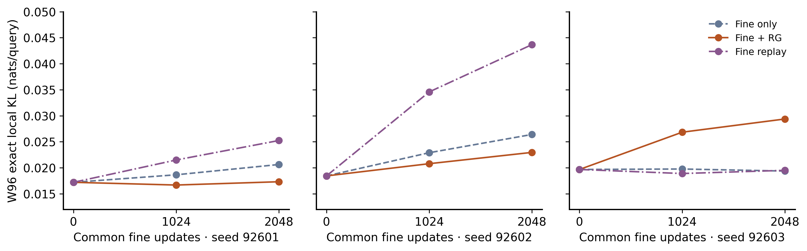

同一 256 父场、M=1/8/32 等权精确局部 KL。横轴共同细更新为 0/1024/2048；Fine-only 总更新同横轴，Fine+RG/Fine replay 总更新为 0/2048/4096；初始是已训练 I-F EMA。本图三条旧谱系分别呈现，不是确认试验。

[矢量 PDF](figures/A0_trajectory.pdf)

## A0_retention_changes

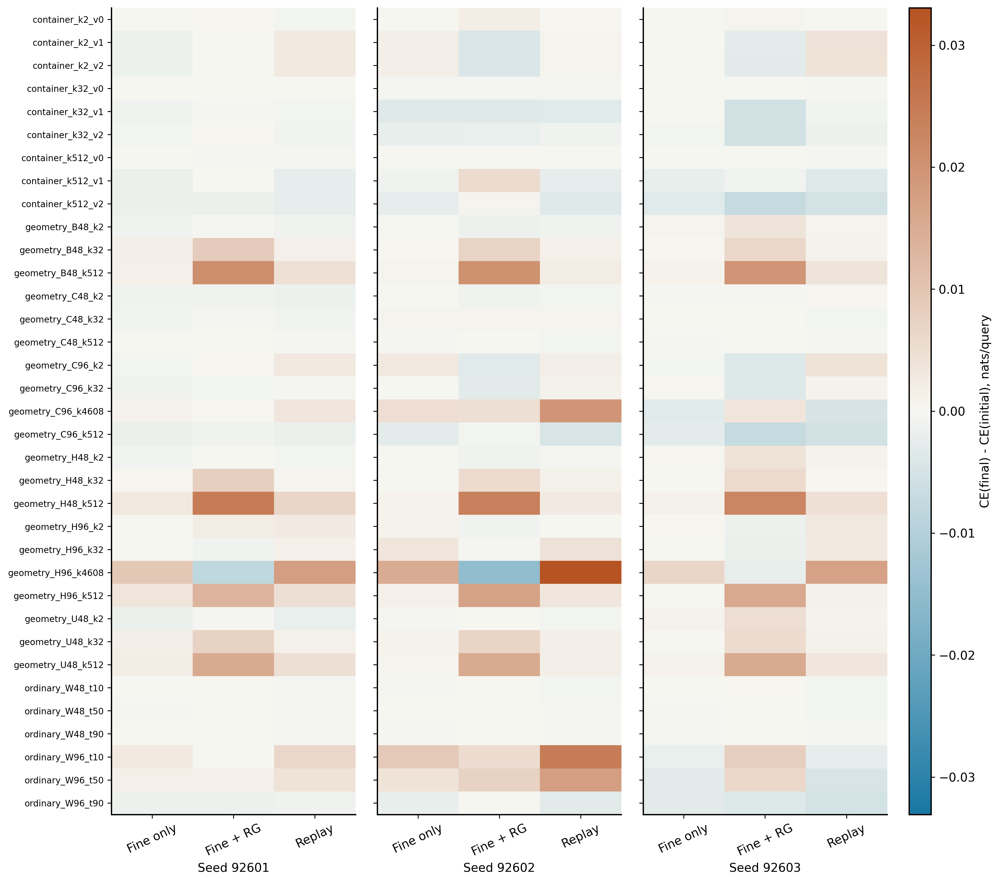

21个旧EMA、每格256父场配对复测。颜色为各终点相对同seed初始的CE变化，蓝色改善、橙色退化；所有seed共用色轴。C=连续格，U=训练间距，H=未见间距，B=聚簇未见间距，k=可见点数。容器v0=W48、v1=W96固定clock、v2=W96自然clock。ordinary为普通Bernoulli遮盖，t10/50/90分别为10%/50%/90%。这是逐任务描述，不作多重显著性宣称。

[矢量 PDF](figures/A0_retention_changes.pdf)

## A2_joint_s92601_all_plus

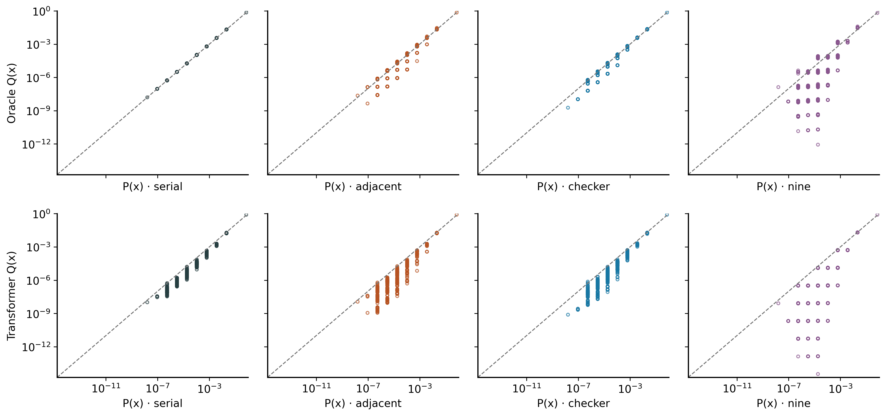

s92601_fine_plus_rg_final, all_plus：512 态精确 P 与各揭示方案 Q；上行精确单点 oracle，下行 Transformer；同图统一坐标。块位于 W16 第6–8行/列，模型 clock=max(剩余隐藏/256,0.01)。固定边界枚举无抽样置信区间。

[矢量 PDF](figures/A2_joint_s92601_all_plus.pdf)

## A2_decomposition_s92601_all_plus

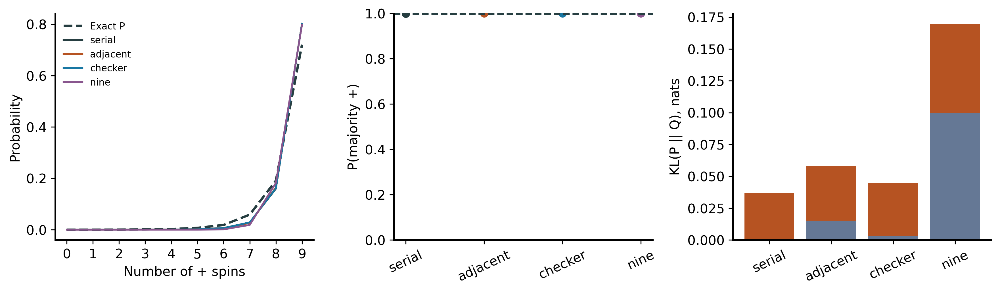

s92601_fine_plus_rg_final, all_plus。左：正自旋数分布；中：块多数为正概率，虚线为真值；右：灰蓝为因子化 KL，赭橙为单点条件 KL，其和逐边界核对联合 KL。

[矢量 PDF](figures/A2_decomposition_s92601_all_plus.pdf)

## A2_joint_s92601_mc_chain0_ord0

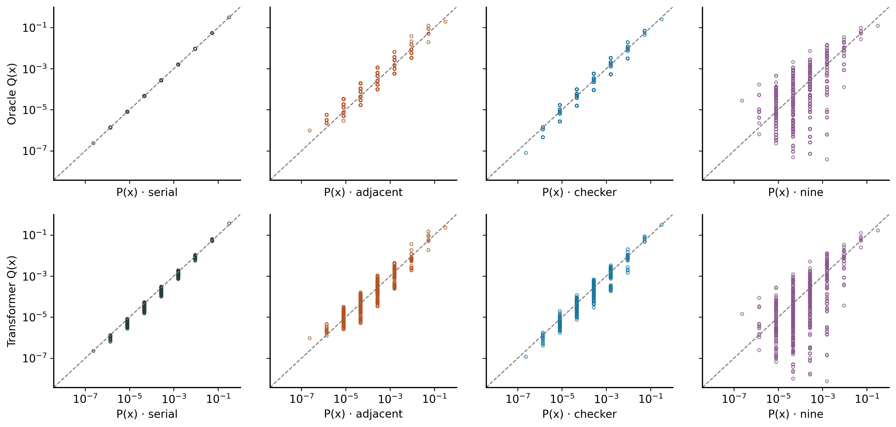

s92601_fine_plus_rg_final, mc_chain0_ord0：512 态精确 P 与各揭示方案 Q；上行精确单点 oracle，下行 Transformer；同图统一坐标。块位于 W16 第6–8行/列，模型 clock=max(剩余隐藏/256,0.01)。固定边界枚举无抽样置信区间。

[矢量 PDF](figures/A2_joint_s92601_mc_chain0_ord0.pdf)

## A2_decomposition_s92601_mc_chain0_ord0

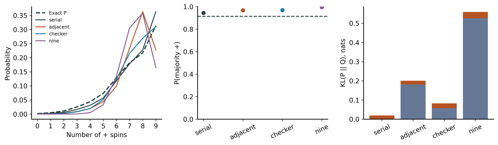

s92601_fine_plus_rg_final, mc_chain0_ord0。左：正自旋数分布；中：块多数为正概率，虚线为真值；右：灰蓝为因子化 KL，赭橙为单点条件 KL，其和逐边界核对联合 KL。

[矢量 PDF](figures/A2_decomposition_s92601_mc_chain0_ord0.pdf)

## A2_joint_s92602_all_plus

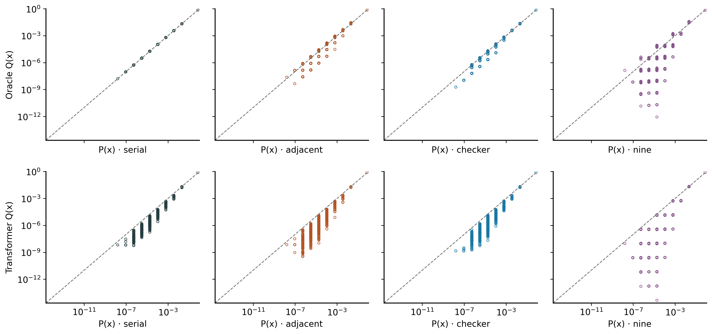

s92602_fine_plus_rg_final, all_plus：512 态精确 P 与各揭示方案 Q；上行精确单点 oracle，下行 Transformer；同图统一坐标。块位于 W16 第6–8行/列，模型 clock=max(剩余隐藏/256,0.01)。固定边界枚举无抽样置信区间。

[矢量 PDF](figures/A2_joint_s92602_all_plus.pdf)

## A2_decomposition_s92602_all_plus

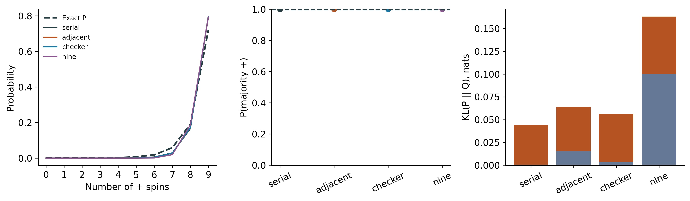

s92602_fine_plus_rg_final, all_plus。左：正自旋数分布；中：块多数为正概率，虚线为真值；右：灰蓝为因子化 KL，赭橙为单点条件 KL，其和逐边界核对联合 KL。

[矢量 PDF](figures/A2_decomposition_s92602_all_plus.pdf)

## A2_joint_s92602_mc_chain0_ord0

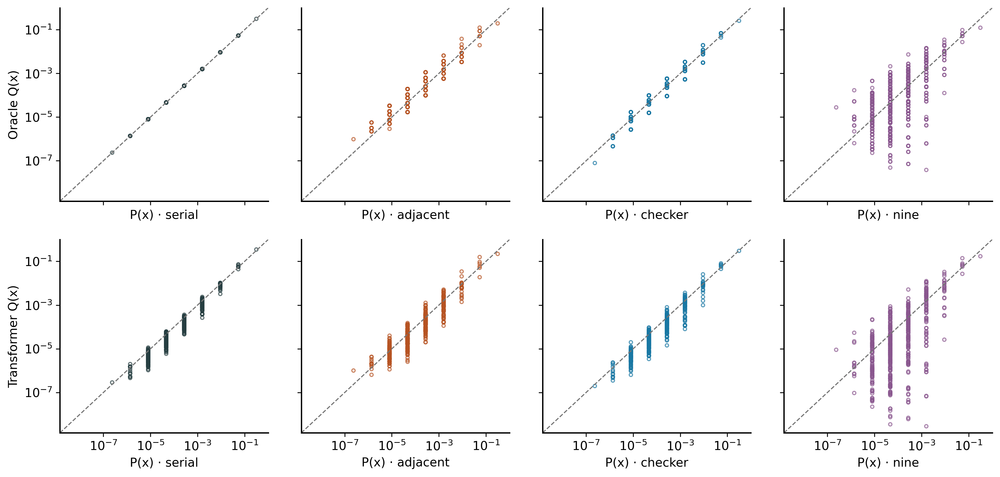

s92602_fine_plus_rg_final, mc_chain0_ord0：512 态精确 P 与各揭示方案 Q；上行精确单点 oracle，下行 Transformer；同图统一坐标。块位于 W16 第6–8行/列，模型 clock=max(剩余隐藏/256,0.01)。固定边界枚举无抽样置信区间。

[矢量 PDF](figures/A2_joint_s92602_mc_chain0_ord0.pdf)

## A2_decomposition_s92602_mc_chain0_ord0

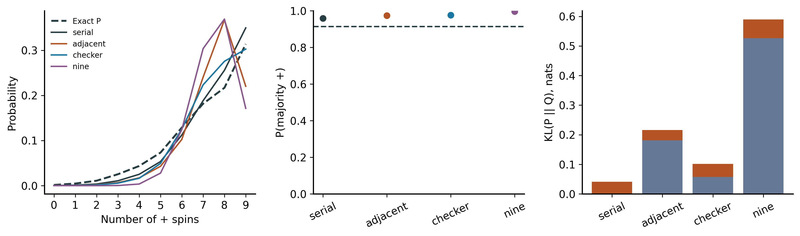

s92602_fine_plus_rg_final, mc_chain0_ord0。左：正自旋数分布；中：块多数为正概率，虚线为真值；右：灰蓝为因子化 KL，赭橙为单点条件 KL，其和逐边界核对联合 KL。

[矢量 PDF](figures/A2_decomposition_s92602_mc_chain0_ord0.pdf)

## A2_joint_s92603_all_plus

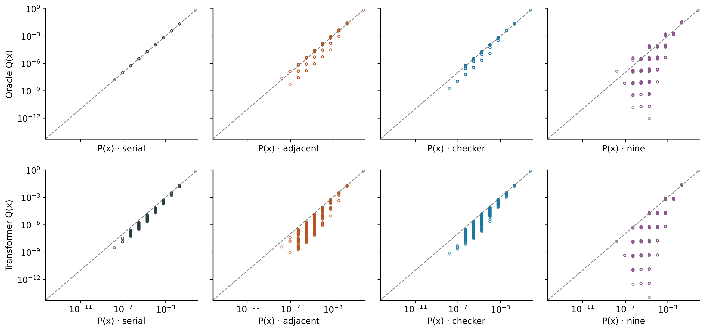

s92603_fine_plus_rg_final, all_plus：512 态精确 P 与各揭示方案 Q；上行精确单点 oracle，下行 Transformer；同图统一坐标。块位于 W16 第6–8行/列，模型 clock=max(剩余隐藏/256,0.01)。固定边界枚举无抽样置信区间。

[矢量 PDF](figures/A2_joint_s92603_all_plus.pdf)

## A2_decomposition_s92603_all_plus

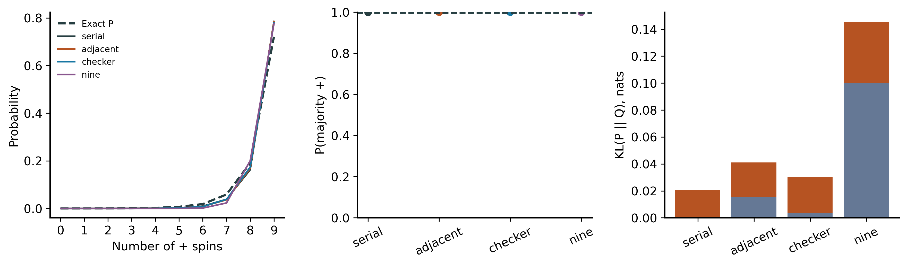

s92603_fine_plus_rg_final, all_plus。左：正自旋数分布；中：块多数为正概率，虚线为真值；右：灰蓝为因子化 KL，赭橙为单点条件 KL，其和逐边界核对联合 KL。

[矢量 PDF](figures/A2_decomposition_s92603_all_plus.pdf)

## A2_joint_s92603_mc_chain0_ord0

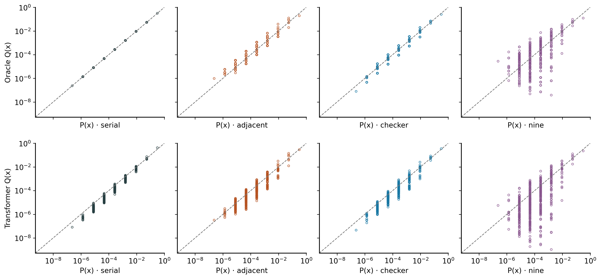

s92603_fine_plus_rg_final, mc_chain0_ord0：512 态精确 P 与各揭示方案 Q；上行精确单点 oracle，下行 Transformer；同图统一坐标。块位于 W16 第6–8行/列，模型 clock=max(剩余隐藏/256,0.01)。固定边界枚举无抽样置信区间。

[矢量 PDF](figures/A2_joint_s92603_mc_chain0_ord0.pdf)

## A2_decomposition_s92603_mc_chain0_ord0

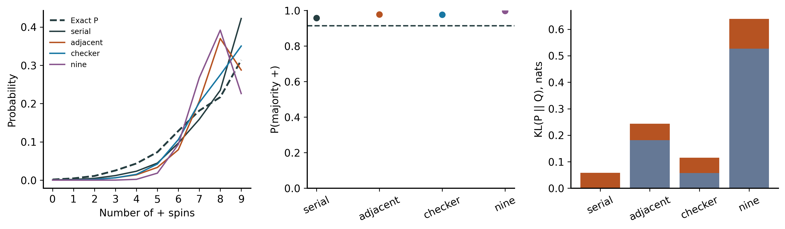

s92603_fine_plus_rg_final, mc_chain0_ord0。左：正自旋数分布；中：块多数为正概率，虚线为真值；右：灰蓝为因子化 KL，赭橙为单点条件 KL，其和逐边界核对联合 KL。

[矢量 PDF](figures/A2_decomposition_s92603_mc_chain0_ord0.pdf)

## A1_curves_s92601_K64

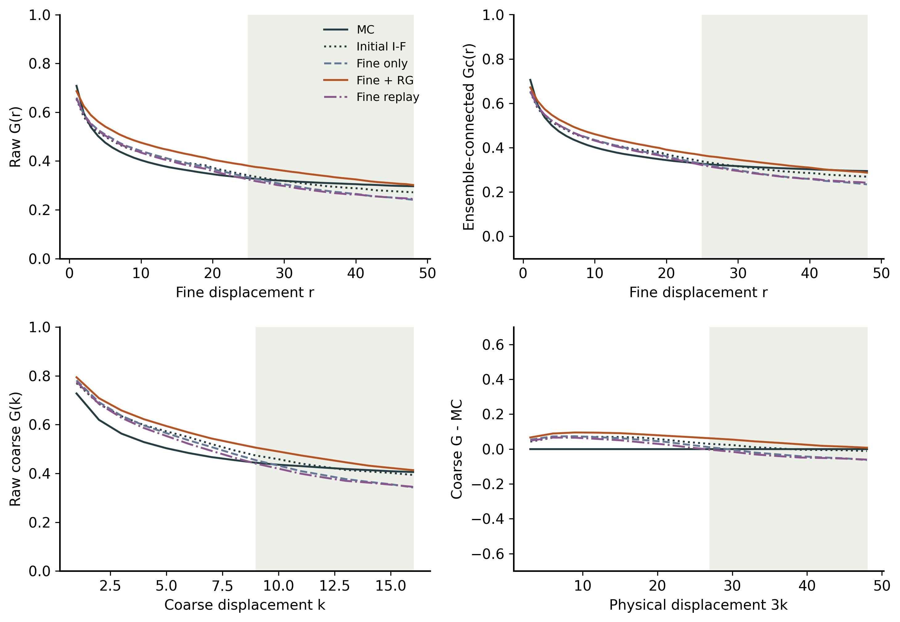

旧谱系 92601, K=64, 每模型32张；MC为8条奇数链各32场。B粗场逐图取真实多数投票。Gc=G−系综平均磁化平方；独立图/独立链的有限样本修正另存 sufficient_statistics。阴影是预定主距离区间；本图不作确认性判断。

[矢量 PDF](figures/A1_curves_s92601_K64.pdf)

## A1_samples_s92601_K64_i0

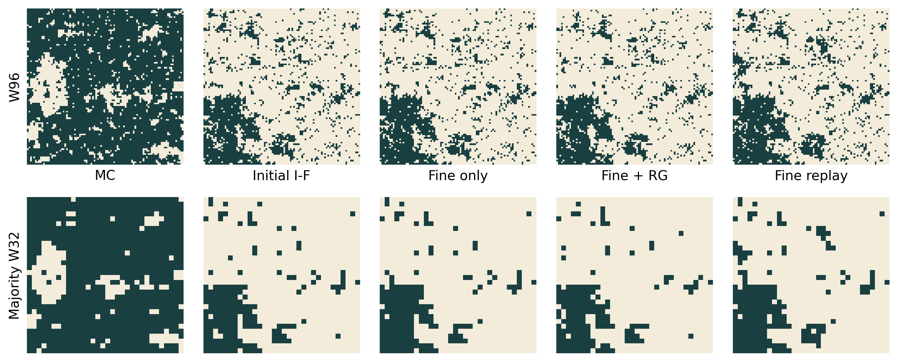

预登记生成ID=0，旧谱系=92601，K=64；MC parent=128、global origin=(464,464)。下行均为正上方细图的3×3多数投票。MC为独立参考构型；同一seed的模型列复用配对U/V随机数，列间不计算像素误差。

[矢量 PDF](figures/A1_samples_s92601_K64_i0.pdf)

## A1_samples_s92601_K64_i1

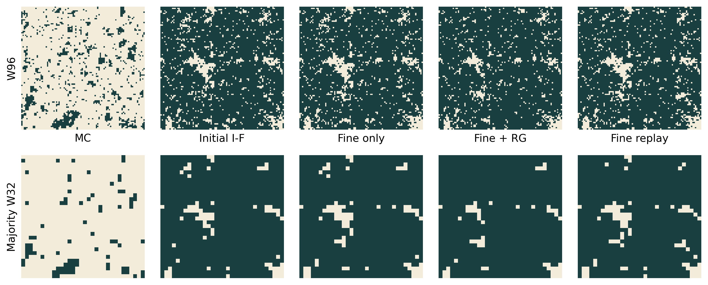

预登记生成ID=1，旧谱系=92601，K=64；MC parent=129、global origin=(464,464)。下行均为正上方细图的3×3多数投票。MC为独立参考构型；同一seed的模型列复用配对U/V随机数，列间不计算像素误差。

[矢量 PDF](figures/A1_samples_s92601_K64_i1.pdf)

## A1_samples_s92601_K64_i2

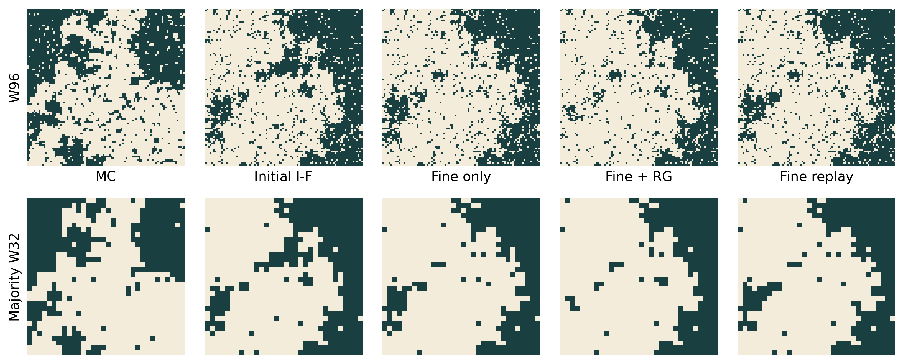

预登记生成ID=2，旧谱系=92601，K=64；MC parent=130、global origin=(464,464)。下行均为正上方细图的3×3多数投票。MC为独立参考构型；同一seed的模型列复用配对U/V随机数，列间不计算像素误差。

[矢量 PDF](figures/A1_samples_s92601_K64_i2.pdf)

## A1_samples_s92601_K64_i3

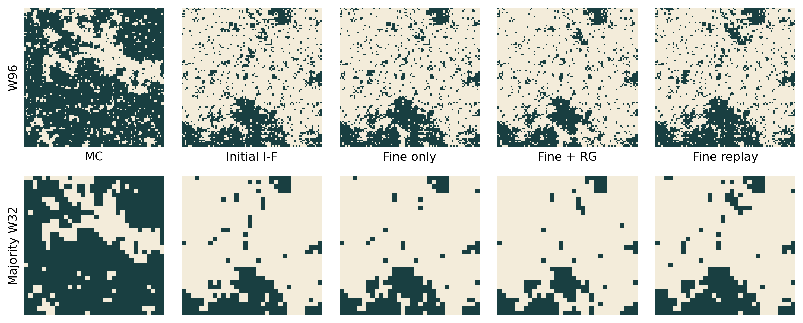

预登记生成ID=3，旧谱系=92601，K=64；MC parent=131、global origin=(464,464)。下行均为正上方细图的3×3多数投票。MC为独立参考构型；同一seed的模型列复用配对U/V随机数，列间不计算像素误差。

[矢量 PDF](figures/A1_samples_s92601_K64_i3.pdf)

## A1_distributions_fine_s92601_K64

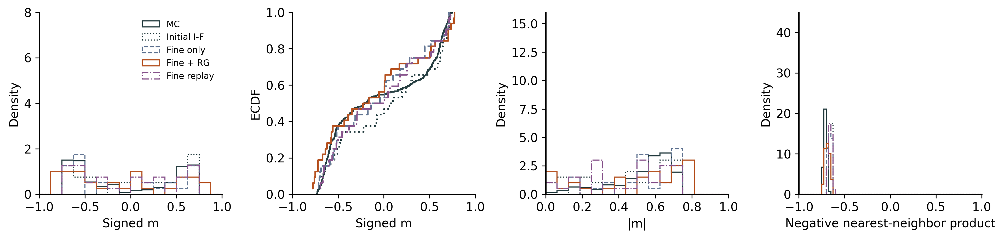

旧谱系 92601, K=64, fine W96。保留生成磁化原符号，所有seed使用相同分箱与全幅坐标。每键能量口径为窗口内邻键乘积负均值；粗格为操作性统计。小样本优先读ECDF。

[矢量 PDF](figures/A1_distributions_fine_s92601_K64.pdf)

## A1_distributions_B_s92601_K64

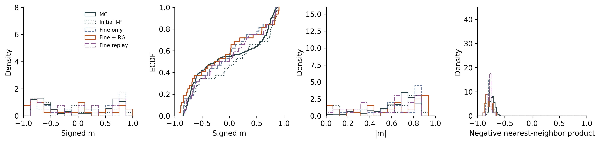

旧谱系 92601, K=64, B W32。保留生成磁化原符号，所有seed使用相同分箱与全幅坐标。每键能量口径为窗口内邻键乘积负均值；粗格为操作性统计。小样本优先读ECDF。

[矢量 PDF](figures/A1_distributions_B_s92601_K64.pdf)

## A1_paths_s92601_K64

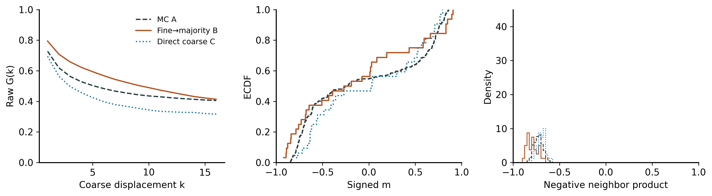

Fine+RG旧谱系92601, K=64。A=真实MC多数投票；B=同模型细生成后的投票；C=level1、块中心物理坐标直接生成。三路径均比较分布，B/C同时对独立MC参照报告误差。

[矢量 PDF](figures/A1_paths_s92601_K64.pdf)

## A1_curves_s92601_K256

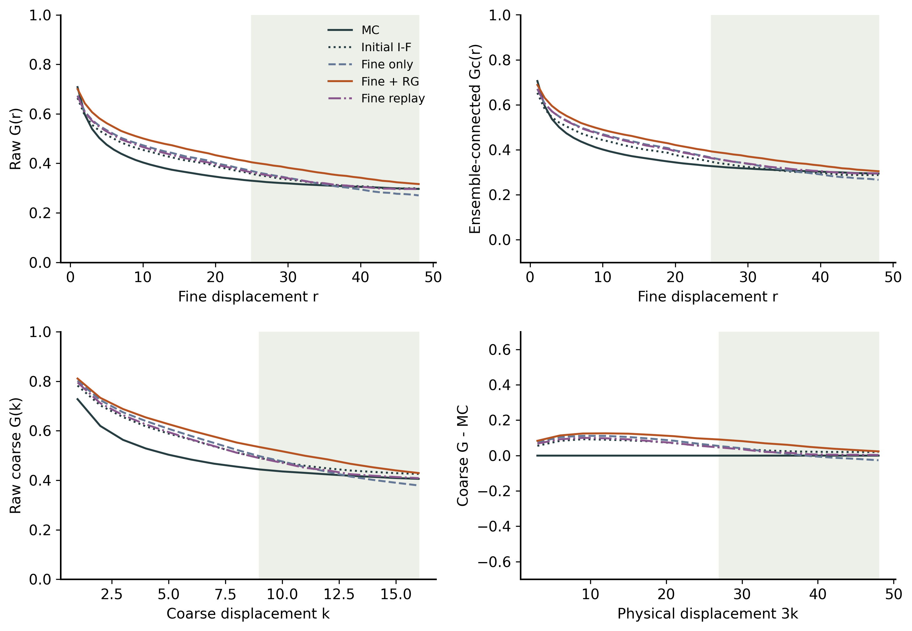

旧谱系 92601, K=256, 每模型32张；MC为8条奇数链各32场。B粗场逐图取真实多数投票。Gc=G−系综平均磁化平方；独立图/独立链的有限样本修正另存 sufficient_statistics。阴影是预定主距离区间；本图不作确认性判断。

[矢量 PDF](figures/A1_curves_s92601_K256.pdf)

## A1_samples_s92601_K256_i0

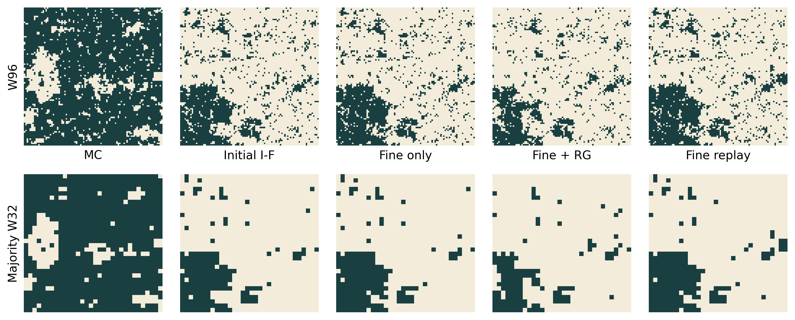

预登记生成ID=0，旧谱系=92601，K=256；MC parent=128、global origin=(464,464)。下行均为正上方细图的3×3多数投票。MC为独立参考构型；同一seed的模型列复用配对U/V随机数，列间不计算像素误差。

[矢量 PDF](figures/A1_samples_s92601_K256_i0.pdf)

## A1_samples_s92601_K256_i1

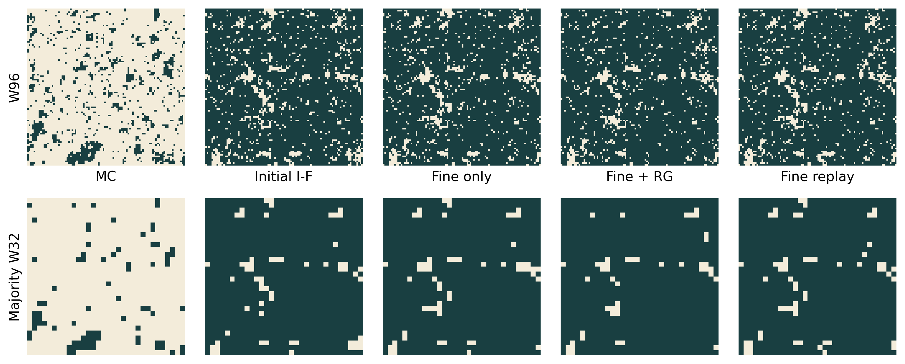

预登记生成ID=1，旧谱系=92601，K=256；MC parent=129、global origin=(464,464)。下行均为正上方细图的3×3多数投票。MC为独立参考构型；同一seed的模型列复用配对U/V随机数，列间不计算像素误差。

[矢量 PDF](figures/A1_samples_s92601_K256_i1.pdf)

## A1_samples_s92601_K256_i2

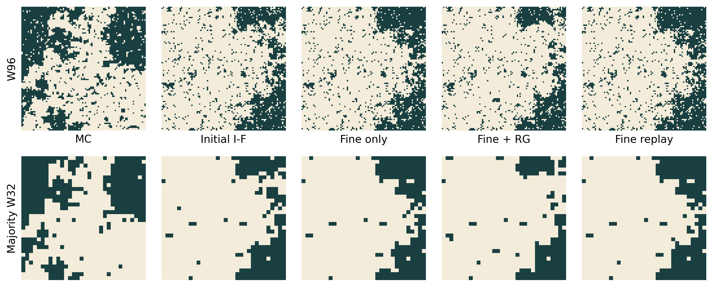

预登记生成ID=2，旧谱系=92601，K=256；MC parent=130、global origin=(464,464)。下行均为正上方细图的3×3多数投票。MC为独立参考构型；同一seed的模型列复用配对U/V随机数，列间不计算像素误差。

[矢量 PDF](figures/A1_samples_s92601_K256_i2.pdf)

## A1_samples_s92601_K256_i3

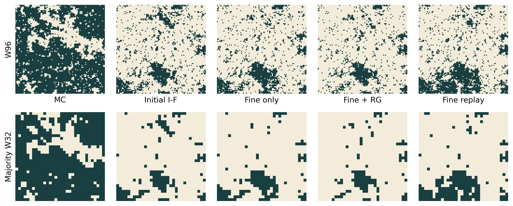

预登记生成ID=3，旧谱系=92601，K=256；MC parent=131、global origin=(464,464)。下行均为正上方细图的3×3多数投票。MC为独立参考构型；同一seed的模型列复用配对U/V随机数，列间不计算像素误差。

[矢量 PDF](figures/A1_samples_s92601_K256_i3.pdf)

## A1_distributions_fine_s92601_K256

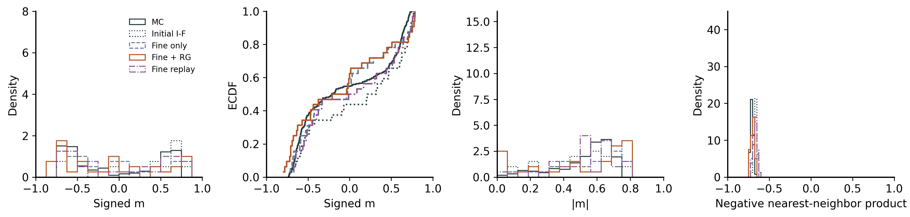

旧谱系 92601, K=256, fine W96。保留生成磁化原符号，所有seed使用相同分箱与全幅坐标。每键能量口径为窗口内邻键乘积负均值；粗格为操作性统计。小样本优先读ECDF。

[矢量 PDF](figures/A1_distributions_fine_s92601_K256.pdf)

## A1_distributions_B_s92601_K256

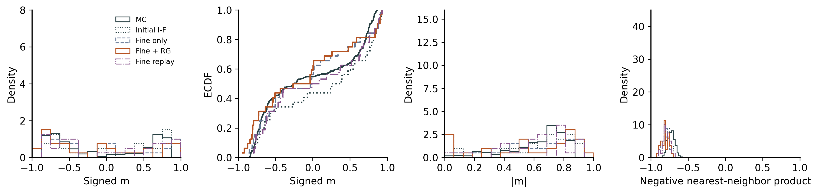

旧谱系 92601, K=256, B W32。保留生成磁化原符号，所有seed使用相同分箱与全幅坐标。每键能量口径为窗口内邻键乘积负均值；粗格为操作性统计。小样本优先读ECDF。

[矢量 PDF](figures/A1_distributions_B_s92601_K256.pdf)

## A1_paths_s92601_K256

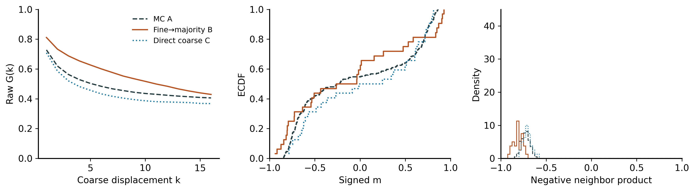

Fine+RG旧谱系92601, K=256。A=真实MC多数投票；B=同模型细生成后的投票；C=level1、块中心物理坐标直接生成。三路径均比较分布，B/C同时对独立MC参照报告误差。

[矢量 PDF](figures/A1_paths_s92601_K256.pdf)

## A1_curves_s92602_K64

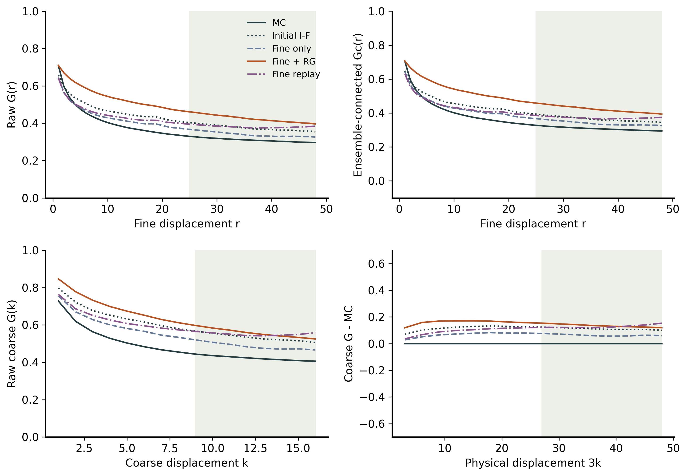

旧谱系 92602, K=64, 每模型32张；MC为8条奇数链各32场。B粗场逐图取真实多数投票。Gc=G−系综平均磁化平方；独立图/独立链的有限样本修正另存 sufficient_statistics。阴影是预定主距离区间；本图不作确认性判断。

[矢量 PDF](figures/A1_curves_s92602_K64.pdf)

## A1_samples_s92602_K64_i0

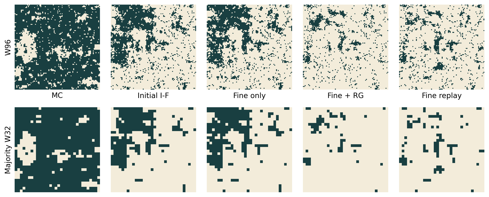

预登记生成ID=0，旧谱系=92602，K=64；MC parent=128、global origin=(464,464)。下行均为正上方细图的3×3多数投票。MC为独立参考构型；同一seed的模型列复用配对U/V随机数，列间不计算像素误差。

[矢量 PDF](figures/A1_samples_s92602_K64_i0.pdf)

## A1_samples_s92602_K64_i1

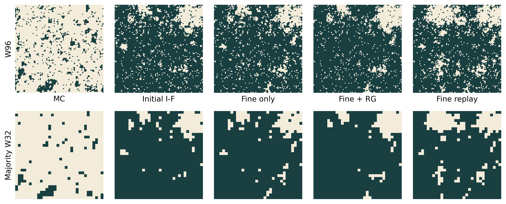

预登记生成ID=1，旧谱系=92602，K=64；MC parent=129、global origin=(464,464)。下行均为正上方细图的3×3多数投票。MC为独立参考构型；同一seed的模型列复用配对U/V随机数，列间不计算像素误差。

[矢量 PDF](figures/A1_samples_s92602_K64_i1.pdf)

## A1_samples_s92602_K64_i2

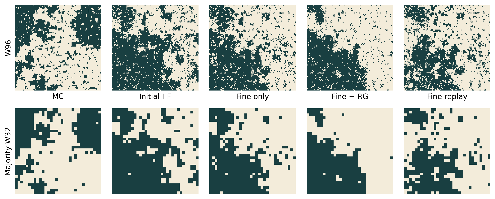

预登记生成ID=2，旧谱系=92602，K=64；MC parent=130、global origin=(464,464)。下行均为正上方细图的3×3多数投票。MC为独立参考构型；同一seed的模型列复用配对U/V随机数，列间不计算像素误差。

[矢量 PDF](figures/A1_samples_s92602_K64_i2.pdf)

## A1_samples_s92602_K64_i3

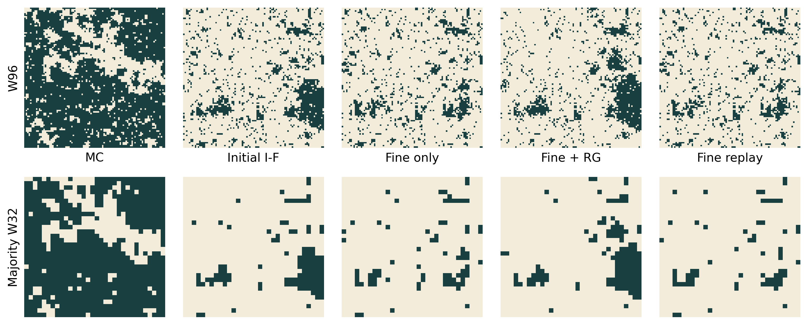

预登记生成ID=3，旧谱系=92602，K=64；MC parent=131、global origin=(464,464)。下行均为正上方细图的3×3多数投票。MC为独立参考构型；同一seed的模型列复用配对U/V随机数，列间不计算像素误差。

[矢量 PDF](figures/A1_samples_s92602_K64_i3.pdf)

## A1_distributions_fine_s92602_K64

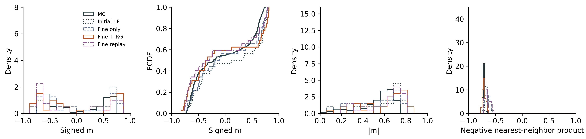

旧谱系 92602, K=64, fine W96。保留生成磁化原符号，所有seed使用相同分箱与全幅坐标。每键能量口径为窗口内邻键乘积负均值；粗格为操作性统计。小样本优先读ECDF。

[矢量 PDF](figures/A1_distributions_fine_s92602_K64.pdf)

## A1_distributions_B_s92602_K64

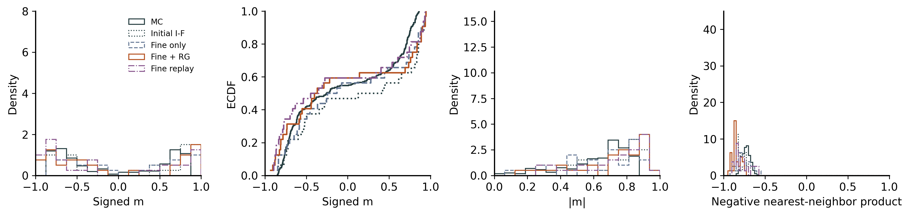

旧谱系 92602, K=64, B W32。保留生成磁化原符号，所有seed使用相同分箱与全幅坐标。每键能量口径为窗口内邻键乘积负均值；粗格为操作性统计。小样本优先读ECDF。

[矢量 PDF](figures/A1_distributions_B_s92602_K64.pdf)

## A1_paths_s92602_K64

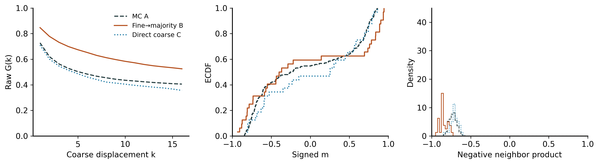

Fine+RG旧谱系92602, K=64。A=真实MC多数投票；B=同模型细生成后的投票；C=level1、块中心物理坐标直接生成。三路径均比较分布，B/C同时对独立MC参照报告误差。

[矢量 PDF](figures/A1_paths_s92602_K64.pdf)

## A1_curves_s92602_K256

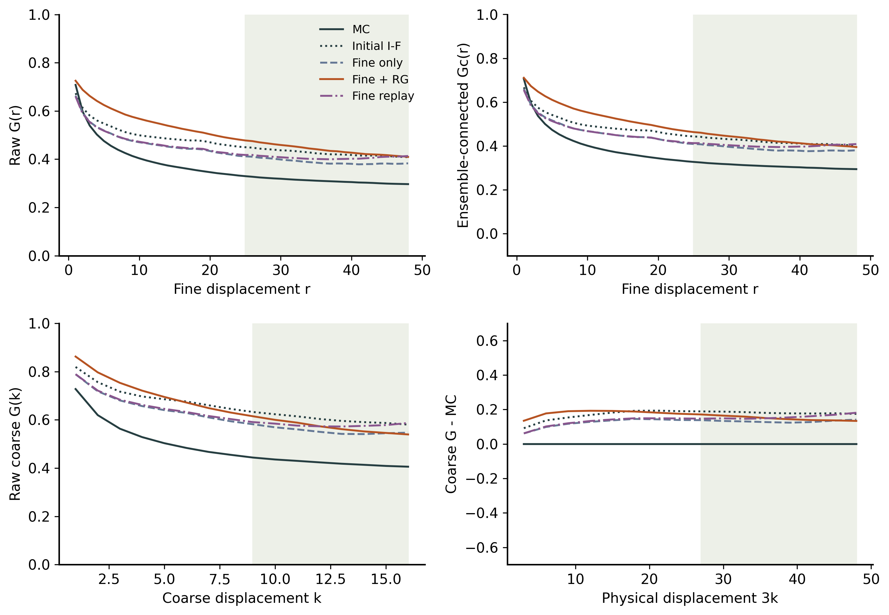

旧谱系 92602, K=256, 每模型32张；MC为8条奇数链各32场。B粗场逐图取真实多数投票。Gc=G−系综平均磁化平方；独立图/独立链的有限样本修正另存 sufficient_statistics。阴影是预定主距离区间；本图不作确认性判断。

[矢量 PDF](figures/A1_curves_s92602_K256.pdf)

## A1_samples_s92602_K256_i0

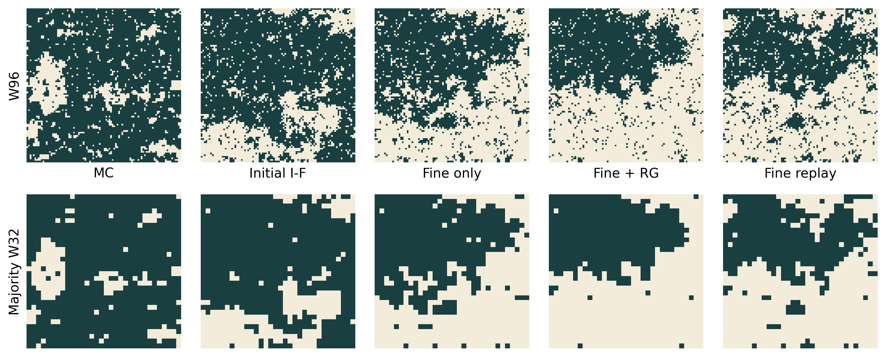

预登记生成ID=0，旧谱系=92602，K=256；MC parent=128、global origin=(464,464)。下行均为正上方细图的3×3多数投票。MC为独立参考构型；同一seed的模型列复用配对U/V随机数，列间不计算像素误差。

[矢量 PDF](figures/A1_samples_s92602_K256_i0.pdf)

## A1_samples_s92602_K256_i1

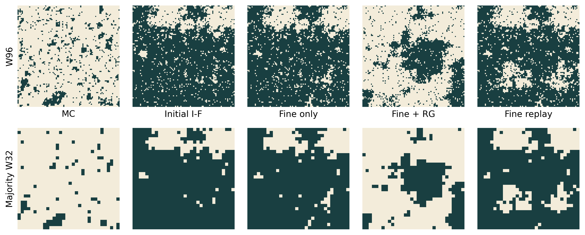

预登记生成ID=1，旧谱系=92602，K=256；MC parent=129、global origin=(464,464)。下行均为正上方细图的3×3多数投票。MC为独立参考构型；同一seed的模型列复用配对U/V随机数，列间不计算像素误差。

[矢量 PDF](figures/A1_samples_s92602_K256_i1.pdf)

## A1_samples_s92602_K256_i2

预登记生成ID=2，旧谱系=92602，K=256；MC parent=130、global origin=(464,464)。下行均为正上方细图的3×3多数投票。MC为独立参考构型；同一seed的模型列复用配对U/V随机数，列间不计算像素误差。

[矢量 PDF](figures/A1_samples_s92602_K256_i2.pdf)

## A1_samples_s92602_K256_i3

预登记生成ID=3，旧谱系=92602，K=256；MC parent=131、global origin=(464,464)。下行均为正上方细图的3×3多数投票。MC为独立参考构型；同一seed的模型列复用配对U/V随机数，列间不计算像素误差。

[矢量 PDF](figures/A1_samples_s92602_K256_i3.pdf)

## A1_distributions_fine_s92602_K256

旧谱系 92602, K=256, fine W96。保留生成磁化原符号，所有seed使用相同分箱与全幅坐标。每键能量口径为窗口内邻键乘积负均值；粗格为操作性统计。小样本优先读ECDF。

[矢量 PDF](figures/A1_distributions_fine_s92602_K256.pdf)

## A1_distributions_B_s92602_K256

旧谱系 92602, K=256, B W32。保留生成磁化原符号，所有seed使用相同分箱与全幅坐标。每键能量口径为窗口内邻键乘积负均值；粗格为操作性统计。小样本优先读ECDF。

[矢量 PDF](figures/A1_distributions_B_s92602_K256.pdf)

## A1_paths_s92602_K256

Fine+RG旧谱系92602, K=256。A=真实MC多数投票；B=同模型细生成后的投票；C=level1、块中心物理坐标直接生成。三路径均比较分布，B/C同时对独立MC参照报告误差。

[矢量 PDF](figures/A1_paths_s92602_K256.pdf)

## A1_curves_s92603_K64

旧谱系 92603, K=64, 每模型32张；MC为8条奇数链各32场。B粗场逐图取真实多数投票。Gc=G−系综平均磁化平方；独立图/独立链的有限样本修正另存 sufficient_statistics。阴影是预定主距离区间；本图不作确认性判断。

[矢量 PDF](figures/A1_curves_s92603_K64.pdf)

## A1_samples_s92603_K64_i0

预登记生成ID=0，旧谱系=92603，K=64；MC parent=128、global origin=(464,464)。下行均为正上方细图的3×3多数投票。MC为独立参考构型；同一seed的模型列复用配对U/V随机数，列间不计算像素误差。

[矢量 PDF](figures/A1_samples_s92603_K64_i0.pdf)

## A1_samples_s92603_K64_i1

预登记生成ID=1，旧谱系=92603，K=64；MC parent=129、global origin=(464,464)。下行均为正上方细图的3×3多数投票。MC为独立参考构型；同一seed的模型列复用配对U/V随机数，列间不计算像素误差。

[矢量 PDF](figures/A1_samples_s92603_K64_i1.pdf)

## A1_samples_s92603_K64_i2

预登记生成ID=2，旧谱系=92603，K=64；MC parent=130、global origin=(464,464)。下行均为正上方细图的3×3多数投票。MC为独立参考构型；同一seed的模型列复用配对U/V随机数，列间不计算像素误差。

[矢量 PDF](figures/A1_samples_s92603_K64_i2.pdf)

## A1_samples_s92603_K64_i3

预登记生成ID=3，旧谱系=92603，K=64；MC parent=131、global origin=(464,464)。下行均为正上方细图的3×3多数投票。MC为独立参考构型；同一seed的模型列复用配对U/V随机数，列间不计算像素误差。

[矢量 PDF](figures/A1_samples_s92603_K64_i3.pdf)

## A1_distributions_fine_s92603_K64

旧谱系 92603, K=64, fine W96。保留生成磁化原符号，所有seed使用相同分箱与全幅坐标。每键能量口径为窗口内邻键乘积负均值；粗格为操作性统计。小样本优先读ECDF。

[矢量 PDF](figures/A1_distributions_fine_s92603_K64.pdf)

## A1_distributions_B_s92603_K64

旧谱系 92603, K=64, B W32。保留生成磁化原符号，所有seed使用相同分箱与全幅坐标。每键能量口径为窗口内邻键乘积负均值；粗格为操作性统计。小样本优先读ECDF。

[矢量 PDF](figures/A1_distributions_B_s92603_K64.pdf)

## A1_paths_s92603_K64

Fine+RG旧谱系92603, K=64。A=真实MC多数投票；B=同模型细生成后的投票；C=level1、块中心物理坐标直接生成。三路径均比较分布，B/C同时对独立MC参照报告误差。

[矢量 PDF](figures/A1_paths_s92603_K64.pdf)

## A1_curves_s92603_K256

旧谱系 92603, K=256, 每模型32张；MC为8条奇数链各32场。B粗场逐图取真实多数投票。Gc=G−系综平均磁化平方；独立图/独立链的有限样本修正另存 sufficient_statistics。阴影是预定主距离区间；本图不作确认性判断。

[矢量 PDF](figures/A1_curves_s92603_K256.pdf)

## A1_samples_s92603_K256_i0

预登记生成ID=0，旧谱系=92603，K=256；MC parent=128、global origin=(464,464)。下行均为正上方细图的3×3多数投票。MC为独立参考构型；同一seed的模型列复用配对U/V随机数，列间不计算像素误差。

[矢量 PDF](figures/A1_samples_s92603_K256_i0.pdf)

## A1_samples_s92603_K256_i1

预登记生成ID=1，旧谱系=92603，K=256；MC parent=129、global origin=(464,464)。下行均为正上方细图的3×3多数投票。MC为独立参考构型；同一seed的模型列复用配对U/V随机数，列间不计算像素误差。

[矢量 PDF](figures/A1_samples_s92603_K256_i1.pdf)

## A1_samples_s92603_K256_i2

预登记生成ID=2，旧谱系=92603，K=256；MC parent=130、global origin=(464,464)。下行均为正上方细图的3×3多数投票。MC为独立参考构型；同一seed的模型列复用配对U/V随机数，列间不计算像素误差。

[矢量 PDF](figures/A1_samples_s92603_K256_i2.pdf)

## A1_samples_s92603_K256_i3

预登记生成ID=3，旧谱系=92603，K=256；MC parent=131、global origin=(464,464)。下行均为正上方细图的3×3多数投票。MC为独立参考构型；同一seed的模型列复用配对U/V随机数，列间不计算像素误差。

[矢量 PDF](figures/A1_samples_s92603_K256_i3.pdf)

## A1_distributions_fine_s92603_K256

旧谱系 92603, K=256, fine W96。保留生成磁化原符号，所有seed使用相同分箱与全幅坐标。每键能量口径为窗口内邻键乘积负均值；粗格为操作性统计。小样本优先读ECDF。

[矢量 PDF](figures/A1_distributions_fine_s92603_K256.pdf)

## A1_distributions_B_s92603_K256

旧谱系 92603, K=256, B W32。保留生成磁化原符号，所有seed使用相同分箱与全幅坐标。每键能量口径为窗口内邻键乘积负均值；粗格为操作性统计。小样本优先读ECDF。

[矢量 PDF](figures/A1_distributions_B_s92603_K256.pdf)

## A1_paths_s92603_K256

Fine+RG旧谱系92603, K=256。A=真实MC多数投票；B=同模型细生成后的投票；C=level1、块中心物理坐标直接生成。三路径均比较分布，B/C同时对独立MC参照报告误差。

[矢量 PDF](figures/A1_paths_s92603_K256.pdf)

## A0_training_s92601

旧谱系92601，原始训练日志逐文件SHA校验。实线粗度的曲线为互不重叠128周期块均值，梯度浅色细线为块内最大值；不是置信区间。实际超过裁剪阈值1的事件共0次。逐次损失、原始范数和更新身份完整保存在A0_historical_logs.csv；旧日志未记录本轮B所用的共同/辅助梯度余弦。

[矢量 PDF](figures/A0_training_s92601.pdf)

## A0_training_s92602

旧谱系92602，原始训练日志逐文件SHA校验。实线粗度的曲线为互不重叠128周期块均值，梯度浅色细线为块内最大值；不是置信区间。实际超过裁剪阈值1的事件共0次。逐次损失、原始范数和更新身份完整保存在A0_historical_logs.csv；旧日志未记录本轮B所用的共同/辅助梯度余弦。

[矢量 PDF](figures/A0_training_s92602.pdf)

## A0_training_s92603

旧谱系92603，原始训练日志逐文件SHA校验。实线粗度的曲线为互不重叠128周期块均值，梯度浅色细线为块内最大值；不是置信区间。实际超过裁剪阈值1的事件共0次。逐次损失、原始范数和更新身份完整保存在A0_historical_logs.csv；旧日志未记录本轮B所用的共同/辅助梯度余弦。

[矢量 PDF](figures/A0_training_s92603.pdf)

