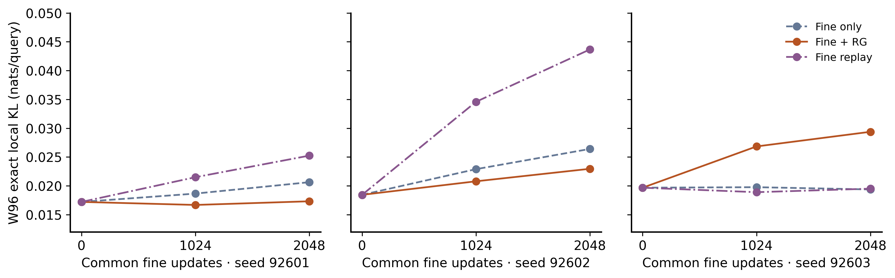
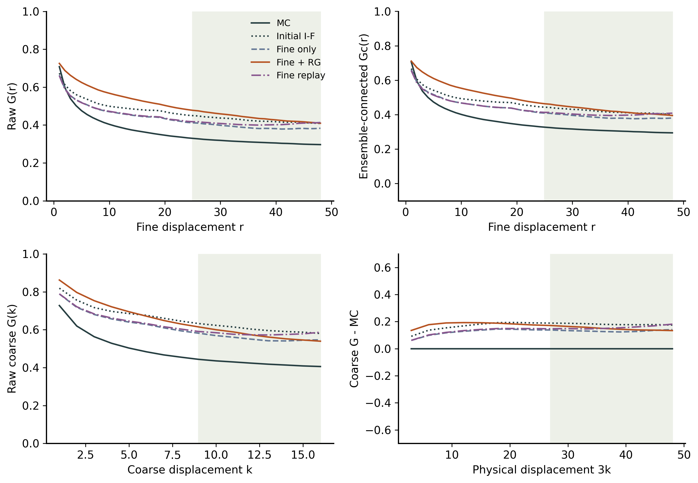
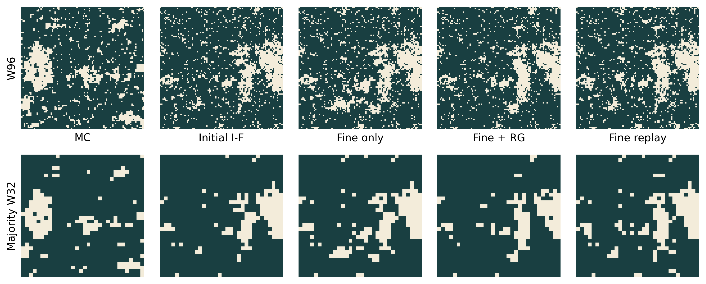
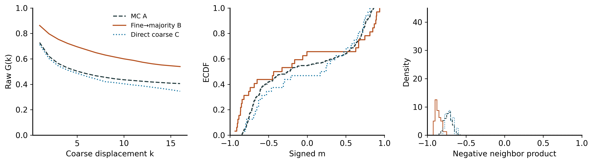
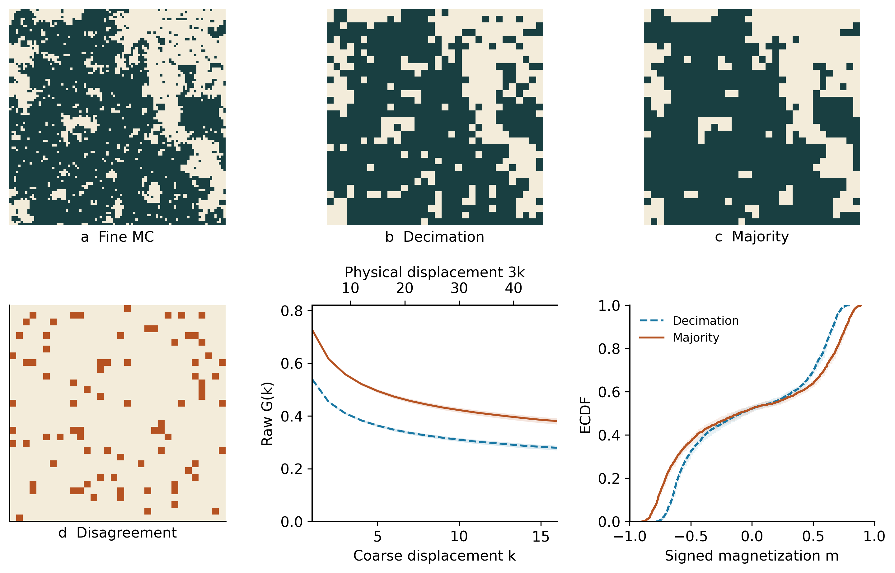
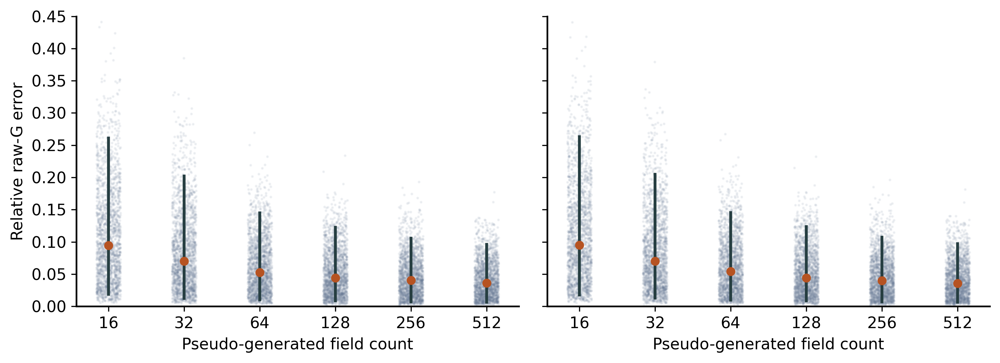

# RG-2 v1.2：阶段 A 结果

阶段 A 已全部完成并通过独立数值复算。**旧模型没有显示稳定的 Fine+RG 细场生成收益：256 步采样时，三个旧谱系的 Fine+RG 长程关联误差都高于初始模型和等预算 replay；64 步时，相对 replay 的方向并不一致。** 这支持继续用从零训练的 F/P/D/M 拆分机制，不能据此否定所有粗尺度训练方案。

本页是旧模型诊断，不能替代阶段 B 的开发对照或阶段 C 的独立确认。每个生成条件只有 32 张图；以下均为描述性结果。

## 1. 本轮实际完成了什么

| 项目 | 完成量 | 回答的问题 |
|---|---:|---|
| A0 精确局部测试 | 21 份权重 × 6 银行＝126 格 | 中点和终点的条件能力是否保留？ |
| A0 条件／几何保留 | 21 份权重 × 35 任务＝735 格 | 原任务的损失是否退化？ |
| A1 自由生成 | 960 张独立生成输出 | 局部能力是否转化为生成分布？ |
| A2 小块联合分布 | 12 模型 × 33 边界＝396 组 | 单点误差与并行因子化误差能否分开？ |
| A3 真实 MC 粗化 | 2,048 父场、16 条链、两种宽度 | 抽点与多数投票实际相差多大？ |
| A3-N 样本量诊断 | 6 档样本量、每档 2,000 次，另有块长敏感性 | 当前样本量能分辨多小的误差？ |

A1 中，三个旧谱系各有初始、Fine-only、Fine+RG、Fine replay 四个模型，各在 W96、64/256 步生成 32 张，共 768 张；Fine+RG 另直接生成 W32 粗场 192 张。所有 W96 生成图另逐图做多数投票，这些衍生粗图不重复计入“独立生成输出”。同谱系不同模型共享配对生成随机数。

## 2. 局部条件能力与原任务保留

下表对 W96 的 M=1/8/32 三个精确局部任务等权平均；KL 越小越好。中点轨迹和全部父场级预测均在配套数据中。

| 旧谱系 | 初始 | Fine-only 终点 | Fine+RG 终点 | Replay 终点 |
|---|---:|---:|---:|---:|
| 92601 | 0.017211 | 0.020632 | 0.017319 | 0.025243 |
| 92602 | 0.018438 | 0.026401 | 0.022956 | 0.043661 |
| 92603 | 0.019676 | 0.019372 | 0.029377 | 0.019510 |

Fine+RG 在 20 个原几何任务上的终点减初始 CE，三个谱系分别为 **+0.004370、+0.003711、+0.004338**。正值表示退化；这些是任务等权的描述性均值，不能推断所有任务都退化。

旧训练日志经 SHA 校验后统计到 **0 次梯度裁剪**，最大原始梯度范数为 0.647894，低于阈值 1。因此，现有记录不支持把退化解释为裁剪触发。

[126 格精确结果](A0_exact.csv) · [735 格保留结果](A0_retention.csv) · [逐父场配对差](A0_retention_paired_differences.npz) · [训练日志表](A0_historical_logs.csv)

## 3. 真正自由生成的长程关联

主观测量是原始两点关联 G，在 W96 的距离 25–48 上计算相对误差。每张图先按窗口内水平／垂直有效点对求均值，再对图等权；不跨裁剪边界。参考为独立于训练数据的历史 MC：8 条奇数链各前 32 场，共 256 场。

| 旧谱系 | 采样步数 | 初始 | Fine-only | Fine+RG | Replay | RG − Replay |
|---|---:|---:|---:|---:|---:|---:|
| 92601 | 64 | 0.04902 | 0.11229 | 0.09917 | 0.11929 | -0.02012 |
| 92601 | 256 | 0.03933 | 0.06685 | 0.15897 | 0.04843 | +0.11055 |
| 92602 | 64 | 0.20933 | 0.09820 | 0.37174 | 0.22988 | +0.14186 |
| 92602 | 256 | 0.37158 | 0.25486 | 0.41828 | 0.31268 | +0.10560 |
| 92603 | 64 | 0.22032 | 0.05196 | 0.10018 | 0.06866 | +0.03152 |
| 92603 | 256 | 0.33200 | 0.25351 | 0.43030 | 0.14409 | +0.28621 |

误差越小越好；最后一列负值表示 RG 更好。256 步下，Fine+RG 相对 replay 的三个差值均为正；64 步下，一条谱系改善、两条退化。**更多采样步数并未在这些旧模型上带来统一的改善。** 不能在看到结果后只选更有利的步数来概括训练效果。

图中阴影是预定的长距离评价区间；连通关联用系综平均磁化扣除，另保存了独立图／独立链有限样本修正。其余谱系、两档采样和固定 ID 的构型见[全部图版](FIGURES.md)。

上行为 W96，下行为正上方同一张图的 3×3 多数投票。MC 是独立参考构型；模型各列共享配对随机数，所以外观相似并不意味着独立复现。展示 ID 0 是预先规定的，完整图版保留 ID 0、1、2、3，不按外观挑图。

## 4. 细生成后粗化与直接粗生成不是一回事

这里的“路径 B/C”是 A1 内部的两种生成路径，**不是实验阶段 B/C**。两条路径都对同一个真实 MC 多数投票分布评价。

| 旧谱系 | 步数 | 细生成→投票的误差 | 直接粗生成的误差 | 两条粗曲线之间的距离 |
|---|---:|---:|---:|---:|
| 92601 | 64 | 0.08880 | 0.21311 | 0.29421 |
| 92601 | 256 | 0.14143 | 0.10443 | 0.24333 |
| 92602 | 64 | 0.32056 | 0.08838 | 0.40698 |
| 92602 | 256 | 0.35509 | 0.10117 | 0.45245 |
| 92603 | 64 | 0.08682 | 0.09866 | 0.18398 |
| 92603 | 256 | 0.39833 | 0.19494 | 0.59172 |

最后一列用真实粗 MC 的关联范数归一。两条路径的结果并不一致；某条直接粗生成曲线接近 MC，也不能证明对应的细生成分布正确。

本例中，直接粗生成的关联和近邻统计比“细生成后再投票”更接近 MC，但有符号磁化仍需单独检查。[所有细粗统计](A1_metrics.csv)包含 G、连通 G、平均 m、平均 |m| 和每键能量口径，完整分布见图版。

## 5. 精确小块诊断：条件误差与并行误差

固定 16×16 外部上下文，对中央 3×3 的 512 种状态直接枚举真值。使用全 + 边界和 32 个固定 MC 边界，比较逐点、三邻接点首次并行、三个指定同色点首次并行以及九点同时揭示。每一步的实际 MASK 状态与 clock 均保存。

在 32 个 MC 边界上，逐点方案的联合 KL 均值为：

| 旧谱系 | Fine+RG | Replay |
|---|---:|---:|
| 92601 | 0.015463 | 0.011286 |
| 92602 | 0.032465 | 0.021772 |
| 92603 | 0.024773 | 0.013445 |

九点并行时，即使每个边缘概率都精确，乘积近似仍有平均 **0.317135 nats** 的因子化 KL。逐点 oracle 则恢复真联合；固定其余位置的同色条件独立控制也通过。全部 396 组的最大 KL 分解残差为 **2.0×10⁻¹⁴**。

这证明所测小块中的并行独立近似有可精确识别的代价；它不等于已经定量解释 W96 全图生成误差。三条旧谱系的 Fine+RG 逐点联合 KL 也都高于 replay，说明此处没有观察到条件预测层面的统一优势。

[全部边界与方案](A2_all_boundaries.csv) · [揭示状态表](A2_reveal_states.npz) · [状态表说明](A2_reveal_states.json)

## 6. 抽点与多数投票，以及样本量限制

同一真实父场上，D 取每个 3×3 块的中心自旋，M 取多数方向。两者分歧率为：

| 父场宽度 | 分歧率 | 逐点 95% 链 bootstrap 区间 |
|---|---:|---:|
| W96 | 8.2523% | [8.1937%, 8.3081%] |
| W144 | 8.2719% | [8.2334%, 8.3073%] |

区间来自 10,000 次整条 MC 链重抽样，保留链内依赖和 D/M 配对；不是同时置信带。D 的物理位移恒等式全部通过。这些结果支持把 D 与 M 作为有区别的干预，尚不能说明哪一种训练更好。

A3-N 以偶数链作伪生成、奇数链作 256 场参考，冻结循环块长 8，并保存 4/8/16 的敏感性。n=32 时，细场误差中位数约 0.0703，95% 分位约 0.2020；粗场对应约 0.0699 和 0.2048。**32 张适合开发筛查，不能据此确认 3 个百分点的小效应。** MC–MC 噪声分位也不是模型间配对效应的正式门槛。

## 7. 可核对到哪一层

独立 NumPy 实现重算了全部 KL/CE、3×3 Hamiltonian 真值、生成图整数点对和、磁化与能量。生成统计的最大差为 1.11×10⁻¹⁶；960 张图的自旋取值、checkpoint 身份、采样身份和同图多数投票全部通过。完整 A 快照含 2,401 个文件，逐文件大小与 SHA-256 均已校验。

原始预测、自旋图、逐图统计、整数乘积和与点对数、配置、全部图注和脚本随本轮结果提供。历史 MC 独立于训练 MC，但已用于开发；它不能充当 C 的新确认数据。

[全部图与图注](FIGURES.md) · [完整阶段摘要](summary.json) · [图形配置](figure_configuration.json) · [文件校验表](manifest.json)
