# 阶段 B：完整图版与图注

两个开发 seed 的结果分别展示；不作确认性解释。

## A1_curves_s112501_K64

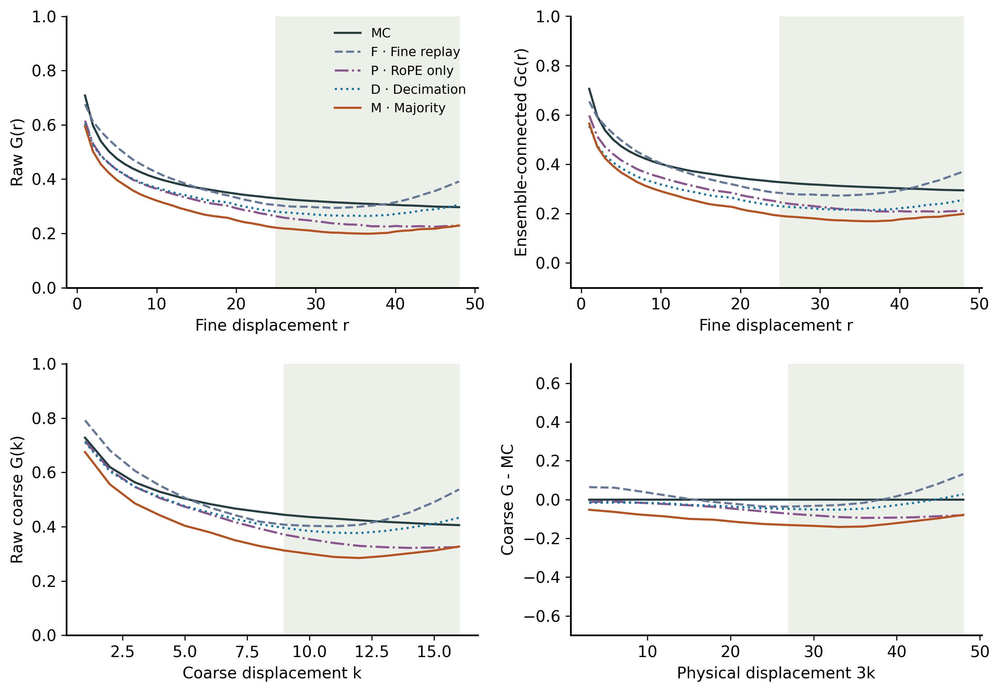

开发 seed 112501, K=64, 每模型32张；MC为8条奇数链各32场。B粗场逐图取真实多数投票。Gc=G−系综平均磁化平方；独立图/独立链的有限样本修正另存 sufficient_statistics。阴影是预定主距离区间；本图不作确认性判断。

[矢量 PDF](figures/A1_curves_s112501_K64.pdf)

## A1_samples_s112501_K64_i0

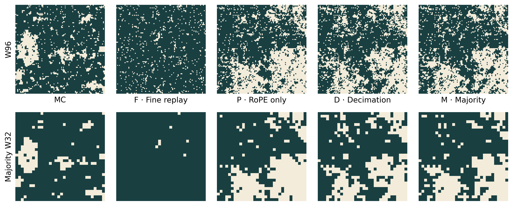

预登记生成ID=0，开发 seed=112501，K=64；MC parent=128、global origin=(464,464)。下行均为正上方细图的3×3多数投票。MC为独立参考构型；同一seed的模型列复用配对U/V随机数，列间不计算像素误差。

[矢量 PDF](figures/A1_samples_s112501_K64_i0.pdf)

## A1_samples_s112501_K64_i1

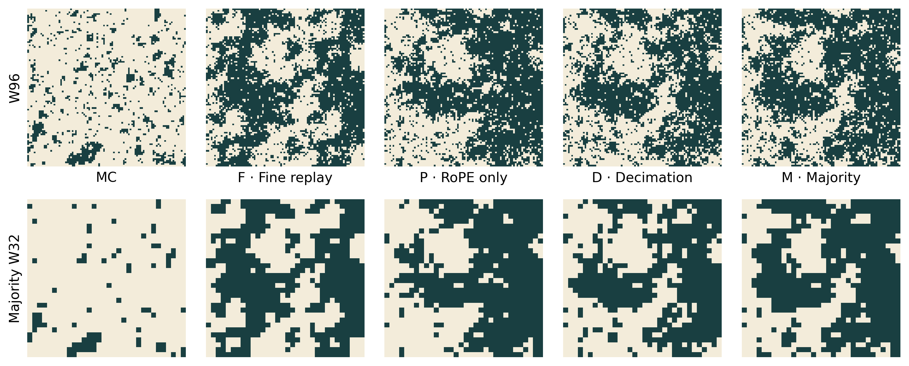

预登记生成ID=1，开发 seed=112501，K=64；MC parent=129、global origin=(464,464)。下行均为正上方细图的3×3多数投票。MC为独立参考构型；同一seed的模型列复用配对U/V随机数，列间不计算像素误差。

[矢量 PDF](figures/A1_samples_s112501_K64_i1.pdf)

## A1_samples_s112501_K64_i2

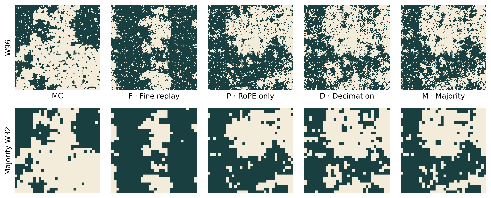

预登记生成ID=2，开发 seed=112501，K=64；MC parent=130、global origin=(464,464)。下行均为正上方细图的3×3多数投票。MC为独立参考构型；同一seed的模型列复用配对U/V随机数，列间不计算像素误差。

[矢量 PDF](figures/A1_samples_s112501_K64_i2.pdf)

## A1_samples_s112501_K64_i3

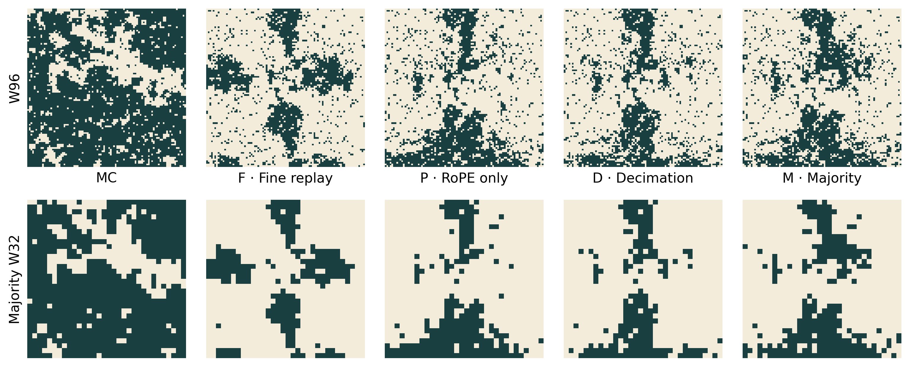

预登记生成ID=3，开发 seed=112501，K=64；MC parent=131、global origin=(464,464)。下行均为正上方细图的3×3多数投票。MC为独立参考构型；同一seed的模型列复用配对U/V随机数，列间不计算像素误差。

[矢量 PDF](figures/A1_samples_s112501_K64_i3.pdf)

## A1_distributions_fine_s112501_K64

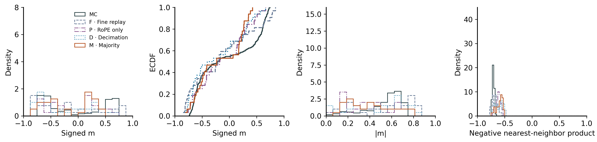

开发 seed 112501, K=64, fine W96。保留生成磁化原符号，所有seed使用相同分箱与全幅坐标。每键能量口径为窗口内邻键乘积负均值；粗格为操作性统计。小样本优先读ECDF。

[矢量 PDF](figures/A1_distributions_fine_s112501_K64.pdf)

## A1_distributions_B_s112501_K64

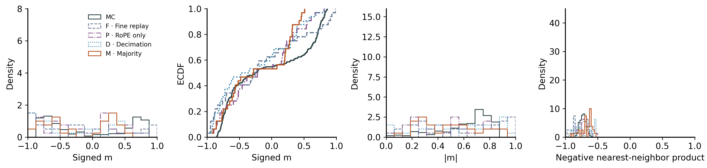

开发 seed 112501, K=64, B W32。保留生成磁化原符号，所有seed使用相同分箱与全幅坐标。每键能量口径为窗口内邻键乘积负均值；粗格为操作性统计。小样本优先读ECDF。

[矢量 PDF](figures/A1_distributions_B_s112501_K64.pdf)

## A1_curves_s112501_K256

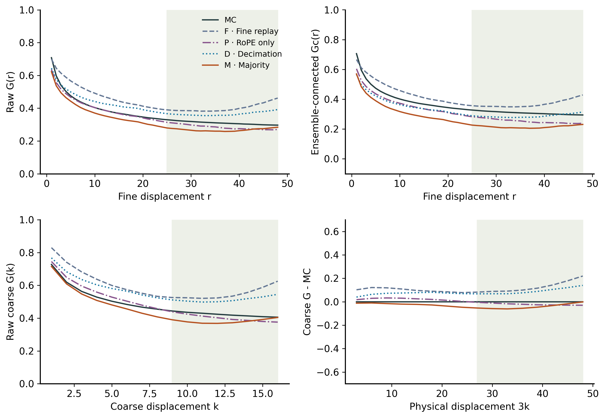

开发 seed 112501, K=256, 每模型32张；MC为8条奇数链各32场。B粗场逐图取真实多数投票。Gc=G−系综平均磁化平方；独立图/独立链的有限样本修正另存 sufficient_statistics。阴影是预定主距离区间；本图不作确认性判断。

[矢量 PDF](figures/A1_curves_s112501_K256.pdf)

## A1_samples_s112501_K256_i0

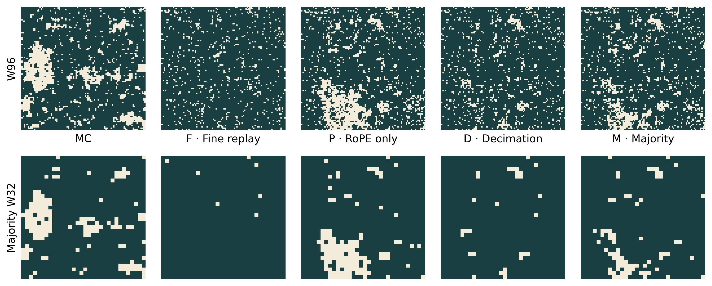

预登记生成ID=0，开发 seed=112501，K=256；MC parent=128、global origin=(464,464)。下行均为正上方细图的3×3多数投票。MC为独立参考构型；同一seed的模型列复用配对U/V随机数，列间不计算像素误差。

[矢量 PDF](figures/A1_samples_s112501_K256_i0.pdf)

## A1_samples_s112501_K256_i1

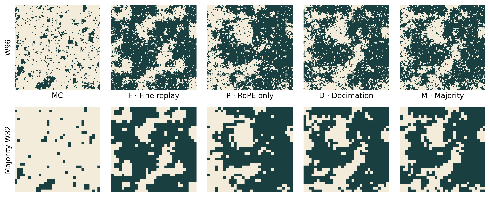

预登记生成ID=1，开发 seed=112501，K=256；MC parent=129、global origin=(464,464)。下行均为正上方细图的3×3多数投票。MC为独立参考构型；同一seed的模型列复用配对U/V随机数，列间不计算像素误差。

[矢量 PDF](figures/A1_samples_s112501_K256_i1.pdf)

## A1_samples_s112501_K256_i2

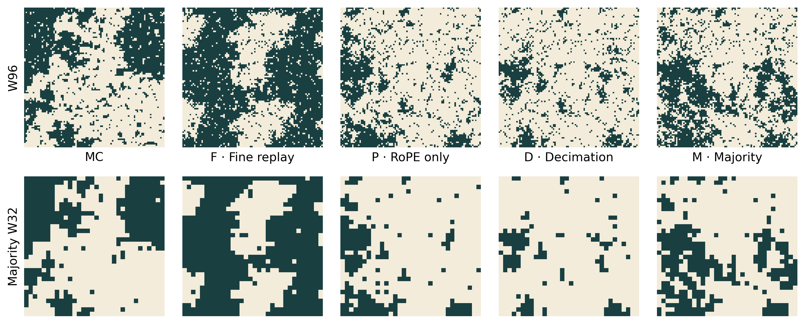

预登记生成ID=2，开发 seed=112501，K=256；MC parent=130、global origin=(464,464)。下行均为正上方细图的3×3多数投票。MC为独立参考构型；同一seed的模型列复用配对U/V随机数，列间不计算像素误差。

[矢量 PDF](figures/A1_samples_s112501_K256_i2.pdf)

## A1_samples_s112501_K256_i3

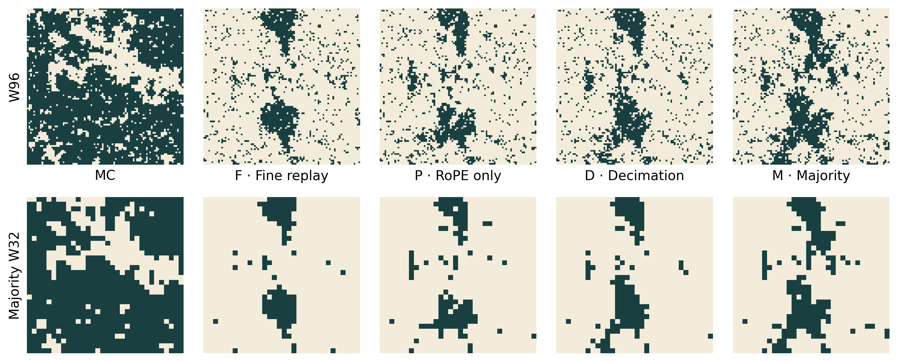

预登记生成ID=3，开发 seed=112501，K=256；MC parent=131、global origin=(464,464)。下行均为正上方细图的3×3多数投票。MC为独立参考构型；同一seed的模型列复用配对U/V随机数，列间不计算像素误差。

[矢量 PDF](figures/A1_samples_s112501_K256_i3.pdf)

## A1_distributions_fine_s112501_K256

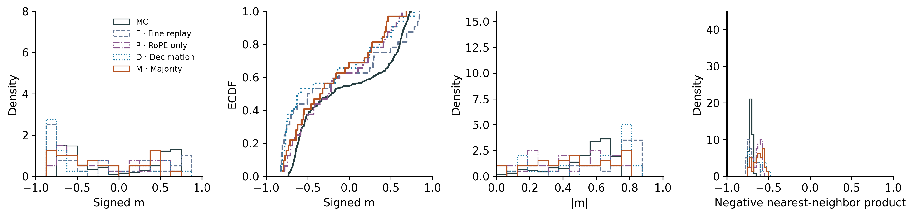

开发 seed 112501, K=256, fine W96。保留生成磁化原符号，所有seed使用相同分箱与全幅坐标。每键能量口径为窗口内邻键乘积负均值；粗格为操作性统计。小样本优先读ECDF。

[矢量 PDF](figures/A1_distributions_fine_s112501_K256.pdf)

## A1_distributions_B_s112501_K256

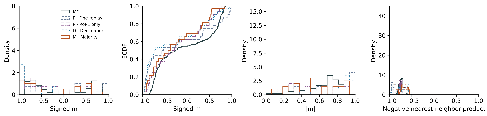

开发 seed 112501, K=256, B W32。保留生成磁化原符号，所有seed使用相同分箱与全幅坐标。每键能量口径为窗口内邻键乘积负均值；粗格为操作性统计。小样本优先读ECDF。

[矢量 PDF](figures/A1_distributions_B_s112501_K256.pdf)

## A1_curves_s112502_K64

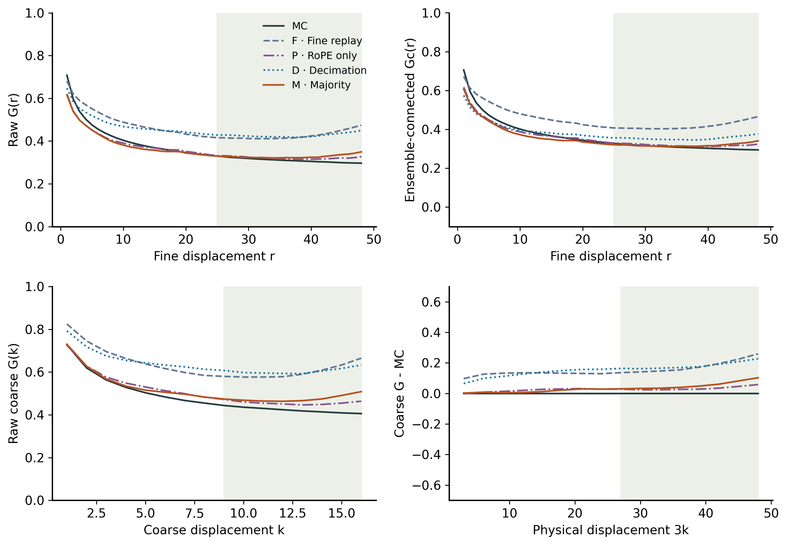

开发 seed 112502, K=64, 每模型32张；MC为8条奇数链各32场。B粗场逐图取真实多数投票。Gc=G−系综平均磁化平方；独立图/独立链的有限样本修正另存 sufficient_statistics。阴影是预定主距离区间；本图不作确认性判断。

[矢量 PDF](figures/A1_curves_s112502_K64.pdf)

## A1_samples_s112502_K64_i0

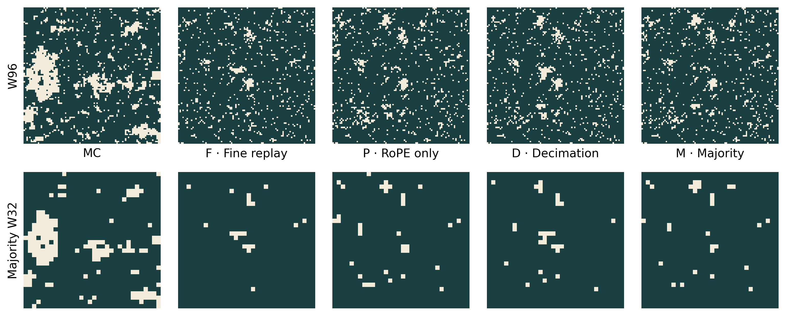

预登记生成ID=0，开发 seed=112502，K=64；MC parent=128、global origin=(464,464)。下行均为正上方细图的3×3多数投票。MC为独立参考构型；同一seed的模型列复用配对U/V随机数，列间不计算像素误差。

[矢量 PDF](figures/A1_samples_s112502_K64_i0.pdf)

## A1_samples_s112502_K64_i1

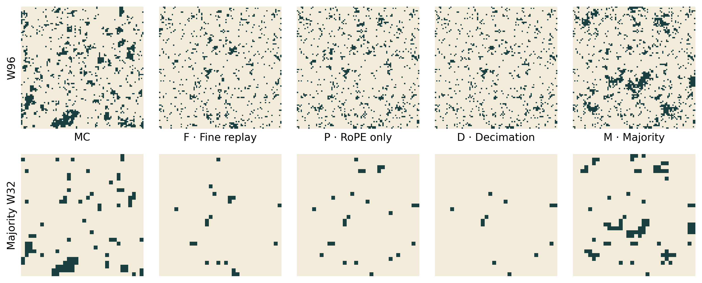

预登记生成ID=1，开发 seed=112502，K=64；MC parent=129、global origin=(464,464)。下行均为正上方细图的3×3多数投票。MC为独立参考构型；同一seed的模型列复用配对U/V随机数，列间不计算像素误差。

[矢量 PDF](figures/A1_samples_s112502_K64_i1.pdf)

## A1_samples_s112502_K64_i2

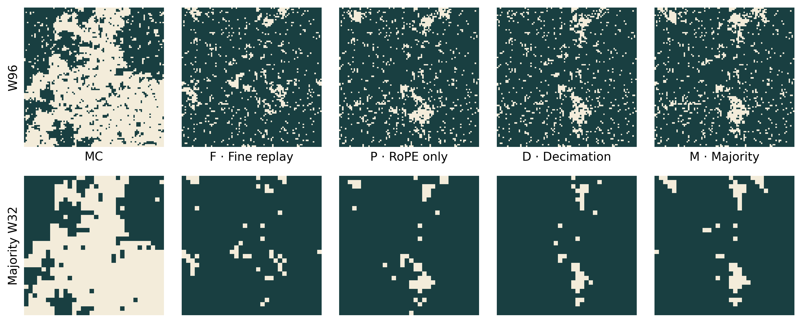

预登记生成ID=2，开发 seed=112502，K=64；MC parent=130、global origin=(464,464)。下行均为正上方细图的3×3多数投票。MC为独立参考构型；同一seed的模型列复用配对U/V随机数，列间不计算像素误差。

[矢量 PDF](figures/A1_samples_s112502_K64_i2.pdf)

## A1_samples_s112502_K64_i3

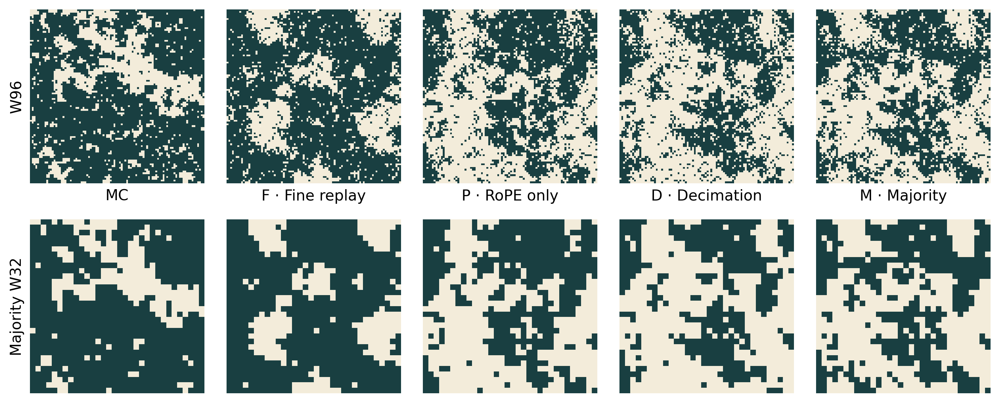

预登记生成ID=3，开发 seed=112502，K=64；MC parent=131、global origin=(464,464)。下行均为正上方细图的3×3多数投票。MC为独立参考构型；同一seed的模型列复用配对U/V随机数，列间不计算像素误差。

[矢量 PDF](figures/A1_samples_s112502_K64_i3.pdf)

## A1_distributions_fine_s112502_K64

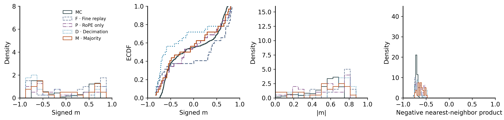

开发 seed 112502, K=64, fine W96。保留生成磁化原符号，所有seed使用相同分箱与全幅坐标。每键能量口径为窗口内邻键乘积负均值；粗格为操作性统计。小样本优先读ECDF。

[矢量 PDF](figures/A1_distributions_fine_s112502_K64.pdf)

## A1_distributions_B_s112502_K64

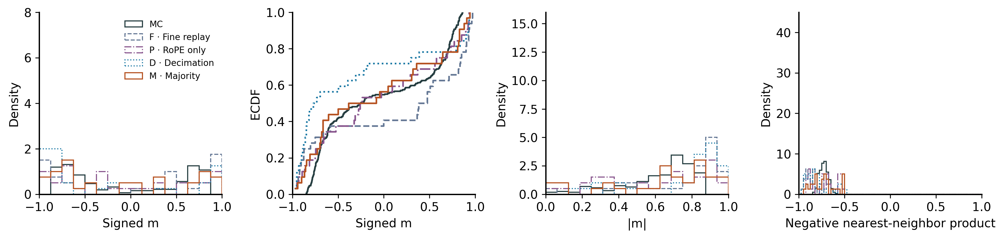

开发 seed 112502, K=64, B W32。保留生成磁化原符号，所有seed使用相同分箱与全幅坐标。每键能量口径为窗口内邻键乘积负均值；粗格为操作性统计。小样本优先读ECDF。

[矢量 PDF](figures/A1_distributions_B_s112502_K64.pdf)

## A1_curves_s112502_K256

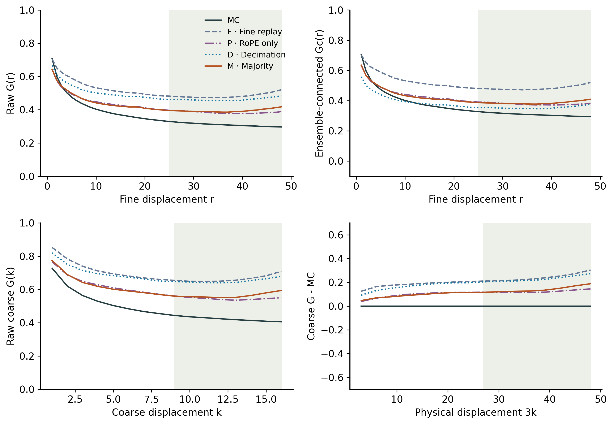

开发 seed 112502, K=256, 每模型32张；MC为8条奇数链各32场。B粗场逐图取真实多数投票。Gc=G−系综平均磁化平方；独立图/独立链的有限样本修正另存 sufficient_statistics。阴影是预定主距离区间；本图不作确认性判断。

[矢量 PDF](figures/A1_curves_s112502_K256.pdf)

## A1_samples_s112502_K256_i0

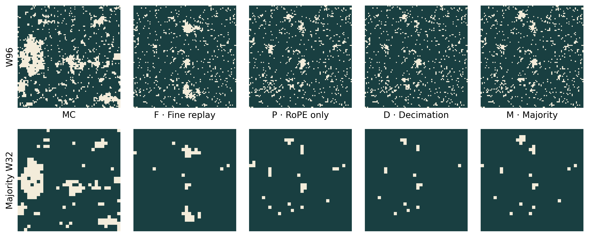

预登记生成ID=0，开发 seed=112502，K=256；MC parent=128、global origin=(464,464)。下行均为正上方细图的3×3多数投票。MC为独立参考构型；同一seed的模型列复用配对U/V随机数，列间不计算像素误差。

[矢量 PDF](figures/A1_samples_s112502_K256_i0.pdf)

## A1_samples_s112502_K256_i1

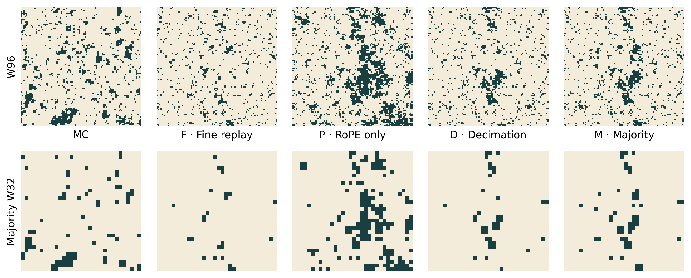

预登记生成ID=1，开发 seed=112502，K=256；MC parent=129、global origin=(464,464)。下行均为正上方细图的3×3多数投票。MC为独立参考构型；同一seed的模型列复用配对U/V随机数，列间不计算像素误差。

[矢量 PDF](figures/A1_samples_s112502_K256_i1.pdf)

## A1_samples_s112502_K256_i2

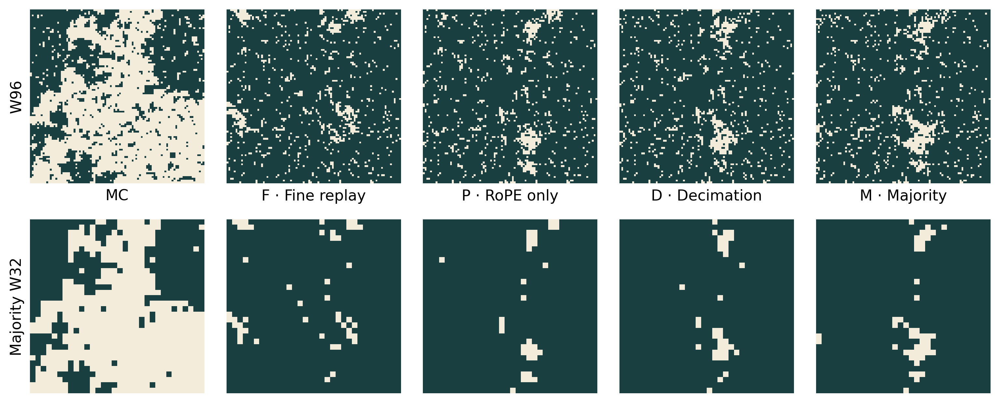

预登记生成ID=2，开发 seed=112502，K=256；MC parent=130、global origin=(464,464)。下行均为正上方细图的3×3多数投票。MC为独立参考构型；同一seed的模型列复用配对U/V随机数，列间不计算像素误差。

[矢量 PDF](figures/A1_samples_s112502_K256_i2.pdf)

## A1_samples_s112502_K256_i3

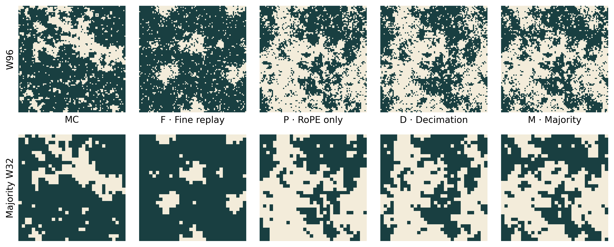

预登记生成ID=3，开发 seed=112502，K=256；MC parent=131、global origin=(464,464)。下行均为正上方细图的3×3多数投票。MC为独立参考构型；同一seed的模型列复用配对U/V随机数，列间不计算像素误差。

[矢量 PDF](figures/A1_samples_s112502_K256_i3.pdf)

## A1_distributions_fine_s112502_K256

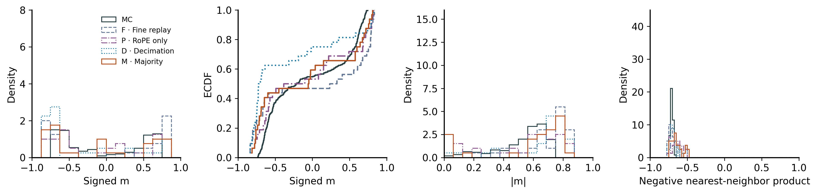

开发 seed 112502, K=256, fine W96。保留生成磁化原符号，所有seed使用相同分箱与全幅坐标。每键能量口径为窗口内邻键乘积负均值；粗格为操作性统计。小样本优先读ECDF。

[矢量 PDF](figures/A1_distributions_fine_s112502_K256.pdf)

## A1_distributions_B_s112502_K256

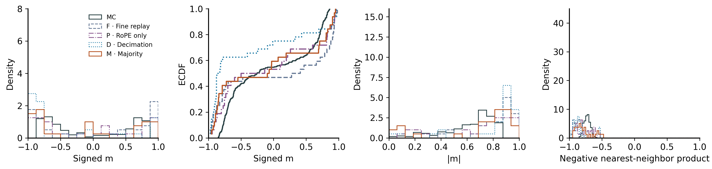

开发 seed 112502, K=256, B W32。保留生成磁化原符号，所有seed使用相同分箱与全幅坐标。每键能量口径为窗口内邻键乘积负均值；粗格为操作性统计。小样本优先读ECDF。

[矢量 PDF](figures/A1_distributions_B_s112502_K256.pdf)

## B_learning_s112501

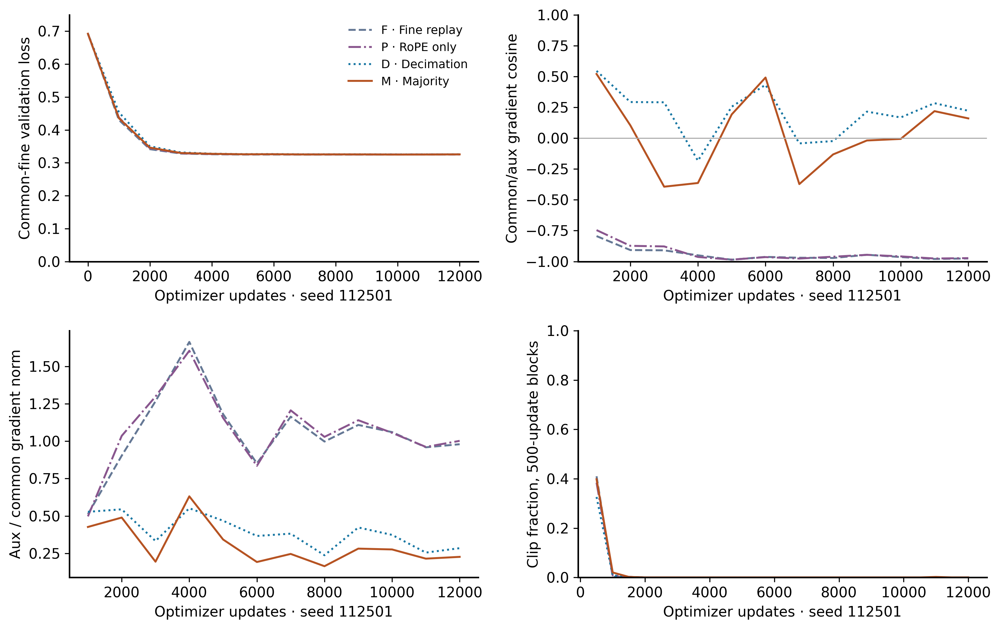

开发seed=112501，四臂各12000次更新。验证使用EMA，输入固定且来自独立验证链；损失为方案规定的inverse-t、按全部token归一的masked CE。梯度在同一raw参数状态下分别反传，排除任务嵌入；范数与实际裁剪率按原始梯度记录。

[矢量 PDF](figures/B_learning_s112501.pdf)

## B_training_s112501

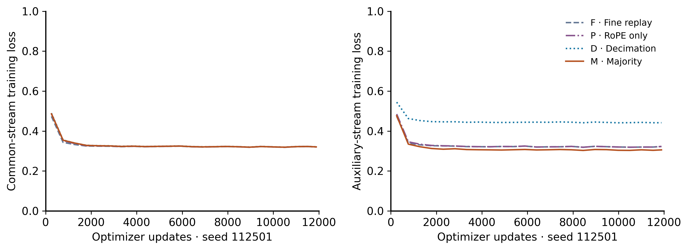

开发seed=112501。每条流按互不重叠的256次流内更新取均值，末块保留剩余更新；横轴为实际优化器更新。辅助流的目标数据随实验臂不同，其损失用于学习状态诊断，跨臂同任务优劣由共同流验证与独立生成评价判断。原始逐次数据及这些均值均保存。

[矢量 PDF](figures/B_training_s112501.pdf)

## B_learning_s112502

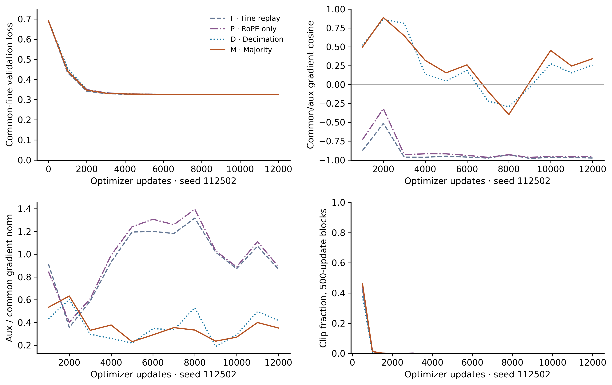

开发seed=112502，四臂各12000次更新。验证使用EMA，输入固定且来自独立验证链；损失为方案规定的inverse-t、按全部token归一的masked CE。梯度在同一raw参数状态下分别反传，排除任务嵌入；范数与实际裁剪率按原始梯度记录。

[矢量 PDF](figures/B_learning_s112502.pdf)

## B_training_s112502

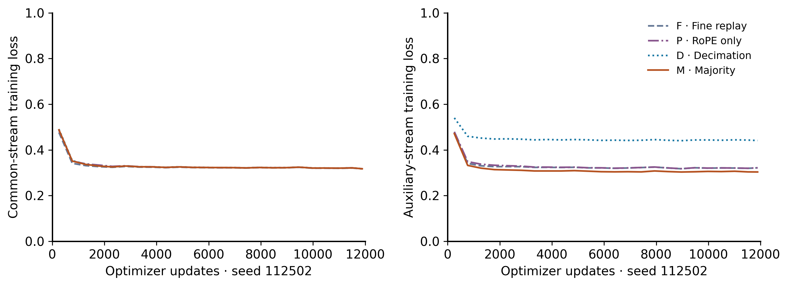

开发seed=112502。每条流按互不重叠的256次流内更新取均值，末块保留剩余更新；横轴为实际优化器更新。辅助流的目标数据随实验臂不同，其损失用于学习状态诊断，跨臂同任务优劣由共同流验证与独立生成评价判断。原始逐次数据及这些均值均保存。

[矢量 PDF](figures/B_training_s112502.pdf)

## B_development_effects

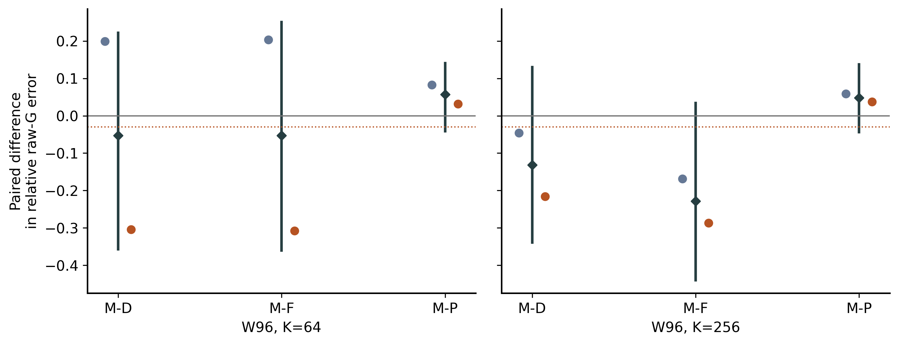

灰蓝点为开发seed 112501，赭橙点为112502，黑菱形为等权平均。竖线是10000次联合seed→配对生成图及独立MC链/块重抽样的描述性95%分位区间；两seed的区间不作确认性解释。虚线−0.03仅是原方案候选阈值，尚未据此开展C。

[矢量 PDF](figures/B_development_effects.pdf)

