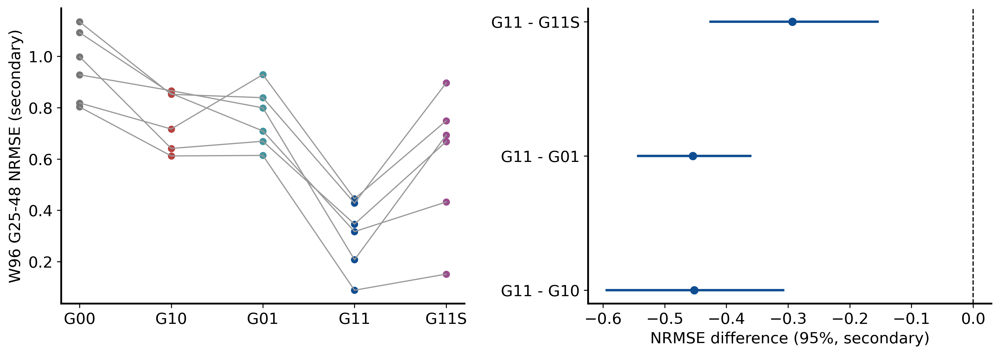

# 训练尺寸与真实间距分别带来什么收益

本轮最重要的结果是：在两个预先指定的条件任务上，增加真实间距覆盖和增加尺寸覆盖分别带来明确改善；但保留细间距排列相对只保留总跨度的主收益尚未确认。它支持训练覆盖策略的指定收益，不证明任意尺度泛化或完整联合生成正确。

实验简称G，完成于2026年9月25日。六个新训练seed、五组从零训练，共30个模型。本文是讲解层；[原参数与结果索引](README.md)、[冻结方案](protocol/CORE_GEOMETRY_FACTORIAL_PROTOCOL_20260925_ZH.md)和[机器统计](evidence/analysis/crossed_uncertainty.json)保留详细依据。

[阅读路线](../STUDY_GUIDE_ZH.md) · [共同方法](../METHODS_ZH.md) · [下一问 I](../fine-geometry-identification/REPORT_ZH.md)

## 为什么做这个实验

模型在大context上退化，至少可能缺少两种训练经验：一是没有见过不同数量和范围的输入位置，二是没有见过不同真实物理间距。如果一次把两种经验都加入，结果变好也不知道是哪一种因素起作用。

因此先构造尺寸覆盖与间距覆盖的2×2对照，再加第五组检验细几何。全程保留原dense attention，不通过更换网络结构来解释覆盖策略的作用。

## 五组分别改变什么

| 组别 | 训练有效边长W | 物理取样间距 | 输入坐标 |
|---|---|---|---|
| G00 | 48 | 连续单位间距 | 真实坐标 |
| G10 | 16、24、32、48 | 连续单位间距 | 真实坐标 |
| G01 | 48 | 连续与非均匀间距 | 真实坐标 |
| G11 | 16、24、32、48 | 连续与非均匀间距 | 真实坐标 |
| G11S | 与G11相同 | 与G11逐样本相同的物理数据 | 保留总跨度，内部位置均匀化 |

训练非均匀间距使用1、2、4、8，指定未见间距任务使用3、6；整数计数与跨度构造以冻结方案为准。间距改变的是父场上真正取到哪些自旋，并同步传入这些位置的物理坐标，不是把同一张连续自旋图随意改坐标标签。

G11S的作用需要单独理解。若一条坐标轴有W个点、总跨度为S，它向模型提供的位置为iS/(W−1)，保留S却抹去每个局部gap的具体排列。rank坐标则是i，两者在非连续布局中不是同一个对照。G11与G11S共享完整物理数据、掩码、查询与时间流；其他组的物理数据随尺寸和间距干预有意变化。

## 三个主比较怎样回答问题

| 主比较 | 保持不变的因素 | 改变的因素 | 指定测试任务 |
|---|---|---|---|
| H1：G11−G10 | 多尺寸训练 | 加入真实间距覆盖 | W48未见间距 |
| H2：G11−G01 | 多种间距训练 | 加入尺寸覆盖 | W96连续布局 |
| H3：G11−G11S | 物理数据、mask、query、时间与总跨度 | 是否给出真实内部排列 | W48未见间距 |

每个任务先对K=2、32、512的条件CE等权平均。K是可见点数，模型预测的是隐藏查询点。H1和H2发生在不同指定任务上，不能因为H1数值更大就说“距离因素普遍比尺寸因素重要”。

四组因素设计还允许检查两种覆盖是否交互。不能因为G11在某一任务最好就声称所有任务都协同，后文有反例。

这里的交互差是(G11−G10)−(G01−G00)：加入间距覆盖的效果，是否随尺寸覆盖而改变。只有在同一测试任务、相同K加权下才作这个相减；负值表示组合效果比相加预期更有利，正值则相反。交互为正也不自动表示G11比所有组都差。

## 模型训练与数据来源

模型为1,976,706参数的dense网络，128维、4头、7块、二维RoPE，dropout为0。每组固定12,000更新、每更新18,432 token；32周期监督配方含75%普通遮盖和25%稀疏可见任务。使用AdamW、梯度裁剪和EMA；训练BF16 autocast、损失与评价FP32。完整学习率和优化器设置见[参数摘要](README.md)。

同seed五组初始化配对。4k和8k EMA用于学习诊断，主评价固定12k final EMA，不按测试效果选checkpoint。相同token预算不应被改写为所有有效物理信息、每种长度的FLOPs都相同。

训练继承768个L1024父场与独立256验证父场；评价使用新的8条MC链、每链128个场，共1024个参考父场。条件任务每个bank选128父场、每父场64个隐藏查询。query、crop和链内相邻场并非独立训练重复。

主不确定性同时重抽六个配对训练seed与MC链，并在链内使用时间块。主bootstrap固定20,000次、块长2，另保留块长1/4及seed-only、MC-only敏感性。

## 主结果

损失差为新方法减对照，负值有利。三个主比较使用98.333333%区间；实质门要求上界低于−0.002 nats/query。

| 主比较 | 平均CE差 | 原定联合区间 | 判定 |
|---|---:|---|---|
| H1 间距覆盖 | −0.066041 | [−0.080240, −0.054136] | 实质门通过 |
| H2 尺寸覆盖 | −0.008908 | [−0.011889, −0.005704] | 实质门通过 |
| H3 细排列相对跨度 | −0.001163 | [−0.002792, +0.000238] | 方向与实质门均未过 |

来源：[主统计与敏感性](evidence/analysis/crossed_uncertainty.json)。表中保留六位小数，原数组为全精度依据。

读图时先看0线和−0.002门槛，再看整个区间的位置。H3与H1共用较宽横轴，视觉上非常靠近零，应结合表读具体区间。H3区间既跨0也跨−0.002，既不能确认原定收益，也不能宣布细几何等效或无用。只看六seed的t区间会更乐观，但不能替换包含MC不确定性的原主区间。

## 不能略去的反例与物理代价

在W96未见间距任务上，G01平均CE为0.597356，优于G11的0.600037；该任务的交互差为+0.003072，95%区间[+0.000368,+0.006038]。所以增加尺寸覆盖在不同任务上的效果并不一致。

次要W96生成中，G11的长程关联误差低于多个对照，也低于G11S；但能量与磁化存在代价。G11能量偏差约+0.036703，而G00/G10约+0.005794/+0.005615。偏差的目标是零，不能只展示有利的长程NRMSE。

生成结果是独立评价层，不能反过来把条件主假设H3改判为通过。这里没有W128生成实验。详细数值见[配对差表](evidence/analysis/paired_contrasts.csv)。

## 这轮结果改变了什么判断

可以明确支持：在原dense结构和本轮固定训练预算下，指定条件任务从相应的尺寸、真实间距覆盖中获益。这不是只有一个幸运seed的观察，两个主要效应在六个配对seed中方向一致，并通过原主统计门。

仍未识别：收益是否唯一来自RoPE内部机制、任意布局上的协同、真实细排列的普遍实质收益，以及完整联合分布是否正确。G11S的比较正是为了不把“看过更多物理数据”与“理解细几何”混为一谈。

下一步I保持物理训练流一致，进一步区分真实细排列、总跨度和随机对应；它是新实验，不是替换G-H3的统计口径。

## 汇报时需要回答的三个问题

**为什么不是只比较G00和G11？** 因为那会同时改变尺寸和间距，无法分别判断作用；四组因素对照提供了单因素增量和交互检查。

**这是不是已经证明模型学会尺度不变性？** 不是。这里有指定任务的收益，也有更大尺寸的反例；没有验证完整尺度变换下的分布一致性。

**为什么H3六个seed都为负仍然未过？** 因为主推断还包含有限MC参考的不确定性，且要求达到预设实质门。负点估计不是完整区间通过。

## 证据与执行边界

正式计算约7.428小时；原10小时预算门失败后，在正式开始前显式改为12小时窗口，不能把旧门写成通过。协议、固定权重身份、学习诊断和备份见[证据索引](EVIDENCE.md)；图与数值沿用正式产物。

公开仓库可以核对主要数组与统计，大checkpoint、完整父场和部分大型数组仍需按清单获取。阅读本报告无需重新训练。见[复现路线](../REPRODUCING.md)与[数据可用性](../DATA_AVAILABILITY.md)。
