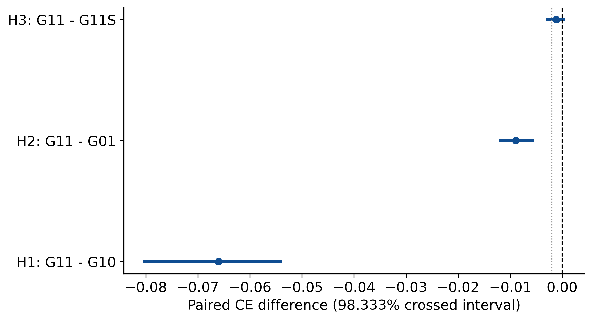

# G｜训练尺寸与真实物理间距分别带来什么收益

> 一句话结论：在两个预先指定的条件任务上，增加间距覆盖和增加尺寸覆盖分别带来明确收益；但“知道真实细排列”相对“只知道总跨度”的原定主收益尚未确认。G 是训练覆盖策略的证据，不是普遍尺度泛化或联合生成正确性的证明。

实验：core_geometry_factorial_20260925；完成于2026-09-25。本文于2026-11-15扩写为学习版，只调整讲解，不重算结果、不改变主假设。数值展示有舍入，全精度以机器证据为准。

[阅读总路线](../STUDY_GUIDE_ZH.md) · [术语与指标](../METHODS_ZH.md) · [参数速查](README.md) · [下一篇 I](../fine-geometry-identification/REPORT_ZH.md)

## 阅读目标与路线

建议用35–45分钟精读：先用10分钟理解五组对照，再用10分钟理解训练与测试，最后用15–25分钟读结果、反例并闭卷复述。这是学习用时建议，不是实验运行时长。

读完至少应能回答四件事：

1. 为什么不是只比较一个小模型和一个大模型，而是同结构的五组训练配方？
2. W48、物理跨度174、可见数K512分别描述什么？
3. H1/H2为什么通过，H3为什么没有通过？
4. 为什么条件预测更好、生成长程关联更好，都不等于完整物理分布正确？

## 1. 研究动机：把两个容易混淆的因素拆开

项目希望模型利用物理位置关系，在没见过的输入布局和尺度上仍能作出合理条件预测。此前观察到大context退化，但至少有两个不同解释：

- **尺寸经验不足**：只在一种有效边长上训练，网络没有适应不同数量的有效位置。
- **距离经验不足**：只看连续单位格点，网络没有学过相邻token之间实际相隔不同物理距离的情形。

若一次同时增加尺寸和间距，最后变好也不能判断哪种经验贡献了收益。因此G保留原dense网络，采用“尺寸覆盖×间距覆盖”的2×2设计，再增加一个跨度对照。

这里的“尺寸”是有效输入网格边长W；“间距”是真实采样位置的相邻坐标差。二者都会影响物理视野，但不是同一变量。

### 一个帮助理解的例子

下面只是教学例子，不是正式实验的W4任务。

从同一条物理轴上取四个点：

- 连续采样：位置0、1、2、3，跨度3。
- 非均匀采样：位置0、1、5、7，间距1、4、2，跨度7。

第二种输入必须真的取物理位置0、1、5、7的自旋，再把这些坐标交给网络。仅取0、1、2、3的自旋却贴上0、1、5、7标签，是“坐标错配”，不是本实验的真实间距训练。

## 2. 五组实验：前四组分因素，第五组问信息

| 组别 | 有效训练边长W | 物理采样 | 网络收到的坐标 |
|---|---|---|---|
| G00 | 仅48 | 连续单位间距 | 真实坐标 |
| G10 | 16、24、32、48均衡 | 连续单位间距 | 真实坐标 |
| G01 | 仅48 | 一半连续、一半非均匀 | 真实坐标 |
| G11 | 16、24、32、48均衡 | 一半连续、一半非均匀 | 真实坐标 |
| G11S | 与G11相同 | 与G11逐样本完全相同 | 同跨度、内部均匀化 |

名称的第一个0/1表示是否多尺寸，第二个0/1表示是否加入非均匀间距；S表示span-only，不是一个额外训练尺寸。

### G11S到底删掉了什么

一条轴有W个点，总跨度为S。G11S提供：

$$
x_i^{\mathrm{span}}=\frac{iS}{W-1},\qquad i=0,\ldots,W-1.
$$

它保留端点跨度，却不告诉模型局部gap如何排列。例如真实坐标[0,1,5,7]会变成[0,7/3,14/3,7]。这不同于rank坐标[0,1,2,3]：后者连物理跨度也丢掉了。

因此G11与G11S问的是：**同样的物理自旋、总跨度和监督，细排列信息是否还有额外价值？**

### “配对”配到了哪一层

同seed五组的模型初始化、更新预算和监督配方配对；但五组不可能共享完全相同的物理输入，因为尺寸和采样距离就是干预。只有G11/G11S共享完整的物理数据、mask、query和时间流，差别在坐标表示。

所以不能把整个G称为“只改RoPE的纯坐标消融”，也不能称为“比较五种模型结构”。

## 3. 非均匀布局怎样构造：未见什么、保留什么

训练相邻gap取1、2、4、8；held-out相邻gap取3、6。这里held-out的准确意思是**相邻采样间距的取值未见**，不是所有两点距离都未见：训练中的非相邻距离和也可能等于3或6。

令q=W/4−1，冻结的计数为：

| 布局 | gap取值与个数 | 总跨度 |
|---|---|---:|
| 训练非均匀 | 1有q+1个；2有q个；4有q+2个；8有q个 | 15q+9 |
| 未见间距 | 3有3q+3个；6有q个 | 15q+9 |

每条轴将对应gap多重集随机排列，再累积求和得到坐标；两轴分别构造。这样同一个W下训练与held布局跨度相同，不能仅凭总跨度识别是哪一种gap集合。

具体到W48，q=11：

- 训练gap个数为12、11、13、11，共47个gap，跨度174。
- held gap为36个3、11个6，共47个gap，跨度同样174。
- W48连续布局的跨度只有47，不是174。
- W96 held跨度为354，不是95，也不与W48 held保持相同跨度。

这说明“W相同”“跨度相同”“细排列相同”是三个不同层次的控制。

## 4. 模型怎样训练

### 固定模型与优化设置

| 项目 | 本轮设置 |
|---|---|
| 独立训练重复 | 6个新seed：92501–92506 |
| 模型数 / 总更新 | 6×5=30个fresh模型；各12,000更新，共360,000更新 |
| 主体结构 | dense Transformer，1,976,706参数；d128、4头、7块、MLP倍率4 |
| 位置信息 | 二维RoPE，base=10000；dropout=0 |
| 每更新输入量 | 18,432 token |
| 对应batch | W16/24/32/48分别为72/32/18/8 |
| 优化器 | AdamW，betas=(.9,.95)，weight decay=.05，梯度裁剪1 |
| 学习率 | 750步warmup至3×10⁻⁴，之后余弦降至3×10⁻⁵ |
| 精度 | BF16训练；损失及评价FP32 |
| 主权重 | 固定12k final EMA，衰减.999 |
| 辅助快照 | 4k、8k EMA，仅作学习诊断 |

每模型累计221,184,000个输入token。相同token预算并不等于相同FLOPs：dense attention对序列长度敏感；不同布局的物理信息也不相等。

### 一个32步监督周期里发生什么

75%的更新是普通随机遮盖；25%是稀疏可见任务。尺寸与几何按冻结的32步周期均衡安排，不根据当前loss临时增减。

普通任务中，t从[.01,1]范围采样，并有2%的全MASK端点。t控制遮盖概率，损失使用对应的逆t加权。稀疏任务则只留K∈{1,2,4,8,16,32}个可见自旋，用实际可见数设置t=1−K/W²。

稀疏更新有**总计512个隐藏query槽**，分配到整个batch，不是每张窗口512个。query与可见点分离，监督是实际自旋硬标签，没有把精确oracle概率或query答案作为输入。

这个混合配方的目的，是既训练一般遮盖状态，也让网络接触非常少的观测。它不是证明两种损失已达到最优比例。

### 为什么固定final很重要

4k、8k和12k都有记录，但主评价始终用事前固定的12k EMA。不能看见某个4k效果好，就把它换成主模型；也不因某项验证效果差而提前停止或补步。

## 5. 数据与评价：训练问题和测试问题如何对应

训练使用继承的768个L1024父场；验证使用独立256个父场。条件测试和生成参考来自新MC：8条链×128场=1024父场，初始化为4条random、2条plus、2条minus。

MC使用固定burn40、gap4及预定QA；能量、绝对磁化等混合诊断用于检查参考质量，不是“继续采到结果对模型有利”。测试参考不回流训练。有限MC仍有不确定性，不能把它当无限精度的真值。

### 六种测试几何

| 简称 | 有效边长 | 采样布局 | 主要角色 |
|---|---:|---|---|
| C48 | 48 | 连续单位间距 | 原范围保留 |
| U48 | 48 | 训练非均匀gap，跨度174 | 已见gap布局 |
| H48 | 48 | held gap3/6，跨度174 | H1、H3主任务 |
| C96 | 96 | 连续 | H2主任务 |
| C128 | 128 | 连续 | 更大容器次要压力 |
| H96 | 96 | held gap3/6，跨度354 | 尺寸与gap共同外推压力 |

每种几何评价5个K：2、32、512、⌊W²/2⌋、⌊.05W²⌋。因此一共30个bank，每个bank选128父场，即每MC链16个、沿原序列间隔8取样；每父场有64个隐藏query。30模型×30bank=900个条件预测单元。

“有64个query”是同一场内的多个评分点，不是64次独立训练实验。也不能把同父场裁出的窗口当作新的独立物理场。

## 6. 主终点究竟算的是什么

令模型预测+1的概率为p，真实自旋编码为y∈{0,1}。单query条件CE是：

$$
\ell(p,y)=-y\log p-(1-y)\log(1-p).
$$

先在父场内平均64个query，再平均父场；每个主任务对K=2、32、512三个条件**等权平均**，最后得到每seed每臂的分数，再作配对差。

这是对真实留出标签的经验条件CE，单位nats/query。不是全图joint NLL，也不是已知完整真实条件分布下的精确KL。

| 主假设 | 配对差 | 改变的主要训练因素 | 指定评价 |
|---|---|---|---|
| H1 | G11−G10 | 同多尺寸背景下加入间距覆盖 | H48，三个K等权 |
| H2 | G11−G01 | 同间距覆盖背景下加入尺寸覆盖 | C96，三个K等权 |
| H3 | G11−G11S | 同物理数据和跨度下保留真实细排列 | H48，三个K等权 |

H1与H2测试任务不同，效应量不能直接拿来排名“间距比尺寸重要多少”。

### 误差条为何不仅包含六个seed

主分析联合重抽6个配对训练seed与8条MC链，并在每链所选16父场序列上用循环块长2；20,000次bootstrap生成区间。块长1/4、seed-only和MC-only各10,000次是敏感性分析，不是可任意挑选的替代主结果。

三个主比较使用Bonferroni校正后的98.333333%区间。实质门要求区间上界<−.002；只要求上界<0是较弱的方向判断。重抽20,000次不意味着有20,000个独立训练重复。

## 7. 主结果：两项成立，一项未决

| 主比较 | 平均CE差 | 98.333333%联合区间 | 原实质门 |
|---|---:|---|---|
| H1 间距覆盖 | −.066041 | [−.080240, −.054136] | 通过 |
| H2 尺寸覆盖 | −.008908 | [−.011889, −.005704] | 通过 |
| H3 细排列相对跨度 | −.001163 | [−.002792, +.000238] | 未通过，方向也未确认 |

来源：[主统计及敏感性](evidence/analysis/crossed_uncertainty.json)。这些是配对差，不是各组绝对CE。

读图按三步走：

1. 看横轴：负值有利于G11；点为平均配对差，线为原定联合区间。
2. 看0线与−.002线：H1、H2整个区间都在实质门左侧；H3不是。
3. H3在较宽横轴上很靠近0，必须结合表格。它既容许小幅不利，也容许超过.002的收益，因此不能作“细几何无用”或“两者等效”的结论。

[逐seed主分数图](evidence/analysis/primary_paired_CE.png)补充展示配对方向。即使H3六个seed点差均为负，包含有限MC误差的主区间仍可能跨零；只选更窄的seed-only/t区间会改变问题，不能用来重判。

## 8. 次要证据：协同不是普遍的，生成也有代价

### 8.1 同时加入两种覆盖，不保证所有任务都最好

同一任务上的交互差定义为：

$$
\Delta_{\mathrm{int}}=(G11-G10)-(G01-G00).
$$

负值意味着加入间距覆盖在多尺寸背景下更有利；正值则表示这种增量减弱。它不是不同任务之间的差，也不是“交互正就所有组都很差”。

在H96上，G01平均CE=.597356，优于G11的.600037。该任务交互差+.003072，95%区间[+.000368,+.006038]。而C96的交互点差为−.008583。方向随任务变化，不能只展示有利的一栏。

这张图使用次要95%区间，不应与主图98.333333%区间混用。

### 8.2 条件预测以外，另做了固定生成评价

每模型生成64张W96，共1920张、120个16图shard。采样器固定为S0、cosine-squared日程、256步、温度1，无MC纠正。同一训练seed的五臂使用配对生成随机身份；不是新增1920个训练模型。没有W128生成。

长程关联指标G25–48 NRMSE为：

$$
\frac{\sqrt{\operatorname{mean}_{r=25}^{48}
(\widehat G_{\mathrm{gen}}(r)-\widehat G_{\mathrm{MC}}(r))^2}}
{\sqrt{\operatorname{mean}_{r=25}^{48}\widehat G_{\mathrm{MC}}(r)^2}}.
$$

实现对分母设数值保护。它评价特定距离段关联曲线的相对误差，不是整个分布的距离。

| 次要指标 | G00 | G10 | G01 | G11 | G11S |
|---|---:|---:|---:|---:|---:|
| W96 G25–48 NRMSE | .962560 | .757280 | .759949 | .305383 | .598294 |

G11−G11S的生成差为−.292911，次要95%区间[−.425566,−.155013]。但G11能量偏差约+.036703，G00/G10约+.005794/+.005615；G11 signed magnetization bias约−.042960。偏差应接近0，不是越负越好。

读这张图时，左侧看每seed的长程误差，右侧看次要配对差；能量与磁化代价还必须结合上文及[数值表](evidence/analysis/paired_contrasts.csv)。这张生成图本身不能代替全部物理检查，更不能把条件H3重新改判为通过。

### 8.3 原范围保留和学习诊断

G11相对G00的两个C48保留条件均通过：各自97.5%区间上界≤+.005。4k/8k/12k学习记录没有触发预定learning-incomplete标记。两点都只是规定任务/阈值下的检查，不代表所有原能力无损或已充分收敛。

## 9. G对主线的价值与不能越过的边界

**最有价值的贡献**是：将“多尺度可能有用”拆成了可检验的训练覆盖问题，给出两项指定任务的正证据，同时暴露了细几何解释和共同外推的边界。

| 可以说 | 不能因此说 |
|---|---|
| 原dense在指定任务中受益于相应训练覆盖 | 任意尺寸、任意间距都有效 |
| 相同物理数据下，细排列增量值得继续识别 | G-H3已经证明细排列有实质收益 |
| 次要长程关联误差明显改善 | 联合生成分布、能量和磁化均正确 |
| 对照降低了多因素混杂 | 唯一机制就是RoPE，或已证明尺度不变性 |

后续I固定全部物理输入，增加独立随机坐标对照，并用新seed、新参考研究细几何。I是由G提出问题的新实验，不能追溯替换G的原主假设。

## 10. 如何向老师讲清楚，以及自测答案

推荐复述顺序：**为什么拆尺寸/间距 → 五组控制 → 三主任务 → 两项通过与H3未决 → H96反例 → 生成tradeoff → 为什么需要I。**

- **为什么不只比G00和G11？** 同时改变两个因素，无法知道各自增量及交互。
- **G11S是没有坐标吗？** 不是；有同跨度均匀坐标，丢的是内部gap排列。
- **held gap是不是所有距离都新？** 不是；只是相邻gap取值新。
- **−.066是否说明间距普遍比尺寸重要？** 不行；H1/H2在不同测试任务上。
- **H3六seed都负为什么未过？** 原主统计还包含MC误差，并检验区间而非只看均值。
- **生成改善能救回H3吗？** 不能；终点与统计层级不同。
- **下一步最合理的问题是什么？** 固定物理输入后，正确细坐标相对粗跨度与错误对应分别贡献多少。

## 11. 证据地图与执行状态

| 想核对的内容 | 入口 |
|---|---|
| 五组、gap计数、损失、判据 | [冻结协议](protocol/CORE_GEOMETRY_FACTORIAL_PROTOCOL_20260925_ZH.md) |
| 实际运行身份与完成状态 | [运行协议](evidence/run_protocol.json)、[完成摘要](evidence/final_summary.json) |
| 主结果、区间与敏感性 | [crossed_uncertainty.json](evidence/analysis/crossed_uncertainty.json) |
| 逐seed与配对数值 | [per_seed_metrics.csv](evidence/analysis/per_seed_metrics.csv)、[paired_contrasts.csv](evidence/analysis/paired_contrasts.csv) |
| 图的计算和NRMSE定义 | [分析实现](../../scripts/research20260921/core_geometry_factorial_analysis.py) |
| 来源与公开边界 | [EVIDENCE](EVIDENCE.md)、[数据可用性](../DATA_AVAILABILITY.md) |

正式计算约7.428小时，含预检预算约7.731小时。本地1459/1459科学路径已核验。原10小时预算门失败，正式开始前显式授权改为12小时窗口；不能将旧门改写为通过。

公开图表与统计足以核对主要结论，但不代表所有权重、父场和大型数组均在普通Git中。学习本文不需要重新训练。本文的新例子和解释不是新增实验结果。
