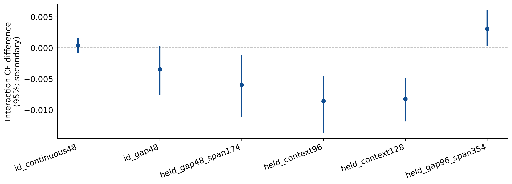

# G｜训练尺寸与真实物理间距分别带来什么收益

> 一句话结论：在两个预先指定的条件任务上，增加间距覆盖和增加尺寸覆盖分别带来明确收益；但“知道真实细排列”相对“只知道总跨度”的原定主收益尚未确认。G 是训练覆盖策略的证据，不是普遍尺度泛化或联合生成正确性的证明。

实验：core_geometry_factorial_20260925；完成于2026-09-25。本文于2026-11-16结合深度讲义扩写为汇报参考版，补充已有结果的分解、统计解释和追问答案；不新增实验、不改变冻结协议或主假设。新增表格来自已有公开数组与统计表，数值有舍入，全精度以机器证据为准。

[阅读总路线](../STUDY_GUIDE_ZH.md) · [术语与指标](../METHODS_ZH.md) · [参数速查](README.md) · [下一篇 I](../fine-geometry-identification/REPORT_ZH.md)

## 阅读目标与路线

建议用50–65分钟精读：15分钟理解对照，15分钟理解训练、测试与统计，20–35分钟精读结果并用第10节自测。时间不足时，优先看第2、6、7、8节。

全文按五个问题展开：

1. 为什么不是只比较一个小模型和一个大模型，而是同结构的五组训练配方？
2. W48、物理跨度174、可见数K512分别描述什么？
3. H1/H2为什么通过，H3为什么没有通过？
4. 为什么条件预测更好、生成长程关联更好，都不等于完整物理分布正确？
5. G留下了什么问题，为什么需要后续I，而不是重复宣布“多尺度有效”？

**汇报时最重要的不是背出五个组名，而是分清三层证据：训练覆盖的两项主收益已确认；真实细排列相对跨度的主收益未确认；生成出现次要改善，但仍有物理偏差。**

## 1. 研究动机：把两个容易混淆的因素拆开

项目希望模型利用物理位置关系，在没见过的输入布局和尺度上仍能作出合理条件预测。此前观察到大context退化，但至少有两个不同解释：

- **尺寸经验不足**：只在一种有效边长上训练，网络没有适应不同数量的有效位置。
- **距离经验不足**：只看连续单位格点，网络没有学过相邻token之间实际相隔不同物理距离的情形。

若一次同时增加尺寸和间距，最后变好也不能判断哪种经验贡献了收益。因此G保留原dense网络，采用“尺寸覆盖×间距覆盖”的2×2设计，再增加一个跨度对照。

这里的“尺寸”是有效输入网格边长W；“间距”是真实采样位置的相邻坐标差。二者都会影响物理视野，但不是同一变量。

| 符号 | 具体含义 | 最容易混淆的地方 |
|---|---|---|
| L=1024 | MC父场每条轴的格点数 | 不是网络每次都输入1024×1024 |
| W；N=W² | 本次输入每轴点数；总token数 | 不直接等于覆盖的物理长度 |
| gap；S | 相邻采样坐标差；一条轴的端点跨度 | 相同W可以有不同S，相同S也可以有不同gap排列 |
| K；t | 可见自旋数；模型的遮盖时间输入 | t不是物理温度；测试中t=1−K/N |

网络同时接收“自旋状态或MASK”和坐标。W改变点数，gap改变点在父场上的分布；提供位置编码不等于模型已学会正确物理规律。

### 一个帮助理解的例子

下面只是教学例子，不是正式实验的W4任务。

从同一条物理轴上取四个点：

- 连续采样：位置0、1、2、3，跨度3。
- 非均匀采样：位置0、1、5、7，间距1、4、2，跨度7。

第二种输入必须真的取物理位置0、1、5、7的自旋，再把这些坐标交给网络。仅取0、1、2、3的自旋却贴上0、1、5、7标签，是“坐标错配”，不是本实验的真实间距训练。

正式实验取两条轴笛卡尔积对应的W×W自旋，随机起点按L1024父场周期边界处理。远处自旋不会因被采样而变成物理近邻；上例只解释一条轴，不是一维Ising实验。

## 2. 五组实验：前四组分因素，第五组问信息

| 组别 | 有效训练边长W | 物理采样 | 网络收到的坐标 |
|---|---|---|---|
| G00 | 仅48 | 连续单位间距 | 真实坐标 |
| G10 | 16、24、32、48均衡 | 连续单位间距 | 真实坐标 |
| G01 | 仅48 | 一半连续、一半非均匀 | 真实坐标 |
| G11 | 16、24、32、48均衡 | 一半连续、一半非均匀 | 真实坐标 |
| G11S | 与G11相同 | 与G11逐样本完全相同 | 同跨度、内部均匀化 |

名称的第一个0/1表示是否多尺寸，第二个0/1表示是否加入非均匀间距；S表示span-only，不是一个额外训练尺寸。

### G11S到底删掉了什么

一条轴有W个点，总跨度为S。G11S提供：

```math
x_i^{\mathrm{span}}=\frac{iS}{W-1},\qquad i=0,\ldots,W-1.
```

它保留端点跨度，却不告诉模型局部gap如何排列。例如真实坐标[0,1,5,7]会变成[0,7/3,14/3,7]。这不同于rank坐标[0,1,2,3]：后者连物理跨度也丢掉了。

因此G11与G11S问的是：**同样的物理自旋、总跨度和监督，细排列信息是否还有额外价值？**

### “配对”配到了哪一层

同seed五组的模型初始化、更新预算和监督配方配对；但五组不可能共享完全相同的物理输入，因为尺寸和采样距离就是干预。只有G11/G11S共享完整的物理数据、mask、query和时间流，差别在坐标表示。

所以不能把整个G称为“只改RoPE的纯坐标消融”，也不能称为“比较五种模型结构”。

### 三项主比较为什么不是同一个问题

G11−G10改变了**训练时是否接触非均匀物理采样**；G11−G01改变了**训练时是否接触多种W**；G11−G11S则在同一物理采样基础上改变**网络获得的几何信息**。前两项干预训练覆盖，第三项干预信息表示，不能相互替代。

H1/H2是指定背景下的简单效应，不是平均另一因素后的全局主效应。其他背景下的增量与交互可以分析，但不能替换预设主比较。

## 3. 非均匀布局怎样构造：未见什么、保留什么

训练相邻gap取1、2、4、8；held-out相邻gap取3、6。这里held-out的准确意思是**相邻采样间距的取值未见**，不是所有两点距离都未见：训练中的非相邻距离和也可能等于3或6。

令q=W/4−1，冻结的计数为：

| 布局 | gap取值与个数 | 总跨度 |
|---|---|---:|
| 训练非均匀 | 1有q+1个；2有q个；4有q+2个；8有q个 | 15q+9 |
| 未见间距 | 3有3q+3个；6有q个 | 15q+9 |

每条轴将对应gap多重集随机排列，再累积求和得到坐标；两轴分别构造。这样同一个W下训练与held布局跨度相同，不能仅凭总跨度识别是哪一种gap集合。

具体到W48，q=11：

- 训练gap个数为12、11、13、11，共47个gap，跨度174。
- held gap为36个3、11个6，共47个gap，跨度同样174。
- W48连续布局的跨度只有47，不是174。
- W96 held跨度为354，不是95，也不与W48 held保持相同跨度。

这说明“W相同”“跨度相同”“细排列相同”是三个不同层次的控制。

若老师要求手算，W48训练跨度就是12×1+11×2+13×4+11×8=174，held跨度是36×3+11×6=174。两者都有48个点、47个gap；随机排列改变细节，不改变这个总和。

W96连续跨度95，小于训练W48非均匀跨度174。因此C96是**输入点数/有效网格的外推**，不是所有物理距离都未见。H96跨度354还增加了物理视野，是更复合的压力测试。

## 4. 模型怎样训练

### 固定模型与优化设置

| 项目 | 本轮设置 |
|---|---|
| 独立训练重复 | 6个新seed：92501–92506 |
| 模型数 / 总更新 | 6×5=30个fresh模型；各12,000更新，共360,000更新 |
| 主体结构 | dense Transformer，1,976,706参数；d128、4头、7块、MLP倍率4 |
| 位置信息 | 二维RoPE，base=10000；dropout=0 |
| 每更新输入量 | 18,432 token |
| 对应batch | W16/24/32/48分别为72/32/18/8 |
| 优化器 | AdamW，betas=(.9,.95)，weight decay=.05，梯度裁剪1 |
| 学习率 | 750步warmup至3×10⁻⁴，之后余弦降至3×10⁻⁵ |
| 精度 | BF16训练；损失及评价FP32 |
| 主权重 | 固定12k final EMA，衰减.999 |
| 辅助快照 | 4k、8k EMA，仅作学习诊断 |

每模型累计221,184,000个输入token。相同token预算并不等于相同FLOPs：dense attention对序列长度敏感；不同布局的物理信息也不相等。

### 一个32步监督周期里发生什么

75%的更新是普通随机遮盖；25%是稀疏可见任务。尺寸与几何按冻结的32步周期均衡安排，不根据当前loss临时增减。

普通任务中，t从[.01,1]范围采样，并有2%的全MASK端点。t控制遮盖概率，损失使用对应的逆t加权。稀疏任务则只留K∈{1,2,4,8,16,32}个可见自旋，用实际可见数设置t=1−K/W²。

稀疏更新有**总计512个隐藏query槽**，分配到整个batch，不是每张窗口512个。query与可见点分离，监督是实际自旋硬标签，没有把精确oracle概率或query答案作为输入。

这个混合配方的目的，是既训练一般遮盖状态，也让网络接触非常少的观测。它不是证明两种损失已达到最优比例。

一次更新是：**选W和布局 → 物理采样 → 遮盖与选query → 输入自旋/MASK、坐标、t → 计算损失并更新**。隐藏真值只用于监督；自旋整体翻转和方形对称变换按预定随机流执行。

例如W48的batch为8，每张64个稀疏query；W16的batch为72，每张7或8个。“固定输入token”不等于“所有token都是独立监督点”。五组按固定1000步块轮换，不按成绩调整算力。

### 为什么固定final很重要

主评价始终用事前固定的12k EMA；4k/8k只作诊断，不按成绩换权重、提前停止或补步。

## 5. 数据与评价：训练问题和测试问题如何对应

训练使用继承的768个L1024父场；验证使用独立256个父场。条件测试和生成参考来自新MC：8条链×128场=1024父场，初始化为4条random、2条plus、2条minus。

MC使用固定burn40、gap4及预定QA；能量、绝对磁化等混合诊断用于检查参考质量，不是“继续采到结果对模型有利”。测试参考不回流训练。有限MC仍有不确定性，不能把它当无限精度的真值。

QA检查能量、|m|、m²及W96的G25–48，要求split-Rhat≤1.1、每链ESS≥16，分别检查链间相容性与有效样本信息量。通过不等于父场完全独立或参考无限精确。

### 六种测试几何

| 简称 | 有效边长 | 采样布局 | 主要角色 |
|---|---:|---|---|
| C48 | 48 | 连续单位间距 | 原范围保留 |
| U48 | 48 | 训练非均匀gap，跨度174 | 已见gap布局 |
| H48 | 48 | held gap3/6，跨度174 | H1、H3主任务 |
| C96 | 96 | 连续 | H2主任务 |
| C128 | 128 | 连续 | 更大容器次要压力 |
| H96 | 96 | held gap3/6，跨度354 | 尺寸与gap共同外推压力 |

每种几何评价5个K：2、32、512、⌊W²/2⌋、⌊.05W²⌋。因此一共30个bank，每个bank选128父场，即每MC链16个、沿原序列间隔8取样；每父场有64个隐藏query。30模型×30bank=900个条件预测单元。

“有64个query”是同一场内的多个评分点，不是64次独立训练实验。也不能把同父场裁出的窗口当作新的独立物理场。

一个bank共有128×64=8192个query评分，但它们来自128父场、8条链。测试先固定隐藏query，再从其余位置按共同随机排列选可见点，使不同K的观测嵌套。五组在同一bank上共享物理自旋、可见点、query和标签，G11S只按其原生规则变换所供坐标。

### 相同K，不等于相同遮盖比例

| 输入 | K=2的t | K=32的t | K=512的t |
|---|---:|---:|---:|
| W48，N=2304 | .999132 | .986111 | .777778 |
| W96，N=9216 | .999783 | .996528 | .944444 |

K512在W48约22.22%可见，在W96仅约5.56%。同一主比较的两臂在同一W、K、t上公平配对，但跨几何比较混合了可见比例、距离和时间输入差异，G未将它们单独解耦。保留条件也按实际K设t，t≈.95只是简称。

## 6. 主终点究竟算的是什么

令模型预测+1的概率为p，真实自旋编码为y∈{0,1}。单query条件CE是：

```math
\ell(p,y)=-y\log p-(1-y)\log(1-p).
```

先在父场内平均64个query，再平均父场；每个主任务对K=2、32、512三个条件**等权平均**，最后得到每seed每臂的分数，再作配对差。

若用a表示组别、s表示训练seed、E表示固定测试几何，以上定义可以写成：

```math
R_{a,s}(E)=\frac{1}{3}\sum_{K\in\{2,32,512\}}
\frac{1}{128}\sum_{b=1}^{128}\frac{1}{64}\sum_{q=1}^{64}
\ell_{a,s,E,K,b,q},\qquad
\bar D=\frac{1}{6}\sum_{s=1}^{6}
\bigl[R_{G11,s}(E)-R_{a,s}(E)\bigr].
```

比较的是同seed、同bank的差。本轮每场query数相同，先平均与直接汇总的点估计等价；**平均顺序本身不能解决相关性，重采样单位才是关键**。

这是对真实留出标签的经验条件CE，单位nats/query。不是全图joint NLL，也不是已知完整真实条件分布下的精确KL。

| 主假设 | 配对差 | 改变的主要训练因素 | 指定评价 |
|---|---|---|---|
| H1 | G11−G10 | 同多尺寸背景下加入间距覆盖 | H48，三个K等权 |
| H2 | G11−G01 | 同间距覆盖背景下加入尺寸覆盖 | C96，三个K等权 |
| H3 | G11−G11S | 同物理数据和跨度下保留真实细排列 | H48，三个K等权 |

H1与H2测试任务不同，效应量不能直接拿来排名“间距比尺寸重要多少”。

### 误差条为何不仅包含六个seed

主分析联合重抽6个配对训练seed与8条MC链，并在每链所选16父场序列上用循环块长2；20,000次bootstrap生成区间。块长1/4、seed-only和MC-only各10,000次是敏感性分析，不是可任意挑选的替代主结果。

三个主比较使用Bonferroni校正后的98.333333%区间。实质门要求区间上界<−.002；只要求上界<0是较弱的方向判断。重抽20,000次不意味着有20,000个独立训练重复。

一次联合bootstrap有放回抽取训练seed、MC链和链内循环时间块；五组及各K共用索引，保留配对并纳入训练和参考两种随机性，绝不把8192个query当成独立实验。

98.333333%=1−.05/3；.002是预设实质门，不是自然常数。区间上界低于−.002才支持超过该门的收益。不要解释成“参数有98.33%的概率落在本次区间内”；6个seed、8条链下，区间仍是有限样本近似。

## 7. 主结果：两项成立，一项未决

| 主比较 | 平均CE差 | 98.333333%联合区间 | 原实质门 |
|---|---:|---|---|
| H1 间距覆盖 | −.066041 | [−.080240, −.054136] | 通过 |
| H2 尺寸覆盖 | −.008908 | [−.011889, −.005704] | 通过 |
| H3 细排列相对跨度 | −.001163 | [−.002792, +.000238] | 未通过，方向也未确认 |

来源：[主统计及敏感性](evidence/analysis/crossed_uncertainty.json)。这些是配对差，不是各组绝对CE。

### 7.1 先看绝对分数，再解释差值

下表均为6个seed、K=2/32/512等权后的CE。它用于理解效应大小，**主判定仍是上表的配对区间，不能用绝对均值排序代替检验**。

| 测试任务 | G00 | G10 | G01 | G11 | G11S |
|---|---:|---:|---:|---:|---:|
| H48：未见相邻gap | .620047 | .626753 | .559955 | .560712 | .561875 |
| C96：连续大网格 | .564264 | .563939 | .540077 | .531169 | .535403 |
| H96：双重变化压力 | .620909 | .620519 | .597356 | .600037 | .600611 |

来源：[逐seed分数](evidence/analysis/per_seed_metrics.csv)。表中H48的G01还略低于G11；这并不推翻H1，因为H1比较的是G11与G10，而不是要求G11赢过所有组。**“指定增量有效”与“某配方处处最优”是不同命题。**

### 7.2 H1：间距覆盖的证据最明显，但效应有条件

在H48上，G10的CE为.626753，G11为.560712，差−.066041；联合区间最靠近零的端点仍为−.054136，明显低于−.002。因此在“多尺寸训练背景、H48留出gap任务、三个K等权”这个完整限定下，加入非均匀物理采样训练有明确实质收益。

可以说：“多尺寸经验不能替代间距经验，本任务补上间距覆盖有效。”不能推广为任意距离或稀疏度都有效，也不能只归因于精确细坐标，因为训练物理分布也变了。

### 7.3 H2：多尺寸训练帮助新的输入点数，不等于无限尺度外推

在C96上，G01为.540077，G11为.531169，差−.008908；区间上界−.005704也低于−.002。这里两个组都接受间距多样性，区别是G11还接受W16/24/32/48的尺寸多样性，因此支持该背景下多尺寸覆盖对W96连续任务的增量价值。

**不能据效应大小宣称间距比尺寸重要约7倍**：两项测试几何、基线难度和可见比例不同。H2支持指定context点数的泛化收益，不是普适尺度规律。

### 7.4 H3：平均方向有利，但原主判据没有确认

在H48上，G11比G11S平均低.001163，点估计尚未达到.002的实质收益幅度；联合区间[−.002792,+.000238]又跨过0。因此它既没有通过实质门，也没有通过原定方向门。正确表述是“本轮未确认真实细排列相对同跨度表示的额外主收益”，不是“真实几何没有作用”。

区间仍容许超过.002的收益，也容许微小反向差异，且未完整落在[−.002,+.002]内。证明等效需要预设等效界限与相应检验，不能把“不显著”当作“等效”。

**H1通过与H3未通过不矛盾。** H1问“有没有接受这种物理采样训练”，H3问“在已经接受相同采样训练后，额外提供局部gap细节有什么增益”。一种可能是总体跨度或训练分布已解释大量收益；另一种可能是细排列效应较小、依赖K或被有限参考误差遮蔽。这些是解释线索，不是G已经识别出的唯一机制。

### 7.5 三个K等权，不代表三个K上的收益一样

把已经保存的逐K配对差展开，可看到主均值的来源：

| 原主比较对应的任务 | K=2 | K=32 | K=512 | 三K等权平均 |
|---|---:|---:|---:|---:|
| H1，H48，G11−G10 | −.001075 | −.038497 | −.158551 | −.066041 |
| H2，C96，G11−G01 | −.005611 | −.008683 | −.012430 | −.008908 |
| H3，H48，G11−G11S | −.000319 | +.000293 | −.003464 | −.001163 |

来源：[逐K配对表](evidence/analysis/paired_contrasts.csv)。这些是**解释性点估计**，不是新增三个主检验。H1的汇总收益主要由较大的K贡献；H3在K32还轻微反向，在K512更有利。它们提示收益可能依赖观测条件，但不能看完表后把主终点改成K512，也不能把主平均的结论复制到每个K。

### 7.6 为什么六个seed都改善，H3仍未确认

H3六个配对差依seed92501–92506依次为−.000992、−.001323、−.001091、−.001209、−.001126、−.001238。它们方向一致，说明**在这套共同测试参考上**训练重复的方向稳定；但同一套有限MC参考的误差，会共同影响这六个分数，并不会因重复训练六次就自动消失。

| H3统计方式 | 98.333333%区间 | 应怎样使用 |
|---|---|---|
| 原主联合bootstrap，块长2 | [−.002792,+.000238] | 决定原主结论 |
| 配对t，仅六个训练seed，df=5 | [−.001333,−.000994] | 训练seed维度的补充，不含完整MC维度 |
| 联合bootstrap，块长1 | [−.002889,+.000351] | 时间相关处理的敏感性检查 |
| 联合bootstrap，块长4 | [−.002798,+.000246] | 同上，不替代主方法 |

块长1/4结果同样跨0，说明这项未确认并非只由主块长2的某个偶然选择造成。表中敏感性端点来自已有bootstrap投影数组的同一分位数口径，未新增抽样。更窄的t区间也没有达到−.002实质门；即使它支持方向，也不能拿来改写联合主判定。


读图先看横轴负向是否有利于G11，再看区间是否整体位于−.002左侧。H1/H2满足，H3不满足；H3在宽横轴上很靠近0，必须结合数值表，不能靠点的位置判断。

[逐seed主分数图](evidence/analysis/primary_paired_CE.png)补充展示配对方向。向老师讲图时先说明误差条的抽样层级，再解释“为什么方向一致仍有不确定性”，不要只展示均值或挑更窄的区间。

## 8. 次要证据：协同不是普遍的，生成也有代价

### 8.1 同时加入两种覆盖，不保证所有任务都最好

同一任务上的交互差定义为：

```math
\Delta_{\mathrm{int}}(E)
=\bigl[R_{G11}(E)-R_{G10}(E)\bigr]
-\bigl[R_{G01}(E)-R_{G00}(E)\bigr].
```

负值意味着加入间距覆盖在多尺寸背景下更有利；正值则表示这种增量减弱。它不是不同任务之间的差，也不是“交互正就所有组都很差”。

在H96上，G01平均CE=.597356，优于G11的.600037。该任务交互差+.003072，95%区间[+.000368,+.006038]。而C96的交互点差为−.008583。方向随任务变化，不能只展示有利的一栏。



这张图使用次要95%区间，不应与主图98.333333%区间混用。

用H96绝对均值手算更直观：多尺寸背景下的间距增量为.600037−.620519≈−.020482；固定尺寸背景下为.597356−.620909≈−.023553，两者相减约+.003073。两个增量本身都为负，但前者的改善幅度较小，所以交互为正。正交互不等于“加入间距训练有害”。

H96的G11−G01点差为+.002681，提醒我们“任务更多、配方更丰富”不保证每个任务都更好。固定预算下的训练覆盖分配可能有关，但本轮没有独立控制每项任务的曝光量来证明这一机制。H96属于次要压力测试，不能把它的95%区间说成已享有三个主假设的统一确认等级。

### 8.2 条件预测以外，另做了固定生成评价

每模型生成64张W96，共1920张、120个16图shard。采样器固定为S0、cosine-squared日程、256步、温度1，无MC纠正。同一训练seed的五臂使用配对生成随机身份；不是新增1920个训练模型。没有W128生成。

长程关联指标G25–48 NRMSE为：

```math
\mathrm{NRMSE}_{25:48}=
\frac{\sqrt{\frac{1}{24}\sum_{r=25}^{48}
\left[\widehat G_{\mathrm{gen}}(r)-\widehat G_{\mathrm{MC}}(r)\right]^2}}
{\sqrt{\frac{1}{24}\sum_{r=25}^{48}\widehat G_{\mathrm{MC}}(r)^2}}.
```

实现将分母下限设为10⁻¹²。G(r)是开放窗口内沿两条坐标轴、按有效点对计数汇总的自旋乘积关联；不是径向全方向平均，也没有在本指标中减去m²。r=25至48共24个距离。先对每个模型的64张生成图汇总关联曲线，得到NRMSE，再平均六seed；不是先平均每张图的NRMSE。

例如.305383表示这段关联曲线的均方根误差约为参考曲线均方根幅度的30.54%，**不是30.54%的自旋生成错误率**。不同距离段、能量、磁化和高阶联合分布仍需分别检查。

| 次要指标 | G00 | G10 | G01 | G11 | G11S |
|---|---:|---:|---:|---:|---:|
| W96 G25–48 NRMSE | .962560 | .757280 | .759949 | .305383 | .598294 |

G11−G11S的生成差为−.292911，次要95%区间[−.425566,−.155013]。但G11能量偏差约+.036703，G00/G10约+.005794/+.005615；G11 signed magnetization bias约−.042960。偏差应接近0，不是越负越好。

下表列出已有生成数组的其他点估计。偏差均为“生成均值−MC参考均值”；能量采用开放窗口最近邻每键能量，即自旋乘积的负平均，不含跨窗口边界的键：

| 次要指标 | G00 | G10 | G01 | G11 | G11S |
|---|---:|---:|---:|---:|---:|
| 短程G1–8 NRMSE | .265606 | .220425 | .187355 | .111325 | .192071 |
| 能量偏差 | +.005794 | +.005615 | +.051980 | +.036703 | +.061093 |
| 有符号磁化m偏差 | +.018576 | +.020172 | +.029710 | −.042960 | −.000927 |
| 绝对磁化偏差 | +.243384 | +.197900 | +.184275 | +.066048 | +.139648 |
| 磁化平方m²偏差 | +.294294 | +.238196 | +.215571 | +.078562 | +.164007 |

G11的关联误差和|m|、m²偏差较小，但能量比G00/G10偏离参考更多；有符号m偏差也不能忽略。这里“有物理代价”必须说清参照组：G11能量又比G01/G11S更接近参考，并不是相对所有组都退化。m均值接近零也可能掩盖过强的正负磁化，故不能只看m而忽略|m|与m²。

生成区间联合重抽训练seed、配对的16图shard及参考MC链/时间块；主生成块长8，块长4/16作敏感性。每模型只有4个shard，统计精度有限，全部仍属次要证据。连续W96生成时五组供给的原生坐标一致，因此G11/G11S的生成差来自其训练后模型差异，不是此时故意给G11S错误的测试坐标。


读这张图时，左侧看每seed的长程误差，右侧看次要配对差；能量与磁化还必须结合上表、[生成点估计数组](evidence/analysis/generation_point.npz)及[生成配对区间](evidence/analysis/crossed_uncertainty.json)的generation_secondary字段。paired_contrasts.csv是条件CE表，不是生成物理量表。生成任务与H48条件H3的输入、终点和证据等级不同，不能把这一改善拿来“救回H3”。

### 8.3 原范围保留和学习诊断

G11相对G00的两个C48保留条件均通过：各自97.5%区间上界≤+.005。4k/8k/12k学习记录没有触发预定learning-incomplete标记。两点都只是规定任务/阈值下的检查，不代表所有原能力无损或已充分收敛。

| C48保留条件 | G11−G00的CE差 | 97.5%联合区间 | 保留门 |
|---|---:|---|---|
| K1152，t=.5 | +.000507 | [−.000578,+.001668] | 上界≤+.005，通过 |
| K115，t≈.950087 | +.000347 | [−.001252,+.002007] | 上界≤+.005，通过 |

均值略正，表示估计上有微小退化；通过的含义是“没有超过预设容忍度的证据界限”，不是两组逐点完全相同。这里用的是97.5%保留区间，也不能与98.333333%主收益区间混为一谈。

学习诊断的明确规则是：固定验证条件下，12k CE若仍不优于ln2，或8k→12k的CE改善超过.005，就标记可能训练不足。30个模型均未触发。它只能排除这一规则检测到的明显问题；不能证明更长训练绝不会改变结果，也不能反过来授权挑选4k/8k来获得更好的主结论。

## 9. G对主线的价值与不能越过的边界

后续I固定全部物理输入，增加独立随机坐标对照，并用新seed、新参考研究细几何。I是由G提出问题的新实验，不能追溯替换G的原主假设。

把主线串起来，应当是：**G先验证训练覆盖是否重要 → G-H3暴露精细坐标解释仍不充分 → I进一步识别正确几何对应的作用 → 后续局部能力与采样实验区分“条件学会了什么”和“生成为什么仍失真”**。真正把粗粒化数据用于训练的RG实验又是另一个干预，G本身不包含RG训练。

| 核心主张 | 对应证据 | 当前状态 |
|---|---|---|
| 多尺寸背景下，间距覆盖帮助H48 | H1配对差及98.333333%联合区间 | 支持，限指定任务 |
| 间距覆盖背景下，多尺寸帮助C96 | H2配对差及同口径区间 | 支持，限指定任务 |
| 真实细排列优于同跨度表示且达到实质门 | H3区间跨0，点差幅度小于.002 | 未确认，不能等同于无作用 |
| G11在固定W96采样器下改善长程关联 | 生成NRMSE及次要95%配对区间 | 次要支持，伴随物理指标权衡 |
| 已实现任意尺度正确联合生成或RG固定点 | G没有相应实验与证明 | 不支持，不应作为本轮结论 |

## 10. 如何向老师讲清楚，以及自测答案

推荐复述顺序：**为什么拆尺寸/间距 → 五组控制 → 三主任务 → 两项通过与H3未决 → H96反例 → 生成tradeoff → 为什么需要I。**

### 10.1 设计与实现追问

**问1：为什么不只比G00和G11？为何要第五组？** 两端比较同时改变尺寸与间距；2×2拆增量和交互，G11S再隔离相同采样、相同跨度下的细排列信息。

**问2：G11S是不是破坏物理样本？** 不是，自旋、mask、query、标签、t都与G11配对，只改变坐标描述。它保留跨度，不是无位置编码或rank坐标。

**问3：有RoPE，为什么还要训练间距？** RoPE提供坐标差表示，不自动赋予正确物理映射。G未比较不同位置编码，不能将收益唯一归因于RoPE。

**问4：同token预算公平吗？** 控制了输入量和更新数，但没有保证同FLOPs、同物理信息量或每项任务曝光量。结论是给定预算的配方收益，不是计算效率最优证明。

**问5：训练稀疏分支有K512吗？** 其可见K只到32；512是整个batch的隐藏query槽数。但普通遮盖分支可产生更多可见点，不能说训练从未出现接近512的可见数量。

**问6：W96是物理长程泛化吗？** 输入点数未见，但连续跨度95小于训练非均匀跨度174。应说指定context点数泛化，而非所有物理长度均未见。

### 10.2 结果与统计追问

**问7：H1通过，是不是G11在H48最强？** 不是，H1只比较G11与G10；H48的G01均值还略低。指定增量有效不等于全组最优。

**问8：三个K等权为什么重要？** 它固定了评价权重，不能按成绩临时选择任务。H1主要由较大K贡献，H3也有异质性，但不能事后只报K512为原主结果。

**问9：六seed方向一致，为何H3未过？** 它们共享有限测试参考，seed稳定不消除MC误差。联合区间跨0，更窄的seed-only/t区间不能替代主判据。

**问10：H3是否只是样本不够？** 不能断言。有限精度、较小效应或K依赖都可能有关；“未确认”既不是无作用，也不保证加样本就成功。

**问11：能不能把.002门改成0？** .002检验实质收益，0检验方向；可同时报告但不能事后换门。H3原联合区间连方向门也未过。

**问12：为什么900份预测不是900次重复？** 900=30模型×30bank，多条件共用父场，query场内相关。每组独立训练seed只有6，参考随机性另按8链和时间块处理。

### 10.3 物理意义与下一步追问

**问13：CE下降证明条件分布正确吗？** 它支持留出任务预测更好，不是任意上下文都正确。没有完整真实条件分布，不能称为精确KL，更不能推出联合分布正确。

**问14：生成NRMSE由.598降到.305，为何还谨慎？** 这是一个距离段、固定采样器下的次要改善，未覆盖能量、磁化和高阶联合结构；G也没有单独识别多步误差累积机制。

**问15：能量偏差变大，是否推翻训练收益？** 不推翻条件CE收益，但限制物理生成全面改善的结论。不同终点必须并报，不能只用有利指标定义成功。

**问16：学习检查通过就是充分收敛吗？** 不是，只是未触发原定标记；不能据此排除更长训练的影响，也不能事后加步、挑seed或换checkpoint。

**问17：G最重要的价值是什么？** 把尺寸与间距拆为可检验干预，得到两项主收益，并以H3未决、H96反例明确下一步：区分正确细坐标、跨度线索和错误对应的贡献。

## 11. 证据地图与执行状态

| 想核对的内容 | 入口 |
|---|---|
| 五组、gap计数、损失、判据 | [冻结协议](protocol/CORE_GEOMETRY_FACTORIAL_PROTOCOL_20260925_ZH.md) |
| 实际运行身份与完成状态 | [运行协议](evidence/run_protocol.json)、[完成摘要](evidence/final_summary.json) |
| 主结果、区间、保留门与学习标记 | [crossed_uncertainty.json](evidence/analysis/crossed_uncertainty.json) |
| H3块长敏感性表的现有抽样数组 | [块长1](evidence/analysis/conditional_bootstrap_block1_primary_projection.npz)、[块长2](evidence/analysis/conditional_bootstrap_block2_primary_projection.npz)、[块长4](evidence/analysis/conditional_bootstrap_block4_primary_projection.npz) |
| 逐seed与配对数值 | [per_seed_metrics.csv](evidence/analysis/per_seed_metrics.csv)、[paired_contrasts.csv](evidence/analysis/paired_contrasts.csv) |
| 生成绝对偏差与区间的指标顺序 | [生成数组](evidence/analysis/generation_point.npz)、[分析实现](../../scripts/research20260921/core_geometry_factorial_analysis.py)的generation_values |
| 配对估计与重采样如何实现 | [统计实现](../../scripts/research20260921/core_geometry_factorial_statistics.py) |
| 自旋、坐标、MASK怎样形成 | [数据适配器](../../scripts/research20260921/core_geometry_factorial_data.py) |
| 来源与公开边界 | [EVIDENCE](EVIDENCE.md)、[数据可用性](../DATA_AVAILABILITY.md) |

正式计算约7.428小时，含预检预算约7.731小时。本地1459/1459科学路径已核验。原10小时预算门失败，正式开始前显式授权改为12小时窗口；不能将旧门改写为通过。

公开图表与统计可核对主要结论，但普通Git不包含全部权重、父场和大数组。本文新解释不代表新增实验，无需重新训练。

### 汇报前的五项自查

1. **贡献：** 指定任务的覆盖收益与几何边界，不是新架构或RG定理。
2. **清晰度：** 能区分W、跨度S、可见数K、遮盖时钟t。
3. **实验强度：** 每组6个seed，不是900独立重复；固定final，不筛结果。
4. **评价完整性：** 同时报H1/H2、H3未决、H96反例、保留门与物理偏差。
5. **机制：** 训练分配、跨度线索与有限精度是解释线索，不是已证实的唯一原因。
