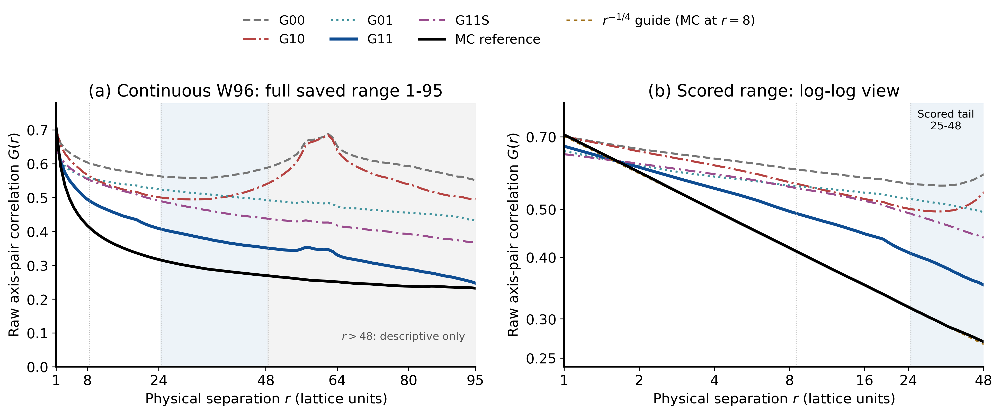
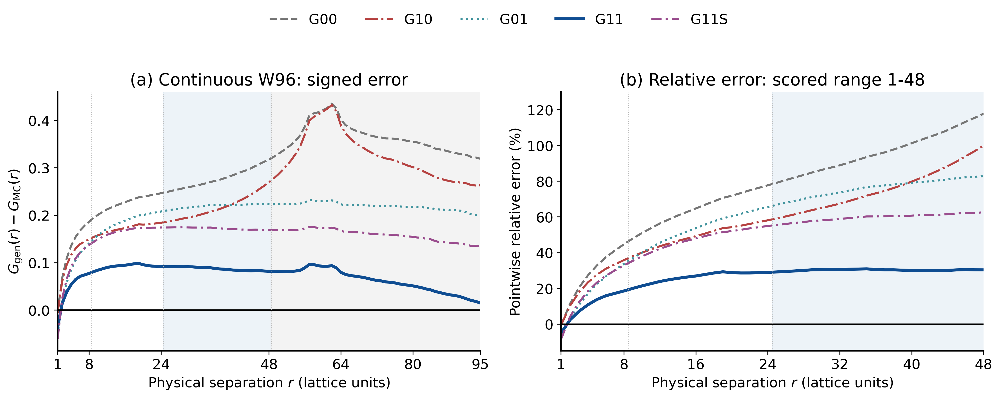
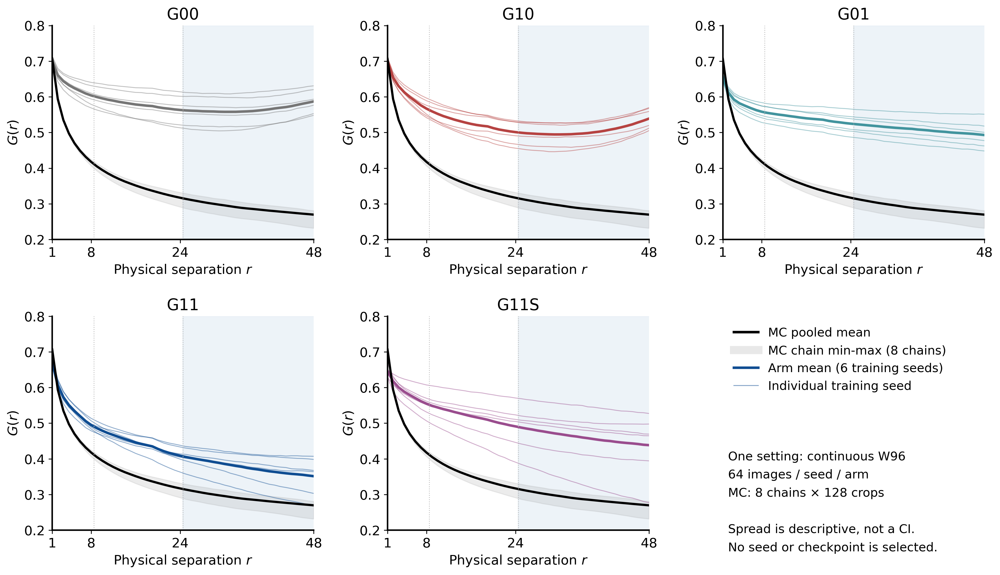

# G实验补充讲义：0.305383对应什么样的关联曲线？

> **结论先行：G11明显改善了W96生成的关联曲线，但还没有复现MC。** 在原定长程区间r=25–48，G11均值曲线仍比MC高约29.1%–30.9%；其衰减形状比G00/G10更接近MC，却不能据此宣布已经学到正确临界幂律。

本页于2026-11-16补充，使用2026-09-25已经完成并冻结的G实验数据。**没有重新训练、生成、选seed、选checkpoint或改变原统计判定。** 新图和描述性斜率属于事后解释，不能取代原报告的主检验与次要生成区间。

建议顺序：先看第1节范围 → 图A及数值表 → 图B → 幂律解释 → 图C及局限。回到[完整G实验报告](../../REPORT_ZH.md)理解五组干预和H1/H2/H3。

## 1. 先锁定setting：五组模型，不是五种测试物理环境

**本次所有曲线都在同一个连续W96测试setting下比较。** G00/G10/G01/G11/G11S是不同训练配方；不是五种温度，也不是五种生成网格。

| 项目 | 这两类补图实际使用的设置 |
|---|---|
| 物理目标 | 零场二维最近邻铁磁Ising，原协议临界逆温度 |
| 生成几何 | 96×96连续网格，最近邻物理间距为1，单轴跨度95 |
| 模型 | 六个训练seed 92501–92506 × 五臂，固定12k final EMA |
| 生成数量 | 每seed、每臂64张；每臂384张，总1920张 |
| 采样器 | 原S0，cosine-squared日程，256步，温度1；无MC纠正 |
| MC参考 | 独立L1024评价父场，8链×128=1024个固定W96裁剪；所有组共用同一参考 |
| 关联定义 | 开放窗口内沿x/y两轴的自旋乘积，按有效点对数汇总；不跨窗口绕回，不是径向平均 |
| 已保存距离 | r=0–95；r=0恒为1，因此图从r=1开始 |
| 原定计分区间 | 短程1–8，中程9–24，长程25–48 |
| 额外展示 | r=49–95只作描述性展示，不扩大原终点范围 |

G实验还做过其他几何的**条件预测**，但没有相应的非均匀网格生成曲线，也没有W128生成。因此目前不能把H48/H96条件CE图包装成这些setting的生成G(r)。以后若要按温度、生成尺寸或非均匀几何分别展示，需要那些setting的独立生成与匹配MC，不能凭已有W96数据补造。

## 2. 图A：直接看生成曲线与MC是否重合



[下载矢量PDF](figures/A_W96_correlations.pdf)。左图是完整保存范围r=1–95；右图把原评分范围r=1–48放到双对数坐标。黑线为MC；彩色线为各臂六训练seed的平均曲线。浅蓝背景是原长程评分段25–48，左图灰背景是评分范围之外。金色虚线是按MC在r=8处定标的r⁻¹/⁴参考，不是对模型拟合出来的曲线。图中没有画置信区间；重复间差异单独见图C。

### 2.1 应先看哪里

**先看G00/G10：最近邻接近MC，不代表整条曲线正确。** 两组在r=1处约0.701，接近MC的0.707；但从r=2开始，均值关联已经高于MC，之后明显衰减过慢。G00在r=32附近、G10在r=31附近达到局部低点后回升；完整范围内两组在r≈62附近还有明显隆起。这不是MC曲线的形状。

**再看G11：它降低了中长程关联的系统性高估，但没有消除。** 在25–48区间，G11持续下降、远比G00/G10贴近MC；然而蓝线仍整段高于黑线。它不像G00/G10那样在这一段明显向上弯，但“更接近平行”与“幅度也正确”是两件事。

**最后看G01/G11S：不能只比较最强组和最弱组。** G01、G11S同样存在较强长程关联，其中G11S整体比G01更低，但都高于G11。五组同图保留了两个单因素组及坐标对照，避免把G11的改善简单归因于某一个未经单独识别的机制。

### 2.2 用几个距离把图讲实

下表是六seed平均G(r)，不是单个“最好seed”；MC列汇总全部1024个参考crop。

| r | MC | G00 | G10 | G01 | G11 | G11S |
|---:|---:|---:|---:|---:|---:|---:|
| 1 | 0.706790 | 0.700997 | 0.701175 | 0.654811 | 0.670088 | 0.645698 |
| 8 | 0.417622 | 0.603947 | 0.566945 | 0.558215 | 0.494877 | 0.554739 |
| 24 | 0.317024 | 0.563209 | 0.501084 | 0.524752 | 0.408624 | 0.491046 |
| 32 | 0.295493 | 0.557944 | 0.494589 | 0.513222 | 0.385627 | 0.469298 |
| 48 | 0.269697 | 0.587153 | 0.539007 | 0.492933 | 0.351409 | 0.438429 |

以r=48为例，G00是MC的约2.177倍；G11是约1.303倍。**G11修正了大量“远处自旋过度同向”的误差，但离MC仍有明显幅度差。** 这里说的是二点乘积平均，不是已经识别出生成失真的唯一原因。

完整范围还显示，G11在r≈57–62附近有较小起伏，不能只截取一段顺滑区间就称为全程纯幂律。r接近95时G11更接近MC，也不能被挑出来替代原25–48终点：这部分点对数很少，且不属于原正式计分范围。

## 3. 0.305383究竟如何算，能解释到什么程度

**0.305383是六个模型各自的归一化曲线误差再平均。** 令s表示训练seed，a表示组别，Nᵢ(r)表示第i张图在距离r的有效点对数，Sᵢ(r)是这些点对的自旋乘积和，则：

```math
\widehat G_{s,a}(r)=\frac{\sum_{i=1}^{64}S_{s,a,i}(r)}{\sum_{i=1}^{64}N_{s,a,i}(r)},\qquad
\widehat G_{\mathrm{MC}}(r)=\frac{\sum_{i=1}^{1024}S_{\mathrm{MC},i}(r)}{\sum_{i=1}^{1024}N_{\mathrm{MC},i}(r)}.
```

原长程分数为：

```math
\mathrm{NRMSE}_{a}=
\frac{1}{6}\sum_{s=1}^{6}
\frac{\sqrt{\frac{1}{24}\sum_{r=25}^{48}
\left[\widehat G_{s,a}(r)-\widehat G_{\mathrm{MC}}(r)\right]^2}}
{\sqrt{\frac{1}{24}\sum_{r=25}^{48}\widehat G_{\mathrm{MC}}(r)^2}}.
```

本批MC在25–48上的均方根幅度为**0.288721**；G11六seed的平均RMSE为**0.088171**，两者之比就是**0.305383**。因此可以说“该区间的曲线RMSE，平均约为MC参考幅度的30.54%”。不能说“30.54%的自旋生成错了”“每个距离都恰好错30.54%”，也不能说“准确率69.46%”。

| 组别 | 原分数：先逐seed计算NRMSE再平均 | 对图中平均曲线直接计算NRMSE |
|---|---:|---:|
| G00 | 0.962560 | 0.962363 |
| G10 | 0.757280 | 0.757002 |
| G01 | 0.759949 | 0.759911 |
| G11 | 0.305383 | 0.301995 |
| G11S | 0.598294 | 0.595581 |

**右列不替换左列。** 图A先平均六条曲线用于展示；平方和开根号是非线性运算，所以“平均曲线的误差”一般不等于“六个曲线误差的平均”。两列略有差别并不是复现失败。G11相对G00的原NRMSE下降约68.27%，这是相对改善幅度，不是“已经复现了68.27%的物理”。

## 4. 图B：偏差在哪一段，方向是什么



[下载矢量PDF](figures/B_W96_signed_errors.pdf)。左图为平均生成曲线减MC，零线表示与MC一致；正值表示过强关联。右图为同一差值除以对应距离的MC值，再乘100%。右图的逐点相对误差**不是**原NRMSE。背景区间定义与图A一致。

**G11的主要剩余问题是系统性偏高，而非围绕零随机上下抖动。** 在25–48，平均曲线的绝对偏差位于+0.081711至+0.091817，逐点相对偏差约29.1%–30.9%。这说明0.305不能解读为“少数距离点特别坏、其余都很好”：这一长程区间基本整体偏高。

**偏差也不是到了r=25才突然出现。** r=25是预设计分分界，不是数据检测出的失效转折点。五组均值在r=1偏低，从r=2开始转为偏高；G11的误差在中程已经积累。相较之下，G00/G10在长程还出现反向上翘，导致误差继续增大。

老师若问“错误更集中在短程还是长程”，应分清比较口径：

| 组别 | NRMSE 1–8 | NRMSE 9–24 | NRMSE 25–48 |
|---|---:|---:|---:|
| G00 | 0.265606 | 0.640088 | 0.962560 |
| G10 | 0.220425 | 0.487726 | 0.757280 |
| G01 | 0.187355 | 0.528900 | 0.759949 |
| G11 | 0.111325 | 0.260706 | 0.305383 |
| G11S | 0.192071 | 0.468932 | 0.598294 |

**按各段归一化误差，五组都表现为长程更难。** 但各段使用各自MC幅度作分母，不能把这三个数直接相加当总误差贡献。G11的中、长程绝对偏差量级接近；长程MC更小，所以同样量级的绝对偏差会对应更大的相对误差。

## 5. 有没有接近r⁻¹/⁴？必须把形状与幅度分开

**理论参考有依据，但本图不是临界指数验证。** 零场二维Ising临界关联在适当的大距离极限具有r⁻¹/⁴渐近行为；参考[T. T. Wu的原始研究](https://journals.aps.org/pr/abstract/10.1103/PhysRev.149.380)。我们的MC是有限L1024父场的W96开放crop，模型是有限W96生成，不能要求所有短距离与窗口边缘都严格沿着同一条无限体积极限直线。

图A的参考线明确取为：

```math
G_{\mathrm{guide}}(r)=\widehat G_{\mathrm{MC}}(8)\left(\frac{r}{8}\right)^{-1/4}.
```

定标只使用MC的r=8值，不对G11单独调幅，也不搜索“看起来最好”的拟合区间。图上金线与黑线接近，所以有些位置会被黑线遮住；这是MC接近该参考形状的表现，不是少画了一条线。

为避免只凭肉眼判断，下面报告两个固定区间的**端点有效衰减指数**：

```math
\eta_{a:b}=-\frac{\log\bigl[\overline G(b)/\overline G(a)\bigr]}{\log(b/a)}.
```

这里的横线表示图中六seed均值，MC使用其汇总曲线。这只是两点的对数斜率，**不是全区间回归拟合、不是新的假设检验，也不是带置信区间的临界指数估计**。

| 曲线 | η₈:₂₄ | η₂₅:₄₈ | 如何读 |
|---|---:|---:|---|
| 理想r⁻¹/⁴参考 | 0.2500 | 0.2500 | 同一纯幂律在任意区间的斜率相同 |
| 本批MC | 0.2509 | 0.2320 | 与参考较接近，但有限范围内并非处处精确0.25 |
| G00 | 0.0636 | −0.0674 | 中程过平；长程两端反而上升 |
| G10 | 0.1124 | −0.1172 | 同样有长程回升 |
| G01 | 0.0563 | 0.0913 | 仍明显衰减过慢 |
| G11 | 0.1743 | 0.2183 | 长程形状改善；中程仍偏平，幅度仍偏高 |
| G11S | 0.1110 | 0.1634 | 有下降，但两个区间都比MC更平 |

因此，老师问“有没有接近幂律”时，可以回答：**G11在25–48的有效衰减斜率，比其他组更接近本批MC及1/4参考；但它在8–24更平，25–48仍有约30%的幅度高估，完整曲线还有起伏，不能称为已经正确恢复临界幂律。**

此外，25–48只跨越不到2倍距离，远不足以凭一段看起来近直线的曲线识别渐近标度律。若要提出“正确指数”的正式结论，需要事前规定的尺度区间、多尺寸/有限尺寸分析、拟合诊断及同时考虑训练和MC不确定性；本补图没有新增这些实验。

## 6. 磁化偏置、有限窗口和能量怎样一起解释

### 6.1 不能把有符号m接近零当成没有磁化问题

**正磁化图和负磁化图可以相互抵消，使平均m很小，但各张图仍过度有序。** 所以需要同时检查|m|和m²。下面是原正式生成统计，偏差目标均为0。

| 相对MC的偏差 | G00 | G11 |
|---|---:|---:|
| 有符号m | +0.018576 | −0.042960 |
| 平均绝对磁化abs(m) | +0.243384 | +0.066048 |
| 平均磁化平方m² | +0.294294 | +0.078562 |
| 开放窗口每键能量 | +0.005794 | +0.036703 |

G11减轻了|m|、m²的偏高，与长程关联高估减轻相一致；**但这种一致性不是“磁化偏置已经被证明是唯一原因”**。m²包含窗口内所有点对的贡献，而图中G(r)只统计两条坐标轴方向，二者相关但不是同一个观测量。

本页保持原来的raw G(r)，不擅自把G(r)−⟨m²⟩当成连通关联来消掉偏移。连通关联应明确是⟨sᵢsⱼ⟩−⟨sᵢ⟩⟨sⱼ⟩，还需说明位置、系综、平移平均和有限样本估计方式。逐图去均值与系综连通关联并非同一口径，不能借重新定义指标掩盖raw曲线的偏差。

### 6.2 长程变好与最近邻能量变差可以同时成立

**同一开放窗口口径下，每键能量恰好等于−G(1)。** G00的G(1)=0.700997更接近MC的0.706790，而G11的G(1)=0.670088偏低更多，所以G11的能量偏差更大；另一方面，G11在25–48远比G00接近MC。

这不是图与能量表矛盾，而是生成分布不同距离段的权衡。也因此，不能说“G11所有物理指标都更正确”，或拿长程NRMSE替代最近邻检验。

### 6.3 有限窗口影响能够说明什么

对连续W96，在r>0处，每张图的有效轴向点对数为2×96×(96−r)。r=1有18,240对，r=48有9,216对，r=95只剩192对。它们共享同一张图的自旋，**不能当成18,240个独立样本**。

较远距离不仅点对数更少，而且更依赖边缘位置组合；因此r=49–95的起伏只能作诊断线索。MC和生成采用相同crop尺寸及开放点对口径，可以排除“图里把MC算周期边界、模型算开放边界”这样的直接口径不一致；但无法仅凭这一个W96 setting分离模型的窗口效应、训练覆盖、坐标表示和采样器等机制。尤其不能看到r≈62的峰就直接宣布“原因一定是RoPE”或“完全是有限尺寸效应”。

## 7. 图C：均值有没有掩盖seed差异



[下载矢量PDF](figures/C_W96_seed_spread.pdf)。每格保留该组全部六个训练seed的细线，粗彩线是均值，黑线为同一MC汇总曲线；灰带是八条MC链各自平均曲线的逐点最小—最大范围。**灰带不是95%置信区间，也不是预定的等效容忍带**，不能靠“有没有落入灰带”宣布通过物理检验。

G11六seed的原长程NRMSE为0.207444、0.346343、0.088610、0.444837、0.427967、0.317100。表现并非完全一致，所以不应只展示第三个seed的漂亮曲线。这里展示全部seed；组间正式不确定性仍沿用原生成分析的训练seed、16图shard、MC链/时间块联合bootstrap，不从本图临时制造更乐观的显著性结论。

## 8. 汇报时怎样把这两张图接回主线

可以依次讲四句话，每一句对应一种证据：

1. **干预是什么：** G把尺寸覆盖、间距覆盖和细排列坐标区分开，五组在相同W96生成setting比较。
2. **改善了什么：** G11相对G00，长程NRMSE从0.962560降至0.305383，曲线明显不再像G00那样远高于MC并在长程回升。
3. **还差什么：** r=48仍高约30.3%，整个25–48区间系统性偏高；长程形状更接近不等于幅度、全部距离或联合分布都正确。
4. **下一层问题是什么：** 需要继续区分“条件能力”“训练覆盖”和“采样导致的生成偏差”；这正是后续能力/采样实验的动机，不应倒过来把后续结果写成G已经证明的机制。

原H1/H2/H3是条件CE终点，仍维持H1/H2通过、H3未确认。G11/G11S生成曲线的差异不能追溯把条件H3判为成功。G也没有加入RG训练；它不能证明粗粒化固定点或逆RG成功。

## 9. 原始证据、复现与自查

本补充从31个历史归档中读取31份统计NPZ和120个生成shard：逐归档核对SHA，再把选中成员同时对照历史归档manifest与[正式科学manifest](../../evidence/manifest.json)核验。shard只用于复核原能量；图由原逐样本pair_sum/pair_count重建。

重新计算了6seed×5臂×7项=**210个正式生成点估计**，与[原generation_point.npz](../../evidence/analysis/generation_point.npz)的最大绝对误差为**0.0**。没有使用preflight样本、截图读数、拟造曲线或每个shard自己的局部MC代替正式1024父场参考。

| 材料 | 用途 |
|---|---|
| [逐距离曲线CSV](curves_by_distance.csv) | 各组均值、MC、残差、相对残差、有效点对数 |
| [逐seed曲线CSV](curves_per_seed.csv) | 六seed全部曲线，检查平均是否掩盖差异 |
| [精确摘要JSON](curve_summary.json) | 原NRMSE、显示曲线NRMSE、端点斜率、选定距离值、物理偏差 |
| [充分统计量NPZ](sufficient_statistics.npz) | 小型公开复现输入；包含逐图点对和磁化/能量，不含权重或生成图 |
| [来源manifest](source_manifest.json) | 原科学成员规范路径、字节、SHA及归档SHA；不暴露私人连接信息 |
| [复现脚本](reproduce.py) | 只在CPU重建曲线、表格与三张PNG/PDF，不启动训练或采样 |
| [复现回执](reproduction_receipt.json) | 全210项复算检查、软件版本和衍生文件SHA |

在仓库根目录安装NumPy、Matplotlib后，运行：

```console
python experiments/size-spacing-factorial/supplemental/generation-curves-20261116/reproduce.py
```

无需模型权重或远程GPU。公开NPZ已足够重画；`--from-backup`仅供持有原归档者额外验证来源。默认重画的是本补充目录的衍生文件，绝不修改原冻结输出。

### 主张—证据核对

| 主张 | 证据 | 状态 |
|---|---|---|
| G11较G00改善W96长程关联 | 原NRMSE、图A/B及六seed显示 | 支持；仍属原生成次要证据 |
| G11在25–48仍系统性偏高 | 逐距离残差+0.081711至+0.091817 | 描述性支持，不是新增同时显著性检验 |
| G11长程斜率更接近MC | 固定端点η为0.2183，对照MC 0.2320 | 限此距离段的描述，非临界指数确认 |
| G11已复现正确幂律或完整物理分布 | 幅度偏高、中程斜率、能量与磁化偏差 | 不支持 |
| 隆起由某个单一机制造成 | 缺少针对性干预 | 尚需证据 |

### 汇报前五项自查

| 检查维度 | 本页处理 |
|---|---|
| 贡献 | 把一个汇总分数展开为可定位的曲线误差，没有包装成新训练突破 |
| 清晰度 | 区分训练组、测试setting、原计分范围和完整保存范围 |
| 实验强度 | 复算全部原点估计，展示所有组/seed，不挑最好结果 |
| 评价完整性 | 同时看幅度、形状、短程能量、磁化；缺少的多setting/正式指数检验明确保留 |
| 方法合理性 | MC和模型采用同一开放点对口径；不改原终点，不以新图覆盖负结果 |
